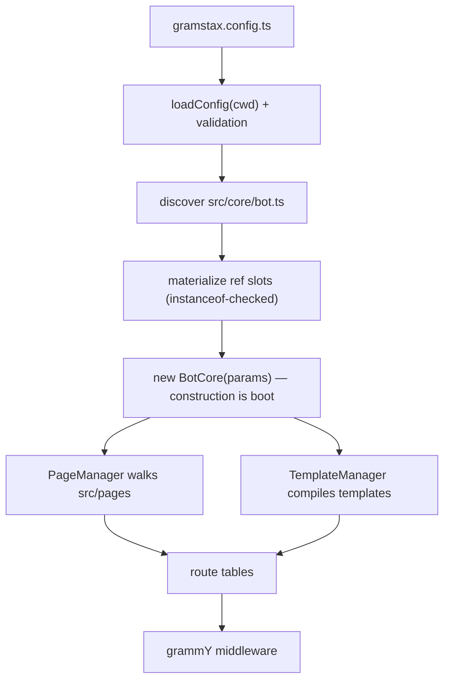

<div align="center">
  <p></p>
  <h1>Gramstax</h1>

  <p>A declarative Telegram bot framework for <a href="https://grammy.dev/">grammY</a> — template-driven pages, a route-aware render API, and config-driven boot. This repository holds the framework, the scaffolding CLI, and two supporting packages.</p>
  <p>
    
    
    
    
    
    
  </p>
</div>

## 💡 Why this repository

Most Telegram frameworks give you a `bot.command("start", …)` and a template literal. Everything after that — where the markup lives, how a second language is added, whether a tap edits the existing message or leaves an orphan, how you prove the bot actually called the Bot API the way you think it did — becomes your problem, decided differently in every file.

**No router, ever.** A page's route *is* its file path. `start.ts` is the `start` route, `admin/ban.ts` is `admin/ban` at whatever depth you like, `admin/index.ts` is `admin`. The scanner takes the first named export as the page class and binds every handler you name by convention — `handleCommandText`, `handleCallbackQueryData`, `handleArgs*`, `handleSession*`, `handleFree*`, `handleCaption*`. Adding a page is adding a file; there is no table to register it in, so it cannot break an unrelated page.

**A template engine, not a string library.** Markup is a typed block vocabulary — `g-message`, `g-keyboard`, `g-media`, `g-poll`, `g-invoice`, `g-callback-answer` and the rest — parsed and compiled ahead of time, with 29 PAGE blocks and 54 Bot API 10.3 Rich HTML tags validated in three layers. `lang="id"` beside a block buys a second language with no branch in the handler; `{{var|upper}}` buys formatting without code in the page; `<g-ifelse>` buys a conditional that survives AOT compilation.

**No hand-written entry point.** A generated project has no `src/index.ts` and no `new Gramstax({...})`. `gramstax start` reads `gramstax.config.ts`, discovers the `Gramstax` subclass at `src/core/bot.ts`, materializes each ref slot, and constructs it. Construction *is* boot — there is no `.run()` to remember, and no ordering to get wrong.

**No markup in strings passed to an API call.** A page owns a `static template` block, so the same source renders in every language the page declares and stays translatable. `<g-message>` and `<g-message lang="id">` sitting side by side means an Indonesian Telegram client gets Indonesian with no branch in the handler.

**No guessing at the Telegram dialect at runtime.** The template engine parses to typed blocks and validates against Bot API **10.3** (`TemplateEngine.BOT_API_VERSION`), covering 54 Rich HTML / `tg-*` tags in three layers: required attributes, attribute value formats, and a per-tag allow-list that rejects unknown attributes instead of ignoring them.

**No render call whose params are a guess.** Render params are a union over delivery routes, so a field the winning route would ignore is a compile error rather than something quietly dropped. `{mode: "reply", fallback: "reply"}` does not typecheck, because a forced reply never edits and so never reaches a fallback. `_assertRenderRoute` enforces the same combinations at runtime for plain-JS callers.

**One deploy field, five behaviours.** `polling`, `webhook`, `serverless`, `raw`, `test` — and per-mode settings live in `optionsDeploy` nested branches where at most one branch may be non-empty and it must equal `deploy`. The old `webhook:<url>` / `serverless:<adapter>` colon grammar throws.

**No updates that vanish without a trace.** An in-process `MetricsStore` counts every outcome — `matched`, `noMatch`, `noHandler`, `blocked`, `timeouts`, `skippedDuplicate`, `skippedValidation`, `dropped` — and surfaces as JSON at `GET /stats` and Prometheus text at `GET /metrics`.

## ✨ Features

### Pages, not string builders

- 📄 **A page is a class** — `PageManager` walks `src/pages/**`, takes the first exported page class in each file (no default exports), and the file path *is* the route (`start.ts` → `start`, `start/counter/index.ts` → `start/counter`)
- 🧩 **Route from the filesystem** — kebab-case files or folder `index.ts`, never both for one route; a root-level `index.ts` is rejected because it has no parent route
- 🎯 **`static data = this.buildData()`** — what makes `this.data.callbackQueryData(base, action)` type-safe instead of stringly-typed
- 🪜 **`g*` step objects** — every step is a `{show, process}` pair, so each is independently renderable, processable, and directly drivable from an e2e test; `gdefault` when there is no `id`, `gs1` for `id="s1"`
- 🔐 **Gates by inheritance** — `PageAdminBase` carries the `hookBeforeRoute` check for a whole family, so an admin route does not repeat the check in every handler

### The template pipeline

- 🧱 **PAGE blocks** — `g-base`, `g-message`, `g-keyboard`, `g-media`, `g-media-group`, `g-poll`, `g-invoice`, `g-paid-media`, `g-venue`, `g-dice`, `g-gift`, `g-description`, plus logic (`g-ifelse`, `g-switch`, `g-case`, `g-default`, `g-map`, `g-div`, `g-script`), answers (`g-callback-answer`, `g-inline-button`, `g-precheckout-error`, `g-shipping-error`, `g-answer-note`) and utilities (`g-import`, `g-space`)
- 🌐 **54 Telegram Rich HTML tags** validated to Bot API 10.3 — inline, block, `tg-*` specifics, media and forms, with per-tag attribute allow-lists
- 🧮 **Compile-time filter pipes** — `{{name|upper}}`, `{{price|number:2}}`, `{{createdAt|date:YYYY-MM-DD}}`, `{{count|plural:item:items}}`, `{{x|default:N/A}}`, chained left to right on a whitelist that cannot execute arbitrary code
- 🔥 **AOT for the edge** — `gramstax build` freezes templates into `.gramstax/gen/*.g.js` with **zero** codegen tokens (`new Function`, `Function(`, `eval(`), asserted by test under a sabotaged `globalThis.Function`
- ♻️ **Hot reload** — `TemplateManager` watches template files through chokidar; `--watch` reboots on `src` change

### Routing and delivery

- 🚦 **Convention handlers** — `handleCommandText`, `handleCallbackQueryData`, `handleArgsText`, `handleSessionFreePhoto`, `handleFreeReaction`, and a `handleSession*` route per update kind with its matching `setSession*` / `methodSession*` pair
- ✏️ **`mode: "auto"` by default** — edits when the update is a callback query, replies otherwise; `reply` and `edit` force the route, and you never branch on `this.callbackQuery` yourself
- 📢 **Broadcast in the same call** — `renderText({broadcast: {ids, languageCode}})` returns an `IBroadcastSendResult` with success/total counts, a resumable `startFrom`, `excludeIds`, pacing chunks and bounded concurrency
- 💬 **Sessions** — `setSession([this.methodSessionFreeText()], {step})` parks the user in a step; `clearSession()` returns them to a stateless route
- 🎛️ **Shared keyboards** — `inlineKeyboardT([this, StartPage], "2-2", Base.home)` builds a template-backed keyboard, or `inlineKeyboard((k, l) => …)` when the buttons are computed

### Operational surface

- 📊 **Prometheus metrics** — `GET /metrics` emits `gramstax_updates_total{listener=…}`, cumulative outcome counters, latency avg/max gauges, and queue stats
- 🔒 **Distributed session lock** — Redis-only atomic `SET NX PX` lease held for the whole update dispatch, so concurrent updates for one user serialise across instances; contention modes `skip`, `wait`, `serialize`
- 🚦 **Rate limiting and outgoing throttle** — `@grammyjs/ratelimiter` with `hookRateLimited(ctx)` / `hookKeyGenerator(ctx)`, and `@grammyjs/transformer-throttler` via `throttle: {global, group, out}`
- ⚙️ **Bounded update queue** — opt-in `UpdateQueue` for polling and webhook; at a 600 users/s target on the dev host the sequential drain fell to 377 users/s at p95 1828 ms while the queue sustained 601 users/s at p95 124 ms
- 🧪 **In-process e2e** — `deploy: "test"` boots a `MockTelegramServer`; `E2eHelper` exposes `sendText`, `sendCallbackQuery`, `lastCall("sendMediaGroup")`, and `gmsg` / `gkb` / `gmedia` to assert against the compiled template itself
- 🗄️ **Typed LMDB storage** — [`@gramstax/lmdb`](./packages/lmdb): declare an `LmdbSchema`, `register()` it, get a typed handle with embedded indexes, TTL, queues, CDC, and backups
- 🧵 **Worker threads** — [`@gramstax/worker-thread`](./packages/worker-thread): `WorkerThreadExport.init()` derives a typed proxy from your worker class, so `mtd*` methods read as local async calls
- 🏗️ **Scaffolding that stays consistent** — [`create-gramstax`](./packages/create-gramstax) generates 9 page templates plus an e2e suite mirroring the page tree, with `--lmdb` / `--worker-thread` / `--biome` / `--runtime node`

## 🚀 Quick Start

### 1. Prerequisites

- [Bun](https://bun.sh) v1.0+ — the CLI resolves TypeScript paths and the `~/*` alias, which plain `node` cannot, so every template script forces the Bun runtime

### 2. Scaffold a project

```bash
bunx create-gramstax@latest my-bot
cd my-bot
bun install
```

The positional is a bare name, not a path. Non-interactive mode needs the flags it would otherwise prompt for:

```bash
bunx create-gramstax@latest my-bot --pm bun --runtime bun --skip-install
```

Each optional feature has a matching negation — `--no-lmdb`, `--no-worker-thread`, `--no-biome` — and `--runtime node` rewires the scripts to `node`, `tsc --outDir dist`, and `node --test`.

### 3. Read the page the scaffold wrote

The generator already wrote `src/pages/start/index.ts` — a page is a class, the markup is a `static template`, and the handlers are convention-named. It ships wired to three sibling pages:

```ts
// src/pages/start/index.ts
export class StartPage extends PageBase {
  static data = this.buildData()

  async handleCommandText() {
    await this.gdefault.show()
  }

  helper = {}
  gdefault = {
    show: async () => {
      await this.clearSession()
      await this.renderText({keyboard: this.inlineKeyboardT([StartRandomPage, SumNumberPage, HelpPage], `2`), data: {userName: this.from?.username}})
    },
    process: () => {}
  }
}
```

Two `<g-message>` blocks follow, one of them `lang="id"`. Drop your own page into `src/pages/` and the file path becomes the route.

### 4. Run it

```bash
bun --bun gramstax start           # boot from gramstax.config.ts
bun --bun gramstax start --watch   # restart on src change
bun --bun gramstax build           # freeze into .gramstax/
```

Token and deploy mode come from the config file at the project root:

```ts
// gramstax.config.ts
import type {GramstaxConfig} from "gramstax"

const config: GramstaxConfig = {
  token: process.env.BOT_TOKEN,
  deploy: process.env.BOT_DEPLOY ?? `polling`,
  cacheSession: {store: process.env.CACHE_SESSION_STORE ?? `memory`, ttlMs: 4 * 60 * 60 * 1000, namespace: `s`},
  log: true
}

export default config
```

## 📖 Usage

### A page is a class

Handlers stay thin; the work lives in `g*` objects, which is what makes each step renderable, processable, and independently testable. Both languages live in the same block set, so `renderText` serves both without a branch.

```ts
// example/2-helloworld/src/pages/start.ts
import {PageBase} from "~/base/page"

export class StartPage extends PageBase {
  static data = this.buildData()

  async handleCommandText() {
    await this.gdefault.show()
  }

  async handleCallbackQueryData() {
    await this.gdefault.show()
  }

  helper = {}
  gdefault = {
    show: async () => {
      await this.renderText({keyboard: this.inlineKeyboardT([this]), data: {time: new Date().toString()}})
    },
    process: () => {}
  }

  static template = `
    <g-base>
      <g-keyboard type="inline">Refresh</g-keyboard>
      <g-keyboard type="inline" lang="id">Segarkan</g-keyboard>
      <g-message>
        Hello World!
        Time now: {{time}}
      </g-message>
      <g-message lang="id">
        Halo Dunia!
        Waktu: {{time}}
      </g-message>
    </g-base>
  `
}
```

### Rendering: params are CONTENT & ROUTE

Every send-family `render*` method takes **one** params object. `mode` picks the route; `AGBaseId` selects which `<g-base>` block resolves.

```ts
// edit when the update is a callback query, reply otherwise
await this.renderText({keyboard: this.inlineKeyboardT([this]), data: {name: "John"}})

// force the route
await this.renderText({keyboard: this.inlineKeyboardT([this]), mode: `reply`})

// pick the block and the media kind
await this.renderPhoto({AGBaseId: Base.infoConfirmPhoto, keyboard: this.gkeyboardConfirm.show(), data: {fileId, caption}})

// broadcast, same call
await this.renderText({data: {name: "John"}, broadcast: {ids: [123456, 789012], languageCode: [`en`, `id`]}})
```

The route atoms are exported so the contract is documented per route, not only per method: `IRouteAuto`, `IRouteReply`, `IRouteForcedReply`, `IRouteEdit`, `IRouteChunked`, `IRouteBroadcastSend`, `IRouteMediaAuto`, `IRouteMediaReply`, `IRouteMediaBroadcastSend`, `IRouteMediaBroadcastRevise`, `IRouteGroupAuto`, `IRouteGroupReply`.

Long text, caption edits, and keyboard-only edits are separate methods rather than `renderText` plus a manual delete: `renderEditCaption`, `renderEditKeyboard`, `renderText({chunkSize})`, `renderBroadcastDelete`.

### Templates: blocks, filters, imports

```ts
// example/1-complex/src/pages/start/block/import.ts — reuse another page's base
static template = `
  <g-base>
    <g-import src="start" base="for-block-import" />
  </g-base>
`
```

Filters compile once and chain left to right; `default` applies only to undefined/null/empty, so `0` and `false` pass through.

```ts
static template = `<g-base><g-message>{{name|upper}}! Joined {{createdAt|date:YYYY-MM-DD}} ({{count|plural:item:items}})</g-message></g-base>`
```

Logic is declarative, not JavaScript:

```html
<g-message>
  📣 Broadcast Message
  <g-ifelse>isEmpty ? "⚠️ Message cannot be empty.\n" : ""</g-ifelse>
  Current draft: {{draftText}}
</g-message>
```

### Keyboards

Template-backed, shared across pages:

```ts
// example/2-helloworld/src/blocks/g-keyboard.ts
import {BlockGKeyboard, LabelGKeyboard} from "gramstax"

export class KeyboardGBlock extends BlockGKeyboard {
  static label = class extends LabelGKeyboard {
    static home = {default: `.. Home`}
    static back = {default: `Back`}
    static cancel = {default: `Cancel`}
  }
  static home = (lang?: string, type?: string) => this._build(`home`, lang, type)
  static back = (lang?: string, type?: string) => this._build(`back`, lang, type)
  static cancel = (lang?: string, type?: string) => this._build(`cancel`, lang, type)
}
```

Computed, for paginated lists:

```ts
// example/5-interactive-menu/src/pages/start/inline/with-range.ts
return this.inlineKeyboard((k, l) => {
  items.forEach((item) => {
    k.text(item.name, this.data.callbackQueryData(`item`, item.id)).row()
  })

  k.row()
  if (safePage > 0) {
    k.text(l[0]!, this.data.callbackQueryData(`page`, String(safePage - 1)))
  }
  k.text(`${l[2]} ${safePage + 1}/${totalPages}`, BlankPage)
  if (safePage < totalPages - 1) {
    k.text(l[1]!, this.data.callbackQueryData(`page`, String(safePage + 1)))
  }
  return k.row().text(l[3]!, StartPage)
})
```

### Sessions and multi-step flows

```ts
// example/8-newsletter/src/pages/broadcast.ts — park the user in a step
await this.setSession([this.methodSessionFreeText(), this.methodSessionFreePhoto()], {position: `form`})
await this.setSessionArgsCallbackQueryData({position: `confirm`, mediaType: `photo`, fileId, caption})
```

The matching `handleSession*` handler picks the step back up, and `handleSessionArgsCallbackQueryData` receives the step in `this.callbackQueryDataArgs`.

### Broadcasting

The same call fans out and reports what happened:

```ts
// example/8-newsletter/src/pages/broadcast.ts
const ids = subscribers.map((item) => item.id)
const langs = subscribers.map((item) => item.language || `default`)
const res = await this.renderText({AGBaseId: Base.infoDeliverText, data: {message: draftText}, broadcast: {ids, languageCode: langs}}) as IBroadcastSendResult
await this.gsuccess.show(res.successCount, res.totalCount)
```

### E2E against the compiled template

```ts
// example/2-helloworld/e2e/setup.ts
import {join} from "node:path"
import {TemplateManager} from "gramstax"
import {BotCore} from "../src/core/bot"

export const bot = new BotCore({
  deploy: `test`,
  token: `test`,
  log: false,
  templateManager: new TemplateManager({
    path: [join(import.meta.dir, `../src/pages`)]
  })
})
export const e2e = bot.e2e!
export const enUser = {user: {id: 4001, language_code: `en`}, chat: {id: 4001}}
export const idUser = {user: {id: 5001, language_code: `id`}, chat: {id: 5001}}
```

```ts
// example/2-helloworld/e2e/start.test.ts
const intent = `start`

beforeEach(() => {
  e2e.clearCalls()
})

describe(`E2E: StartPage`, () => {
  it(`respond to /start`, async () => {
    const res = await e2e.sendText(`/start`, enUser)
    const resId = await e2e.sendText(`/start`, idUser)
    expect(res.length).toBeGreaterThan(0)
    expect(resId.length).toBeGreaterThan(0)
    expect(res[0]!.body?.text).toStartWith(e2e.gmsg(intent, `default`, {}))
    expect(resId[0]!.body?.text).toStartWith(e2e.gmsg(intent, `default`, {}, `id`))
  })
})
```

`e2e.gmsg` renders the page's own compiled template, so a drift between template and handler fails the test instead of shipping.

### Storage: LMDB wired into a page

```ts
// example/7-crud/src/db/index.ts
import {LmdbEnv} from "@gramstax/lmdb"
import {ItemRepository} from "./repositories/item"
import {SequenceRepository} from "./repositories/sequence"
import {ItemSchema} from "./schema/item"
import {SequenceSchema} from "./schema/sequence"

export class Db extends LmdbEnv {
  items!: ItemRepository
  sequences!: SequenceRepository

  constructor(storePath: string) {
    super({path: storePath, maxDbs: 5, compression: true})
    this.sequences = new SequenceRepository(this.register(SequenceSchema))
    this.items = new ItemRepository(this.register(ItemSchema), this.sequences)
  }
}
```

```ts
// example/7-crud/src/db/repositories/item.ts — a service layer over the typed handle
async create(userId: number, title: string, description: string) {
  return this.env.owner.transaction(async (tx) => {
    this.seq.ensure(userId)
    const id = await this.seq.nextId(userId)
    const now = Date.now()
    const item: IVItem = {id, title, description, status: `todo`, createdAt: now, updatedAt: now}
    await this.env.put(this.key(userId, id), item, tx)
    await this.seq.incrCount(userId)
    return item
  })
}
```

### Background work: a worker thread

```ts
// example/1-complex/src/jobs/increment.ts
import {WorkerThreadExport, WorkerThreadInit} from "@gramstax/worker-thread"
import {log} from "gramstax"

export class Worker extends WorkerThreadInit {
  count = 0
  constructor() {
    super()
    const ms = Number(process.argv[3])
    this.mtdAutoRun(ms)
  }

  mtdAutoRun(ms: number) {
    const padStart = `(${this.pid}:${this.id}) [IncrementCoreJob]`
    log.debug(`${padStart} Started..`)
    setInterval(() => {
      this.count += 1
      log.debug(`${padStart} count: ${this.count}`)
    }, ms)
  }

  mtdGetCount() {
    return this.count
  }
}

export const IncrementJob = WorkerThreadExport.init({path: __filename, WTInit: Worker})
```

## 🔍 How it works

### Boot



`gramstax start [--deploy <mode>] [--watch]` reads `gramstax.config.ts` from the project root, takes its default export, and validates it. Unknown top-level fields throw `Invalid gramstax config at <file>: …` — including `manifest`, which is a constructor param and not a config field. It then imports `src/core/bot.ts` and takes the first value export whose `prototype instanceof Gramstax`. Ref slots (`cacheSession`, `cacheKeyboard`, `templateManager`, `log`) are materialized and each checked against its expected base; a wrong export fails with the slot name and the base it wanted. Finally it constructs the subclass — no `.run()`.

The e2e harness is the one deliberate exception: `e2e/setup.ts` constructs `BotCore` directly to inject `deploy: "test"`, `token: "test"`, and a `TemplateManager`.

### Template pipeline

`TemplateManager` watches and loads template files; `TemplateEngine` parses them into typed compiled blocks — one `compileBlockG*` static per `ICompiledTemplate` field — and compiles `{{}}` interpolation and filter pipes into callable bodies. Unknown filters render empty plus a one-time `console.warn`; the whitelist cannot execute arbitrary code.

For `serverless`, `gramstax build` runs the same compiler with emit hooks installed and writes `.gramstax/gen/*.g.js` instead: bodies are frozen at build time, media-style closures rebuild at import through a body-keyed link table, and a miss throws (regenerate). The output carries no `new Function`, `Function(`, or `eval(` — which is what makes it runnable on a Workers isolate that has no `Function` constructor.

### Routing

Route names come from file paths, never from a router table: `shop/index.ts` → `shop`, `shop/detail.ts` → `shop/detail`. `PageManager.getFileManySync` computes the walk once and the same value feeds both fs boot and the frozen `.gramstax/routes.json`.

Inside `_pageRoutes`, priority is: chat-member → static session (matched by `session.method`) → static intents → intent-with-args → `handleFree*` → a global `handleFree()` fallback. `blocked` short-circuits the remaining routes for that listener. Two `hookBeforeRoute` hooks exist and both must pass — a bot-level gate `(ctx, data)` running once per update before matching, and a page-level gate running after a route matches on the instantiated page. `hookAfterRoute` reports state: `matched`, `no-match`, `no-handler`, `blocked`, `error`, `timeout`.

Two operational details worth knowing: the page gate runs **before** `clearSessionOnce()`, so denying a non-session route does not wipe a user's step state; and the page instance is throwaway per route, so a gate must not depend on state a previous handler left on it.

## 📜 Scripts

| Script | What it does |
| :----- | :------------ |
| `bun run build` | `nx run-many -t build` across every workspace project |
| `bun run build:packages` | Build only `packages/*` — the release scope |
| `bun run build:gramstax` | Build just the framework package |
| `bun run build:create-gramstax` | Build just the scaffolding CLI |
| `bun run build:worker-thread` | Build just the worker package |
| `bun run build:manifest` | Run `packages/gramstax/scripts/build-manifest.ts` |
| `bun run test` | `bun test ./example ./packages` |
| `bun run test:packages` | Packages only |
| `bun run test:packages:parallel` | Same, with `--parallel` |
| `bun run test:example` | Example e2e suites only |
| `bun run lint` | `biome lint` over the repo |
| `bun run lint:packages` / `lint:example` | Scoped lint |
| `bun run format` | `biome format --write ./example ./packages` — the repo root and `real-projects/` are *not* covered |
| `bun run format:example` / `format:packages` | Scoped format |
| `bun run ci:check` | `tsc --noEmit` for the root and all four packages, then `biome lint` |
| `bun run ci:check:packages` | Typecheck + lint for `./packages` only |
| `bun run ci:test` | `ci:check` then the full suite |
| `bun run ci:test:packages` | `ci:check:packages` then package tests |
| `bun run prepush` | Typecheck, lint, test, build, and a safety echo |
| `bun run version[:patch\|:minor\|:major]` | `nx release version` — one workspace version for all four packages |
| `bun run release[:patch\|:minor\|:major]` | Version, tag, and publish |
| `bun run publish:all` | `nx release publish` — publish the on-disk version without re-versioning (recovery path) |
| `bun run dry-run[:patch\|:minor\|:major]` | Rehearse a release, publish nothing |

Inside `packages/lmdb` and `packages/worker-thread`, the `bench:*` scripts run [mitata](https://github.com/benoitgrelard/mitata) suites; benches are `@internal` and excluded from `bun test` and CI.

## 🗂️ Project Structure

```text
gramstax/
├── packages/
│   ├── gramstax/            # the framework: routing, templates, render API, CLI
│   │   ├── src/
│   │   │   ├── core/        # bot.ts (orchestration), ctx.ts (render/session/route), session-lock.ts
│   │   │   ├── template/    # engine.ts (parser/compiler/validator), manager.ts (watcher/loader)
│   │   │   ├── page/        # manager.ts — module loader and route-name walk
│   │   │   ├── blocks/ labels/  # g-keyboard block + label builders
│   │   │   ├── cache/       # external.ts — Keyv/Redis session cache
│   │   │   ├── update/      # queue.ts, dispatcher.ts, gate.ts, gate-key.ts
│   │   │   ├── mock/        # telegram-server.ts — in-process Bot API mock
│   │   │   ├── e2e/         # helper.ts — E2eHelper harness
│   │   │   ├── helpers/     # log.ts, metrics.ts
│   │   │   ├── cli/         # gramstax bin: start/build + config loader + serverless targets
│   │   │   ├── types/       # 11 public type modules (bot, ctx, template, config, manifest, …)
│   │   │   └── index.ts     # the public barrel — named exports only
│   │   ├── docs/            # generated API reference (markdown + yaml) plus adr/
│   │   ├── skills/          # gramstax-best-practices — router + references/
│   │   ├── test/            # 117 bun:test files
│   │   └── security-poc/    # standalone template-engine breakout/injection/RCE PoCs
│   ├── create-gramstax/     # scaffolding CLI + src/templates/ — the generated project
│   ├── lmdb/                # @gramstax/lmdb — typed LMDB layer, its own README and skill
│   └── worker-thread/       # @gramstax/worker-thread — RPC, pools, socket gateway
├── example/                 # 11 workspace members, 1-complex → 11-cloudflare-worker
├── real-projects/           # production-vip-content-bot — standalone, own lockfile, NOT a workspace member
├── docs/                    # CLI + deploy guides, agent guides, capacity model, research notes
├── plans/                   # 40 numbered implementation plans
├── prompts/                 # PROMPT.md, PROMPT_WITH_VALUE.md — agent prompts
├── scripts/                 # link-workspace-bins.ts + e2e-mirror tooling
├── AGENTS.md                # repo-wide agent guidance
├── CONTEXT-MAP.md           # domain docs map, one CONTEXT.md per context
├── package.json             # the root workspace — private, scripts only
├── nx.json                  # build/test targets and the release contract
├── biome.json               # lint + format config (the only style gate)
└── tsconfig.json            # root typecheck + path remap for typechecking
```

## 🔧 Configuration

`gramstax.config.ts` is the single composition point. Every field is optional, so a missing file yields `{deploy: "polling"}`; the annotated `: GramstaxConfig` type (a thin alias of `IGramstaxConfig`) typo-checks every key.

```ts
import type {GramstaxConfig} from "gramstax"

const config: GramstaxConfig = {
  token: process.env.BOT_TOKEN ?? ``,
  deploy: process.env.DEPLOY ?? `polling`,
  cacheSession: {store: `redis://localhost:6379`, ttlMs: 3600000},
  log: {pathFile: `./logs/bot.log`, force: `all`},
  optionsDeploy: {webhook: {url: `https://example.com/bot`, secretToken: process.env.BOT_WEBHOOK_SECRET ?? ``}}
}

export default config
```

### Field groups

| Group | Fields | Notes |
| :---- | :----- | :---- |
| Identity | `token`, `deploy` | `deploy` is a bare `string` so env expressions typecheck; membership is enforced by the loader |
| Deploy | `optionsDeploy` | Nested branches — see below |
| Caches | `cacheSession`, `cacheKeyboard` | `{store, ttlMs?, namespace?}`, or a module ref; `memory` / `redis://…` are the built-in stores |
| Templates | `templateManager` | A module ref, or builtin `{path, enableWatch?, watchOptions?, onReload?}` |
| Logging | `log` | `true` (default logger) / `false` (silent) / a module ref / `{pathFile?, force?, formatTime?}` |
| Routing | `optionsPage`, `updateTimeoutMs`, `maxTextLength`, `skipDuplicateUpdate`, `mediaRoots`, `botConfig` | `shortCallbackQueryData: true` shortens callback args; `mediaRoots` is a local-path jail for uploads |
| Reliability | `autoRetry`, `autoRetryOptions`, `rateLimit`, `throttle` | `{windowMs, max}`; throttler options `{global, group, out}` |
| Observability | `statusServerPort`, `statusServerHostname` | Serves `GET /health` and `GET /stats` in any deploy mode |
| Multi-instance | `sessionLock` | `{enabled, leaseMs, onContended: skip \| wait \| serialize, key?}` — Redis only; memory store disables it with a warning |

Instance slots hold **refs and plain data, never instances**. A bare `{module}` without the `override` wrapper is rejected:

```ts
log: {override: {module: `./src/helpers/log.ts`, export: `LogHe`}}
```

### `optionsDeploy` branches

At most one branch may be non-empty, and it must equal `deploy`. The legacy `webhook:<url>` / `serverless:<adapter>` colon grammar throws.

| Branch | Fields | Required |
| :----- | :----- | :------- |
| `polling` | `maxRetries` (default `5`, `-1` retries forever), `dropPendingUpdates`, `queue` | — |
| `webhook` | `url`, `secretToken`, `queue` | `url` + `secretToken` |
| `serverless` | keyed by adapter — exactly one of `cloudflare-mod` (adds `name`, `compatibilityDate`, `compatibilityFlags`, `toml`) or `aws-lambda-async` | `url` + `secretToken` |
| `raw` | none — any defined key is rejected | — |
| `test` | none — any defined key is rejected | — |

The adapter is the **key**, and a field that does not apply to an adapter is rejected rather than ignored. `secretToken` is runtime-required but type-optional so a zero-config `gramstax build` keeps working; it is never baked into an emitted bundle — the edge reads the `BOT_WEBHOOK_SECRET` binding.

The `queue` block is the same shape on `polling` and `webhook` and configures the same `UpdateQueue` class, each mode keeping its own instance: `enabled` (default `false`, so both modes drain sequentially until you opt in), `maxQueueSize` (`5000`), `workerCount` (`8`), `perChatConcurrency` (`1`), `blockWhenFull` (`true`), `enqueueTimeoutMs` (`10000`), `waiterTimeoutMs` (`30000`), `drainTimeoutMs` (`10000`). `getWebhookQueueStats()` and `getPollingQueueStats()` each return `null` while their queue is off.

### Deploy modes

| `deploy` | What boots |
| :------- | :--------- |
| `polling` | Long-polling against the Bot API |
| `webhook` | Webhook server with health/status endpoints |
| `serverless` | Cloudflare Workers (`cloudflare-mod`) or AWS Lambda (`aws-lambda-async`); reads the frozen `.gramstax/` output |
| `test` | In-process `MockTelegramServer` for e2e |
| `raw` | A bare grammY bot — no pages, no templates, no routing, no auto-start |

`gramstax build` freezes `src/pages` into `.gramstax/` — `routes.json`, `manifest.js`, AOT `gen/`, and `server/` entries per target. Only `serverless` auto-loads it; every other deploy boots from the filesystem so hot reload keeps working.

```bash
gramstax build [--target cloudflare-mod|aws-lambda-async] [--bundle] [--dry-run] [--raw]
```

## 🏗️ Architecture

### The four packages

| Package | Version | Owns |
| :------ | :------ | :--- |
| [`gramstax`](./packages/gramstax) | 5.0.0 | Page routing, template engine, render API, session/caching, CLI, mock server, e2e harness |
| [`create-gramstax`](./packages/create-gramstax) | 5.0.0 | Project scaffolding and the `templates/` tree that becomes a new project |
| [`@gramstax/lmdb`](./packages/lmdb) | 5.0.0 | Schema-declared LMDB sub-databases, indexes, transactions, queues, CDC, backups |
| [`@gramstax/worker-thread`](./packages/worker-thread) | 5.0.0 | Worker lifecycle, typed RPC, pools, inter-worker socket gateway |

One workspace version governs all four (`nx release` tags `v{version}` and updates every `packages/{projectName}` manifest), which is why they are always installed together. The two supporting packages have **no dependency on `gramstax`** — a worker never touches storage, and a repository never knows about the bot. `create-gramstax` wires them in behind `--lmdb` and `--worker-thread`, independently combinable, and regenerates `src/core/services.ts` from `buildServicesSource(useLmdb, useWorkerThread)` so the bot class never statically references a pruned directory.

### Params are CONTENT & ROUTE

The render contract has two halves and they are not negotiable:

- **CONTENT** — which `<g-base>` block (`AGBaseId`), what data (`data`), which keyboard, and which Telegram method the compiled block selects. The template decides plain text versus Rich HTML at compile time, so `renderText` is the single text method and there is no rich variant to choose between.
- **ROUTE** — `mode` (`auto` / `reply` / `edit`), chunking, broadcast, and the fallback policy. `auto` edits on a callback query and replies otherwise; `fallback` (`delete-reply` default, `reply`, `disable`) only matters once the route resolves to edit, which is exactly why the type makes it unread on the reply, chunked, and broadcast routes instead of silently ignoring it.

Each route declares the same ten keys — a real type where the route reads the key, `never` where it does not — and `_assertRenderRoute` enforces the same combinations at runtime for plain-JS callers, naming the offending field and the fix.

### Route atoms

Route names are structural, which is what keeps them greppable:

```text
src/pages/
├── start.ts                # route `start`
└── start/
    ├── index.ts            # route `start`
    ├── counter/
    │   ├── index.ts        # route `start/counter`
    │   └── thread.ts       # route `start/counter/thread`
    └── input/text/
        ├── index.ts        # route `start/input/text`
        └── 2.ts            # route `start/input/text/2`
```

Base ids map the same way: no `id` → `gdefault`, `id="s1"` → `gs1`, `id="amount"` → `gamount`.

### Guardrails worth knowing

| Rule | Why |
| :--- | :--- |
| `bun --bun`, always | Plain `node` cannot resolve TS paths or the `~` alias, and config path-refs need it |
| One workspace version | `nx release` moves all four packages together; mixing versions is unsupported |
| Build packages before running an example | Bun resolves `workspace:*` to `dist/src/index.js`, so examples execute the *built* output; typechecking resolves to `src` |
| `bun --bun gramstax build` after every page or template change | The frozen manifest is a snapshot; `gramstax build` is not incremental |
| One `gramstax` copy in a project | Two copies break `prototype instanceof Gramstax` discovery and surface as `no Gramstax subclass export` |
| `<hr/>`, ``, `<input/>`, `<br/>`, `<tg-map/>` self-closing | Void-element format validation, wired into `validateTemplate` the same way `<g-space/>` and `<g-import/>` are |
| Every `g*` object needs `show` **and** `process` | Uniform shape keeps every step renderable and processable; define `process: () => {}` when no input is expected |
| A page override of `hookBeforeRoute` replaces the family gate | Call `super.hookBeforeRoute()` to compose, or you have silently unlocked the page |
| `bun:test` only | No Jest, no Vitest, anywhere |
| Never commit a token or secret | The framework cannot tell a literal from an env-derived value, so no warning is possible |
| `@ts-ignore` / `@ts-expect-error` are banned in `src` | Suppression hides the bug it was hiding |

## 📚 API Reference

### Generated docs

`packages/gramstax/docs/` holds the API-extractor output: `markdown/` (one file per exported symbol), `yaml/`, and hand-written guides (`architecture.md`, `getting-started.md`, `glossary.md`, `overview.md`, `development.md`). Regenerate with `bun run build:docs` inside the package.

### Guides in `docs/`

| Document | Covers |
| :------- | :----- |
| [`docs/gramstax-start.md`](./docs/gramstax-start.md) | Boot from config: discovery, precedence, ref slots, `--watch`, the queue field table |
| [`docs/gramstax-build.md`](./docs/gramstax-build.md) | The `.gramstax/` output tree, CLI flags, manifest boot, exit codes |
| [`docs/serverless-deploy.md`](./docs/serverless-deploy.md) | Cloudflare Workers and Lambda: build → secret → deploy → verify |
| [`docs/aot-contract.md`](./docs/aot-contract.md) | The `gen/` emit contract and its v1 limits |
| [`docs/capacity-model-50m-peak.md`](./docs/capacity-model-50m-peak.md) | Capacity modelling for large deployments |
| [`docs/agents/`](./docs/agents) | Domain docs, issue tracker, and triage-label conventions for agents |

### Agent skills

Each package ships a rule-based skill consumed by coding agents, with `references/` holding one file per rule:

- [`packages/gramstax/skills/gramstax-best-practices/`](./packages/gramstax/skills/gramstax-best-practices/SKILL.md) — ten priority categories, `config-` through `cache-`
- [`packages/lmdb/skills/lmdb-best-practices/`](./packages/lmdb/skills/lmdb-best-practices/SKILL.md)
- [`packages/worker-thread/skills/worker-thread-best-practices/`](./packages/worker-thread/skills/worker-thread-best-practices/SKILL.md)

### Domain docs

[`CONTEXT-MAP.md`](./CONTEXT-MAP.md) points at one `CONTEXT.md` per context (`gramstax`, `lmdb`, `worker-thread`, `create-gramstax`); ADRs live in `packages/gramstax/docs/adr/`. [`AGENTS.md`](./AGENTS.md) is repo-wide agent guidance, with per-package files under each package.

### Per-package READMEs

| Package | README |
| :------ | :----- |
| `gramstax` | [`packages/gramstax/README.md`](./packages/gramstax/README.md) |
| `create-gramstax` | [`packages/create-gramstax/README.md`](./packages/create-gramstax/README.md) |
| `@gramstax/lmdb` | [`packages/lmdb/README.md`](./packages/lmdb/README.md) |
| `@gramstax/worker-thread` | [`packages/worker-thread/README.md`](./packages/worker-thread/README.md) |

### Examples

Eleven runnable workspace members under [`example/`](./example), ordered as a progression — [`example/AGENTS.md`](./example/AGENTS.md) is the map:

| # | Project | Demonstrates |
| :- | :------ | :----------- |
| 1 | `1-complex` | Kitchen sink: multi-page, guards, i18n, media, `<g-import>`/map/switch, a worker job, 27 e2e files |
| 2 | `2-helloworld` | Minimal TS bot; start/status/blank pages |
| 3 | `3-helloworld-js` | Pure JS port — proof Gramstax works without TypeScript |
| 4 | `4-echo` | Beginner multi-page echo |
| 5 | `5-interactive-menu` | Inline keyboards, pagination, reply keyboards, stateful navigation |
| 6 | `6-bank-system` | Stateful store, bigint money math, a multi-step deposit/withdraw/transfer flow |
| 7 | `7-crud` | LMDB persistence with a schema + repository service layer |
| 8 | `8-newsletter` | LMDB subscribers, admin-gated broadcast, per-recipient language |
| 9 | `9-substore-bot` | Full e-commerce on in-memory data plus `CacheExternal`; the only example with a unit test |
| 10 | `10-http-request` | External HTTP via `fetch` with `AbortSignal.timeout` |
| 11 | `11-cloudflare-worker` | Manifest boot and AOT on a Cloudflare Workers isolate |

## License

Apache-2.0 — Copyright (c) 2026 Gramstax. The four published packages carry `"license": "Apache-2.0"` in their `package.json`. See [LICENSE](./LICENSE).

Releases `gramstax@0.0.1` through `gramstax@0.3.19` (November 2025 – January 2026) were published under **MIT** and remain MIT — that grant is perpetual and is not withdrawn by this relicensing. Everything from `0.3.20` onward is Apache-2.0.