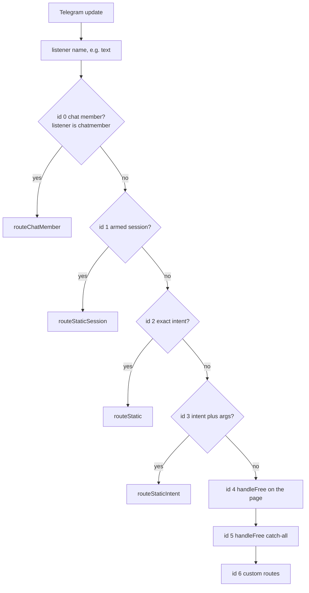

# Routing

By the time an update arrives, every page in the tree has already been filed into
lookup tables at boot. Dispatch itself does no searching: it tries seven
mechanisms in a fixed priority order and stops at the first that produces a
handler.

This page is about that runtime walk. How a file path becomes a route name in the
first place is [page routing](/concepts/page-routing); what a page looks like once
you have one is [pages](/guides/pages). If you already know both, this page
explains why a page that looks right can still be unreachable, and where to look
when it is.

## From files to tables

Boot runs one pipeline, and there are only three steps in it worth knowing.

| Step | What it does |
| :--- | :---------- |
| `PageManager.getFileManySync` | Walks `src/pages`, imports each module and pairs it with the route name derived from its path |
| `_pageRegisterEntry` | Fills in default intents, enforces uniqueness, then calls `_pageSorts` |
| `_pageSorts` | Walks the class prototype once and files every `handle*` method it finds into the routing tables |

`_pageSorts` is where the convention becomes data. It does not call your handlers
and it does not read your template; it only asks, for each name the framework
knows, whether the prototype has a function of that name, and if so writes one
`{name, routeName}` pair into the table that name belongs to.

A page that defines none of the known names is not an error. It is a page with
`data` set and no entries, and it simply never dispatches.

## The tables

| Table | Filled from | Key | Notes |
| :---- | :---------- | :-- | :----- |
| `all` | every page | `data.name` | The class itself, used to construct one |
| `routeStatic` | `listRouteStatic` names present on the prototype | the intent (`/command`, callback intent, text intent, or bare name) | Exact-match routes |
| `routeStaticIntent` | `listRouteStaticIntent` names present on the prototype | the same intent, and `lang:intent` for text | Prefix routes with args |
| `routeStaticSession` | `listRouteStaticSession` names present on the prototype | the string returned by `methodSession<Base>(name)` | Armed sessions only |
| `routeDynamicSpesific` | `handleFree*` found with `Object.hasOwn` | the listener name | Bucketed per listener |
| `routeDynamic` | pages that define `handleFree` | page name | The global fallback |
| `routeChatMember` | `handleChatMember*` and `handleMyChatMember*` | n/a, it is a list | Carries `oldStatus`, `newStatus` and a precomputed filter |
| `routeCustom` | `registerCustomRoute` calls | n/a, it is a list | Also reachable as `pages.customRoutes`, the same array |

The four lists that drive the first three tables are fixed at boot, not derived
from your code. They are the complete vocabulary the framework dispatches on:

| List | Contents |
| :--- | :------- |
| `listRouteStatic` | `handleCallbackQueryData`, `handleText`, `handleCommandText`, and the `handleCaption<Kind>` / `handleCommandCaption<Kind>` pair for photo, video, audio, document, animation and voice |
| `listRouteStaticIntent` | the `Args` variants of the same shapes |
| `listRouteStaticSession` | every name in the two lists above with `Session` spliced in, plus the long tail of `handleSessionFree<Kind>` names |
| `listRouteDynamicSpesific` | the `handleFree<Kind>` names |

<Note>
  A method the framework does not know is not routed and not an error; it is an
  ordinary method. The lists are the entire contract.
</Note>

### Keys are not always the plain intent

Three normalisations happen while filling the tables, and they explain most of the
"why did my route not match" reports.

| Input | Registered key |
| :---- | :------------- |
| a `Command` handler | `/` plus the intent, always |
| a text handler whose `buildData` passed `intentText` as a language record | one key per language, `${lang}:${intent}`, plus a `default:` variant |
| a callback handler on a project with `optionsPage.shortCallbackQueryData` | the page's index number instead of its name |

The language-prefixed keys are looked up with the user's `language_code` and fall
back to `default`, which is why a page with an `id` variant still answers an
unknown locale.

### Uniqueness is checked at boot

`_pageRegisterEntry` refuses to start rather than let two pages fight over one
key. Duplicate names, duplicate text intents, duplicate command intents and
duplicate callback intents are all fatal, and the message names the file:

| Conflict | Fatal error |
| :------- | :---------- |
| two pages with the same `data.name` | `Duplicate page name "…" in <path>` |
| two pages claiming the same text intent, or the same `lang:intent` variant | `Duplicate intentText "…" in <path>` |
| two pages claiming the same command intent | `Duplicate intentCommandText "/…" in <path>` |
| two pages claiming the same callback intent | `Duplicate intentCallbackQueryData "…" in <path>` |

## The seven ids

`_pageRoutes` takes the constructed context and the name of the listener that
fired, and works down this list. Every row runs at most once per update.

| Id | Type | Algorithm | Example |
| :- | :--- | :-------- | :------ |
| 0 | chat member | O(n) over `routeChatMember`, filtered by a precomputed predicate | `handleMyChatMemberOutAdmin` |
| 1 | static session | O(x) keyed by `session.method`, filtered by listener | `handleSessionFreeText` |
| 2 | static | O(1) exact lookup on the intent | `handleCommandText`, `handleCallbackQueryData` |
| 3 | static intent | O(x) prefix match after the separator | `handleCommandArgsText`, `handleArgsCallbackQueryData` |
| 4 | dynamic specific | `handleFree*` defined on the page | `handleFreeText` |
| 5 | dynamic global | the page's `handleFree()` | catch-all free updates |
| 6 | custom routes | `registerCustomRoute` entries | app-defined listeners |



The first three ids are "find one page and one method". Ids 4 and 5 are not:
they iterate, and **every** matching handler runs, so two pages that both define
`handleFreeText` both see the message. Ids 0 and 6 return on the first match.

### The separators

Id 2 matches the raw payload exactly. Id 3 only runs when the payload contains a
separator at all: callback data splits on `:`, everything else splits on a space,
and the head of the split is looked up in `routeStaticIntent`. `handleArgs`
therefore resolves on the prefix (`start/counter:I` matches intent
`start/counter`), which is why a longer payload still reaches the same handler and
the remainder is what `callbackQueryDataArg` and `msgTextArgs` hand you.

### Two exclusions worth knowing

`handleSessionFree*` is deliberately kept out of `routeDynamicSpesific`, even
though its name looks like a `handleFree*`. It is only reachable through id 1,
because a session handler has to run against an armed session, and the dynamic
pass does not check for one. A second exclusion: id 0 only runs when the listener
is `chatmember` or `mychatmember`, so chat member routes are invisible to every
other update.

## What happened: the four outcomes

`_pageRoutes` returns a state, and the state is the only thing the rest of the
framework knows about your handler.

| State | Meaning | What the framework does |
| :----- | :------ | :----------------------- |
| `matched` | a handler ran and the page answered | nothing further |
| `no-match` | nothing matched, or a handler ran and the page answered nothing | fires `hookNotFoundPage` if the listener opts in |
| `no-handler` | a page matched but the method is not on its prototype | counted, no render |
| `blocked` | a route matched and `hookBeforeRoute` returned `false` | ids 0, 1, 2, 3 and 6 return immediately; ids 4 and 5 skip that handler and carry on |

<Note>
  `matched` and `no-match` are not "found" and "not found". Both are returned by
  the same expression, `ctx.temp.isAnswer`, which the framework sets when a page
  actually answers the update. A handler that matched and then replied with
  nothing reports `no-match`, so a user who taps a dead button reaches your
  not-found path instead of silence.
</Note>

Two more states are added around this, not by it. `_handleCtx` races routing
against `updateTimeoutMs` and reports `timeout`, and any other throw is caught and
reported as `error` after `hookErrorPage` has had its turn. Those six values are
the `state` you receive in `hookAfterRoute`, and the three routing outcomes are
what the `matched`, `noMatch` and `noHandler` metric counters record.

## The dispatch shape

Every one of the seven ids builds the page, asks the gate, calls the method, and
closes. It looks like this at each site:

```ts
const initPage = new Page(ctx)
if ((await initPage.hookBeforeRoute?.()) !== false) {
  await initPage[route.routeName]()
  await initPage.hookAfterRoute?.()
}
return {state: ctx.temp.isAnswer ? `matched` : `no-match`}
```

Three things fall out of that shape.

`new Page(ctx)` is constructed per route, so a handler never sees another
handler's state. The context is shared; the page instance is not.

The gate is a strict `!== false`. Returning `undefined`, `null`, `0` or `""` all
allow the update through, which is what makes an inherited gate composable.

`hookBeforeRoute` on a page replaces an inherited one rather than adding to it.
Call `super.hookBeforeRoute()` to keep the parent's behaviour. The same method on
the bot class is a different, earlier gate: it runs once, before routing, for
every update. Both are described in [guards](/guides/guards).

## Custom routes

The seven ids cover the update kinds the framework subscribes to. For a listener
you need to gate yourself, `registerCustomRoute` adds an eighth source that is
checked last. Call it once the pages exist, which in practice means from
`hookAfterStart`:

```ts
// src/core/bot.ts
export class BotCore extends Gramstax {
  async hookAfterStart() {
    this.registerCustomRoute({
      name: `search`,
      routeName: `handleInlineQuery`,
      listenerName: `inlinequery`,
      event: `inline_query`,
      filter: () => true
    })
  }
}
```

| Field | What it does |
| :---- | :----------- |
| `name` | `Page.data.name` of the page that owns the handler; the page must already be registered |
| `routeName` | the method to call, and it must start with `handle` |
| `listenerName` | the routing key, which is what the built-in listener is called |
| `event` | the grammY event, used only when it has no built-in listener |
| `filter` | the predicate, called with the context |
| `shouldCheckNotFound` | whether a `no-match` may render the not-found view; only consulted when the subscription is created for you, and defaults to true |

Three rules are enforced rather than documented, so you meet them as errors or as
a silent skip:

| Condition | What happens |
| :-------- | :----------- |
| `routeName` does not start with `handle` | throws |
| `name` is not a registered page | throws, naming the page |
| `routeName` is already registered | logs a warning and skips |
| `event` already has a built-in listener | no second `bot.on` is made; `listenerName` must equal the built-in one, or it throws |

The fourth row is not an optimisation. Built-in listeners do not call grammY's
`next()`, so a second subscription on the same event could never run; the built-in
one has to be the thing that dispatches the custom route.

## Where to go next

<Columns cols={2}>
  <Card title="Pages" icon="file-code" href="/guides/pages">
    The class these tables are filled from, part by part.
  </Card>
  <Card title="Page routing" icon="map" href="/concepts/page-routing">
    The file-path rules, the naming grammar, and guards.
  </Card>
  <Card title="Architecture" icon="layers" href="/guides/architecture">
    Where routing sits between update intake and the template manager.
  </Card>
  <Card title="Concurrency" icon="gauge" href="/concepts/concurrency">
    The queue and per-chat gate that run outside this walk.
  </Card>
  <Card title="Troubleshooting" icon="wrench" href="/guides/troubleshooting">
    The boot errors this page's tables produce, and their fixes.
  </Card>
  <Card title="API reference" icon="terminal" href="/reference/gramstax">
    Every hook and entry type referenced above.
  </Card>
</Columns>
