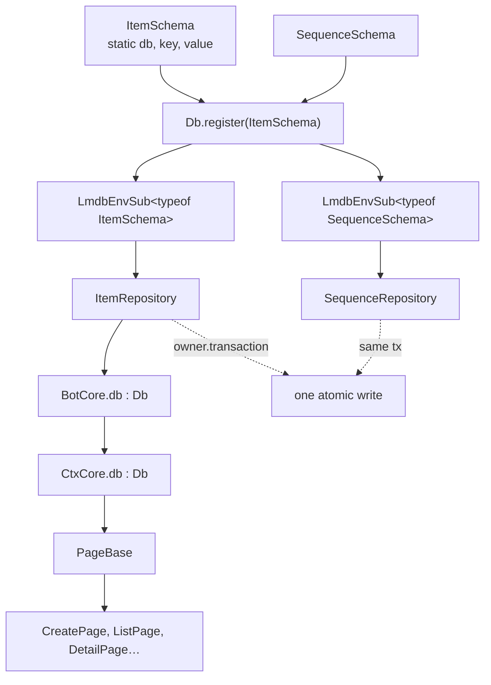

# Storage with LMDB

A page is a fresh object per update. Nothing it writes to a field survives the
update, and the caches the framework hands you ([sessions](/guides/sessions),
[keyboards](/guides/keyboards)) are there for hot conversational state, not for
records a user expects to still find tomorrow.

When a bot has to remember something across restarts, it needs a store. This
page wires the sibling package `@gramstax/lmdb` into a real bot, worked from
[`example/7-crud`](https://github.com/gramstax/gramstax/tree/main/example/7-crud),
which is a working todo bot that creates, edits, deletes, and pages through
items. The framework's own [configuration](/guides/configuration) is unchanged:
the store is a plain object you own, and nothing about the page contract moves.

## Why this package

<Columns cols={3}>
  <Card title="It persists" icon="hard-drive">
    Memory-mapped LMDB, so a restart resumes where the last write left off.
  </Card>
  <Card title="It is typed" icon="braces">
    A schema class is the row type, and the handle that comes back is typed too.
  </Card>
  <Card title="It is fast to declare" icon="zap">
    One class per entity, one `register()` call, no `openDB` bookkeeping.
  </Card>
</Columns>

Install it next to `gramstax`. It is a separate npm package, versioned and
released with the framework (both are at `6.0.2`), and nothing in `gramstax`
depends on it, so a bot that never persists anything does not install it.

```bash
bun add @gramstax/lmdb
```

<Note>
  Imports come from the package root: `import {LmdbEnv, t} from "@gramstax/lmdb"`.
  Never reach into `dist/src/...`. The package runs on Bun and on Node.js 18 or
  newer, so it does not force a runtime choice on the bot that uses it.
</Note>

## Three files and one environment

Everything below is `example/7-crud/src/db`. The shape is the package's core
pattern: a **schema** declares the rows, the **env** owns the file and hands
back a typed handle per schema, and a **repository** holds the behaviour.

### The schema declares the rows

```ts
// example/7-crud/src/db/schema/item.ts
import {type KeyOf, LmdbSchema, t, type ValueOf} from "@gramstax/lmdb"

export type IKItem = KeyOf<typeof ItemSchema>
export type IVItem = ValueOf<typeof ItemSchema>
export class ItemSchema extends LmdbSchema {
  static db = `item`
  static key = t.string()
  static value = {
    id: t.string(),
    title: t.string(),
    description: t.string(),
    status: t.string(),
    createdAt: t.number(),
    updatedAt: t.number()
  }
}
```

Three statics carry the whole declaration: `db` names the sub-database, `key` is
the single primary-key builder, and `value` maps column names to `t` builders.
`IVItem` is derived from the class, so adding a column changes the row type and
every call site that builds one at the same time.

The second schema is the same idea over a numeric key, and it exists for a
reason the third file will explain:

```ts
// example/7-crud/src/db/schema/sequence.ts
import {type KeyOf, LmdbSchema, t, type ValueOf} from "@gramstax/lmdb"

export type IKSequence = KeyOf<typeof SequenceSchema>
export type IVSequence = ValueOf<typeof SequenceSchema>
export class SequenceSchema extends LmdbSchema {
  static db = `sequence`
  static key = t.number()
  static value = {
    seq: t.number(),
    count: t.number()
  }
}
```

### The env owns the file and the handles

```ts
// example/7-crud/src/db/index.ts
import {LmdbEnv} from "@gramstax/lmdb"
import {ItemRepository} from "./repositories/item"
import {SequenceRepository} from "./repositories/sequence"
import {ItemSchema} from "./schema/item"
import {SequenceSchema} from "./schema/sequence"

export class Db extends LmdbEnv {
  items!: ItemRepository
  sequences!: SequenceRepository

  constructor(storePath: string) {
    super({path: storePath, maxDbs: 5, compression: true})
    this.sequences = new SequenceRepository(this.register(SequenceSchema))
    this.items = new ItemRepository(this.register(ItemSchema), this.sequences)
  }
}
```

`Db` **extends** `LmdbEnv`, it does not wrap it. Construction opens the
environment, so there is no `await open()` anywhere in the boot path. Each call
to `register(SchemaClass)` opens that schema's sub-database and returns an
`LmdbEnvSub` handle with every method already bound to the schema, which is why
`this.register(ItemSchema)` can be handed straight to a constructor.

`maxDbs: 5` is a headroom number, not a limit of two: a schema takes a slot, and
so does every `.unique()` or `.index()` column declared on it. Neither schema
here declares one, so two slots are in use. `compression: true` is LZ4 on
commit, which trades a little CPU for a smaller file on disk.

### The repository holds the behaviour

The package's own rule is that domain methods do not live on the schema or the
handle, so `ItemRepository` is an ordinary class that takes the typed handle in
its constructor and receives the sequence repository alongside it:

```ts
// example/7-crud/src/db/repositories/item.ts
import type {LmdbEnvSub} from "@gramstax/lmdb"
import type {ItemSchema, IVItem} from "../schema/item"
import type {SequenceRepository} from "./sequence"

export class ItemRepository {
  constructor(
    private readonly env: LmdbEnvSub<typeof ItemSchema>,
    private readonly seq: SequenceRepository
  ) {}

  async create(userId: number, title: string, description: string) {
    return this.env.owner.transaction(async (tx) => {
      this.seq.ensure(userId)
      const id = await this.seq.nextId(userId)
      const now = Date.now()
      const item: IVItem = {id, title, description, status: `todo`, createdAt: now, updatedAt: now}
      await this.env.put(this.key(userId, id), item, tx)
      await this.seq.incrCount(userId)
      return item
    })
  }

  async remove(userId: number, id: string) {
    return this.env.owner.transaction(async (tx) => {
      const existed = await this.env.delete(this.key(userId, id), tx)
      if (existed) await this.seq.decrCount(userId)
      return existed
    })
  }
}
```

<Note>
  Trimmed from the file for this page: the private `key` and `keyPrefix` helpers,
  and the `purge`, `total`, `fetch`, and `edit` methods. `list` appears further
  down because the page that reads it needs the range bounds it computes.
</Note>

Read that `create` closely, because four of its five ideas are the whole
integration:

| Line | What it does |
| :--- | :----------- |
| `this.env.owner.transaction(...)` | `owner` is the env the handle belongs to, so a repository reaches a write transaction through its own handle rather than holding the `Db` |
| the callback receives `tx` | `tx` is the `LmdbTransaction`, the handle every call in this block passes to stay inside one atomic unit |
| `this.seq.ensure(userId)` | a write to a **second** repository, inside the same transaction |
| `await this.env.put(key, item, tx)` | the third argument is what joins the write to that transaction; `put(key, value, ttlOrTx?)` accepts either a TTL or a transaction |
| the row is annotated `IVItem` | annotation belongs where a row is **constructed**; a read is already typed by the handle |

The key itself is `${userId}:${id}`. The package discourages prefix-encoded keys
for namespacing because each entity gets its own sub-database, but a composite
key that orders one user's rows together is a different thing, and it is what
makes the range read in the next section a two-line method.

## Getting the store onto a page

Three hops, all of them ordinary TypeScript. The bot constructs the store, the
context carries it, and the page reads it off `this`.

```ts
// example/7-crud/src/core/bot.ts
import {Gramstax} from "gramstax"
import {Db} from "~/db"
import {Env} from "~/env"
import {CrudGuard} from "~/guards/crud"
import {StatusPage} from "~/pages/status"
import {CtxCore} from "./ctx"

// BotCore wires hooks and shared stores.
export class BotCore extends Gramstax {
  db = new Db(Env.DB_PATH)

  createCtx(ct: Parameters<Gramstax[`createCtx`]>[0]) {
    return new CtxCore({
      ct,
      cacheSession: this.cacheSession,
      cacheKeyboard: this.cacheKeyboard,
      templateManager: this.templateManager,
      db: this.db,
      temp: {
        isAnswer: false,
        session: {},
        data: {}
      }
    })
  }
```

<Note>
  Trimmed for this page: `hookBeforeRoute`, `hookErrorPage`, and
  `hookNotFoundPage`. The two hooks that matter for storage are covered in their
  own sections below.
</Note>

```ts
// example/7-crud/src/core/ctx.ts
import {Ctx} from "gramstax"
import type {Db} from "~/db"

// Shared context for CRUD pages.
export class CtxCore extends Ctx {
  db: Db

  constructor(params: ConstructorParameters<typeof Ctx>[0] & {db: Db}) {
    super({...params})
    this.db = params.db
  }
}
```

```ts
// example/7-crud/src/base/page.ts
import {KeyboardGBlock} from "~/blocks/g-keyboard"
import {CtxCore} from "~/core/ctx"

export abstract class PageBase extends CtxCore {
  static kbk = KeyboardGBlock
  static kbl = KeyboardGBlock.label
}
```

That is all the wiring. `createCtx` is gramstax's own hook for building the
context of each update, the extra `db` field rides along in the params, and every
page that extends `PageBase` inherits it. Nothing is registered, nothing is
imported from a package-specific integration module, and [the page
contract](/guides/pages) is untouched: `static data`, `handle*`, `g*`, and
`renderText` all behave exactly as they do in a bot with no database.



## Writing from a page

The create page is a two-step conversation: it collects a title, then a
description, and the last step is the write. The repository call is one line
inside a `g*` step, and the row it returns goes straight into the render data.

```ts
// example/7-crud/src/pages/create.ts
  gsuccess = {
    show: async (title: string, input: string) => {
      await this.clearSession()
      const item = await this.db.items.create(this.from!.id, title!, input)
      await this.renderText({AGBaseId: Base.success, keyboard: this.helper.buildHomeKeyboard(Base.success), data: {id: item.id, title: item.title, description: item.description, status: item.status}})
    },
    process: () => {}
  }
```

Three things are worth copying. The write is awaited before the render, so the
message can only claim success if the row committed. The identifiers come from
`this.from!.id`, which is the only place the row's owner is decided. And the
row is interpolated as `{{id}}`, `{{title}}`, and so on in the `<g-base>`
template, so the confirmation is rendered by the template rather than assembled
in the handler.

## Reading and paging from a page

Listing is the other half of the loop, and it is where the range read earns its
keep. `list` reads every row whose key starts with the user id, sorts by
creation time, and slices in memory:

```ts
// example/7-crud/src/db/repositories/item.ts
  async list(userId: number, options?: {limit?: number; offset?: number}) {
    const prefix = this.keyPrefix(userId)
    const end = `${prefix}￿`
    const entries = await this.env.entries({start: prefix, end})
    const sorted = entries.map(([, v]) => v).sort((a, b) => a.createdAt! - b.createdAt!)
    const limit = options?.limit
    const offset = options?.offset ?? 0
    if (limit == null && offset === 0) return sorted
    return sorted.slice(offset, limit == null ? undefined : offset + limit)
  }
```

<Note>
  The source file writes the end bound as `${prefix}\uffff`. It is the same
  character as the one shown above, unescaped.
</Note>

`entries({start, end})` takes an inclusive lower bound and an exclusive upper
bound, and `\uffff` is the highest code point, so the range covers exactly the
user's own keys. The page then computes the slice it needs:

```ts
// example/7-crud/src/pages/list.ts
  gindex = {
    show: async (pageNo = 0) => {
      const totalItems = await this.db.items.total(this.from!.id)
      if (totalItems === 0) {
        return await this.ginfoEmpty.show()
      }

      const totalPages = Math.max(Math.ceil(totalItems / PAGE_SIZE), 1)
      const safePage = Math.min(Math.max(pageNo, 0), totalPages - 1)
      const offset = safePage * PAGE_SIZE
      const items = await this.db.items.list(this.from!.id, {limit: PAGE_SIZE, offset})
      const list = items
        .map((item) => {
          const ts = TimeUt.formatTimestamp(item.updatedAt!)
          return `#${item.id} ${item.title} [${item.status}] (updated ${ts})`
        })
        .join(`\n`)

      await this.renderText({AGBaseId: Base.index, keyboard: this.helper.buildKeyboard(safePage, totalPages), data: {items: list, pageNo: safePage + 1, totalPages}})
    },
```

<Note>
  Trimmed for this page: the rest of `gindex` (the `process` step), the
  `ginfoEmpty` step, the keyboard helpers, and the `static template`.
</Note>

The empty branch is the detail most hand-rolled persistence gets wrong: a range
read over no rows is an empty array, not an error, and the page has to decide
what to say about it before it asks for page zero of something that does not
exist.

## Two repositories, one transaction

`total` does not read the items. It reads a counter that `create` incremented and
`remove` decremented, in the same transaction as the write that moved it:

```ts
// example/7-crud/src/db/repositories/sequence.ts
  ensure(userId: number) {
    return this.env.putIfNotExists(userId, {seq: 0, count: 0})
  }

  nextId(userId: number) {
    return this.env.owner.transaction(() => {
      const data = this.env.get(userId) ?? {seq: 0, count: 0}
      const next = (data.seq ?? 0) + 1
      this.env.put(userId, {...data, seq: next})
      return `${next}`
    })
  }

  total(userId: number) {
    return this.env.get(userId)?.count ?? 0
  }

  incrCount(userId: number) {
    return this.env.owner.transaction(() => {
      const data = this.env.get(userId)
      if (data) {
        this.env.put(userId, {...data, count: (data.count ?? 0) + 1})
      }
    })
  }
```

<Note>
  Trimmed for this page: `decrCount` and `reset`, which are the mirror images of
  `incrCount` and `ensure`.
</Note>

This is the reason the transaction exists in the integration at all. A create
touches the `item` sub-database and the `sequence` sub-database. Without one
transaction, a failure between the two writes leaves an item with no id in the
sequence, or a counter that has moved while the item did not. Because
`ItemRepository.create` opens the transaction through `this.env.owner` and passes
`tx` to every call, both repositories commit together or not at all.

`ensure` uses `putIfNotExists`, which writes only when the key is absent. That is
how a user gets a counter row before any item exists, and it is why
`CrudGuard.ensureUser` can call it on every single update.

## A guard that touches the store on every update

The guard runs before routing, so it is the first place a per-user row can be
made to exist:

```ts
// example/7-crud/src/guards/crud.ts
import type {CtxCore} from "~/core/ctx"

export class CrudGuard {
  static async ensureUser(ctx: CtxCore) {
    ctx.db.sequences.ensure(ctx.from!.id!)
    return true
  }
}
```

It is wired into `BotCore.hookBeforeRoute`, which means it runs for every update
the bot accepts, not for a page that happens to need it. Combined with `ensure`
above, the effect is that a user has a `sequence` row from their very first
message, and every later page can assume it. [Guards](/guides/guards) covers
the routing side of that hook.

<Warning>
  This is a write on the hot path of every update, executed before routing, for
  every user and every message. That is a deliberate trade in this example, and
  it is the kind of thing to measure before copying it into a bot with real
  traffic. A read under `readTransaction` is the alternative when the row only
  needs to exist for reads.
</Warning>

## The store is real in tests

One consequence of the store being an ordinary object on the bot is that the e2e
harness writes to the same real database your bot does, because
`e2e/setup.ts` constructs `BotCore` directly rather than through the CLI. The
harness handles that by purging through the repository:

```ts
// example/7-crud/e2e/setup.ts
export const e2e = bot.e2e!
export const enUser = {user: {id: 4001, language_code: `en`}, chat: {id: 4001}}
export const idUser = {user: {id: 5001, language_code: `id`}, chat: {id: 5001}}
export async function resetEnv(userId: number) {
  await bot.db.items.purge(userId)
}
```

```ts
// example/7-crud/e2e/create.test.ts
import {beforeEach, describe, expect, it} from "bun:test"
import {e2e, enUser, idUser, resetEnv} from "./setup"

const intent = `create`
beforeEach(async () => {
  e2e.clearCalls()
  await resetEnv(4001)
  await resetEnv(5001)
})
```

`resetEnv` reaches through `bot.db.items`, the same path a page uses, and
`purge` opens a transaction, reads the user's keys through it, and clears their
sequence row. The assertion that follows is `e2e.gmsg(intent, 't', {})`, which
renders the page's own compiled template, so a drift between the write and the
message fails the test rather than shipping. [E2E testing](/guides/e2e-testing)
covers the harness itself.

<Warning>
  Read `purge` before copying it. It calls three things in sequence:
  `this.env.owner.transaction(async (tx) => { ... })`,
  `this.env.keys({start: prefix, end}, tx)`, then
  `await Promise.all(keys.map((k) => this.env.delete(k)))`. The deletes are not
  passed `tx`, and `delete(key, tx?)` forwards that argument straight through, so
  they are ordinary queued writes rather than calls joined to the surrounding
  transaction. `SequenceRepository.reset` deletes its row the same way. Every
  other write in this integration passes `tx`, which is the form to copy.
</Warning>

<Warning>
  Because the store is real, an e2e run leaves data on disk and two runs sharing
  a data directory can see each other. Point `Env.DB_PATH` at a scratch
  directory, or purge in `beforeEach` the way this example does.
</Warning>

## What this integration touches

Every identifier the wiring above uses, and where it lives. This is the whole
surface, which is the point: an integration should not need the full package
reference to be correct.

| Identifier | Defined in | Used here for |
| :--------- | :---------- | :------------ |
| `LmdbEnv` | `packages/lmdb/src/env.ts` | the class `Db` extends; construction opens the env |
| `LmdbEnv.register(S)` | `packages/lmdb/src/env.ts` | returns the typed `LmdbEnvSub` handle for a schema |
| `LmdbEnv.transaction(fn)` | `packages/lmdb/src/env.ts` | the atomic block, reached here through `owner` |
| `LmdbSchema` | `packages/lmdb/src/schema.ts` | the base class both schema declarations extend |
| `t` | `packages/lmdb/src/schema.ts` | the column builders behind `static key` and `static value` |
| `KeyOf` / `ValueOf` | `packages/lmdb/src/schema.ts` (re-exported from `./types/schema`) | `IKItem` / `IVItem`, the key and row types |
| `LmdbEnvSub<S>` | `packages/lmdb/src/sub.ts` | the handle a repository receives |
| `LmdbEnvSub.owner` | `packages/lmdb/src/sub.ts` | the env behind the handle, used to open a transaction |
| `put` / `get` | `packages/lmdb/src/sub.ts` | the write (async) and the point read (sync) |
| `putIfNotExists` | `packages/lmdb/src/sub.ts` | create-if-absent, used by `ensure` |
| `delete` / `keys` / `entries` | `packages/lmdb/src/sub.ts` | removal, and the bounded range reads |
| `LmdbTransaction` | `packages/lmdb/src/transaction.ts` | the `tx` argument threaded through a transaction |
| `LmdbError` | `packages/lmdb/src/errors.ts` | the only error class the package throws |

`maxDbs`, `compression`, and `path` are the only constructor options used, and
all three are documented in the package README.

## The rest of the package

`@gramstax/lmdb` re-exports 68 names, 18 runtime values and 50 type definitions,
through the 20 re-export paths in its barrel, and none of the other 60 appear
above. The package's own README is the complete reference for everything this
page skipped: embedded indexes (`.unique()`, `.index()`, `.search()`), keyset
pagination, TTL repositories, queues, backups, change data capture, differential
sync, read-only replicas, and migrations.

- [`packages/lmdb/README.md`](https://github.com/gramstax/gramstax/blob/main/packages/lmdb/README.md)
  on GitHub, the full reference.
- `packages/lmdb/example/` in the same repository, one runnable file per feature.

<Note>
  Two things this integration deliberately did not do, both of which the package
  README covers in depth. The `item` rows use `${userId}:${id}` keys, and the
  list method slices in memory after a full range read; the package's own
  guidance is keyset pagination with `{start, limit}` for large sets. And the
  `sequence` sub-database keeps a denormalized `count` next to data the handle
  could count with `count()` in constant time. Both are fine at this example's
  size, and both are the first things to change under load.
</Note>

## Where to go next

<Columns cols={2}>
  <Card title="Pages" icon="file-code" href="/guides/pages">
    The four moving parts every `PageBase` subclass already has.
  </Card>
  <Card title="Guards" icon="shield" href="/guides/guards">
    Where `hookBeforeRoute` runs, and what a guard is allowed to do.
  </Card>
  <Card title="Sessions" icon="messages-square" href="/guides/sessions">
    What belongs in the session cache, and what belongs on disk instead.
  </Card>
  <Card title="E2E testing" icon="flask-conical" href="/guides/e2e-testing">
    The harness that drives a real store through real pages.
  </Card>
  <Card title="Configuration reference" icon="settings" href="/guides/configuration">
    The config fields the store sits beside.
  </Card>
  <Card title="Background work" icon="cpu" href="/guides/worker-threads">
    The other sibling package, for work that should not sit on the update path.
  </Card>
</Columns>