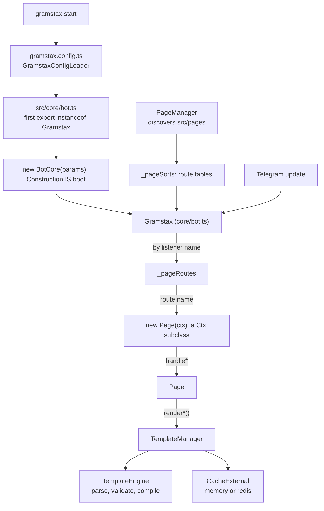

<div align="center">
  <p></p>
  <h1>gramstax</h1>

  <p>A declarative Telegram bot framework: turn a bot into pages that own a slice of markup, a keyboard and a set of handlers, discovered from <code>src/pages</code> and routed by convention.</p>
  <p>
    
    
    
    
    
    
  </p>
</div>

## 💡 Why this package

Most Telegram frameworks hand you a registration call and leave the rest to be
decided per file: where markup lives, how a second language gets added, whether a
tap edits the message it came from or orphans it. These are the parts that end up
decided differently in every file.

**A page is a file.** `start.ts` is `/start`, `admin/ban.ts` is `/admin/ban`, at
any depth. There is no route table to keep in sync, so adding a page cannot break
an unrelated one.

**One template owns every language.** `lang="id"` beside the default block gives
an Indonesian client Indonesian, with no branch in the handler and no second
source of truth to keep in step.

**`mode: "auto"` decides send versus edit.** The framework reads the update in
one place instead of every handler branching on `ctx.callbackQuery`.

**Render params cannot describe a state that cannot happen.** Each `render*()`
params type is a union over its real delivery routes, with `?: never` where a key
is unreachable. `{mode: "reply", fallback: "reply"}` does not compile, and
`_assertRenderRoute` enforces the same rule at runtime.

**Templates are frozen before they ship.** `gramstax build` compiles them ahead of
time, and a test asserts the output carries zero `new Function`, `Function(` or
`eval(` under a sabotaged `globalThis.Function`.

**Silence is counted.** `noMatch`, `noHandler`, `blocked` and `dropped` are
counters rather than a shrug: `GET /stats` for JSON, `GET /metrics` for Prometheus.

### Against the usual approach

| Area | The usual way | Here |
| --- | --- | --- |
| routing | every route registered by hand in one place | the file path *is* the route; naming a `handle*` method registers it |
| markup and i18n | markup inside the API call, one branch per locale | one template; `<g-message lang="id">` sits beside `<g-message>`, and no handler branches |
| send versus edit | read the update and choose | `mode: "auto"` reads it in one place |
| impossible states | an options object assembled by hand | a union over real routes, `?: never` where a key is unreachable, re-checked at runtime |
| nothing matched | silence | `noMatch`, `noHandler`, `blocked` and `dropped` counted |
| server codegen | `new Function` at runtime | frozen ahead of time, asserted to hold zero codegen tokens |

## ✨ Features

### Page routing

- 📄 **Pages are classes, discovered from the filesystem**: every named export under `src/pages` that extends `Ctx` becomes a routable page; `PageManager` loads them and the route name comes from the path (`start/index.ts` → `start`, `start/counter/thread.ts` → `start/counter/thread`)
- 🧭 **Routing by handler-name convention**: `handleCommandText`, `handleArgsText`, `handleCallbackQueryData`, `handleArgsCallbackQueryData`, `handleCaptionPhoto`, the `handleFree*` family and its `handleSession*` variants are all picked up by name; a handler that does not exist is simply not a route
- 🪝 **Typed callback payloads**: `static data = this.buildData((id: string) => [id])` types `data.callbackQueryData(...)`, and `inlineKeyboardT` then compile-checks that the destination page actually defines the matching handler
- 🚪 **Two gates, not one**: a bot-level `hookBeforeRoute(ctx, data)` filter that runs before routing, and a page-level `hookBeforeRoute()` that runs on the constructed page after a route matches; only strict `false` denies
- 🧭 **`g*` step objects**: every step is a `{show, process}` pair, so each view is independently renderable and independently testable in e2e

### The render contract

- 🧩 **`CONTENT & ROUTE`**: the content half names the template fields (`data`, `AGBaseId`, media `type`), the route atoms say how the rendered block is delivered; `params = IContent & (union of routes)`
- 🚦 **`mode: 'auto' | 'reply' | 'edit'`**: the send-versus-edit decision, implemented once, with `fallback` (`delete-reply` · `reply` · `disable`) covering a failed edit
- 📐 **32 `render*()` methods on `Ctx`**: text, media (10 kinds), media groups, poll, invoice, paid media, venue, dice, gift, caption edit, keyboard edit, broadcast revise/delete, and 6 template-backed query answers
- 🛡️ **Runtime route guard**: `Ctx._assertRenderRoute` and `Ctx._assertInlineKeyboardForEdit` throw with the offending field named and the fix suggested, for plain-JS callers the types cannot reach

### Templates

- 🧱 **29 `<g-*>` PAGE blocks**: structure (`g-base`, `g-import`, `g-space`, `g-div`), logic (`g-ifelse`, `g-switch`, `g-case`, `g-default`, `g-script`, `g-map`), content (`g-message`, `g-keyboard`, `g-media`, `g-media-group`, `g-poll`, `g-invoice`, `g-price`, `g-paid-media`, `g-venue`, `g-dice`, `g-gift`, `g-description`, `g-question`, `g-option`) and answers (`g-callback-answer`, `g-inline-button`, `g-precheckout-error`, `g-shipping-error`, `g-answer-note`)
- 🌐 **54 Telegram tags passed through**: 9 legacy HTML-mode tags plus 45 from the Bot API 10.3 Rich Message Formatting spec, in 5 categories, with required-attribute, value-format and unknown-attribute validation per tag
- 🔧 **Compile-time filter pipes**: `{{name|upper}}`, `{{price|number:2}}`, `{{createdAt|date:YYYY-MM-DD}}`, `{{count|plural:item:items}}`, `{{x|default:N/A}}` compiled into chained calls, on a whitelist: an unknown filter renders empty and warns once, never executes code
- 🌍 **Per-language variants**: `lang="id"` on any block, resolved from the user's `language_code` with a `default` fallback chain
- ⚡ **AOT for the edge**: `gramstax build` freezes every template into a plain ESM module under `.gramstax/gen/` with zero `new Function` / `eval` tokens; `template.aot-parity.test.ts` locks AOT output byte-for-byte against JIT

### Runtime features

- 🚦 **Inbound rate limiting**: `@grammyjs/ratelimiter` with `hookRateLimited(ctx)` and a synchronous `hookKeyGenerator(ctx)` (defaults to sender id)
- 🐢 **Outgoing throttling**: `@grammyjs/transformer-throttler` via `throttle: {global, group, out}`, composing with `autoRetry`
- 📎 **File download**: `@grammyjs/files` mounted by default; `ctx.download(path?)` saves the current message's file and rejects `..` / NUL-byte paths
- 🔒 **Distributed session lock**: a Redis `SET NX PX` lease held for the whole update dispatch, with `skip` · `wait` · `serialize` contention modes; auto-disabled with a warning on a memory store
- 📊 **Prometheus metrics**: `GET /metrics` on the status server, plus `GET /health` and `GET /stats`, with an optional `hookTrace` span after every routed update
- 🧪 **In-process e2e**: `deploy: "test"` mounts `MockTelegramServer` and `bot.e2e` (`E2eHelper`), so tests drive updates and assert captured Bot API calls with zero HTTP and zero ports

### Boot and deploy

- ⚙️ **Config-driven boot**: a typed `gramstax.config.ts` default export; 19 known top-level fields, anything else throws `unknown field`
- 📦 **Nested `optionsDeploy` branches**: at most one branch may be non-empty and it must equal `deploy`; the legacy `webhook:<url>` colon grammar throws
- 🧊 **Frozen build output**: `.gramstax/` with `routes.json`, `manifest.js`, AOT `gen/` and per-target `server/` entries; only `serverless` auto-loads it
- 🚀 **Five deploy modes**: `polling`, `webhook`, `serverless` (`cloudflare-mod` · `aws-lambda-async`), `raw` (a bare `Bot` instance) and `test`
- 🔁 **Hot reload**: `gramstax start --watch` restarts on `src` change with cache-busted imports

## 🚀 Quick Start

### 1. Prerequisites

- [Bun](https://bun.sh): the CLI resolves TypeScript paths and the `~/*` alias through a `file://` import, which plain `node` cannot
- `typescript ^6.0.3` (peer dependency)
- A bot token from [@BotFather](https://t.me/BotFather)

### 2. Install

```bash
bun add gramstax
```

Scaffold a whole project instead of wiring it by hand (the scaffolding CLI is the sibling package `create-gramstax`):

```bash
bun create gramstax my-bot
```

### 3. Declare a page

A page is a class. The markup is a static template; the keyboard is built from the page's own blocks. This is [`example/2-helloworld/src/pages/start.ts`](../../example/2-helloworld/src/pages/start.ts), verbatim:

```ts
import {PageBase} from "~/base/page"

export class StartPage extends PageBase {
  static data = this.buildData()

  async handleCommandText() {
    await this.gdefault.show()
  }

  async handleCallbackQueryData() {
    await this.gdefault.show()
  }

  helper = {}
  gdefault = {
    show: async () => {
      await this.renderText({keyboard: this.inlineKeyboardT([this]), data: {time: new Date().toString()}})
    },
    process: () => {}
  }

  static template = `
    <g-base>
      <g-keyboard type="inline">Refresh</g-keyboard>
      <g-keyboard type="inline" lang="id">Segarkan</g-keyboard>
      <g-message>
        Hello World!
        Time now: {{time}}
      </g-message>
      <g-message lang="id">
        Halo Dunia!
        Waktu: {{time}}
      </g-message>
    </g-base>
  `
}
```

Because both languages live in the same block set, the bot renders Indonesian for an Indonesian Telegram client and English for everyone else, without a branch in the handler.

### 4. Configure and run

`gramstax.config.ts` at the project root, default export, annotated. This is [`example/2-helloworld/gramstax.config.ts`](../../example/2-helloworld/gramstax.config.ts), trimmed to the fields that matter:

```ts
import type {GramstaxConfig} from "gramstax"

const config: GramstaxConfig = {
  token: process.env.BOT_TOKEN,
  deploy: process.env.BOT_DEPLOY ?? `polling`,
  cacheSession: {
    store: process.env.CACHE_SESSION_STORE ?? `memory`,
    ttlMs: 4 * 60 * 60 * 1000,
    namespace: `s`
  },
  log: true,
  optionsDeploy: {polling: {maxRetries: undefined, queue: undefined}}
}

export default config
```

```bash
bun --bun gramstax start          # boot
bun --bun gramstax start --watch  # boot + restart on src change
```

### 5. Next steps

- Write more pages under `src/pages`: routing is filesystem discovery, there is no registry to update
- Add a shared keyboard block in `src/blocks/g-keyboard.ts` once two or more pages need it
- Add the global error / not-found pages via `hookErrorPage` and `hookNotFoundPage` on `src/core/bot.ts`
- Add `e2e/setup.ts` and drive the bot through `bot.e2e` with `deploy: "test"`
- Run [`gramstax build`](../../docs-site/guides/gramstax-build.md) before any `serverless` deploy

## 📖 Usage

### Page anatomy

Four moving parts, in this order:

| Piece | Declared as | What it is |
| :---- | :---------- | :--------- |
| `static data` | `this.buildData(...)` | Route identity: the page name, the text/command/callback intents, and the typed `callbackQueryData(...)` signature |
| handlers | `handle*` methods | The entry points routing dispatches to; each stays thin and delegates to a `g*` step |
| `helper` / `g*` | instance fields | Page-local closures and the `{show, process}` step objects |
| `static template` | a template literal | The markup: `<g-base>` blocks containing `<g-message>`, `<g-keyboard>`, `<g-media>` and friends |

`buildData` has four shapes:

```ts
// no args: callbackQueryData() takes zero arguments
static data = this.buildData()

// a callback-arg mapper: types data.callbackQueryData(id)
static data = this.buildData((id: string) => [id])

// optional args
static data = this.buildData((exe?: string) => [exe])

// a name override plus per-language intents
static data = this.buildData({name: `lang`, intentTextMap: {en: `hello`, default: `hello`}})
```

A page **without** `static data` still routes, but `callbackQueryData` is not available: `IPageDataBase` deliberately omits it, so a page cannot wire a callback it never declared. `data.callbackQueryData(...)` returns `{result, page, args}`: `result` is the string Telegram carries, `page` is the destination class, `args` the tuple you passed.

```ts
// example/1-complex/src/pages/start/counter/index.ts
helper = {
  counterKeyboard: () => this.inlineKeyboardT([this.data.callbackQueryData(`I`), this.data.callbackQueryData(`D`), StartPage], `2`)
}
```

`inlineKeyboardT` resolves each destination into its callback payload (a `IKbCallbackData` object uses `result`, a page class has `callbackQueryData()` called for you, and a bare string passes through), and `Helper.ensurePageHasCallback` throws if the destination page has no `handleCallbackQueryData`.

#### Handler naming

| Handler | Fires on |
| :------ | :-------- |
| `handleText` / `handleArgsText` | a plain text message matching `data.intentText` (and its `lang` variants) |
| `handleCommandText` / `handleCommandArgsText` | `/command` matching `data.intentCommandText` |
| `handleCallbackQueryData` / `handleArgsCallbackQueryData` | a callback query matching `data.intentCallbackQueryData` |
| `handleCaptionPhoto` / `handleCommandCaptionPhoto` / … | a caption on that media kind |
| `handleFree*` | any update of that kind, whatever the intent (dynamic route) |
| `handleSession*` | the update the armed session points at (see [sessions](#sessions)) |
| `handleChatMember*` / `handleMyChatMember*` | a status transition, e.g. `handleMyChatMemberOutAdmin` |
| `handleFree()` | the global fallback for every unmatched free update |

Args come **after** the verb, and the singular getters return the first token:

| Getter | Returns |
| :----- | :------ |
| `this.msg?.text` | `string \| undefined`: always optional-chain; a caption update carries no text |
| `this.msgTextArg` / `this.msgTextArgs` | the first token / all tokens after the intent |
| `this.msgTextCommandArg` / `msgTextCommandArgs` | the same for the command payload |
| `this.msgCaptionArg` / `msgCaptionArgs` | the same for captions |
| `this.callbackQueryDataArg` / `callbackQueryDataArgs` | the first callback argument / all of them |

### The render contract

`renderText`, `renderMedia`, `renderMediaGroup` and friends share one rule, and it is the part worth knowing before anything else.

**Params are a union over delivery routes.** `IRenderTextParams = IContent & (IRouteAuto | IRouteEdit | IRouteReply | IRouteChunked | IRouteBroadcastSend)`. `IContent` is the shared `data` (interpolation) + `AGBaseId` (which `<g-base>` to resolve). On top of it, every route declares the same **ten universal keys**:

| Key | Feeds |
| :-- | :---- |
| `mode` | send-versus-edit resolution: `auto` (default), `reply`, or `edit` |
| `keyboard` | reply markup; narrowed to `IInlineKb` where the call is always an edit |
| `rich` | the `InputRichMessage` payload |
| `richOptions` | rich-call options (send-only routes get `IOptRichSend`, edit-capable ones `IOptRich`) |
| `options` | the send call |
| `editOptions` | `editMessageText` |
| `fallback` | `delete-reply` (default) · `reply` · `disable` |
| `fallbackOptions` | options for the fallback resend |
| `broadcast` | fan-out to `broadcast.ids` / `broadcast.targets` |
| `chunkSize` | characters per chunk on the split route |

A combination the winning route would ignore is a **compile error**, not a field quietly dropped:

```ts
// ❌ a forced reply never edits, so it never reaches a fallback
await this.renderText({mode: `reply`, fallback: `reply`})

// ✅
await this.renderText({mode: `edit`, keyboard: this.inlineKeyboardT([this]), editOptions: {parse_mode: `HTML`}})
```

**One field, one call.** There is no options bag that has to satisfy two Telegram methods at once. `options` feeds the send, `editOptions` the edit, `fallbackOptions` the resend after a failed edit. On the media family the same rule splits one overloaded field into `captionOptions` (the caption-bearing send), `media` + `mediaOptions` (`editMessageMedia`), and `resendOptions` (the delete-then-resend path for kinds that cannot be edited in place).

**The runtime backs it up.** `Ctx._assertRenderRoute(method, params, richAxis)` is one function shared by `renderText`, `renderMedia` and `renderMediaGroup`; it resolves the route from the same discriminators (`broadcast` shape, then `chunkSize`, then `mode`) and throws naming every dropped field and the fix. `Ctx._assertInlineKeyboardForEdit` rejects a bottom keyboard on an edit route before any API call: `editMessageText` would otherwise come back as an opaque Telegram 400.

**Rich versus plain is a compile-time decision.** The `<g-message>` block decides, not the params: each route carries both `options` (plain) and `rich` (rich payload), and passing the one the block does not read logs a one-time `log.warn` and is ignored, never a throw, because a `--watch` hot reload can flip a page between the two in one process.

#### Route atoms

The twelve atoms are exported, so the contract is documented per route rather than only per method:

| Atom | Route | Unread keys |
| :--- | :---- | :---------- |
| `IRouteAuto` | runtime-decided single message | `broadcast`, `chunkSize` |
| `IRouteEdit` | forced edit of the message tied to the update | `options` |
| `IRouteReply` | forced send, `mode` required | `editOptions`, `fallbackOptions`, `fallback` |
| `IRouteForcedReply` | the same for send-only methods: `mode` optional | `editOptions`, `fallbackOptions`, `fallback` |
| `IRouteChunked` | sequential reply chunks (`chunkSize` required) | `editOptions`, `fallbackOptions`, `fallback` |
| `IRouteBroadcastSend` | fan-out to `broadcast.ids` | `mode`, `editOptions`, `fallbackOptions`, `fallback`, `chunkSize` |
| `IRouteMediaAuto<T>` | runtime-decided single media | `options`, `editOptions`, `rich`, `richOptions`, `captionOptions` |
| `IRouteMediaReply<T>` | forced media send | everything edit-side, plus `media`, `mediaOptions`, `resendOptions` |
| `IRouteMediaBroadcastSend<T>` | media fan-out: the kind comes from the block | `mode`, `type`, and every edit-side key |
| `IRouteMediaBroadcastRevise<T>` | revise stored `broadcast.targets` | `mode`, `options`, `captionOptions`, `fallbackOptions`, … |
| `IRouteGroupAuto` | runtime-decided group send | `keyboard` (groups carry no markup), `rich`, `richOptions`, `fallbackOptions` |
| `IRouteGroupReply` | forced group send | same, plus `fallback` |

The uniform key set is why `{mode: 'edit', broadcast: {...}}` is a compile error rather than a silently dropped field: `IRouteEdit` declares `broadcast` as `null | undefined`.

### Template blocks

29 PAGE blocks, grouped by what they do.

**Structure and sharing**

```html
<g-base id="i">
  <g-message>Hello</g-message>
</g-base>
<g-base id="s">
  <g-import src="start" base="i" />   <!-- reuse a base's keyboard -->
  <g-message>Done</g-message>
</g-base>
<g-space />                             <!-- void, self-closing -->
```

**Logic**, conditionals live in the template, not in a near-duplicate base:

```html
<g-ifelse>deletedAt ? "Yes" : "No"</g-ifelse>
<g-switch value="status">
  <g-case is="1">🔴 Off</g-case>
  <g-default>🟢 On</g-default>
</g-switch>
<g-map src="arr" join="\n\n">
  Position: {{ord}}      <!-- 1-based -->
  Number: {{e.number}}   <!-- current element -->
</g-map>
```

`<g-script>` and every `{~~ … ~~}` scope emit `with(`, which is forbidden in ESM strict mode. They work under `gramstax start` (JIT) and hard-fail `gramstax build`. `<g-ifelse>` is the AOT-safe conditional: it emits a plain optional-`data` ternary. For anything computed, put it in a page-class method and interpolate it with `{{}}`.

**Content**

```html
<g-message>Plain or Telegram Rich HTML, {{escaped}}</g-message>
<g-keyboard type="inline">🔢 Counter, ❓ Help, 🔄 Refresh</g-keyboard>
<g-keyboard type="bottom">🏠 Home, ⌨️ Keyboard</g-keyboard>
<g-media type="photo" src="https://example.com/a.jpg">🖼️ Caption goes here</g-media>
<g-media-group>
  <g-media type="photo" src="a.jpg">…</g-media>
  <g-media type="video" src="b.mp4">…</g-media>
</g-media-group>
<g-poll type="quiz" correct="0">
  <g-question>2 + 2?</g-question>
  <g-option>3</g-option>
  <g-option>4</g-option>
</g-poll>
<g-invoice title="Pro" description="30 days" payload="sub-42" currency="USD">
  <g-price label="Monthly" amount="999" />
</g-invoice>
<g-paid-media stars="100"><g-media type="photo" src="a.jpg">…</g-media></g-paid-media>
<g-venue title="HQ" address="Somewhere" latitude="-6.2" longitude="106.8" />
<g-dice emoji="🎲" />
<g-description>Shown in the /command list</g-description>
<g-gift>🎁 Gift text</g-gift>
```

**Answers**, the text a query is answered with is a template block, so it is localizable: `<g-callback-answer>Saved</g-callback-answer>`, `<g-inline-button text="Search" start-parameter="q" />`, `<g-precheckout-error>Card declined</g-precheckout-error>`, `<g-shipping-error>We cannot ship there</g-shipping-error>`, `<g-answer-note>Note appended to the inline result</g-answer-note>`.

**Telegram Rich HTML.** 54 tags pass straight through to the message `html` field: `a`, `b`, `code`, `del`, `em`, `i`, `ins`, `mark`, `s`, `strike`, `strong`, `sub`, `sup`, `tg-spoiler`, `u`; `aside`, `blockquote`, `blockquote expandable`, `br`, `caption`, `details`, `footer`, `h1`–`h6`, `hr`, `li`, `ol`, `p`, `pre`, `summary`, `table`, `td`, `th`, `tr`, `ul`; `tg-collage`, `tg-emoji`, `tg-map`, `tg-math`, `tg-math-block`, `tg-reference`, `tg-slideshow`, `tg-time`; `audio`, `cite`, `figcaption`, `figure`, `img`, `video`; `input`. Void elements must self-close (`<hr/>`, ``, `<input/>`, `<br/>`, `<tg-map/>`). Required attributes, value formats and the per-tag allowlist are all validated: `<tg-time unix="1647531900">` is legal, `<tg-time unix="abc">` is not, and `<table ngasal="x">` is rejected by name.

### Interpolation and filters

| Syntax | Behaviour |
| :----- | :-------- |
| `{{key}}` | HTML-escaped interpolation (`&`, `<`, `>` escaped) |
| `{{{key}}}` | raw pass-through: developer-authored markup only |
| `{{key|filter:arg}}` | post-processing pipe, compiled into a chained call |
| `<g-ifelse>…</g-ifelse>` | AOT-safe conditional, raw output |
| `{{user.name|upper}}` | dotted paths work |

| Filter | Signature | Behaviour |
| :----- | :-------- | :-------- |
| `upper` / `lower` | `{{name\|upper}}` | case conversion; nullish becomes `""` |
| `number` | `{{price\|number:2}}` | fixed decimals (default 0); non-numeric renders empty, never `NaN` |
| `date` | `{{at\|date:YYYY-MM-DD}}` | UTC formatting over `YYYY MM DD HH mm ss`; default `YYYY-MM-DD` |
| `plural` | `{{count\|plural:item:items}}` | first arg when the value is exactly `1`, second otherwise |
| `default` | `{{x\|upper\|default:N/A}}` | applies only to undefined / null / empty: `0` and `false` pass through |

Pipes chain left to right. `DEFAULT_FILTERS` is a strict whitelist: an unknown filter renders empty and logs one `console.warn` per compile, because a template cannot execute arbitrary code through a pipe.

### Keyboards

Two builders, two template block types:

```ts
// inline: button text and callback data both come from the labels
const inline = this.inlineKeyboardT([StartCounterPage, StartHelpPage], `2`)
const inlineFn = this.inlineKeyboard((k, l) => k.text(l[0]!, StartCounterPage).row().text(l[1]!, StartHelpPage), {cache: true, AGBaseId: Base.index})

// bottom: text buttons that re-trigger text routing
const bottom = this.bottomKeyboard((k, l) => k.text(l[0]!).row().text(l[1]!).oneTime())
```

`layout` is an `IKbCols`: a fixed `"1"`–`"6"` or a responsive range like `"2-4"`; `AGBaseId` picks which base's `<g-keyboard>` block supplies the labels; `cache: true` memoizes the built keyboard per `page:base:lang:i`.

Inline is right for anything that should edit in place (the callback query makes `mode: 'auto'` edit the same message). Bottom is right for durable input modes (a city name, a persistent action) because bottom buttons send plain text. `renderEditKeyboard` swaps only the markup, with no resend.

**Shared blocks.** Once two or more pages need the same board, lift it into `src/blocks/g-keyboard.ts` and expose it on `PageBase`:

```ts
// src/blocks/g-keyboard.ts: example/1-complex
import {BlockGKeyboard, LabelGKeyboard} from "gramstax"

export class KeyboardGBlock extends BlockGKeyboard {
  static label = class extends LabelGKeyboard {
    static home = {default: `🏠 Home`, id: `🏠 Beranda`}
    static back = {default: `⬅️ Back`, id: `⬅️ Kembali`}
  }
  static home = (lang?: string, type?: string) => this._build(`home`, lang, type)
  static back = (lang?: string, type?: string) => this._build(`back`, lang, type)
}

// src/base/page.ts
export abstract class PageBase extends CtxCore {
  static kbk = KeyboardGBlock
  static kbl = KeyboardGBlock.label
}
```

Then `${this.kbk.back()}` emits every language variant of the block, and `${this.kbl.back.default}` / `.id` gives the raw label string when you need it inside a sentence.

### Sessions

A session is a cache entry keyed `userId:chatId` that names which `handleSession*` method owns the next update. Arm one with the shorthand setter, read it from `this.temp.session`:

```ts
// example/1-complex/src/pages/start/input/text/index.ts
export class StartInputTextPage extends PageBase {
  static data = this.buildData({intentCommandText: `input_text`})

  async handleCommandText() {
    await this.gindex.show()
  }

  async handleSessionFreeText() {
    const {step} = this.temp.session.params ?? {}
    if (step === Base.index) {
      await this.gindex.process()
    }
  }

  helper = {
    homeKeyboard: (AGBaseId?: string) => this.inlineKeyboardT([StartPage], `1`, AGBaseId)
  }
  gindex = {
    show: async () => {
      await this.setSessionFreeText({step: Base.index})
      await this.renderText({AGBaseId: Base.index, keyboard: this.helper.homeKeyboard(Base.index)})
    },
    process: async () => {
      await this.gsuccess.show()
    }
  }
  // …gsuccess…
}
```

Four behaviours worth knowing:

- **Non-session routes auto-clear.** Once per dispatch, the first matched non-session route clears any existing session, so nothing leaks into the next update. Session routes never auto-clear.
- **Do not fetch the session by hand.** The framework injects it into `this.temp.session` before your handler runs; a manual `getSession()` races a dispatch that already happened.
- **Clear explicitly on `/start`.** `await this.clearSession()` at the top of the command handler is the cheapest way to guarantee a clean slate.
- **`setSession([...])` for multi-input.** Bind one payload to several handlers at once: `await this.setSession([this.methodSessionFreeText(), this.methodSessionFreePhoto()], {position: `form`})`.

### Guards

| You want | Use |
| :------ | :-- |
| every route in a page family gated | a base class + `hookBeforeRoute()`: the framework calls it on every matched route, so a new page cannot opt out |
| one check inside one handler or step | a `GuardBase` subclass whose method returns a value you branch on |
| every route in the whole bot | `BotCore.hookBeforeRoute(ctx, data)` |

```ts
// page-level gate: no params, `this` IS the page
export abstract class PageAdminBase extends PageBase {
  async hookBeforeRoute() {
    if (await isAdmin(this.from!.id)) return true
    await this.renderCallbackAnswer({showAlert: true, AGBaseId: Base.denied})
    return false // strict `false` only
  }
}
```

```ts
// bot-level gate: example/1-complex/src/core/bot.ts
export class BotCore extends Gramstax {
  async hookBeforeRoute(ctx: CtxCore) {
    const user = await new UserGuard(ctx).overrideLang()
    return user !== null
  }
  async hookErrorPage(ctx: CtxCore, data: {listenerName: string; error: unknown}) {
    await new StatusPage(ctx).gerror.show(`${data.listenerName}:hookErrorPage`, data.error)
  }
}
```

`!== false` is the test: omitting the hook allows, and so does returning `undefined`, `null`, `0` or `""`. Denying is silent by default: answer the callback or render a page, or the user sees nothing. A page that overrides an inherited gate **replaces** it; call `super.hookBeforeRoute()` to compose.

### Query answers

Six methods take their text from a template block instead of a literal string, so the answer is localizable and lives with the page's markup:

| Method | Block | Telegram call | Params |
| :----- | :---- | :------------ | :----- |
| `renderCallbackAnswer` | `<g-callback-answer>` | `answerCallbackQuery` | `{showAlert, data?, AGBaseId?, options?}` |
| `renderPreCheckout` | `<g-precheckout-error>` | `answerPreCheckoutQuery` | `{ok, data?, AGBaseId?, options?}` |
| `renderShipping` | `<g-shipping-error>` | `answerShippingQuery` | `{ok, data?, AGBaseId?, options?}` |
| `renderInlineAnswer` | `<g-inline-button>` | `answerInlineQuery` | `{results, data?, AGBaseId?, options?, buttonStartParameter?}` |
| `renderGuestAnswer` | `<g-answer-note>` | `answerGuestQuery` | `{result, data?, AGBaseId?, options?}` |
| `renderWebAppAnswer` | _not applicable_ | `api.answerWebAppQuery` | `{webAppQueryId, result, data?, AGBaseId?, options?}` |

```ts
await this.renderCallbackAnswer({showAlert: true, AGBaseId: Base.denied})
```

Send failures are classified via `Ctx.classifySendError`, reported to the `hookSendError` surface, logged, and then **always rethrown**: plan for the throw. `renderPreCheckout` resolves its block even when `ok: true`, as fail-fast validation that the template exists.

### Broadcast

`broadcast.ids` fans out; `broadcast.targets` revises already-sent messages. The template is resolved once per language, rate limits are paced, and the result carries counts plus a re-drive list:

```ts
// example/8-newsletter/src/pages/broadcast.ts
ginfoDeliverText = {
  show: async (ids: number[], langs: string[], draftText?: string) => {
    return (await this.renderText({AGBaseId: Base.infoDeliverText, data: {message: draftText}, broadcast: {ids, languageCode: langs}})) as IBroadcastSendResult
  },
  process: () => {}
}
```

| Where | Method |
| :---- | :----- |
| text fan-out | `renderText({broadcast: {ids, languageCode}})` |
| media fan-out | `renderMedia({broadcast: {ids, languageCode}})`: no `type`; the kind comes from the `<g-media>` block |
| poll fan-out | `renderPoll({broadcast})` |
| revise stored messages | `renderMedia({type, broadcast: {targets}})` |
| delete stored messages | `renderBroadcastDelete({targets})` |

`IBroadcastSendParams` adds `chunkSize` / `chunkDelayMs` pacing (different from the render-level `chunkSize`, which splits one message), `excludeIds`, `concurrency` (1–10), `startFrom` for resuming a checkpoint, `throwError`, and `onProgress`. The result is `{successCount, failedCount, totalCount, skippedCount, retryable: [{index, id, error}]}`. Retryable failures never abort the run.

### Deploy modes

| `deploy` | What boots | Startup hooks | `optionsDeploy` branch |
| :------- | :---------- | :------------- | :---------------------- |
| `polling` (default) | the `getUpdates` loop | `hookBeforeStart` → `hookAfterStart` | `{maxRetries?, dropPendingUpdates?, queue?}` |
| `webhook` | `Bun.serve` HTTP server + optional queue | both | `{url, secretToken, queue?}`: both mandatory |
| `serverless` | the platform handler, fs-less from the frozen manifest | both | `{[adapter]: {url, secretToken, …}}`: the adapter **is the key** |
| `raw` | nothing: a bare `Bot` instance, no pages, no auto-start | `hookBeforeStart` only | `{}` |
| `test` | the in-process e2e harness | both, no network | `{}` |

```ts
const config: GramstaxConfig = {
  token: process.env.BOT_TOKEN ?? ``,
  deploy: `webhook`,
  optionsDeploy: {webhook: {url: `https://bot.example.com/hook`, secretToken: process.env.BOT_WEBHOOK_SECRET ?? ``}}
}
```

```ts
const config: GramstaxConfig = {
  deploy: `serverless`,
  optionsDeploy: {
    serverless: {
      'cloudflare-mod': {
        name: `gramstax-worker`,
        url: `https://gramstax-worker.workers.dev/webhook`,
        secretToken: process.env.BOT_WEBHOOK_SECRET ?? ``,
        compatibilityDate: `2026-01-01`,
        compatibilityFlags: [`nodejs_compat`]
      }
    }
  }
}
```

`--deploy <mode>` on `gramstax start` overrides the file; precedence is flag → config → `polling`, with no env-var channel. The colon grammar (`webhook:https://…`) was removed and throws by name.

### The build

```bash
gramstax build                            # freeze src/pages into .gramstax/
gramstax build --dry-run                  # print the resolved plan, write nothing
gramstax build --target cloudflare-mod    # Workers entry only
gramstax build --target aws-lambda-async # Lambda entry only
gramstax build --raw                      # raw projects: skip, exit 0
gramstax build --bundle                   # single-file bundle (deprecated)
```

`pagesDir` is always `src/pages` and `outDir` always `.gramstax/`. The output tree:

```text
.gramstax/
  routes.json        # frozen route list (pure data, diffable), always
  manifest.js        # static page-class imports + embedded templates, always
  gen/               # AOT template modules, always
    <key>.g.js       # one module per template key (`sub/note` → `sub_note.g.js`)
    manifest.js      # {templates: Record<key, ICompiledTemplate>}
  server/            # only for a resolved serverless target
    worker.js        # cloudflare-mod entry
    wrangler.toml    # complete deployable Workers config
    bun-stub.ts      # `bun` resolve stub for the Workers bundler
    lambda.js        # aws-lambda-async entry
```

AOT is unconditional: there is no `--aot` flag on `gramstax build` (it exists only on the raw `build-manifest.ts` script). Regenerate after every page or template change: there is no staleness check at boot, and the quietest symptom of a stale `gen/` is a blank message rather than an error.

## 🔍 How it works



### The boot path

`src/cli/gramstax.ts` builds a Commander program with two subcommands; `exitOverride` turns `--help` and `--version` into exit code 0 rather than `process.exit`. Each action translates its flags into a positional `argv` array and copies the resolved code onto `process.exitCode`.

`GramstaxStart.boot()` ([`src/cli/start.ts`](./src/cli/start.ts)) then, in order:

1. `new GramstaxConfigLoader().loadConfig(cwd)`: imports `gramstax.config.ts` through a `file://` URL. A **missing** file is legal and yields `{deploy: 'polling'}` (that is what keeps zero-config `gramstax build` working); a file that exists but cannot be imported is fatal. Every unknown key throws `unknown field`.
2. `_resolveToken`: the loader allows `""` so `process.env.X ?? ""` typechecks and an env-less build still works; `start` is where an empty token throws.
3. `_resolveDeploy`: flag, then config, then `polling`. A colon in the flag is rejected separately, by name.
4. `_discoverBotCore(cwd)`: imports `src/core/bot.ts` (then `.js`) and takes the **first export whose `prototype instanceof Gramstax`**. The export name is free: `BotCore`, `App`, anything.
5. `_buildParams`: materializes each ref slot (`cacheSession`, `cacheKeyboard`, `templateManager`, `log`, `sessionLock.key`) and `instanceof`-checks it against its expected base.
6. `return new BotCore(params)`: there is no `.run()`. The `Gramstax` constructor creates the underlying `Bot`, mounts `autoRetry`, `stream`, the optional ratelimiter and throttler, `hydrateFiles`, registers the listeners and starts the deploy-mode loop.

### The template compile pipeline

[`TemplateManager.compile`](./src/template/manager.ts) runs the same sequence for a page's `static template` or for a `.html` file under `src/pages`:

1. **Expand `<g-import/>`**: a base importing another base's blocks (`processGImportBlocks`), recursively resolved against the import cache.
2. **`validateTemplate`**: [`TemplateEngine.validateTemplate`](./src/template/engine.ts) walks the tag allowlist (`ALLOWED_BLOCKS_PAGE` + `ALLOWED_BLOCKS_TELEGRAM`), then the per-block PAGE attribute validators, then the three Telegram steps (required attributes, value formats, unknown attributes), then positions, format blocks and scopes.
3. **Compile each block family**: one static per block kind: `compileBlockGMessage`, `compileBlockGKeyboards`, `compileBlockGMedia`, `compileBlockGPoll`, `compileBlockGVenue`, `compileBlockGDice`, `compileBlockGGift`, `compileBlockGInvoice`, `compileBlockGPaidMedia`, `compileBlockGDescription`, `compileBlockGCallbackAnswer`, `compileBlockGPrecheckoutError`, `compileBlockGShippingError`, `compileBlockGInlineButton`, `compileBlockGAnswerNote`.
4. **Produce an `ICompiledTemplate`**: 15 fields, each indexed by base id and then by language. That is the shape cached in the manager and frozen by AOT.
5. **`new Function`** on the JIT path (`gramstax start`), or plain ESM source on the AOT path (`gramstax build`): the AOT emitter is asserted per file to contain no codegen tokens.

Under `gramstax start --watch`, chokidar re-runs this for a changed template file only.

### Routing an update

`_pageSorts` (in [`core/bot.ts`](./src/core/bot.ts)) walks each page prototype once at boot and fills the routing tables: `all`, `routeStatic`, `routeStaticIntent`, `routeStaticSession`, `routeDynamicSpesific`, `routeDynamic` and `routeChatMember`. `_pageRoutes` then resolves an update against them in priority order, returning `matched` · `no-match` · `no-handler` · `blocked`:

| Id | Type | Algorithm | Example |
| :- | :--- | :-------- | :------ |
| 0 | chat-member | O(n) over `routeChatMember`, pre-computed filters | `handleMyChatMemberOutAdmin` |
| 1 | static session | O(x) keyed by `session.method`, filtered by listener | `handleSessionFreeText` |
| 2 | static | O(1) exact lookup on the intent | `handleCommandText`, `handleCallbackQueryData` |
| 3 | static intent | O(x) `startsWith` after the separator | `handleCommandArgsText`, `handleArgsCallbackQueryData` |
| 4 | dynamic specific | `handleFree*` defined on the page | `handleFreeText` |
| 5 | dynamic global | the page's `handleFree()` | catch-all free updates |
| 6 | custom routes | `registerCustomRoute` entries | app-defined listeners |

At every site the shape is the same: `const initPage = new Page(ctx)`, gate on `hookBeforeRoute`, then `await initPage[route.routeName]()`, then `hookAfterRoute`. `blocked` short-circuits the remaining routes for that listener.

## 📜 Scripts

Run from the repository root.

```bash
bun run ci:check:packages   # tsc --noEmit for every package + biome lint ./packages
bun run test:packages       # bun test ./packages: 117 files in packages/gramstax/test
bun run test:packages:parallel
bun run build:gramstax      # tsup → packages/gramstax/dist/src (nx build gramstax)
bun run build               # nx run-many -t build
bun run build:manifest      # bun packages/gramstax/scripts/build-manifest.ts <pagesDir> <outDir>
bun run lint:packages       # biome lint ./packages
bun run ci:test:packages    # ci:check:packages + test:packages: what CI runs
```

Inside `packages/gramstax`:

```bash
bun run build               # tsup: ./src/index.ts + ./src/cli/gramstax.ts, cjs + esm, dts
bun run build:docs          # api-extractor + api-documenter → docs/markdown + docs/yaml
bun test test/              # the unit suite
bun test --filter TemplateEngine
bun bench/bench.ts run      # users-per-second benchmark (k6 + MockTelegramServer)
```

## 🗂️ Project Structure

```text
packages/gramstax/
├── src/
│   ├── index.ts            # Public barrel: runtime exports, then types
│   ├── core/
│   │   ├── bot.ts          # Gramstax: lifecycle, routing tables, deploy-mode startup, hooks
│   │   ├── ctx.ts          # Ctx: the 32 render* methods, keyboards, sessions, page handlers
│   │   └── session-lock.ts # SessionLock: Redis SET NX PX lease with atomic Lua release
│   ├── template/
│   │   ├── engine.ts       # TemplateEngine: block registry, parser, compiler, validators, filters
│   │   └── manager.ts      # TemplateManager: watcher, loader, compile, getG* accessors
│   ├── page/manager.ts     # PageManager: src/pages discovery and module loading
│   ├── blocks/g-keyboard.ts # BlockGKeyboard: emits <g-keyboard> blocks from labels
│   ├── labels/g-keyboard.ts # LabelGKeyboard: per-language label maps, order reversal
│   ├── cache/external.ts    # CacheExternal: Keyv-backed session/keyboard cache (memory | redis)
│   ├── helpers/
│   │   ├── log.ts          # LoggingHelper: extends logging-pretty; the shared `log` singleton
│   │   └── metrics.ts      # MetricsStore + metricsToPrometheus
│   ├── update/
│   │   ├── queue.ts        # UpdateQueue: bounded queue; WebhookQueue is a deprecated alias
│   │   ├── dispatcher.ts   # UpdateDispatcher: worker pool draining the queue
│   │   ├── gate.ts         # UpdateGate: per-chat concurrency gate
│   │   └── gate-key.ts     # resolveGateKey: per-chat key derivation
│   ├── mock/telegram-server.ts # MockTelegramServer: in-process Bot API stand-in
│   ├── e2e/helper.ts       # E2eHelper: send updates, capture calls, assert payloads
│   ├── cli/
│   │   ├── gramstax.ts     # The `gramstax` binary: Commander program, start + build
│   │   ├── config.ts       # GramstaxConfigLoader: load and validate gramstax.config.ts
│   │   ├── start.ts        # GramstaxStart: boot, discover BotCore, --watch restarter
│   │   ├── build.ts        # GramstaxBuild: freeze pages, emit serverless entries
│   │   ├── collect.ts      # Route/template collection shared by the build
│   │   └── targets/        # lambda.ts (aws-lambda-async) · worker.ts (cloudflare-mod)
│   └── types/              # 11 files: bot, cache, cli, config, ctx, e2e, manifest,
│                           #            metrics, mock, session-lock, template
├── test/                   # 117 bun:test files + a manifest fixture dir
├── docs/
│   ├── architecture.md     # How the package is structured and why
│   ├── getting-started.md  # Local setup walkthrough
│   ├── overview.md         # Component overview
│   ├── glossary.md         # Terms (page, base id, intent, session, route)
│   ├── development.md      # Local dev workflow
│   ├── adr/                # 8 architecture decision records
│   ├── markdown/           # Generated API reference (api-documenter markdown)
│   ├── yaml/               # Generated API reference (api-documenter yaml)
│   └── extractor/          # api-extractor report (etc/) + temp rollup
├── skills/
│   └── gramstax-best-practices/
│       ├── SKILL.md        # Router: when to apply, rule priority, start-here table
│       ├── CHANGELOG.md
│       └── references/     # 34 rule files + _sections.md index + _template.md
├── scripts/
│   ├── build-manifest.ts   # generate(pagesDir, outDir, {aot}): the raw fs-less generator
│   ├── aot-emit.ts         # AOT module emitter
│   └── doc-inventory.ts    # doc inventory helper
├── bench/
│   ├── bench.ts            # Users-per-second bench: k6 → mock → webhook → bot
│   └── k6/                 # intake-load.js, webhook-load.js
├── security-poc/           # 10 numbered TemplateEngine PoCs (breakout/injection/RCE/XSS)
├── AGENTS.md               # Package conventions and architecture facts
├── CONTEXT.md              # Domain-modeling context
├── api-extractor.json      # API report config
├── tsup.config.ts          # Bundler: cjs + esm, dts, external: bun
└── package.json            # name: gramstax · bin: dist/src/cli/gramstax.js · license: Apache-2.0
```

## 🔧 Configuration

### `GramstaxConfig` vs `IGramstaxParams`

They are two different shapes for two different things, and the difference is the whole boot story.

| | `GramstaxConfig` | `IGramstaxParams` |
| :-- | :--------------- | :---------------- |
| Used by | `gramstax.config.ts` (annotated, default export) | `new Gramstax(params)` |
| Field strictness | **every field optional**: a missing file yields `{deploy: 'polling'}` | `token` and `deploy` required |
| Instance values | **not possible**: slots hold refs or plain data | `cacheSession: CacheExternal`, `cacheKeyboard: Map`, `templateManager: TemplateManager`, `log: LoggingHelper` |
| `manifest` | **rejected** (`unknown field`): it is a constructor param | accepted: `IAppManifest`, the fs-less boot |
| Who fills it | the CLI, materializing each slot and `instanceof`-checking it | you |

### Ref slots

Five slots accept a module reference the CLI resolves and instantiates:

| Form | Meaning |
| :--- | :------ |
| `"path string"` | default export, zero-arg constructor |
| `{override: {module, export?, args?}}` | named export, `args` spread into `new Export(...args)` |
| `{module, ...}` bare | **rejected**: `uses removed bare {module, ...} form` |
| plain data | builtin form, passed to the default constructor |

| Slot | Expected base | Builtin form |
| :--- | :------------ | :------------ |
| `cacheSession` | `CacheExternal` | `{store, ttlMs?, namespace?}` |
| `cacheKeyboard` | `Map` | entries array or plain object |
| `templateManager` | `TemplateManager` | `{path, enableWatch?, watchOptions?, onReload?}` |
| `log` | `LoggingHelper` | `true` · `false` · `{pathFile?, force?, formatTime?}` |
| `sessionLock.key` | a non-class `(ctx) => string` | _not applicable_ |

Paths resolve relative to the **project root**, not the config file.

### Top-level fields

20 fields; anything else throws `unknown field`. All are optional.

| Field | Type | Default | Purpose |
| :---- | :--- | :------ | :------ |
| `token` | `string` | _none_ | Bot token value. `""` is accepted at load so `process.env.X ?? ""` typechecks; `gramstax start` throws `Token is not valid or empty` |
| `deploy` | `string` | `polling` | One of `polling` · `webhook` · `serverless` · `raw` · `test`; membership enforced by the loader. Plain `string` so `process.env.DEPLOY ?? "polling"` typechecks |
| `optionsDeploy` | object | `{deploy: 'polling'}` | Nested per-mode branches: see below |
| `mediaRoots` | `string[] \| null` | `null` | Opt-in local-path jail for media uploads; `[]` and `undefined` leave it off |
| `botConfig` | `BotConfig` | _none_ | Forwarded to the underlying client (`apiRoot`, …) |
| `autoRetry` | `boolean` | `true` | Mount `@grammyjs/auto-retry` |
| `autoRetryOptions` | `{maxRetryAttempts?, retryOnInternalServerErrors?}` | _none_ | Backoff / retry policy |
| `rateLimit` | `{windowMs, max}` | _none_ | Inbound limit; both must be positive |
| `throttle` | `APIThrottlerOptions` | _none_ | Outgoing Bottleneck buckets (`global`, `group`, `out`) |
| `updateTimeoutMs` | `number` | `30000` | A handler past it lands in `timeout` state |
| `skipDuplicateUpdate` | `boolean` | `false` | Idempotency on `update_id` |
| `maxTextLength` | `number` | `0` | Cap on `message.text` / `message.caption`; `0` = unlimited |
| `statusServerPort` | `number` | _none_ | `0`–`65535`; enables `GET /health`, `/stats`, `/metrics` |
| `statusServerHostname` | `string` | `127.0.0.1` | Status-server bind address |
| `optionsPage` | `{shortCallbackQueryData?}` | `false` | Numeric callback ids instead of names |
| `cacheSession` | ref \| builtin | `memory` | Session store; `memory` or `redis:<url>` |
| `cacheKeyboard` | ref \| array \| object | internal `Map` | Keyboard memoization store |
| `templateManager` | ref \| builtin | `new TemplateManager({path: [<cwd>/src/pages]})` | Set only to share one manager across several page directories |
| `log` | `boolean` \| ref \| `{pathFile?, force?, formatTime?}` | silent | `true` mounts the default logger |
| `sessionLock` | `{enabled?, leaseMs?, onContended?, key?}` | off | Redis-only distributed lease; a memory store auto-disables it with a warning |

### `optionsDeploy`

Nested branches, **at most one non-empty**, and that branch must equal `deploy`:

```ts
optionsDeploy: {
  polling: {maxRetries: 5},
  webhook: {url: `https://bot.example.com/hook`, secretToken: process.env.BOT_WEBHOOK_SECRET ?? ``},
  serverless: undefined,
  raw: undefined,
  test: undefined
}
```

| Branch | Fields |
| :----- | :----- |
| `polling` | `maxRetries` (`-1` = forever, default `5`), `dropPendingUpdates` (default `false`), `queue` |
| `webhook` | `url`, `secretToken` (**both required**), plus `queue` |
| `serverless` | exactly one adapter key: `{'cloudflare-mod': {...}}` or `{'aws-lambda-async': {...}}` |
| `raw` | none: `Record<string, never>`; any key throws |
| `test` | none: `Record<string, never>`; any key throws |

| Adapter | Accepted fields |
| :------ | :--------------- |
| `cloudflare-mod` | `url`, `secretToken` (required) + `name`, `compatibilityDate`, `compatibilityFlags`, `toml` |
| `aws-lambda-async` | `url`, `secretToken` (required) only |

A field that does not apply to the chosen adapter is **rejected**, not ignored. `toml` is flat-merged last into the emitted `wrangler.toml`, so it overrides every typed field. `secretToken` must match `^[A-Za-z0-9_-]{1,256}$` (generate with `openssl rand -hex 32`) and is never baked into an emitted bundle; the deployed entry reads the `BOT_WEBHOOK_SECRET` runtime binding.

### Update queue

`optionsDeploy.polling.queue` and `optionsDeploy.webhook.queue` configure the **same** class, `UpdateQueue`, with one independent instance per mode.

| Field | Default | Effect |
| :---- | :------ | :----- |
| `enabled` | `false` | Opt-in. Absent or `false`, both modes drain strictly sequentially: polling is exactly what it was before the queue existed |
| `maxQueueSize` | `5000` | Bounded capacity |
| `workerCount` | `8` | Concurrent in-process drain loops (not OS threads) |
| `perChatConcurrency` | `1` | `1` preserves ordering per chat; `0` disables the gate |
| `blockWhenFull` | `true` | `false` = webhook answers HTTP 429, polling drops the update |
| `enqueueTimeoutMs` | `10000` | How long a blocking producer waits for a slot |
| `waiterTimeoutMs` | `30000` | How long a worker waits for a per-chat slot |
| `drainTimeoutMs` | `10000` | How long `stop()` waits for in-flight handlers |

Why opt-in: measured with `bench/bench.ts`, the queue is neutral below saturation but holds p95 flat past it: at a 600 users/s target the sequential drain managed 377 users/s at p95 1828 ms, the queue sustained 601 users/s at p95 124 ms. Polling delivery is at-least-once at the enqueue boundary, because the client advances its offset when the update is buffered. `getWebhookQueueStats()` / `getPollingQueueStats()` each return `null` while their queue is disabled.

## 🏗️ Architecture

- **Config is data, the CLI composes.** There is no `src/index.ts` and no hand-written `new Gramstax({...})` entry. A stale constructor call in an entry file cannot drift from `.env`, because there is no entry file.
- **Pages are discovered, not registered.** `PageManager` walks `src/pages`, and `_pageSorts` turns each prototype's method names into routing tables. Adding a file is the whole integration step.
- **The template is the content half of the render contract.** `params = CONTENT & ROUTE`: what to render comes from the template block, how it is delivered comes from the route atom. Neither half alone is enough to lose information about *what* is sent or *how* it arrives.
- **Plain-versus-rich is decided at compile time**, by the `<g-message>` block (not by a runtime flag that could disagree with the markup).
- **Types are the primary guard; the runtime guard is the safety net.** The union rejects illegal combinations for TypeScript callers; `_assertRenderRoute` catches what slips past the compiler in plain JS, before any API call.
- **e2e is the one exception to config-driven boot.** `e2e/setup.ts` constructs `BotCore` directly so it can inject `deploy: 'test'`, `token: 'test'`, `stream` and `log: false`.
- **`deploy: 'raw'` is the escape hatch.** A bare `Bot` instance with no pages, no templates, no routing and no auto-start: you own the lifecycle. The legacy `templateManager: {} as any` exception is gone; using it in a non-raw mode throws.

### Guardrails worth knowing

| Rule | Why |
| :--- | :-- |
| **The `?: never` convention** | Merely *omitting* an unread key from one union member is not enough: TypeScript's excess-property check treats a property as known when **any** member declares it. `never` is what makes it a compile error. |
| **`Ctx._assertRenderRoute`** | One function, not one per method: the route resolves from the same discriminators everywhere, and a key the method does not have reads as `undefined` and is skipped. The three hand-maintained copies it replaced had already drifted apart. |
| **`Ctx._assertInlineKeyboardForEdit`** | `editMessageText`/`editMessageMedia` accept inline keyboards only. The throw names `mode: 'reply'` as the fix instead of returning an opaque Telegram 400. |
| **No default exports** | `PageManager._getFile` reads the *first named export* and throws `must have export (not default) class page`. The same rule covers page modules, `gramstax.config.ts` and every module in the barrel. |
| **No `@ts-ignore` / `@ts-expect-error`** | In source, never. `tsc --noEmit` runs over `packages/gramstax` in CI. Type suppression is confined to test files. |
| **Only 20 config fields** | Anything else (including `manifest`) throws `unknown field`, and the message lists the supported keys. |
| **One `optionsDeploy` branch** | Two live branches means one of them is a lie. A non-empty branch that does not equal `deploy` fails at boot, by name. |
| **Regenerate `.gramstax/`** | There is no staleness check at boot. A stale manifest serves the **old version with no error at all**: the most confusing report this framework produces. |
| **`<g-script>` and `{~~ … ~~}` are AOT-blocked** | They emit `with(`, forbidden in ESM strict mode. They work in dev and kill the deploy: the worst possible split. |
| **Deny is strict `false`** | `hookBeforeRoute` tests `!== false`, so `undefined`, `null`, `0` and `""` all **allow**. Coerce explicitly. |
| **Secrets are never literals** | `token` and `secretToken` hold `process.env.X ?? ""`. A literal in the config file is a committed secret. |
| **Never concatenate user input into template source** | Templates compile to executable functions. User input belongs in `data` (inert by construction: `security-poc/3-safe-data-binding.ts`); the same string in the source is an RCE (`security-poc/4-untrusted-template-rce.ts`). |
| **`deploy: 'raw'` needs `optionsDeploy: {raw: {}}`** | The branch is `Record<string, never>`: present-but-empty counts as empty, which is what lets the one-branch rule pass. Any key inside it throws. |

## 📚 API Reference

### Generated reference

| Directory | What it is |
| :-------- | :---------- |
| [`docs/markdown/`](./docs/markdown/index.md) | One page per symbol: `gramstax.ctx.rendertext.md`, `gramstax.templateengine.md`, … (1 032 files) |
| [`docs/yaml/`](./docs/yaml/gramstax.yml) | The same surface as YAML + a `toc.yml` for machine consumption |
| [`docs/extractor/`](./docs/extractor/etc/gramstax.api.md) | The api-extractor API report and its rollup in `temp/` |
| [`docs/architecture.md`](./docs/architecture.md) · [`getting-started.md`](./docs/getting-started.md) · [`overview.md`](./docs/overview.md) · [`glossary.md`](./docs/glossary.md) · [`development.md`](./docs/development.md) | Hand-written |
| [`docs/adr/`](./docs/adr) | 8 decision records: why that Bot API client, why the template DSL, why Keyv/Redis, why convention routing, why hot reload, why in-process e2e, why Bun + tsup + Nx |

Regenerate with `bun run build:docs` inside `packages/gramstax` (`tsup --dts-only` → `api-extractor` → `api-documenter markdown` + `yaml`).

### Barrel: `src/index.ts`

Runtime exports first, then a `// type` separator and the type-only re-exports.

| Module | Key exports |
| :----- | :---------- |
| `core/bot` | `Gramstax` |
| `core/ctx` | `Ctx`: all 32 `render*()` methods, the keyboard builders, the session API, the `assert*` validation statics |
| `core/session-lock` | `SessionLock` |
| `template/engine` | `TemplateEngine`, `DEFAULT_FILTERS` |
| `template/manager` | `TemplateManager` |
| `page/manager` | `PageManager` |
| `blocks/g-keyboard` · `labels/g-keyboard` | `BlockGKeyboard`, `LabelGKeyboard` |
| `cache/external` | `CacheExternal` |
| `helpers/log` · `helpers/metrics` | `LoggingHelper`, `log`, `MetricsStore`, `metricsToPrometheus` |
| `update/queue` · `dispatcher` · `gate` · `gate-key` | `UpdateQueue`, `WebhookQueue` (deprecated alias), `UpdateDispatcher`, `UpdateGate`, `resolveGateKey` |
| `mock/telegram-server` | `MockTelegramServer` |
| `e2e/helper` | `E2eHelper` |
| `cli/types` | `GRAMSTAX_DEPLOY_MODES`, `GRAMSTAX_DEPLOY_MODE_SET`, `GRAMSTAX_SERVERLESS_ADAPTERS`, `GRAMSTAX_SERVERLESS_FIELDS`, `GramstaxConfig` |
| `types/*` | `IGramstaxConfig` and the `*Ref` slot types, `IGramstaxParams`, every `IRender*Params`, every `IRoute*` atom, `INeverFields`, `IContent`, `ICompiledTemplate`, the `I*Block` shapes, `ITemp`, `IAppManifest`, `I*QueueConfig`, `ISessionLockOptions` |
| top level | `__esc` and `FILTERS`: the escape helper and filter table that AOT-generated modules import |

Adding a public symbol means adding it to `src/index.ts`; the barrel is the contract.

### Agent skills

[`skills/gramstax-best-practices/`](./skills/gramstax-best-practices/SKILL.md) ships with the package: a router plus 34 rule files under [`references/`](./skills/gramstax-best-practices/references/_sections.md). Each rule file opens with a one-line verdict, then the failure mode, then incorrect and correct code, then the gramstax-specific exceptions. Categories by priority:

| Prefix | Priority | Covers |
| :----- | :------- | :----- |
| `config-` | CRITICAL | mandatory `gramstax.config.ts`, `BotCore` discovery, path-ref slots, boot precedence; plus the programmatic constructor for cluster / multi-bot |
| `route-` | CRITICAL | `mode` resolution, the render family, sessions, `g*` step objects, the two `hookBeforeRoute` gates, broadcast |
| `security-` | CRITICAL | templates-are-code, `{{}}` vs `{{{}}}`, filter whitelist |
| `template-` | HIGH | logic blocks, AOT, scopes, filters, the 54-tag allowlist, media authoring, i18n |
| `pages-` | HIGH | file order, base classes, naming, `buildData` typings |
| `keyboard-` | HIGH | reuse, labels, inline-vs-bottom |
| `e2e-` | MEDIUM-HIGH | harness setup, payload assertions, multi-step flows |
| `deploy-` | MEDIUM | modes, the build, runtime tuning |
| `guard-` · `cache-` | MEDIUM | choosing a gate; session store topology |

### Learn more

- [Gramstax best practices](./AGENTS.md): package conventions and architecture facts
- [Monorepo README](../../README.md): the four packages and how they fit
- [`example/`](../../example): 11 runnable bots, `1-complex` through `11-cloudflare-worker`
- [`example/AGENTS.md`](../../example/AGENTS.md): the shared project skeleton and the e2e harness
- [Domain docs](../../docs/agents/domain.md): `CONTEXT-MAP.md`, per-context `CONTEXT.md`, ADRs

## 📄 License

Apache-2.0: Copyright (c) 2026 Gramstax. See [LICENSE](./LICENSE).