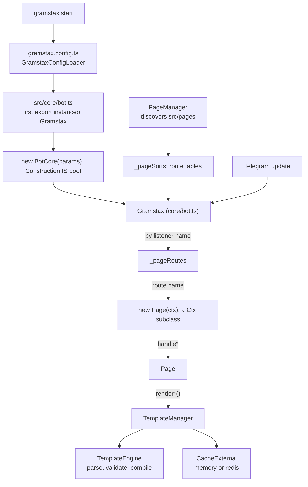

<div align="center">
  <p></p>
  <h1>gramstax</h1>

  <p>A modern Telegram bot framework built around page-based routing and a powerful template system.</p>
  <p>
    
    
    
    
    
    <a href="https://gramstax.mintlify.site/"></a>
    
  </p>
</div>

## 💡 Why this package

Most Telegram frameworks hand you a registration call and leave the rest to be
decided per file: where markup lives, how a second language gets added, whether a
tap edits the message it came from or orphans it. Three of those gaps are closed
by construction here rather than by convention.

**Render params cannot describe a state that cannot happen.** Each `render*()`
params type is a union over its real delivery routes, with `?: never` where a key
is unreachable. `{mode: "reply", fallback: "reply"}` does not compile, and
`_assertRenderRoute` enforces the same rule at runtime.

**Templates are frozen before they ship.** `gramstax build` compiles them ahead of
time, and a test asserts the output carries zero `new Function`, `Function(` or
`eval(` under a sabotaged `globalThis.Function`.

**Silence is counted.** `noMatch`, `noHandler`, `blocked` and `dropped` are
counters rather than a shrug: `GET /stats` for JSON, `GET /metrics` for Prometheus.

### Against the usual approach

| Area | The usual way | Here |
| --- | --- | --- |
| routing | every route registered by hand in one place | the file path *is* the route; naming a `handle*` method registers it |
| markup and i18n | markup inside the API call, one branch per locale | one template; `<g-message lang="id">` sits beside `<g-message>`, and no handler branches |
| send versus edit | read the update and choose | `mode: "auto"` reads it in one place |
| impossible states | an options object assembled by hand | a union over real routes, `?: never` where a key is unreachable, re-checked at runtime |
| nothing matched | silence | `noMatch`, `noHandler`, `blocked` and `dropped` counted |
| server codegen | `new Function` at runtime | frozen ahead of time, asserted to hold zero codegen tokens |

## ✨ Features

### Pages, not string builders

- 📄 **A page is a class**: `PageManager` walks `src/pages/**`, takes the first exported page class in each file (no default exports), and the file path *is* the route (`start.ts` → `start`, `start/counter/index.ts` → `start/counter`)
- 🧩 **Route from the filesystem**: kebab-case files or folder `index.ts`, never both for one route; a root-level `index.ts` is rejected because it has no parent route
- 🎯 **`static data = this.buildData()`**: what makes `this.data.callbackQueryData(base, action)` type-safe instead of stringly-typed
- 🪜 **`g*` step objects**: every step is a `{show, process}` pair, so each is independently renderable, processable, and directly drivable from an e2e test; `gdefault` when there is no `id`, `gs1` for `id="s1"`
- 🔐 **Gates by inheritance**: `PageAdminBase` carries the `hookBeforeRoute` check for a whole family, so an admin route does not repeat the check in every handler

### The template pipeline

- 🧱 **PAGE blocks**: `g-base`, `g-message`, `g-keyboard`, `g-media`, `g-media-group`, `g-poll`, `g-invoice`, `g-paid-media`, `g-venue`, `g-dice`, `g-gift`, `g-description`, plus logic (`g-ifelse`, `g-switch`, `g-case`, `g-default`, `g-map`, `g-div`, `g-script`), answers (`g-callback-answer`, `g-inline-button`, `g-precheckout-error`, `g-shipping-error`, `g-answer-note`) and utilities (`g-import`, `g-space`)
- 🌐 **54 Telegram Rich HTML tags** validated to Bot API 10.3: inline, block, `tg-*` specifics, media and forms, with per-tag attribute allow-lists
- 🧮 **Compile-time filter pipes**: `{{name|upper}}`, `{{price|number:2}}`, `{{createdAt|date:YYYY-MM-DD}}`, `{{count|plural:item:items}}`, `{{x|default:N/A}}`, chained left to right on a whitelist that cannot execute arbitrary code
- 🔥 **AOT for the edge**: `gramstax build` freezes templates into `.gramstax/gen/*.g.js` with **zero** codegen tokens (`new Function`, `Function(`, `eval(`), asserted by test under a sabotaged `globalThis.Function`
- ♻️ **Hot reload**: `TemplateManager` watches template files through chokidar; `--watch` reboots on `src` change

### Routing and delivery

- 🚦 **Convention handlers**: `handleCommandText`, `handleCallbackQueryData`, `handleArgsText`, `handleSessionFreePhoto`, `handleFreeReaction`, and a `handleSession*` route per update kind with its matching `setSession*` / `methodSession*` pair
- ✏️ **`mode: "auto"` by default**: edits when the update is a callback query, replies otherwise; `reply` and `edit` force the route, and you never branch on `this.callbackQuery` yourself
- 📢 **Broadcast in the same call**: `renderText({broadcast: {ids, languageCode}})` returns an `IBroadcastSendResult` with success/total counts, a resumable `startFrom`, `excludeIds`, pacing chunks and bounded concurrency
- 💬 **Sessions**: `setSession([this.methodSessionFreeText()], {step})` parks the user in a step; `clearSession()` returns them to a stateless route
- 🎛️ **Shared keyboards**: `inlineKeyboardT([this, StartPage], "2-2", Base.home)` builds a template-backed keyboard, or `inlineKeyboard((k, l) => …)` when the buttons are computed

### Operational surface

- 📊 **Prometheus metrics**: `GET /metrics` emits `gramstax_updates_total{listener=…}`, cumulative outcome counters, latency avg/max gauges, and queue stats
- 🔒 **Distributed session lock**: Redis-only atomic `SET NX PX` lease held for the whole update dispatch, so concurrent updates for one user serialise across instances; contention modes `skip`, `wait`, `serialize`
- 🚦 **Rate limiting and outgoing throttle**: `@grammyjs/ratelimiter` with `hookRateLimited(ctx)` / `hookKeyGenerator(ctx)`, and `@grammyjs/transformer-throttler` via `throttle: {global, group, out}`
- ⚙️ **Bounded update queue**: opt-in `UpdateQueue` for polling and webhook; at a 600 users/s target on the dev host the sequential drain fell to 377 users/s at p95 1828 ms while the queue sustained 601 users/s at p95 124 ms
- 🧪 **In-process e2e**: `deploy: "test"` attaches an in-process `E2eHelper` with no HTTP; it exposes `sendText`, `sendCallbackQuery`, `lastCall("sendMediaGroup")`, and `gmsg` / `gkb` / `gmedia` to assert against the compiled template itself
- 🗄️ **Typed LMDB storage**: [`@gramstax/lmdb`](https://github.com/gramstax/gramstax/tree/main/packages/lmdb): declare an `LmdbSchema`, `register()` it, get a typed handle with embedded indexes, TTL, queues, CDC, and backups
- 🧵 **Worker threads**: [`@gramstax/worker-thread`](https://github.com/gramstax/gramstax/tree/main/packages/worker-thread): `WorkerThreadExport.init()` derives a typed proxy from your worker class, so `mtd*` methods read as local async calls
- 🏗️ **Scaffolding that stays consistent**: [`create-gramstax`](https://github.com/gramstax/gramstax/tree/main/packages/create-gramstax) generates 9 page templates plus an e2e suite mirroring the page tree, with `--lmdb` / `--worker-thread` / `--biome` / `--runtime node`

## 🚀 Quick Start

### 1. Prerequisites

- [Bun](https://bun.sh) v1.0+: the CLI resolves TypeScript paths and the `~/*` alias through a `file://` import, which plain `node` cannot, so every template script forces the Bun runtime
- `typescript ^6.0.3` (peer dependency)
- A bot token from [@BotFather](https://t.me/BotFather)

### 2. Install and scaffold

```bash
bun add gramstax
```

Scaffold a whole project instead of wiring it by hand (the scaffolding CLI is the sibling package `create-gramstax`):

```bash
bunx create-gramstax@latest my-bot
cd my-bot
bun install
```

The positional is a bare name, not a path. Non-interactive mode needs the flags it would otherwise prompt for:

```bash
bunx create-gramstax@latest my-bot --pm bun --runtime bun --skip-install
```

Each optional feature has a matching negation (`--no-lmdb`, `--no-worker-thread`, `--no-biome`), and `--runtime node` rewires the scripts to `node`, `tsc --outDir dist`, and `node --test`.

### 3. Declare a page

A page is a class. The markup is a static template; the keyboard is built from the page's own blocks. This is [`example/2-helloworld/src/pages/start.ts`](https://github.com/gramstax/gramstax/blob/main/example/2-helloworld/src/pages/start.ts), verbatim:

```ts
import {PageBase} from "~/base/page"

export class StartPage extends PageBase {
  static data = this.buildData()

  async handleCommandText() {
    await this.gdefault.show()
  }

  async handleCallbackQueryData() {
    await this.gdefault.show()
  }

  helper = {}
  gdefault = {
    show: async () => {
      await this.renderText({keyboard: this.inlineKeyboardT([this]), data: {time: new Date().toString()}})
    },
    process: () => {}
  }

  static template = `
    <g-base>
      <g-keyboard type="inline">Refresh</g-keyboard>
      <g-keyboard type="inline" lang="id">Segarkan</g-keyboard>
      <g-message>
        Hello World!
        Time now: {{time}}
      </g-message>
      <g-message lang="id">
        Halo Dunia!
        Waktu: {{time}}
      </g-message>
    </g-base>
  `
}
```

Because both languages live in the same block set, the bot renders Indonesian for an Indonesian Telegram client and English for everyone else, without a branch in the handler.

### 4. Configure and run

`gramstax.config.ts` at the project root, default export, annotated. This is [`example/2-helloworld/gramstax.config.ts`](https://github.com/gramstax/gramstax/blob/main/example/2-helloworld/gramstax.config.ts), trimmed to the fields that matter:

```ts
import type {GramstaxConfig} from "gramstax"

const config: GramstaxConfig = {
  token: process.env.BOT_TOKEN,
  deploy: process.env.BOT_DEPLOY ?? `polling`,
  cacheSession: {
    store: process.env.CACHE_SESSION_STORE ?? `memory`,
    ttlMs: 4 * 60 * 60 * 1000,
    namespace: `s`
  },
  log: true,
  optionsDeploy: {polling: {maxRetries: undefined, queue: undefined}}
}

export default config
```

```bash
bun --bun gramstax start          # boot
bun --bun gramstax start --watch  # boot + restart on src change
```

### 5. Next steps

- Write more pages under `src/pages`: routing is filesystem discovery, there is no registry to update
- Add a shared keyboard block in `src/blocks/g-keyboard.ts` once two or more pages need it
- Add the global error / not-found pages via `hookErrorPage` and `hookNotFoundPage` on `src/core/bot.ts`
- Add `e2e/setup.ts` and drive the bot through `bot.e2e` with `deploy: "test"`
- Run [`gramstax build`](https://github.com/gramstax/gramstax/blob/main/docs-site/guides/gramstax-build.md) before any `serverless` deploy

## 📖 Usage

### Page anatomy

Four moving parts, in this order:

| Piece | Declared as | What it is |
| :---- | :---------- | :--------- |
| `static data` | `this.buildData(...)` | Route identity: the page name, the text/command/callback intents, and the typed `callbackQueryData(...)` signature |
| handlers | `handle*` methods | The entry points routing dispatches to; each stays thin and delegates to a `g*` step |
| `helper` / `g*` | instance fields | Page-local closures and the `{show, process}` step objects |
| `static template` | a template literal | The markup: `<g-base>` blocks containing `<g-message>`, `<g-keyboard>`, `<g-media>` and friends |

`buildData` has four shapes:

```ts
// no args: callbackQueryData() takes zero arguments
static data = this.buildData()

// a callback-arg mapper: types data.callbackQueryData(id)
static data = this.buildData((id: string) => [id])

// optional args
static data = this.buildData((exe?: string) => [exe])

// a name override plus per-language intents
static data = this.buildData({name: `lang`, intentText: {en: `hello`, default: `hello`}})
```

A page **without** `static data` still routes, but `callbackQueryData` is not available: `IPageDataBase` deliberately omits it, so a page cannot wire a callback it never declared. `data.callbackQueryData(...)` returns `{result, page, args}`: `result` is the string Telegram carries, `page` is the destination class, `args` the tuple you passed.

```ts
// example/1-complex/src/pages/start/counter/index.ts
helper = {
  counterKeyboard: () => this.inlineKeyboardT([this.data.callbackQueryData(`I`), this.data.callbackQueryData(`D`), StartPage], `2`)
}
```

`inlineKeyboardT` resolves each destination into its callback payload (a `IKbCallbackData` object uses `result`, a page class has `callbackQueryData()` called for you, and a bare string passes through), and `Helper.ensurePageHasCallback` throws if the destination page has no `handleCallbackQueryData`.

#### Handler naming

| Handler | Fires on |
| :------ | :-------- |
| `handleText` / `handleArgsText` | a plain text message matching `data.intentText` (and its `lang` variants) |
| `handleCommandText` / `handleCommandArgsText` | `/command` matching `data.intentCommandText` |
| `handleCallbackQueryData` / `handleArgsCallbackQueryData` | a callback query matching `data.intentCallbackQueryData` |
| `handleCaptionPhoto` / `handleCommandCaptionPhoto` / … | a caption on that media kind |
| `handleFree*` | any update of that kind, whatever the intent (dynamic route) |
| `handleSession*` | the update the armed session points at (see [sessions](#sessions)) |
| `handleChatMember*` / `handleMyChatMember*` | a status transition, e.g. `handleMyChatMemberOutAdmin` |
| `handleFree()` | the global fallback for every unmatched free update |

Args come **after** the verb, and the singular getters return the first token:

| Getter | Returns |
| :----- | :------ |
| `this.msg?.text` | `string \| undefined`: always optional-chain; a caption update carries no text |
| `this.msgTextArg` / `this.msgTextArgs` | the first token / all tokens after the intent |
| `this.msgTextCommandArg` / `msgTextCommandArgs` | the same for the command payload |
| `this.msgCaptionArg` / `msgCaptionArgs` | the same for captions |
| `this.callbackQueryDataArg` / `callbackQueryDataArgs` | the first callback argument / all of them |

### The render contract

`renderText`, `renderMedia`, `renderMediaGroup` and friends share one rule, and it is the part worth knowing before anything else.

**Params are a union over delivery routes.** `IRenderTextParams = IContent & (IRouteAuto | IRouteEdit | IRouteReply | IRouteChunked | IRouteBroadcastSend)`. `IContent` is the shared `data` (interpolation) + `AGBaseId` (which `<g-base>` to resolve). On top of it, every route declares the same **ten universal keys**:

| Key | Feeds |
| :-- | :---- |
| `mode` | send-versus-edit resolution: `auto` (default), `reply`, or `edit` |
| `keyboard` | reply markup; narrowed to `IInlineKb` where the call is always an edit |
| `rich` | the `InputRichMessage` payload |
| `richOptions` | rich-call options (send-only routes get `IOptRichSend`, edit-capable ones `IOptRich`) |
| `options` | the send call |
| `editOptions` | `editMessageText` |
| `fallback` | `delete-reply` (default) · `reply` · `disable` |
| `fallbackOptions` | options for the fallback resend |
| `broadcast` | fan-out to `broadcast.ids` / `broadcast.targets` |
| `chunkSize` | characters per chunk on the split route |

A combination the winning route would ignore is a **compile error**, not a field quietly dropped:

```ts
// ❌ a forced reply never edits, so it never reaches a fallback
await this.renderText({mode: `reply`, fallback: `reply`})

// ✅
await this.renderText({mode: `edit`, keyboard: this.inlineKeyboardT([this]), editOptions: {parse_mode: `HTML`}})
```

**One field, one call.** There is no options bag that has to satisfy two Telegram methods at once. `options` feeds the send, `editOptions` the edit, `fallbackOptions` the resend after a failed edit. On the media family the same rule splits one overloaded field into `captionOptions` (the caption-bearing send), `media` + `mediaOptions` (`editMessageMedia`), and `resendOptions` (the delete-then-resend path for kinds that cannot be edited in place).

**The runtime backs it up.** `Ctx._assertRenderRoute(method, params, richAxis)` is one function shared by `renderText`, `renderMedia` and `renderMediaGroup`; it resolves the route from the same discriminators (`broadcast` shape, then `chunkSize`, then `mode`) and throws naming every dropped field and the fix. `Ctx._assertInlineKeyboardForEdit` rejects a bottom keyboard on an edit route before any API call: `editMessageText` would otherwise come back as an opaque Telegram 400.

**Rich versus plain is a compile-time decision.** The `<g-message>` block decides, not the params: each route carries both `options` (plain) and `rich` (rich payload), and passing the one the block does not read logs a one-time `log.warn` and is ignored, never a throw, because a `--watch` hot reload can flip a page between the two in one process.

#### Route atoms

The twelve atoms are exported, so the contract is documented per route rather than only per method:

| Atom | Route | Unread keys |
| :--- | :---- | :---------- |
| `IRouteAuto` | runtime-decided single message | `broadcast`, `chunkSize` |
| `IRouteEdit` | forced edit of the message tied to the update | `options` |
| `IRouteReply` | forced send, `mode` required | `editOptions`, `fallbackOptions`, `fallback` |
| `IRouteForcedReply` | the same for send-only methods: `mode` optional | `editOptions`, `fallbackOptions`, `fallback` |
| `IRouteChunked` | sequential reply chunks (`chunkSize` required) | `editOptions`, `fallbackOptions`, `fallback` |
| `IRouteBroadcastSend` | fan-out to `broadcast.ids` | `mode`, `editOptions`, `fallbackOptions`, `fallback`, `chunkSize` |
| `IRouteMediaAuto<T>` | runtime-decided single media | `options`, `editOptions`, `rich`, `richOptions`, `captionOptions` |
| `IRouteMediaReply<T>` | forced media send | everything edit-side, plus `media`, `mediaOptions`, `resendOptions` |
| `IRouteMediaBroadcastSend<T>` | media fan-out: the kind comes from the block | `mode`, `type`, and every edit-side key |
| `IRouteMediaBroadcastRevise<T>` | revise stored `broadcast.targets` | `mode`, `options`, `captionOptions`, `fallbackOptions`, … |
| `IRouteGroupAuto` | runtime-decided group send | `keyboard` (groups carry no markup), `rich`, `richOptions`, `fallbackOptions` |
| `IRouteGroupReply` | forced group send | same, plus `fallback` |

The uniform key set is why `{mode: 'edit', broadcast: {...}}` is a compile error rather than a silently dropped field: `IRouteEdit` declares `broadcast` as `null | undefined`.

### Template blocks

29 PAGE blocks, grouped by what they do.

**Structure and sharing**

```html
<g-base id="i">
  <g-message>Hello</g-message>
</g-base>
<g-base id="s">
  <g-import src="start" base="i" />   <!-- reuse a base's keyboard -->
  <g-message>Done</g-message>
</g-base>
<g-space />                             <!-- void, self-closing -->
```

**Logic**, conditionals live in the template, not in a near-duplicate base:

```html
<g-ifelse>deletedAt ? "Yes" : "No"</g-ifelse>
<g-switch value="status">
  <g-case is="1">🔴 Off</g-case>
  <g-default>🟢 On</g-default>
</g-switch>
<g-map src="arr" join="\n\n">
  Position: {{ord}}      <!-- 1-based -->
  Number: {{e.number}}   <!-- current element -->
</g-map>
```

`<g-script>` and every `{~~ … ~~}` scope emit `with(`, which is forbidden in ESM strict mode. They work under `gramstax start` (JIT) and hard-fail `gramstax build`. `<g-ifelse>` is the AOT-safe conditional: it emits a plain optional-`data` ternary. For anything computed, put it in a page-class method and interpolate it with `{{}}`.

**Content**

```html
<g-message>Plain or Telegram Rich HTML, {{escaped}}</g-message>
<g-keyboard type="inline">🔢 Counter, ❓ Help, 🔄 Refresh</g-keyboard>
<g-keyboard type="bottom">🏠 Home, ⌨️ Keyboard</g-keyboard>
<g-media type="photo" src="https://example.com/a.jpg">🖼️ Caption goes here</g-media>
<g-media-group>
  <g-media type="photo" src="a.jpg">…</g-media>
  <g-media type="video" src="b.mp4">…</g-media>
</g-media-group>
<g-poll type="quiz" correct="0">
  <g-question>2 + 2?</g-question>
  <g-option>3</g-option>
  <g-option>4</g-option>
</g-poll>
<g-invoice title="Pro" description="30 days" payload="sub-42" currency="USD">
  <g-price label="Monthly" amount="999" />
</g-invoice>
<g-paid-media stars="100"><g-media type="photo" src="a.jpg">…</g-media></g-paid-media>
<g-venue title="HQ" address="Somewhere" latitude="-6.2" longitude="106.8" />
<g-dice emoji="🎲" />
<g-description>Shown in the /command list</g-description>
<g-gift>🎁 Gift text</g-gift>
```

**Answers**, the text a query is answered with is a template block, so it is localizable: `<g-callback-answer>Saved</g-callback-answer>`, `<g-inline-button text="Search" start-parameter="q" />`, `<g-precheckout-error>Card declined</g-precheckout-error>`, `<g-shipping-error>We cannot ship there</g-shipping-error>`, `<g-answer-note>Note appended to the inline result</g-answer-note>`.

**Telegram Rich HTML.** 54 tags pass straight through to the message `html` field: `a`, `b`, `code`, `del`, `em`, `i`, `ins`, `mark`, `s`, `strike`, `strong`, `sub`, `sup`, `tg-spoiler`, `u`; `aside`, `blockquote`, `blockquote expandable`, `br`, `caption`, `details`, `footer`, `h1`–`h6`, `hr`, `li`, `ol`, `p`, `pre`, `summary`, `table`, `td`, `th`, `tr`, `ul`; `tg-collage`, `tg-emoji`, `tg-map`, `tg-math`, `tg-math-block`, `tg-reference`, `tg-slideshow`, `tg-time`; `audio`, `cite`, `figcaption`, `figure`, `img`, `video`; `input`. Void elements must self-close (`<hr/>`, ``, `<input/>`, `<br/>`, `<tg-map/>`). Required attributes, value formats and the per-tag allowlist are all validated: `<tg-time unix="1647531900">` is legal, `<tg-time unix="abc">` is not, and `<table ngasal="x">` is rejected by name.

### Interpolation and filters

| Syntax | Behaviour |
| :----- | :-------- |
| `{{key}}` | HTML-escaped interpolation (`&`, `<`, `>` escaped) |
| `{{{key}}}` | raw pass-through: developer-authored markup only |
| `{{key|filter:arg}}` | post-processing pipe, compiled into a chained call |
| `<g-ifelse>…</g-ifelse>` | AOT-safe conditional, raw output |
| `{{user.name|upper}}` | dotted paths work |

| Filter | Signature | Behaviour |
| :----- | :-------- | :-------- |
| `upper` / `lower` | `{{name\|upper}}` | case conversion; nullish becomes `""` |
| `number` | `{{price\|number:2}}` | fixed decimals (default 0); non-numeric renders empty, never `NaN` |
| `date` | `{{at\|date:YYYY-MM-DD}}` | UTC formatting over `YYYY MM DD HH mm ss`; default `YYYY-MM-DD` |
| `plural` | `{{count\|plural:item:items}}` | first arg when the value is exactly `1`, second otherwise |
| `default` | `{{x\|upper\|default:N/A}}` | applies only to undefined / null / empty: `0` and `false` pass through |

Pipes chain left to right. `DEFAULT_FILTERS` is a strict whitelist: an unknown filter renders empty and logs one `console.warn` per compile, because a template cannot execute arbitrary code through a pipe.

### Keyboards

Two builders, two template block types:

```ts
// inline: button text and callback data both come from the labels
const inline = this.inlineKeyboardT([StartCounterPage, StartHelpPage], `2`)
const inlineFn = this.inlineKeyboard((k, l) => k.text(l[0]!, StartCounterPage).row().text(l[1]!, StartHelpPage), {cache: true, AGBaseId: Base.index})

// bottom: text buttons that re-trigger text routing
const bottom = this.bottomKeyboard((k, l) => k.text(l[0]!).row().text(l[1]!).oneTime())
```

`layout` is an `IKbCols`: a fixed `"1"`–`"6"` or a responsive range like `"2-4"`; `AGBaseId` picks which base's `<g-keyboard>` block supplies the labels; `cache: true` memoizes the built keyboard per `page:base:lang:i`.

Inline is right for anything that should edit in place (the callback query makes `mode: 'auto'` edit the same message). Bottom is right for durable input modes (a city name, a persistent action) because bottom buttons send plain text. `renderEditKeyboard` swaps only the markup, with no resend.

**Shared blocks.** Once two or more pages need the same board, lift it into `src/blocks/g-keyboard.ts` and expose it on `PageBase`:

```ts
// src/blocks/g-keyboard.ts: example/1-complex
import {BlockGKeyboard, LabelGKeyboard} from "gramstax"

export class KeyboardGBlock extends BlockGKeyboard {
  static label = class extends LabelGKeyboard {
    static home = {default: `🏠 Home`, id: `🏠 Beranda`}
    static back = {default: `⬅️ Back`, id: `⬅️ Kembali`}
  }
  static home = (lang?: string, type?: string) => this._build(`home`, lang, type)
  static back = (lang?: string, type?: string) => this._build(`back`, lang, type)
}

// src/base/page.ts
export abstract class PageBase extends CtxCore {
  static kbk = KeyboardGBlock
  static kbl = KeyboardGBlock.label
}
```

Then `${this.kbk.back()}` emits every language variant of the block, and `${this.kbl.back.default}` / `.id` gives the raw label string when you need it inside a sentence.

### Sessions

A session is a cache entry keyed `userId:chatId` that names which `handleSession*` method owns the next update. Arm one with the shorthand setter, read it from `this.temp.session`:

```ts
// example/1-complex/src/pages/start/input/text/index.ts
export class StartInputTextPage extends PageBase {
  static data = this.buildData({intentCommandText: `input_text`})

  async handleCommandText() {
    await this.gindex.show()
  }

  async handleSessionFreeText() {
    const {step} = this.temp.session.params ?? {}
    if (step === Base.index) {
      await this.gindex.process()
    }
  }

  helper = {
    homeKeyboard: (AGBaseId?: string) => this.inlineKeyboardT([StartPage], `1`, AGBaseId)
  }
  gindex = {
    show: async () => {
      await this.setSessionFreeText({step: Base.index})
      await this.renderText({AGBaseId: Base.index, keyboard: this.helper.homeKeyboard(Base.index)})
    },
    process: async () => {
      await this.gsuccess.show()
    }
  }
  // …gsuccess…
}
```

Four behaviours worth knowing:

- **Non-session routes auto-clear.** Once per dispatch, the first matched non-session route clears any existing session, so nothing leaks into the next update. Session routes never auto-clear.
- **Do not fetch the session by hand.** The framework injects it into `this.temp.session` before your handler runs; a manual `getSession()` races a dispatch that already happened.
- **Clear explicitly on `/start`.** `await this.clearSession()` at the top of the command handler is the cheapest way to guarantee a clean slate.
- **`setSession([...])` for multi-input.** Bind one payload to several handlers at once: `await this.setSession([this.methodSessionFreeText(), this.methodSessionFreePhoto()], {position: `form`})`.

### Guards

| You want | Use |
| :------ | :-- |
| every route in a page family gated | a base class + `hookBeforeRoute()`: the framework calls it on every matched route, so a new page cannot opt out |
| one check inside one handler or step | a `GuardBase` subclass whose method returns a value you branch on |
| every route in the whole bot | `BotCore.hookBeforeRoute(ctx, data)` |

Only two of these are framework API. `hookBeforeRoute` is a method the router calls, on a page base class or on your `Gramstax` subclass, which is what makes those gates automatic. The middle row is a pattern rather than a class: `GuardBase` is project code, the small `Ctx` subclass the scaffold writes to `src/base/guard.ts`, and `gramstax` does not export it. It exists because a guard is not a page and so has no `static data` of its own; the base class hands it the page's `data` through `temp.data`.

```ts
// page-level gate: no params, `this` IS the page
export abstract class PageAdminBase extends PageBase {
  async hookBeforeRoute() {
    if (await isAdmin(this.from!.id)) return true
    await this.renderCallbackAnswer({showAlert: true, AGBaseId: Base.denied})
    return false // strict `false` only
  }
}
```

```ts
// bot-level gate: example/1-complex/src/core/bot.ts
export class BotCore extends Gramstax {
  async hookBeforeRoute(ctx: CtxCore) {
    const user = await new UserGuard(ctx).overrideLang()
    return user !== null
  }
  async hookErrorPage(ctx: CtxCore, data: {listenerName: string; error: unknown}) {
    await new StatusPage(ctx).gerror.show(`${data.listenerName}:hookErrorPage`, data.error)
  }
}
```

`!== false` is the test: omitting the hook allows, and so does returning `undefined`, `null`, `0` or `""`. Denying is silent by default: answer the callback or render a page, or the user sees nothing. A page that overrides an inherited gate **replaces** it; call `super.hookBeforeRoute()` to compose.

### Query answers

Six methods take their text from a template block instead of a literal string, so the answer is localizable and lives with the page's markup:

| Method | Block | Telegram call | Params |
| :----- | :---- | :------------ | :----- |
| `renderCallbackAnswer` | `<g-callback-answer>` | `answerCallbackQuery` | `{showAlert, data?, AGBaseId?, options?}` |
| `renderPreCheckout` | `<g-precheckout-error>` | `answerPreCheckoutQuery` | `{ok, data?, AGBaseId?, options?}` |
| `renderShipping` | `<g-shipping-error>` | `answerShippingQuery` | `{ok, data?, AGBaseId?, options?}` |
| `renderInlineAnswer` | `<g-inline-button>` | `answerInlineQuery` | `{results, data?, AGBaseId?, options?, buttonStartParameter?}` |
| `renderGuestAnswer` | `<g-answer-note>` | `answerGuestQuery` | `{result, data?, AGBaseId?, options?}` |
| `renderWebAppAnswer` | _not applicable_ | `api.answerWebAppQuery` | `{webAppQueryId, result, data?, AGBaseId?, options?}` |

```ts
await this.renderCallbackAnswer({showAlert: true, AGBaseId: Base.denied})
```

Send failures are classified via `Ctx.classifySendError`, reported to the `hookSendError` surface, logged, and then **always rethrown**: plan for the throw. `renderPreCheckout` resolves its block even when `ok: true`, as fail-fast validation that the template exists.

### Broadcast

`broadcast.ids` fans out; `broadcast.targets` revises already-sent messages. The template is resolved once per language, rate limits are paced, and the result carries counts plus a re-drive list:

```ts
// example/8-newsletter/src/pages/broadcast.ts
ginfoDeliverText = {
  show: async (ids: number[], langs: string[], draftText?: string) => {
    return (await this.renderText({AGBaseId: Base.infoDeliverText, data: {message: draftText}, broadcast: {ids, languageCode: langs}})) as IBroadcastSendResult
  },
  process: () => {}
}
```

| Where | Method |
| :---- | :----- |
| text fan-out | `renderText({broadcast: {ids, languageCode}})` |
| media fan-out | `renderMedia({broadcast: {ids, languageCode}})`: no `type`; the kind comes from the `<g-media>` block |
| poll fan-out | `renderPoll({broadcast})` |
| revise stored messages | `renderMedia({type, broadcast: {targets}})` |
| delete stored messages | `renderBroadcastDelete({targets})` |

`IBroadcastSendParams` adds `chunkSize` / `chunkDelayMs` pacing (different from the render-level `chunkSize`, which splits one message), `excludeIds`, `concurrency` (1–10), `startFrom` for resuming a checkpoint, `throwError`, and `onProgress`. The result is `{successCount, failedCount, totalCount, skippedCount, retryable: [{index, id, error}]}`. Retryable failures never abort the run.

### Deploy modes

| `deploy` | What boots | Startup hooks | `optionsDeploy` branch |
| :------- | :---------- | :------------- | :---------------------- |
| `polling` (default) | the `getUpdates` loop | `hookBeforeStart` → `hookAfterStart` | `{maxRetries?, dropPendingUpdates?, queue?}` |
| `webhook` | `Bun.serve` HTTP server + optional queue | both | `{url, secretToken, queue?}`: both mandatory |
| `serverless` | the platform handler, fs-less from the frozen manifest | both | `{[adapter]: {url, secretToken, …}}`: the adapter **is the key** |
| `raw` | nothing: a bare `Bot` instance, no pages, no auto-start | `hookBeforeStart` only | `{}` |
| `test` | the in-process e2e harness | both, no network | `{}` |

```ts
const config: GramstaxConfig = {
  token: process.env.BOT_TOKEN ?? ``,
  deploy: `webhook`,
  optionsDeploy: {webhook: {url: `https://bot.example.com/hook`, secretToken: process.env.BOT_WEBHOOK_SECRET ?? ``}}
}
```

```ts
const config: GramstaxConfig = {
  deploy: `serverless`,
  optionsDeploy: {
    serverless: {
      'cloudflare-mod': {
        name: `gramstax-worker`,
        url: `https://gramstax-worker.workers.dev/webhook`,
        secretToken: process.env.BOT_WEBHOOK_SECRET ?? ``,
        compatibilityDate: `2026-01-01`,
        compatibilityFlags: [`nodejs_compat`]
      }
    }
  }
}
```

`--deploy <mode>` on `gramstax start` overrides the file; precedence is flag → config → `polling`, with no env-var channel. The colon grammar (`webhook:https://…`) was removed and throws by name.

### The build

```bash
gramstax build                            # freeze src/pages into .gramstax/
gramstax build --dry-run                  # print the resolved plan, write nothing
gramstax build --target cloudflare-mod    # Workers entry only
gramstax build --target aws-lambda-async # Lambda entry only
gramstax build --raw                      # raw projects: skip, exit 0
gramstax build --bundle                   # single-file bundle (deprecated)
```

`pagesDir` is always `src/pages` and `outDir` always `.gramstax/`. The output tree:

```text
.gramstax/
  routes.json        # frozen route list (pure data, diffable), always
  manifest.js        # static page-class imports + embedded templates, always
  gen/               # AOT template modules, always
    <key>.g.js       # one module per template key (`sub/note` → `sub_note.g.js`)
    manifest.js      # {templates: Record<key, ICompiledTemplate>}
  server/            # only for a resolved serverless target
    worker.js        # cloudflare-mod entry
    wrangler.toml    # complete deployable Workers config
    bun-stub.ts      # `bun` resolve stub for the Workers bundler
    lambda.js        # aws-lambda-async entry
```

AOT is unconditional: there is no `--aot` flag on `gramstax build` (it exists only on the raw `build-manifest.ts` script). Regenerate after every page or template change: there is no staleness check at boot, and the quietest symptom of a stale `gen/` is a blank message rather than an error.

### E2E against the compiled template

```ts
// example/2-helloworld/e2e/setup.ts
import {join} from "node:path"
import {TemplateManager} from "gramstax"
import {BotCore} from "../src/core/bot"

export const bot = new BotCore({
  deploy: `test`,
  token: `test`,
  log: false,
  templateManager: new TemplateManager({
    path: [join(import.meta.dir, `../src/pages`)]
  })
})
export const e2e = bot.e2e!
export const enUser = {user: {id: 4001, language_code: `en`}, chat: {id: 4001}}
export const idUser = {user: {id: 5001, language_code: `id`}, chat: {id: 5001}}
```

```ts
// example/2-helloworld/e2e/start.test.ts
const intent = `start`

beforeEach(() => {
  e2e.clearCalls()
})

describe(`E2E: StartPage`, () => {
  it(`respond to /start`, async () => {
    const res = await e2e.sendText(`/start`, enUser)
    const resId = await e2e.sendText(`/start`, idUser)
    expect(res.length).toBeGreaterThan(0)
    expect(resId.length).toBeGreaterThan(0)
    expect(res[0]!.body?.text).toStartWith(e2e.gmsg(intent, `default`, {}))
    expect(resId[0]!.body?.text).toStartWith(e2e.gmsg(intent, `default`, {}, `id`))
  })
})
```

`e2e.gmsg` renders the page's own compiled template, so a drift between template and handler fails the test instead of shipping.

Persistence and background work live in the sibling packages:
[`@gramstax/lmdb`](https://github.com/gramstax/gramstax/tree/main/packages/lmdb) and
[`@gramstax/worker-thread`](https://github.com/gramstax/gramstax/tree/main/packages/worker-thread).
The [repository README](https://github.com/gramstax/gramstax) shows each of them wired into a page.

## 🔍 How it works



### The boot path

`src/cli/gramstax.ts` builds a Commander program with two subcommands; `exitOverride` turns `--help` and `--version` into exit code 0 rather than `process.exit`. Each action translates its flags into a positional `argv` array and copies the resolved code onto `process.exitCode`.

`GramstaxStart.boot()` ([`src/cli/start.ts`](https://github.com/gramstax/gramstax/blob/main/packages/gramstax/src/cli/start.ts)) then, in order:

1. `new GramstaxConfigLoader().loadConfig(cwd)`: imports `gramstax.config.ts` through a `file://` URL. A **missing** file is legal and yields `{deploy: 'polling'}` (that is what keeps zero-config `gramstax build` working); a file that exists but cannot be imported is fatal. Every unknown key throws `unknown field`.
2. `_resolveToken`: the loader allows `""` so `process.env.X ?? ""` typechecks and an env-less build still works; `start` is where an empty token throws.
3. `_resolveDeploy`: flag, then config, then `polling`. A colon in the flag is rejected separately, by name.
4. `_discoverBotCore(cwd)`: imports `src/core/bot.ts` (then `.js`) and takes the **first export whose `prototype instanceof Gramstax`**. The export name is free: `BotCore`, `App`, anything.
5. `_buildParams`: materializes each ref slot (`cacheSession`, `cacheKeyboard`, `templateManager`, `log`, `sessionLock.key`) and `instanceof`-checks it against its expected base.
6. `return new BotCore(params)`: there is no `.run()`. The `Gramstax` constructor creates the underlying `Bot`, mounts `autoRetry`, `stream`, the optional ratelimiter and throttler, `hydrateFiles`, registers the listeners and starts the deploy-mode loop.

### The template compile pipeline

[`TemplateManager.compile`](https://github.com/gramstax/gramstax/blob/main/packages/gramstax/src/template/manager.ts) runs the same sequence for a page's `static template` or for a `.html` file under `src/pages`:

1. **Expand `<g-import/>`**: a base importing another base's blocks (`processGImportBlocks`), recursively resolved against the import cache.
2. **`validateTemplate`**: [`TemplateEngine.validateTemplate`](https://github.com/gramstax/gramstax/blob/main/packages/gramstax/src/template/engine.ts) walks the tag allowlist (`ALLOWED_BLOCKS_PAGE` + `ALLOWED_BLOCKS_TELEGRAM`), then the per-block PAGE attribute validators, then the three Telegram steps (required attributes, value formats, unknown attributes), then positions, format blocks and scopes.
3. **Compile each block family**: one static per block kind: `compileBlockGMessage`, `compileBlockGKeyboards`, `compileBlockGMedia`, `compileBlockGPoll`, `compileBlockGVenue`, `compileBlockGDice`, `compileBlockGGift`, `compileBlockGInvoice`, `compileBlockGPaidMedia`, `compileBlockGDescription`, `compileBlockGCallbackAnswer`, `compileBlockGPrecheckoutError`, `compileBlockGShippingError`, `compileBlockGInlineButton`, `compileBlockGAnswerNote`.
4. **Produce an `ICompiledTemplate`**: 15 fields, each indexed by base id and then by language. That is the shape cached in the manager and frozen by AOT.
5. **`new Function`** on the JIT path (`gramstax start`), or plain ESM source on the AOT path (`gramstax build`): the AOT emitter is asserted per file to contain no codegen tokens.

Under `gramstax start --watch`, chokidar re-runs this for a changed template file only.

### Routing an update

`_pageSorts` (in [`core/bot.ts`](https://github.com/gramstax/gramstax/blob/main/packages/gramstax/src/core/bot.ts)) walks each page prototype once at boot and fills the routing tables: `all`, `routeStatic`, `routeStaticIntent`, `routeStaticSession`, `routeDynamicSpesific`, `routeDynamic` and `routeChatMember`. `_pageRoutes` then resolves an update against them in priority order, returning `matched` · `no-match` · `no-handler` · `blocked`:

| Id | Type | Algorithm | Example |
| :- | :--- | :-------- | :------ |
| 0 | chat-member | O(n) over `routeChatMember`, pre-computed filters | `handleMyChatMemberOutAdmin` |
| 1 | static session | O(x) keyed by `session.method`, filtered by listener | `handleSessionFreeText` |
| 2 | static | O(1) exact lookup on the intent | `handleCommandText`, `handleCallbackQueryData` |
| 3 | static intent | O(x) `startsWith` after the separator | `handleCommandArgsText`, `handleArgsCallbackQueryData` |
| 4 | dynamic specific | `handleFree*` defined on the page | `handleFreeText` |
| 5 | dynamic global | the page's `handleFree()` | catch-all free updates |
| 6 | custom routes | `registerCustomRoute` entries | app-defined listeners |

At every site the shape is the same: `const initPage = new Page(ctx)`, gate on `hookBeforeRoute`, then `await initPage[route.routeName]()`, then `hookAfterRoute`. `blocked` short-circuits the remaining routes for that listener.

## 📜 Scripts

Run from the repository root.

```bash
bun run ci:check:packages   # tsc --noEmit for every package + biome lint ./packages
bun run test:packages       # bun test ./packages: 118 files in packages/gramstax/test
bun run test:packages:parallel
bun run build:gramstax      # tsup → packages/gramstax/dist/src (nx build gramstax)
bun run build               # nx run-many -t build
bun run build:manifest      # bun packages/gramstax/scripts/build-manifest.ts <pagesDir> <outDir>
bun run lint:packages       # biome lint ./packages
bun run ci:test:packages    # ci:check:packages + test:packages: what CI runs
```

Inside `packages/gramstax`:

```bash
bun run build               # tsup: ./src/index.ts + ./src/cli/gramstax.ts, cjs + esm, dts
bun run build:docs          # api-extractor + api-documenter → docs/markdown + docs/yaml
bun test test/              # the unit suite
bun test --filter TemplateEngine
bun bench/bench.ts run      # users-per-second benchmark (k6 + MockTelegramServer)
```

The remaining `nx` scripts in the [repository README](https://github.com/gramstax/gramstax)
are repo-level: they cover every workspace project at once.

## 🗂️ Project Structure

```text
packages/gramstax/
├── src/
│   ├── index.ts            # Public barrel: runtime exports, then types
│   ├── core/
│   │   ├── bot.ts          # Gramstax: lifecycle, routing tables, deploy-mode startup, hooks
│   │   ├── ctx.ts          # Ctx: the 32 render* methods, keyboards, sessions, page handlers
│   │   └── session-lock.ts # SessionLock: Redis SET NX PX lease with atomic Lua release
│   ├── template/
│   │   ├── engine.ts       # TemplateEngine: block registry, parser, compiler, validators, filters
│   │   └── manager.ts      # TemplateManager: watcher, loader, compile, getG* accessors
│   ├── page/manager.ts     # PageManager: src/pages discovery and module loading
│   ├── blocks/g-keyboard.ts # BlockGKeyboard: emits <g-keyboard> blocks from labels
│   ├── labels/g-keyboard.ts # LabelGKeyboard: per-language label maps, order reversal
│   ├── cache/external.ts    # CacheExternal: Keyv-backed session/keyboard cache (memory | redis)
│   ├── helpers/
│   │   ├── log.ts          # LoggingHelper: extends logging-pretty; the shared `log` singleton
│   │   └── metrics.ts      # MetricsStore + metricsToPrometheus
│   ├── update/
│   │   ├── queue.ts        # UpdateQueue: bounded queue; WebhookQueue is a deprecated alias
│   │   ├── dispatcher.ts   # UpdateDispatcher: worker pool draining the queue
│   │   ├── gate.ts         # UpdateGate: per-chat concurrency gate
│   │   └── gate-key.ts     # resolveGateKey: per-chat key derivation
│   ├── mock/telegram-server.ts # MockTelegramServer: in-process Bot API stand-in
│   ├── e2e/helper.ts       # E2eHelper: send updates, capture calls, assert payloads
│   ├── cli/
│   │   ├── gramstax.ts     # The `gramstax` binary: Commander program, start + build
│   │   ├── config.ts       # GramstaxConfigLoader: load and validate gramstax.config.ts
│   │   ├── start.ts        # GramstaxStart: boot, discover BotCore, --watch restarter
│   │   ├── build.ts        # GramstaxBuild: freeze pages, emit serverless entries
│   │   ├── collect.ts      # Route/template collection shared by the build
│   │   └── targets/        # lambda.ts (aws-lambda-async) · worker.ts (cloudflare-mod)
│   └── types/              # 11 files: bot, cache, cli, config, ctx, e2e, manifest,
│                           #            metrics, mock, session-lock, template
├── test/                   # 118 bun:test files + a manifest fixture dir
├── docs/                   # generated API reference, versioned
│   ├── extractor/          # api-extractor report (etc/) + temp rollup
│   └── yaml/               # api-documenter yaml reference
├── skills/
│   └── gramstax-best-practices/
│       ├── SKILL.md        # Router: when to apply, rule priority, start-here table
│       ├── CHANGELOG.md
│       └── references/     # 34 rule files + _sections.md index + _template.md
├── scripts/
│   ├── build-manifest.ts   # generate(pagesDir, outDir, {aot}): the raw fs-less generator
│   ├── aot-emit.ts         # AOT module emitter
│   └── doc-inventory.ts    # doc inventory helper
├── bench/
│   ├── bench.ts            # Users-per-second bench: k6 → mock → webhook → bot
│   └── k6/                 # intake-load.js, webhook-load.js
├── security-poc/           # 10 numbered TemplateEngine PoCs (breakout/injection/RCE/XSS)
├── AGENTS.md               # Package conventions and architecture facts
├── CONTEXT.md              # Domain-modeling context
├── api-extractor.json      # API report config
├── tsup.config.ts          # Bundler: cjs + esm, dts, external: bun
└── package.json            # name: gramstax · bin: dist/src/cli/gramstax.js · license: Apache-2.0
```

This package is one of four in the repository; `create-gramstax`, `@gramstax/lmdb` and
`@gramstax/worker-thread` are siblings under
[`packages/`](https://github.com/gramstax/gramstax/tree/main/packages).

## 🔧 Configuration

### `GramstaxConfig` vs `IGramstaxParams`

They are two different shapes for two different things, and the difference is the whole boot story.

| | `GramstaxConfig` | `IGramstaxParams` |
| :-- | :--------------- | :---------------- |
| Used by | `gramstax.config.ts` (annotated, default export) | `new Gramstax(params)` |
| Field strictness | **every field optional**: a missing file yields `{deploy: 'polling'}` | `token` and `deploy` required |
| Instance values | **not possible**: slots hold refs or plain data | `cacheSession: CacheExternal`, `cacheKeyboard: Map`, `templateManager: TemplateManager`, `log: LoggingHelper` |
| `manifest` | **rejected** (`unknown field`): it is a constructor param | accepted: `IAppManifest`, the fs-less boot |
| Who fills it | the CLI, materializing each slot and `instanceof`-checking it | you |

### Ref slots

Five slots accept a module reference the CLI resolves and instantiates:

| Form | Meaning |
| :--- | :------ |
| `"path string"` | default export, zero-arg constructor |
| `{override: {module, export?, args?}}` | named export, `args` spread into `new Export(...args)` |
| `{module, ...}` bare | **rejected**: `uses removed bare {module, ...} form` |
| plain data | builtin form, passed to the default constructor |

| Slot | Expected base | Builtin form |
| :--- | :------------ | :------------ |
| `cacheSession` | `CacheExternal` | `{store, ttlMs?, namespace?}` |
| `cacheKeyboard` | `Map` | entries array or plain object |
| `templateManager` | `TemplateManager` | `{path, enableWatch?, watchOptions?, onReload?}` |
| `log` | `LoggingHelper` | `true` · `false` · `{pathFile?, force?, formatTime?}` |
| `sessionLock.key` | a non-class `(ctx) => string` | _not applicable_ |

Paths resolve relative to the **project root**, not the config file.

### Top-level fields

20 fields; anything else throws `unknown field`. All are optional.

| Field | Type | Default | Purpose |
| :---- | :--- | :------ | :------ |
| `token` | `string` | _none_ | Bot token value. `""` is accepted at load so `process.env.X ?? ""` typechecks; `gramstax start` throws `Token is not valid or empty` |
| `deploy` | `string` | `polling` | One of `polling` · `webhook` · `serverless` · `raw` · `test`; membership enforced by the loader. Plain `string` so `process.env.DEPLOY ?? "polling"` typechecks |
| `optionsDeploy` | object | `{deploy: 'polling'}` | Nested per-mode branches: see below |
| `mediaRoots` | `string[] \| null` | `null` | Opt-in local-path jail for media uploads; `[]` and `undefined` leave it off |
| `botConfig` | `BotConfig` | _none_ | Forwarded to the underlying client (`apiRoot`, …) |
| `autoRetry` | `boolean` | `true` | Mount `@grammyjs/auto-retry` |
| `autoRetryOptions` | `{maxRetryAttempts?, retryOnInternalServerErrors?}` | _none_ | Backoff / retry policy |
| `rateLimit` | `{windowMs, max}` | _none_ | Inbound limit; both must be positive |
| `throttle` | `APIThrottlerOptions` | _none_ | Outgoing Bottleneck buckets (`global`, `group`, `out`) |
| `updateTimeoutMs` | `number` | `30000` | A handler past it lands in `timeout` state |
| `skipDuplicateUpdate` | `boolean` | `false` | Idempotency on `update_id` |
| `maxTextLength` | `number` | `0` | Cap on `message.text` / `message.caption`; `0` = unlimited |
| `statusServerPort` | `number` | _none_ | `0`–`65535`; enables `GET /health`, `/stats`, `/metrics` |
| `statusServerHostname` | `string` | `127.0.0.1` | Status-server bind address |
| `optionsPage` | `{shortCallbackQueryData?}` | `false` | Numeric callback ids instead of names |
| `cacheSession` | ref \| builtin | `memory` | Session store; `memory` or `redis:<url>` |
| `cacheKeyboard` | ref \| array \| object | internal `Map` | Keyboard memoization store |
| `templateManager` | ref \| builtin | `new TemplateManager({path: [<cwd>/src/pages]})` | Set only to share one manager across several page directories |
| `log` | `boolean` \| ref \| `{pathFile?, force?, formatTime?}` | silent | `true` mounts the default logger |
| `sessionLock` | `{enabled?, leaseMs?, onContended?, key?}` | off | Redis-only distributed lease; a memory store auto-disables it with a warning |

### `optionsDeploy`

Nested branches, **at most one non-empty**, and that branch must equal `deploy`:

```ts
optionsDeploy: {
  polling: {maxRetries: 5},
  webhook: {url: `https://bot.example.com/hook`, secretToken: process.env.BOT_WEBHOOK_SECRET ?? ``},
  serverless: undefined,
  raw: undefined,
  test: undefined
}
```

| Branch | Fields |
| :----- | :----- |
| `polling` | `maxRetries` (`-1` = forever, default `5`), `dropPendingUpdates` (default `false`), `queue` |
| `webhook` | `url`, `secretToken` (**both required**), plus `queue` |
| `serverless` | exactly one adapter key: `{'cloudflare-mod': {...}}` or `{'aws-lambda-async': {...}}` |
| `raw` | none: `Record<string, never>`; any key throws |
| `test` | none: `Record<string, never>`; any key throws |

| Adapter | Accepted fields |
| :------ | :--------------- |
| `cloudflare-mod` | `url`, `secretToken` (required) + `name`, `compatibilityDate`, `compatibilityFlags`, `toml` |
| `aws-lambda-async` | `url`, `secretToken` (required) only |

A field that does not apply to the chosen adapter is **rejected**, not ignored. `toml` is flat-merged last into the emitted `wrangler.toml`, so it overrides every typed field. `secretToken` must match `^[A-Za-z0-9_-]{1,256}$` (generate with `openssl rand -hex 32`) and is never baked into an emitted bundle; the deployed entry reads the `BOT_WEBHOOK_SECRET` runtime binding.

### Update queue

`optionsDeploy.polling.queue` and `optionsDeploy.webhook.queue` configure the **same** class, `UpdateQueue`, with one independent instance per mode.

| Field | Default | Effect |
| :---- | :------ | :----- |
| `enabled` | `false` | Opt-in. Absent or `false`, both modes drain strictly sequentially: polling is exactly what it was before the queue existed |
| `maxQueueSize` | `5000` | Bounded capacity |
| `workerCount` | `8` | Concurrent in-process drain loops (not OS threads) |
| `perChatConcurrency` | `1` | `1` preserves ordering per chat; `0` disables the gate |
| `blockWhenFull` | `true` | `false` = webhook answers HTTP 429, polling drops the update |
| `enqueueTimeoutMs` | `10000` | How long a blocking producer waits for a slot |
| `waiterTimeoutMs` | `30000` | How long a worker waits for a per-chat slot |
| `drainTimeoutMs` | `10000` | How long `stop()` waits for in-flight handlers |

Why opt-in: measured with `bench/bench.ts`, the queue is neutral below saturation but holds p95 flat past it: at a 600 users/s target the sequential drain managed 377 users/s at p95 1828 ms, the queue sustained 601 users/s at p95 124 ms. Polling delivery is at-least-once at the enqueue boundary, because the client advances its offset when the update is buffered. `getWebhookQueueStats()` / `getPollingQueueStats()` each return `null` while their queue is disabled.

## 🏗️ Architecture

### The four packages

| Package | Version | Owns |
| :------ | :------ | :--- |
| [`gramstax`](https://github.com/gramstax/gramstax/tree/main/packages/gramstax) | 6.0.1 | Page routing, template engine, render API, session/caching, CLI, mock server, e2e harness |
| [`create-gramstax`](https://github.com/gramstax/gramstax/tree/main/packages/create-gramstax) | 6.0.1 | Project scaffolding and the `templates/` tree that becomes a new project |
| [`@gramstax/lmdb`](https://github.com/gramstax/gramstax/tree/main/packages/lmdb) | 6.0.1 | Schema-declared LMDB sub-databases, indexes, transactions, queues, CDC, backups |
| [`@gramstax/worker-thread`](https://github.com/gramstax/gramstax/tree/main/packages/worker-thread) | 6.0.1 | Worker lifecycle, typed RPC, pools, inter-worker socket gateway |

One workspace version governs all four (`nx release` tags `v{version}` and updates every `packages/{projectName}` manifest), which is why they are always installed together. The two supporting packages have **no dependency on `gramstax`**: a worker never touches storage, and a repository never knows about the bot. `create-gramstax` wires them in behind `--lmdb` and `--worker-thread`, independently combinable, and regenerates `src/core/services.ts` from `buildServicesSource(useLmdb, useWorkerThread)` so the bot class never statically references a pruned directory.

### Params are CONTENT & ROUTE

The render contract has two halves and they are not negotiable:

- **CONTENT**: which `<g-base>` block (`AGBaseId`), what data (`data`), which keyboard, and which Telegram method the compiled block selects. The template decides plain text versus Rich HTML at compile time, so `renderText` is the single text method and there is no rich variant to choose between.
- **ROUTE**: `mode` (`auto` / `reply` / `edit`), chunking, broadcast, and the fallback policy. `auto` edits on a callback query and replies otherwise; `fallback` (`delete-reply` default, `reply`, `disable`) only matters once the route resolves to edit, which is exactly why the type makes it unread on the reply, chunked, and broadcast routes instead of silently ignoring it.

Each route declares the same ten keys (a real type where the route reads the key, `never` where it does not), and `_assertRenderRoute` enforces the same combinations at runtime for plain-JS callers, naming the offending field and the fix.

### Route names come from the tree

Route names are structural, which is what keeps them greppable:

```text
src/pages/
├── start.ts                # route `start`
└── start/
    ├── index.ts            # route `start`
    ├── counter/
    │   ├── index.ts        # route `start/counter`
    │   └── thread.ts       # route `start/counter/thread`
    └── input/text/
        ├── index.ts        # route `start/input/text`
        └── 2.ts            # route `start/input/text/2`
```

Base ids map the same way: no `id` → `gdefault`, `id="s1"` → `gs1`, `id="amount"` → `gamount`.

### Guardrails worth knowing

| Rule | Why |
| :--- | :-- |
| **The `?: never` convention** | Merely *omitting* an unread key from one union member is not enough: TypeScript's excess-property check treats a property as known when **any** member declares it. `never` is what makes it a compile error. |
| **`Ctx._assertRenderRoute`** | One function, not one per method: the route resolves from the same discriminators everywhere, and a key the method does not have reads as `undefined` and is skipped. The three hand-maintained copies it replaced had already drifted apart. |
| **`Ctx._assertInlineKeyboardForEdit`** | `editMessageText`/`editMessageMedia` accept inline keyboards only. The throw names `mode: 'reply'` as the fix instead of returning an opaque Telegram 400. |
| **No default exports** | `PageManager._getFile` reads the *first named export* and throws `must have export (not default) class page`. The same rule covers page modules, `gramstax.config.ts` and every module in the barrel. |
| **No `@ts-ignore` / `@ts-expect-error`** | In source, never. `tsc --noEmit` runs over `packages/gramstax` in CI. Type suppression is confined to test files. |
| **Only 20 config fields** | Anything else (including `manifest`) throws `unknown field`, and the message lists the supported keys. |
| **One `optionsDeploy` branch** | Two live branches means one of them is a lie. A non-empty branch that does not equal `deploy` fails at boot, by name. |
| **Regenerate `.gramstax/`** | There is no staleness check at boot. A stale manifest serves the **old version with no error at all**: the most confusing report this framework produces. |
| **`<g-script>` and `{~~ … ~~}` are AOT-blocked** | They emit `with(`, forbidden in ESM strict mode. They work in dev and kill the deploy: the worst possible split. |
| **Deny is strict `false`** | `hookBeforeRoute` tests `!== false`, so `undefined`, `null`, `0` and `""` all **allow**. Coerce explicitly. |
| **Secrets are never literals** | `token` and `secretToken` hold `process.env.X ?? ""`. A literal in the config file is a committed secret. |
| **Never concatenate user input into template source** | Templates compile to executable functions. User input belongs in `data` (inert by construction: `security-poc/3-safe-data-binding.ts`); the same string in the source is an RCE (`security-poc/4-untrusted-template-rce.ts`). |
| **`deploy: 'raw'` needs `optionsDeploy: {raw: {}}`** | The branch is `Record<string, never>`: present-but-empty counts as empty, which is what lets the one-branch rule pass. Any key inside it throws. |

## 📚 API Reference

### Live documentation

**https://gramstax.mintlify.site/**

Every exported symbol of the `gramstax` package has a page, alongside material
written for readers rather than for the extractor. The API section is generated
from the package's TSDoc: 1 032 pages under [`docs-site/reference/`](https://github.com/gramstax/gramstax/tree/main/docs-site/reference),
sanitized for MDX and committed by CI on every push to `main`. You never write it
by hand.

Regenerate with `bun run build:docs` from the repository root.

### Guides

| Page | Covers |
| :--- | :----- |
| [Introduction](https://github.com/gramstax/gramstax/blob/main/docs-site/introduction.md) · [Quickstart](https://github.com/gramstax/gramstax/blob/main/docs-site/quickstart.md) | Start here |
| [Page routing](https://github.com/gramstax/gramstax/blob/main/docs-site/concepts/page-routing.md) | Routes as file paths, handler-name convention, sessions, gates |
| [The render contract](https://github.com/gramstax/gramstax/blob/main/docs-site/concepts/render-contract.md) | The 12 route atoms behind every `render*()` |
| [Templates](https://github.com/gramstax/gramstax/blob/main/docs-site/concepts/templates.md) | PAGE blocks, Rich HTML, filter pipes, keyboards, i18n |
| [Deploy](https://github.com/gramstax/gramstax/blob/main/docs-site/concepts/deploy.md) | The five modes and their nested option branches |
| [Concurrency](https://github.com/gramstax/gramstax/blob/main/docs-site/concepts/concurrency.md) | The update queue, the worker pool and the per-chat gate |
| [Extending](https://github.com/gramstax/gramstax/blob/main/docs-site/concepts/extending.md) | `buildData`, `Ctx` subclassing, send-error hooks, manifest boot |
| [Configuration](https://github.com/gramstax/gramstax/blob/main/docs-site/guides/configuration.md) | Every `gramstax.config.ts` field |
| [`gramstax start`](https://github.com/gramstax/gramstax/blob/main/docs-site/guides/gramstax-start.md) | Boot from config: discovery, precedence, ref slots, `--watch` |
| [`gramstax build`](https://github.com/gramstax/gramstax/blob/main/docs-site/guides/gramstax-build.md) | The `.gramstax/` output tree, CLI flags, manifest boot, exit codes |
| [Serverless deploy](https://github.com/gramstax/gramstax/blob/main/docs-site/guides/serverless-deploy.md) | Cloudflare Workers and Lambda, end to end |
| [AOT contract](https://github.com/gramstax/gramstax/blob/main/docs-site/guides/aot-contract.md) | The `gen/` emit contract and its limits |
| [E2E testing](https://github.com/gramstax/gramstax/blob/main/docs-site/guides/e2e-testing.md) | Driving the compiled template against the in-process mock |
| [Session lock](https://github.com/gramstax/gramstax/blob/main/docs-site/guides/session-lock.md) | Serialising one user across instances |
| [Architecture](https://github.com/gramstax/gramstax/blob/main/docs-site/guides/architecture.md) · [Development](https://github.com/gramstax/gramstax/blob/main/docs-site/guides/development.md) · [Glossary](https://github.com/gramstax/gramstax/blob/main/docs-site/guides/glossary.md) | Internals, contributing, vocabulary |
| [ADRs](https://github.com/gramstax/gramstax/blob/main/docs-site/guides/adr/index.md) | 8 decision records |
| [`docs/capacity-model-50m-peak.md`](https://github.com/gramstax/gramstax/blob/main/docs/capacity-model-50m-peak.md) | Capacity modelling for large deployments |

### Agent skills

Each package ships a rule-based skill consumed by coding agents, with `references/` holding one file per rule:

- [`packages/gramstax/skills/gramstax-best-practices/`](https://github.com/gramstax/gramstax/blob/main/packages/gramstax/skills/gramstax-best-practices/SKILL.md): ten priority categories, `config-` through `cache-`
- [`packages/lmdb/skills/lmdb-best-practices/`](https://github.com/gramstax/gramstax/blob/main/packages/lmdb/skills/lmdb-best-practices/SKILL.md)
- [`packages/worker-thread/skills/worker-thread-best-practices/`](https://github.com/gramstax/gramstax/blob/main/packages/worker-thread/skills/worker-thread-best-practices/SKILL.md)

### Domain docs

[`CONTEXT-MAP.md`](https://github.com/gramstax/gramstax/blob/main/CONTEXT-MAP.md) points at one `CONTEXT.md` per context (`gramstax`, `lmdb`, `worker-thread`, `create-gramstax`); ADRs live in `docs-site/guides/adr/`. [`AGENTS.md`](https://github.com/gramstax/gramstax/blob/main/AGENTS.md) is repo-wide agent guidance, with per-package files under each package.

### Per-package READMEs

| Package | README |
| :------ | :----- |
| `gramstax` | [`packages/gramstax/README.md`](https://github.com/gramstax/gramstax/blob/main/packages/gramstax/README.md) |
| `create-gramstax` | [`packages/create-gramstax/README.md`](https://github.com/gramstax/gramstax/blob/main/packages/create-gramstax/README.md) |
| `@gramstax/lmdb` | [`packages/lmdb/README.md`](https://github.com/gramstax/gramstax/blob/main/packages/lmdb/README.md) |
| `@gramstax/worker-thread` | [`packages/worker-thread/README.md`](https://github.com/gramstax/gramstax/blob/main/packages/worker-thread/README.md) |

### Examples

Eleven runnable workspace members under [`example/`](https://github.com/gramstax/gramstax/tree/main/example), ordered as a progression: [`example/AGENTS.md`](https://github.com/gramstax/gramstax/blob/main/example/AGENTS.md) is the map:

| # | Project | Demonstrates |
| :- | :------ | :----------- |
| 1 | `1-complex` | Kitchen sink: multi-page, guards, i18n, media, `<g-import>`/map/switch, a worker job, 27 e2e files |
| 2 | `2-helloworld` | Minimal TS bot; start/status/blank pages |
| 3 | `3-helloworld-js` | Pure JS port: proof Gramstax works without TypeScript |
| 4 | `4-echo` | Beginner multi-page echo |
| 5 | `5-interactive-menu` | Inline keyboards, pagination, reply keyboards, stateful navigation |
| 6 | `6-bank-system` | Stateful store, bigint money math, a multi-step deposit/withdraw/transfer flow |
| 7 | `7-crud` | LMDB persistence with a schema + repository service layer |
| 8 | `8-newsletter` | LMDB subscribers, admin-gated broadcast, per-recipient language |
| 9 | `9-substore-bot` | Full e-commerce on in-memory data plus `CacheExternal`; the only example with a unit test |
| 10 | `10-http-request` | External HTTP via `fetch` with `AbortSignal.timeout` |
| 11 | `11-cloudflare-worker` | Manifest boot and AOT on a Cloudflare Workers isolate |

## 📄 License

Apache-2.0: Copyright (c) 2026 Gramstax. The four published packages carry `"license": "Apache-2.0"` in their `package.json`. See [LICENSE](https://github.com/gramstax/gramstax/blob/main/LICENSE).

Releases `gramstax@0.0.1` through `gramstax@0.3.19` (November 2025 – January 2026) were published under **MIT** and remain MIT: that grant is perpetual and is not withdrawn by this relicensing. Everything from `0.3.20` onward is Apache-2.0.