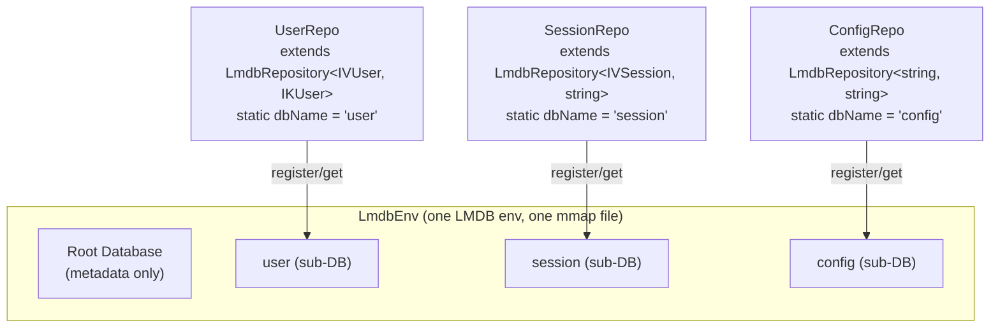
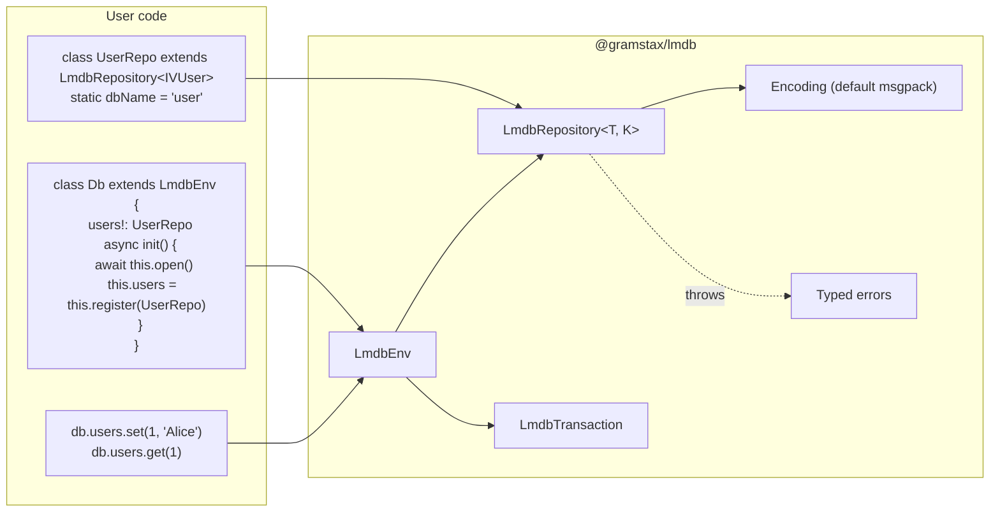
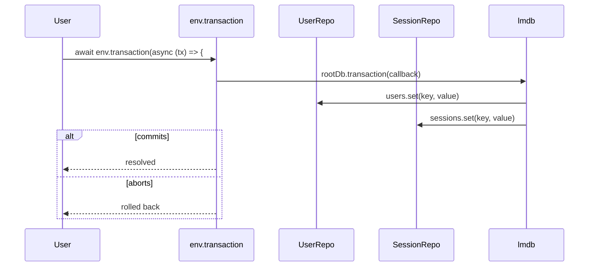

# @gramstax/lmdb

LMDB-backed key-value database with OOP Repository pattern per sub-database. Multi-runtime (Bun, Node.js >=18).

## Features

- **OOP Repository pattern** — each repository extends `LmdbRepository<T, K>` with a `static dbName` and owns an isolated sub-database
- **Cross-repository transactions** — atomic writes across multiple repositories via `env.transaction()`
- **Snapshot reads** — consistent point-in-time reads via `env.readTransaction()`
- **Root `Db` class** — `class Db extends LmdbEnv` with direct repo properties (`users!: UserRepo`)
- **Cross-repo access** — `this.env.getRepository(OtherRepo)` to access other repositories inside transactions
- **LMDB-native encoding** — default msgpack (fastest, supports `Date`/`Map`/`Set`/BigInt), opt into `encoding: "json"` for human-readable storage
- **Range queries & streaming** — `keys`/`values`/`entries`/`iterate` with start/end/limit/offset/reverse options
- **Read-only mode** — open envs as read-only for safe sharing
- **Async (Promise-based)** API

## Runtime Support

| Runtime | Status       | Notes               |
| ------- | ------------ | ------------------- |
| Bun     | ✅ Supported | `>= 1.0.0` — native |
| Node.js | ✅ Supported | `>= 18`             |

**Dependencies**: One runtime dep — [`lmdb`](https://www.npmjs.com/package/lmdb) — for the LMDB native binding via Node-API.

## Install

```bash
bun add @gramstax/lmdb
# or
npm install @gramstax/lmdb
```

## Quick Start

```typescript
import {LmdbEnv, LmdbRepository} from "@gramstax/lmdb"

// 1. Define a repository
type IKUser = number
type IVUser = {
  id: number
  name: string
  age: number
}

class UserRepo extends LmdbRepository<IVUser, IKUser> {
  static dbName = `user`
}

// 2. Root class extends LmdbEnv with direct repo properties
class Db extends LmdbEnv {
  users!: UserRepo
  private _ready: Promise<void>

  constructor(storePath: string) {
    super({path: storePath, maxDbs: 10, compression: true, encoding: `json`})
    this._ready = this._init()
  }

  private async _init() {
    await this.open()
    this.users = this.register(UserRepo)
  }

  async ready() {
    await this._ready
  }
}

// 3. Use it
const db = new Db(`./data`)
await db.ready()

await db.users.set(1, {id: 1, name: `Alice`, age: 30})
const alice = await db.users.get(1)
//    ^? IVUser | undefined

console.log(await db.users.count()) // 1

await db.close()
```

## Why a Root Db Class?

```typescript
// ✅ CORRECT — extends LmdbEnv, repos as direct properties
class Db extends LmdbEnv {
  users!: UserRepo
  sessions!: SessionRepo

  constructor(path: string) {
    super({path, maxDbs: 10, compression: true})
  }

  async init() {
    await this.open()
    this.users = this.register(UserRepo)
    this.sessions = this.register(SessionRepo)
  }
}
```

Extending gives you:
- Inherited `open()`, `close()`, `register()`, `transaction()`, `getRepository()`, `get()`
- No delegation layer — `db.transaction(...)` works directly
- Cleaner lifecycle management

## The Pattern: Repository-Per-Sub-DB

Each repository class declares a `static dbName`. At runtime, the env opens one LMDB sub-database per `dbName`, giving you isolated key-value namespaces with zero key collisions.



**Why sub-DBs over prefix-encoded keys?**
- **Clean cursor isolation** — range queries never leak across namespaces
- **Simple `count()`** — `repo.count()` is O(1) per sub-db
- **No manual prefix bounds** — no `item:user:123:` prefix logic

## Architecture Overview



**Key components:**

| Component            | Role                                                              |
| -------------------- | ----------------------------------------------------------------- |
| `LmdbEnv`            | Opens one LMDB env, manages sub-DBs, transactions, lifecycle      |
| `LmdbRepository<T, K>` | Typed CRUD over one sub-DB; subclass with `static dbName`       |
| `LmdbTransaction`    | Lifecycle API (`commit`/`abort`/`lifecycle`/`raw`)                |
| `ICodec<T>`          | Custom value transforms (optional; encoding set on `LmdbEnv` by default) |
| `LmdbError` + friends | Typed errors: `instanceof`-discriminable                         |

## Lifecycle

```typescript
// 1. Construct — init starts automatically
const db = new Db(`./data`)

// 2. Ready — wait for open + register to complete
await db.ready()

// 3. Use — repos are already registered
await db.users.set(1, {id: 1, name: `Alice`})
const user = await db.users.get(1)

// 4. Close — flushes and releases resources
await db.close()
```

For production, use a reusable init pattern:

```typescript
class Db extends LmdbEnv {
  users!: UserRepo
  sessions!: SessionRepo
  private _ready: Promise<void>

  constructor(storePath: string) {
    super({path: storePath, maxDbs: 10, compression: true, encoding: `json`})
    this._ready = this._init()
  }

  private async _init() {
    await this.open()
    this.users = this.register(UserRepo)
    this.sessions = this.register(SessionRepo)
  }

  async ready() {
    await this._ready
  }
}

// Usage
const db = new Db(`./data`)
await db.ready()
await db.users.set(1, {id: 1, name: `Alice`})
```

## Transactions

### When to Use

**Every read-then-write pattern MUST use `env.transaction()`:**

```typescript
// ✅ Atomic: read + write inside transaction
class UserRepo extends LmdbRepository<IVUser, IKUser> {
  static dbName = `user`

  async findOrCreate(id: number, name: string) {
    return this.env.transaction(async () => {
      const existing = await this.get(id)
      if (existing) {
        const updated = {...existing, name, updatedAt: Date.now()}
        await this.set(id, updated)
        return {user: updated, created: false}
      }
      const user: IVUser = {id, name, createdAt: Date.now(), updatedAt: Date.now()}
      await this.set(id, user)
      return {user, created: true}
    })
  }
}
```

```typescript
// ❌ Race condition: concurrent calls interleave between get and set
async findOrCreate(id: number, name: string) {
  const existing = await this.get(id)
  if (existing) {
    await this.set(id, {...existing, name})  // may overwrite concurrent change
  }
}
```

**When transactions are NOT needed:**
- Single writes (`set`, `delete`) — already atomic at LMDB level
- Read-only operations (`get`, `has`, `count`) — no write involved

### Cross-Repository Transactions

Use `this.env.getRepository(OtherRepo)` inside a transaction:

```typescript
class ItemRepo extends LmdbRepository<IVItem, string> {
  static dbName = `items`

  async create(userId: number, title: string) {
    const counter = this.env.getRepository(CounterRepo)
    return this.env.transaction(async () => {
      const id = await counter.nextId(userId)
      const item: IVItem = {id, title, createdAt: Date.now()}
      await this.set(`${userId}:${id}`, item)
      await counter.incr(userId)
      return item
    })
  }
}
```

### Cross-LmdbRepository Sequence Diagram



## API

### `LmdbEnv` (or your root `Db` class)

```typescript
// Standalone usage
const env = new LmdbEnv({path: `./data`})
await env.open()
env.register(UserRepo)

// Recommended: extends LmdbEnv with init() and direct repo properties
class Db extends LmdbEnv {
  users!: UserRepo

  constructor(path: string) {
    super({path, maxDbs: 10, compression: true})
  }

  async init() {
    await this.open()
    this.users = this.register(UserRepo)
  }
}
const db = new Db(`./data`)
await db.init()
await env.transaction(fn)               // cross-repo write transaction
await env.readTransaction(fn)           // snapshot read
await env.close()
```

**Constructor options:**

| Option         | Type    | Default       | Description                        |
| -------------- | ------- | ------------- | ---------------------------------- |
| `path`         | string  | **required**  | Filesystem path for data files     |
| `maxDbs`       | number  | `10`          | Max sub-databases                  |
| `compression`  | boolean | `false`       | LZ4 compression (off-thread)       |
| `encoding`     | string  | `msgpack`     | `msgpack`, `json`, `binary`, etc.  |
| `readOnly`     | boolean | `false`       | Open in read-only mode             |
| `mapSize`      | number  | `256 MB`      | Virtual memory mapping in bytes    |

### `LmdbRepository<T, K>`

```typescript
class UserRepo extends LmdbRepository<IVUser, number> {
  static dbName = `user`

  // Optional: static serialize / static deserialize / static codec
}

await repo.set(key, value, tx?)         // write (upsert)
const v = await repo.get(key, tx?)       // read (T | undefined)
const exists = await repo.has(key)       // boolean
const deleted = await repo.delete(key)   // boolean (true if existed)
await repo.clear()                       // remove all
const n = await repo.count()             // O(1), LMDB-maintained

// Range & iteration
const keys = await repo.keys(options?)         // K[]
const values = await repo.values(options?)      // T[]
const entries = await repo.entries(options?)    // [K, T][]
for await (const [k, v] of repo.iterate(options?)) { /* streaming */ }
const [firstKey, firstValue] = (await repo.first()) ?? []
const [lastKey, lastValue] = (await repo.last()) ?? []

// Batch & helpers
await repo.prefetch(keys)              // warm page cache
const many = await repo.getMany(keys)  // parallel reads
const matches = await repo.like(`prefix:*`)    // LIKE-style glob
const byPrefix = await repo.findByPrefix(`admin:`)  // prefix scan
const n = await repo.countByPrefix(`admin:`)   // O(log N + M)
```

The `env` property is public, so subclasses can call:

```typescript
this.env.transaction(fn)
this.env.getRepository(OtherRepo)
this.env.readOnly
```

### `LmdbTransaction`

```typescript
await env.transaction(async (tx) => {
  await userRepo.set(1, user)
  await sessionRepo.set(`s1`, session)
  tx.commit() // explicit commit (callback return auto-commits otherwise)
})

tx.lifecycle      // 'active' | 'committed' | 'aborted'
tx.done           // true when lifecycle !== 'active'
tx.isCommitted    // true after tx.commit()
tx.isAborted      // true after tx.abort()
tx.raw            // underlying LMDB read transaction (read-tx only)
```

## Encoding Choice

Set `encoding` when constructing your `LmdbEnv`:

```typescript
// Default — msgpack (fastest, supports Date/Map/Set/BigInt)
const env = new LmdbEnv({path: `./data`})

// Human-readable JSON storage
const env = new LmdbEnv({path: `./data`, encoding: `json`})
```

| Option            | Encoder                    | Use when                                        |
| ----------------- | -------------------------- | ----------------------------------------------- |
| `msgpack` (default) | msgpackr (binary)         | Default — fastest, supports Date/Map/Set/BigInt |
| `json`            | `JSON.stringify` / `parse` | Human-readable, debug-friendly, V8-native fast  |
| `binary`          | Raw `Buffer`               | Already-encoded binary payloads                  |
| `string`          | UTF-8 string               | String values                                   |
| `ordered-binary`  | Same encoding as keys       | `dupSort` indexes                               |

**Benchmark** (2,000 ops per encoding, fresh env, `process.hrtime.bigint`):

```
                          SMALL (4 fields)  MEDIUM (12 fields)  LARGE (40 fields)  HUGE (22KB)
msgpack         read p50:   84us              84us                161us              625us
json            read p50:   50us              65us                107us              691us
msgpack         size/value: 397B              790B                4.6KB              13.3KB
json            size/value: 397B              922B                4.6KB              22.1KB
```

For typical bot data (small objects under 1KB), `json` is faster for reads because V8's `JSON.parse` is highly optimized.

## Custom Codecs

Custom codecs run BEFORE LMDB encoding. Use for typed transforms that
LMDB's native encoders can't handle (e.g. `Date → number`):

```typescript
import {LmdbRepository, LmdbCodec} from "@gramstax/lmdb"

class DateRepo extends LmdbRepository<Date, string> {
  static dbName = `dates`
  static codec = LmdbCodec.create<Date, number>(
    (d) => d.getTime(),
    (n) => new Date(n)
  )
}
```

## Range Queries & Prefix Scans

```typescript
// Bounded range
await repo.entries({start: `user:`, end: `user:\uffff`, limit: 50})

// Efficient prefix scan (uses LMDB range scan internally)
const admins = await repo.findByPrefix(`admin:`)

// LIKE-style glob (prefix patterns use range scan, others use full scan + filter)
const matches = await repo.like(`admin:*`)   // range scan
const fuzzy = await repo.like(`*partial*`)   // full scan + regex filter
```

The `\uffff` sentinel character creates an exclusive upper bound — `${prefix}\uffff` is the first key that does NOT start with `${prefix}`.

## License

Proprietary — Copyright (c) 2026 Gramstax. See [LICENSE](./LICENSE).
