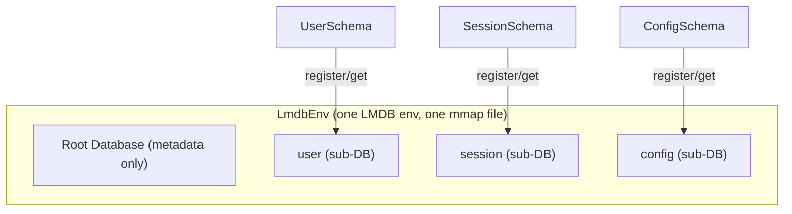

# @gramstax/lmdb

LMDB-backed key-value database with isolated sub-database namespaces per entity type. Multi-runtime (Bun, Node.js >=18).

## Why @gramstax/lmdb?

This package is a thin opinionated layer over lmdb-js — the Node/Bun binding for the LMDB embedded database. It does not abstract away LMDB's semantics; it codifies them into a consistent typed pattern. The value is in what you stop needing to do on every project:

**No sub-DB bookkeeping.** Raw lmdb-js requires you to call `root.openDB(name, opts)` for every sub-database, pass handles around manually, and remember to forward `encoding`, `compression`, and `cache` options every time. This package binds a schema class to a sub-DB at registration time — declare `static db`, and the wiring is automatic. Env-level options propagate to every sub-DB without repetition.

**No prefix-encoded keys.** Without sub-DBs, the established pattern is prefix-encoded keys (`"user:1"`, `"session:1"`) with manual inclusive-start / exclusive-end bounds for range queries. Each repository here owns a dedicated sub-DB — keys are intrinsically isolated, `count()` is O(1) per entity, and range scans never cross boundaries.

**Zero-overhead reads.** The underlying LMDB C calls for point lookups, existence checks, and cardinality are synchronous. Wrapping them in Promises would add a microtask with no benefit. `get()`, `has()`, and `count()` return values directly. Writes remain asynchronous — lmdb-js queues them and flushes in a batch on the next microtask, providing natural batching for single-key writes without explicit transactions.

**Cross-entity atomicity without ceremony.** Raw lmdb-js transactions are callback-based with manual error plumbing. This package lets you group reads and writes across any repositories inside a single `env.transaction()` call — one native LMDB write transaction, atomic commit or full rollback, no two-phase commit overhead.

**Consistent snapshot reads.** `env.readTransaction()` pins a read transaction at open time, giving a frozen point-in-time view that concurrent writers cannot affect. Useful for batch reports, exports, or queries that need consistency without blocking writes.

**Per-instance env isolation.** Each `LmdbEnv` opens its own LMDB environment. Multiple envs in the same process — read-only replicas, shards, or test fixtures — never share sub-DB handle caches. A problem that surfaces when lmdb-js caches `openDB` results on a shared prototype across `openAsClass` instances.

**Constructor-ready lifecycle.** The LMDB environment opens synchronously during `new LmdbEnv(...)`. No `await env.open()`, no deferred initialization point. The first read or write is safe immediately after construction.

## Runtime Support

| Runtime | Status       | Notes               |
| ------- | ------------ | ------------------- |
| Bun     | ✅ Supported | `>= 1.0.0` — native |
| Node.js | ✅ Supported | `>= 18`             |

**Dependencies**: One runtime dep — [`lmdb`](https://www.npmjs.com/package/lmdb) — for the LMDB native binding via Node-API.

## Install

```bash
bun add @gramstax/lmdb
# or
npm install @gramstax/lmdb
```

## Quick Start

Repositories are declared with `LmdbSchema` — extend it with `static db`, `static key` (a `t` builder), and `static value` (a map of `t` column builders), then pass the class to `register(SchemaClass)`. `register` returns a typed **`LmdbEnvSub`** handle — every sub method comes pre-bound to the schema, so callers never repeat it as argument 1. The handle is CACHED: `env.register(UserSchema) === env.sub(UserSchema)`. Sub operations exist ONLY on the handle — the former schema-class-first env methods (schema as first argument) and raw `dbName` overloads were removed in v1.x.

```typescript
import { LmdbEnv, LmdbEnvSub, LmdbSchema, t } from "@gramstax/lmdb";

// 1. Define a repository schema
class UserSchema extends LmdbSchema {
  static db = `user`;
  static key = t.number();
  static value = {
    id: t.number().unique(),   // SQL UNIQUE INDEX — duplicates throw LmdbUniqueConstraintError
    name: t.string(),
    age: t.number()
  };
}

// 2. Root class extends LmdbEnv — register schemas in the constructor
class Db extends LmdbEnv {
  users!: LmdbEnvSub<typeof UserSchema>; // typed handle, schema pre-bound

  constructor(storePath: string) {
    super({ path: storePath, maxDbs: 10, compression: true, encoding: `json` });
    this.users = this.register(UserSchema); // → LmdbEnvSub<typeof UserSchema>
  }
}

// 3. Use it — handle methods bind the schema; `get()` is synchronous
const db = new Db(`./data`);

await db.users.put(1, { id: 1, name: `Alice`, age: 30 });
const alice = db.users.get(1); // sync — no await!
//    ^? { id: number; name: string; age: number } | undefined

console.log(db.users.count()); // sync — 1

await db.close();
```

The handle is the only sub API — `register` returns it, `sub` fetches the cached one:

```typescript
db.users.put(1, user)                    // handle: schema pre-bound
db.sub(UserSchema).get(1)                // cached handle fetch + call
```

## Lifecycle

The native LMDB environment opens during construction — the `open()` system call happens synchronously inside `new LmdbEnv(...)`. No explicit `await env.open()` is needed. Closing flushes pending writes and releases the memory-mapped region, and also purges this env's handles from lmdb-js's internal `allDbs` registry so repeated open/close cycles do not accumulate process-lifetime references.

```typescript
// 1. Construct — LMDB env opens synchronously
const db = new Db(`./data`);

// 2. Use — env is immediately operational
await db.users.put(1, { id: 1, name: `Alice` });
const user = db.users.get(1); // synchronous read

// 3. Close — flush + release mmap
await db.close();
```

After `close()` every entry point throws `LmdbEnvClosedError` (sub reads/writes, env-level data ops, transactions) instead of surfacing raw lmdb native errors.

## Sub-Database Isolation

Each entity type maps to one LMDB sub-database (`mdb_dbi`). Sub-DBs share the same physical file and memory-mapped region but maintain independent B+ trees. This gives:

- **Cursor isolation** — a range query over the `"user"` sub-DB cannot see `"session"` keys. No prefix filtering needed.
- **O(1) cardinality** — `mdb_env_stat` reports exact entry count per sub-DB at zero marginal cost.
- **Zero key collisions** — keys are scoped to the sub-DB namespace. `"1"` in `"user"` and `"1"` in `"session"` are distinct entries.



## Transaction Model

### Write Transactions

Every LMDB write transaction has exclusive writer lock semantics — a single writer is active at any time. Multiple writes queued in the same event turn are batched into one native transaction by lmdb-js before the next microtask boundary.

`env.transaction()` wraps the native callback-based transaction. **Use a sync callback whenever possible** — both sync and async callbacks are atomic (the native write transaction stays open until the callback settles), but a sync callback commits in the same event turn and avoids promise overhead. Sub methods are non-async, making sync callbacks natural:

```typescript
// ✅ Recommended: sync callback — all writes batched atomically
const result = await env.transaction(() => {
  userRepo.put(`u1`, user);
  sessionRepo.put(`s1`, session);
  return { ok: true };
});

// ⚠️  Works atomically too, but slower: async callback
await env.transaction(async (tx) => {
  await userRepo.put(`u1`, user);
  await sessionRepo.put(`s1`, session);
  tx.abort(); // also rolls back correctly after an await
});
```

### Read Transactions

`env.readTransaction()` acquires an LMDB read transaction that pins a consistent snapshot. The raw read transaction is released when the callback completes. Inside the callback, sub reads receive the pinned snapshot by passing the transaction through — every read method (`get`/`has`/`count`/`keys`/`values`/`entries`/`iterate`/`like`/`findByPrefix`/`first`/`last`) accepts an optional trailing `tx` argument, so a frozen view is guaranteed regardless of concurrent writes:

### Atomicity Rules

| Pattern                                                | Safe? | Reason                                                |
| ------------------------------------------------------ | ----- | ----------------------------------------------------- |
| Single `put` or `delete`                               | ✅    | lmdb async writes are atomic per-key                  |
| `get` then `put` (no tx)                               | ❌    | Interleaving writer can modify between read and write |
| `get` then `put` (inside `env.transaction`)            | ✅    | Exclusive write lock covers both operations           |
| Multiple `put` across repos (inside `env.transaction`) | ✅    | Single native LMDB write transaction                  |
| Multiple `get` (inside `env.readTransaction`)          | ✅    | Snapshot isolation from pinned read transaction       |

## API

### `LmdbEnv` Constructor Options

Every option maps directly to lmdb-js `open()` parameters:

| Option              | Type             | Default          | Description                                             |
| ------------------- | ---------------- | ---------------- | ------------------------------------------------------- |
| `path`              | string           | **required**     | Filesystem path for data files                          |
| `maxDbs`            | number           | `128`            | Max sub-databases                                       |
| `encoding`          | string           | `msgpack`        | `msgpack`, `json`, `binary`, `string`, `ordered-binary` |
| `compression`       | boolean / object | `false`          | LZ4 compression (off-thread)                            |
| `readOnly`          | boolean          | `false`          | Open in read-only mode                                  |
| `mapSize`           | number           | `4 GB`           | Virtual memory mapping in bytes                         |
| `cache`             | boolean / object | `false`          | In-memory read cache                                    |
| `useVersions`       | boolean          | `false`          | Optimistic locking via version numbers                  |
| `keyEncoding`       | string           | `ordered-binary` | `uint32`, `binary`, `ordered-binary`                    |
| `dupSort`           | boolean          | `false`          | Allow duplicate entries per key                         |
| `noSync`            | boolean          | `false`          | Skip fsync (faster, crash-unsafe)                       |
| `encryptionKey`     | string / Buffer  | —                | ChaCha8 encryption (32 bytes)                           |
| `maxReaders`        | number           | `126`            | Max concurrent readers                                  |
| `pageSize`          | number           | OS default       | DB page size (4096/8192/16384)                          |
| `commitDelay`       | number (ms)      | `0`              | Batch writes before committing                          |
| `eventTurnBatching` | boolean          | `true`           | Batch writes in same event turn                         |

Sub-DB options (`compression`, `cache`, `encoding`, `useVersions`, `keyEncoding`, `dupSort`, `strictAsyncOrder`) are automatically forwarded from the env constructor to every sub-database — no need to repeat them per repository.

### Repository Registration

Repositories are declared as schema classes and registered against the env:

```
class UserSchema extends LmdbSchema { static db; static key; static value }  // declaration
env.register(UserSchema)                    // → typed handle — validates + attaches derived indexes
env.sub(UserSchema)                         // → the same cached instance (throws LmdbSchemaNotRegisteredError if absent)
env.isRegistered(UserSchema)                // → boolean — registered or not
```

- `register(SchemaClass)` is strict: re-registering the same class throws `LmdbSchemaAlreadyRegisteredError`; a second schema with the same `static db` throws `LmdbDuplicateDbNameError`.
- `env.sub(SchemaClass)` fetches the cached handle by its schema class; `env.isRegistered(SchemaClass)` checks whether it was registered — useful inside transactions and migrations, where the handle is not in scope.
- TTL: a schema with `static ttl` (ms) materializes a TTL repository (see [Custom transforms](#custom-transforms-writeread-hooks) and the TTL note in [LmdbSchema](#lmdbschema)).

### Repository Handle Dispatch Model

Sub methods dispatch to one of two LMDB code paths depending on whether the underlying C function is synchronous or returns a Future:

**Synchronous** (calls lmdb `Database.get` / `doesExist` / `getCount` directly — returns value in the same call frame):

```
repo.get(key, tx?)       → T | undefined       // mdb_get, sync
repo.getStrict(key, tx?) → T                    // like get, throws LmdbKeyNotFoundError
repo.has(key, tx?)       → boolean              // mdb_get existence probe, sync
repo.count(tx?)          → number               // mdb_env_stat entry count, sync
```

**Asynchronous** (returns a Promise — write operations queue through lmdb-js async batching, range materialization drains a lazy `RangeIterable`):

```
await repo.put(key, value, ttlOrTx?) → void      // queued put
await repo.delete(key, tx?)          → boolean   // queued remove
await repo.clear(tx?)                → void      // queued clearAsync
await repo.drop()                    → void      // queued sub-DB drop
await repo.prefetch(keys)            → void      // async page-fault

await repo.keys(options, tx?)        → K[]       // RangeIterable.asArray
await repo.values(options, tx?)      → T[]       // RangeIterable.asArray
await repo.entries(options, tx?)     → [K, T][]  // RangeIterable.asArray
await repo.first(tx?)                → [K, T] | undefined
await repo.last(tx?)                 → [K, T] | undefined
await repo.getMany(keys)             → (T | undefined)[]

await repo.like(pattern)         → [K, T][]
await repo.findByPrefix(prefix)  → [K, T][]
await repo.countByPrefix(prefix) → Promise<number>
await repo.deleteByPrefix(prefix)→ number     // rejects LmdbEmptyPrefixError on empty prefix

for await (const [k, v] of repo.iterate(options))  // lazy async generator
```

The `owner` property is public, giving access to transaction boundaries:

```
this.owner.transaction(fn)
this.owner.sub(OtherSchema).get(key)
this.owner.readOnly
```

### `LmdbTransaction` Lifecycle

```
tx.lifecycle      → 'active' | 'committed' | 'aborted' | 'released'
tx.done           → boolean (true when lifecycle !== 'active')
tx.isCommitted    → boolean
tx.isAborted      → boolean  // read txns that finished normally report false
tx.raw            → underlying LMDB Transaction (read-tx only)
tx.commit()       → marks wrapper committed (auto-commits on callback return)
tx.abort()        → rolls back the native transaction
```

## Encoding Architecture

LMDB natively serializes values using one of five encoders set per sub-DB at `openDB()` time. The encoding is NOT inherited from the root env — the wrapper explicitly forwards it to each sub-DB.

| Encoder             | Serializer                 | Use case                                        |
| ------------------- | -------------------------- | ----------------------------------------------- |
| `msgpack` (default) | msgpackr (binary)          | Default — fastest, supports Date/Map/Set/BigInt |
| `json`              | `JSON.stringify` / `parse` | Human-readable, V8-optimized for small objects  |
| `binary`            | Raw `Buffer`               | Already-encoded binary payloads                 |
| `string`            | UTF-8 string               | String-only values                              |
| `ordered-binary`    | Same encoding as keys      | `dupSort` index values                          |

Schema-level `hookBeforeWrite`/`hookBeforeRead` transforms can be stacked on top of LMDB encoding for custom formats (`Date → number`, encryption, compression) that run before the native serializer — see [Custom transforms](#custom-transforms-writeread-hooks).

## Custom transforms (write/read hooks)

The removed `LmdbCodec` class is replaced by optional `static hookBeforeWrite` / `static hookBeforeRead` functions on a schema. They transform rows at the repository boundary — `hookBeforeWrite` runs before LMDB serializes the value, `hookBeforeRead` after it deserializes it. Use them for types LMDB cannot represent natively, or for a compact stored form. They must be declared **together** or registration throws `LmdbError`:

```typescript
import { LmdbEnv, LmdbSchema, t } from "@gramstax/lmdb";

// Date → ms number at the boundary; the stored value is a plain object.
class DateSchema extends LmdbSchema {
  static db = `dates`;
  static key = t.string();
  static value = { at: t.date() };
  static hookBeforeWrite = (row: unknown): unknown => ({ at: (row as { at: Date }).at.getTime() });
  static hookBeforeRead = (raw: unknown): unknown => ({ at: new Date((raw as { at: number }).at) });
}
```

The schema's `static value` still drives the row type (`ValueOf`), so reads and writes stay typed while the on-disk representation is whatever `hookBeforeWrite`/`hookBeforeRead` produce.

## Embedded Indexes

Secondary indexes are declared as schema value columns. There is no manual index sub-DB wiring and no separate index helper class — the legacy `NonUniqueIndex`/`SecondaryIndex` helpers were removed. Each declared index gets an auto-created sub-DB (`{db}:idx:{name}`) and is maintained in the same writer transaction as the primary write.

```typescript
import { LmdbEnv, LmdbSchema, t } from "@gramstax/lmdb";

class UserSchema extends LmdbSchema {
  static db = `users`;
  static key = t.number();

  // id: SQL CREATE UNIQUE INDEX — duplicates throw LmdbUniqueConstraintError
  // email: SQL CREATE INDEX — duplicates allowed (many users, one address)
  // lowerEmail: `.index(name)` overrides the derived index name (auto-resolves value.lowerEmail)
  static value = {
    id: t.number().unique(),
    username: t.string().unique(),
    email: t.string().index(),
    lowerEmail: t.string().index(`lowerEmail`)
  };
}

class Db extends LmdbEnv {
  constructor(path: string) {
    super({ path, maxDbs: 10 });
    this.register(UserSchema); // attaches the index sub-DBs
  }
}

const db = new Db(`./data`);
const users = db.sub(UserSchema); // cached handle — schema pre-bound

await users.put(1, { id: 1, username: `damar`, email: `Damar@Example.com`, lowerEmail: `damar@example.com` });

await users.findByIndex({ email: `Damar@Example.com` });     // non-unique → UserRow[]
await users.findByIndex({ username: `damar` });               // unique → UserRow | undefined
await users.findByIndex({ lowerEmail: `damar@example.com` }); // explicit name lookup
```

Semantics:

- **Object-query reads.** `findByIndex(query, tx?)` is the single read API — no more `findByIndex`/`findOneByIndex` split (the old `findOneByIndex` was never released). The query maps declared index names to values; every key is ANDed, and unique and non-unique indexes are queried alike. The optional `tx` argument keeps every point read of the query (index lookups + primary fetches) on the same snapshot, so `findByIndex(query, tx)` inside `readTransaction`/`transaction` sees a consistent view. Return shape is driven by the *uniqueness of the queried keys*:
  - all queried keys are unique (`{ username: ... }`, `{ username, email }` on two unique indexes) → `T | undefined`
  - any queried key is non-unique (`{ email: ... }`, `{ username, email }` where email is non-unique) → `T[]`
  - multi-key queries AND the keys — the driver key (unique indexes tried first, then non-unique) seeds the candidates and the remaining keys filter them; contradictory keys yield no match (`undefined`/`[]`), never an error.
  - `{}` (no keys), a `null`/`undefined` value, or an undeclared index name each throw `LmdbError`. Unknown query keys are also compile errors: the schema's index map (`SchemaIndexesOf`) types `findByIndex` per schema.
- **Auto-resolved paths.** Without an `extractor`, the index name is treated as a field path on the value. Dotted paths work: `"profile.email": t.string().index()` indexes `value.profile.email`. A field resolving to `undefined` or `null` skips the entry, so that record is findable only by primary key. (Class-style custom `extractor`s are gone — schema indexes auto-resolve field paths only.)
- **Unique conflicts throw.** A write whose unique index value is already owned by a different primary key rejects with `LmdbUniqueConstraintError` and rolls back. Re-putting the same key with the same value (self-update) is allowed.
- **Atomic writes.** Primary value and index rows land in one writer transaction, so concurrent writers can never leave them inconsistent.
- **Updates free the old value.** Changing an indexed field removes the old index row and inserts the new one in the same transaction.
- **`reindex()` rebuilds.** `await repo.reindex()` clears and rebuilds every index from primary data, resolving `{ built, skipped }`; `reindex(name)` rebuilds one index. Records whose value collides on a unique index are reported in `skipped` instead of failing the rebuild.
- **Bulk deletes clean indexes.** `deleteByPrefix()` and `clear()` remove the index rows of every deleted record; `putMany` and `update` maintain indexes per entry.
- **TTL repos supported.** Extractors run on the unwrapped value (before the expiry envelope), and `purgeExpired` removes index rows with the record.
- **`increment`/`putBinary` forbidden.** Both reject with `LmdbError` on indexed subs, since they would leave the index stale. Keep counters in a separate non-indexed sub.
- **Unknown index names throw.** An undeclared query key throws `LmdbError` listing the declared indexes.
- **`useVersions` note.** Unique index sub-DBs inherit the env's versions; non-unique (dupSort) index sub-DBs opt out (`useVersions: false` in construction opts), because LMDB rejects `dupSort` combined with versions. `compareAndSet` works on indexed subs opened with `useVersions: true`.

## LmdbSchema

`LmdbSchema` is the single sub declaration path — a Drizzle-inspired declarative layer over the sub-DB engine. Describe a sub as a schema class with `static db`, `static key`, and `static value` (a map of `t` column builders), then pass the class to `register(SchemaClass)`. All operations run on the returned `LmdbEnvSub` handle — schema pre-bound, no repeated class argument. Row type, key type, and per-query `findByIndex` narrowing all flow from the column definitions via `ValueOf`, `KeyOf`, and `SchemaIndexesOf`. (The former class-style `LmdbRepository` subclass with `static dbName` / `static indexes` / `static codec` is removed — see [Migrating from class-style](#migrating-from-class-style).)

```typescript
import { LmdbEnv, LmdbSchema, t } from "@gramstax/lmdb";
class UserSchema extends LmdbSchema {
  static db = `users`

  static key = t.number()              // primary key — required, never unique/indexed
  static value = {
    id: t.number().unique(),      // SQL CREATE UNIQUE INDEX — duplicates throw LmdbUniqueConstraintError
    username: t.string().index(), // SQL CREATE INDEX — duplicates allowed
    email: t.string(),
    tags: t.array().nullable(),   // undefined values are stored as absent
    createdAt: t.date()
  } // no `as const` needed — builder generics carry the literal index markers
}

type UserRow = ValueOf<typeof UserSchema>

class Db extends LmdbEnv {
  constructor(path: string) {
    super({ path, maxDbs: 10 })
    this.register(UserSchema) // schema class → typed sub
  }
}

const db = new Db(`./data`)
const users = db.sub(UserSchema) // cached handle — schema pre-bound

await users.put(1, { id: 1, username: `damar`, email: `damar@example.com`, tags: [`admin`], createdAt: new Date() })

await users.findByIndex({ id: 1 })             // unique key → user | undefined
await users.findByIndex({ username: `damar` }) // non-unique key → user[]
```

**Column builders** — every kind maps to a TypeScript type; `.nullable()` on any builder widens it with `| undefined`:

| Builder       | Value type                | Notes          |
| ------------- | ------------------------- | -------------- |
| `t.string()`  | `string`                  |                |
| `t.number()`  | `number`                  |                |
| `t.bigint()`  | `bigint`                  | msgpack-native |
| `t.boolean()` | `boolean`                 |                |
| `t.object()`  | `Record<string, unknown>` | Generic `t.object<T>()` narrows to `T` |
| `t.array()`   | `unknown[]`               | Generic `t.array<T>()` narrows to `T[]` |
| `t.date()`    | `Date`                    | msgpack-native |
| `t.buffer()`  | `Uint8Array`              |                |

**Index declaration.** `.unique()` marks the column as a unique index (implies indexed); `.index(name?)` marks it as a non-unique index under an explicit name (defaults to the column name). The `static key` is the primary key and must not be indexed. Derived indexes ride the same embedded-index machinery as the removed `static indexes` block, so every semantics carries over: atomic maintenance with primary writes, `LmdbUniqueConstraintError` on unique conflict, `reindex()` rebuilds, `delete` cleans index rows.

**Type inference.** `ValueOf<typeof UserSchema>` is the row value type; `KeyOf` and `SchemaIndexesOf` supply the key type and index map — `env.sub(UserSchema).put(...)` / `env.sub(UserSchema).findByIndex(...)` are fully typed from the schema class. No `as const` is needed on `static value` — the builder generics carry the literal index markers, so `unique: true`-style narrowing keeps working. All of these are type-level only — nothing exists at runtime to dereference.

**Custom transforms.** Optional `static hookBeforeWrite` / `static hookBeforeRead` functions transform rows at the repository boundary — `hookBeforeWrite` runs before LMDB serializes the value, `hookBeforeRead` after it deserializes it (e.g. storing a `Date` field as a ms `number`). They must be declared **together** or registration throws `LmdbError` — see [Custom transforms](#custom-transforms-writeread-hooks).

**TTL.** Optional `static ttl` (ms) materializes a TTL sub: every `put` stores an expiry envelope and reads (`get`/`has`) treat expired entries as missing. Priority: per-put `{ttlMs}` override → `static ttl` → never expires. Declaring `static ttl = 0` still materializes a TTL sub (so per-call `{ttlMs}` and `purgeExpired` are available) but adds no default expiry. The TTL-specific members (`put(..., {ttlMs})`, `purgeExpired`) are typed via `LmdbTtlCollection`; narrow the registered handle with a cast when you need them:

```typescript
import { LmdbTtlCollection } from "@gramstax/lmdb";

class SessionSchema extends LmdbSchema {
  static db = `sessions`
  static key = t.string()
  static value = { userId: t.string(), token: t.string() }
  static ttl = 0 // TTL repository, no default expiry
}

const sessions = env.register(SessionSchema) as unknown as LmdbTtlCollection<ValueOf<typeof SessionSchema>, KeyOf<typeof SessionSchema>>
await sessions.put(`s1`, { userId: `u1`, token: `tok` }, { ttlMs: 80 })
const purged = await sessions.purgeExpired()
```

**Key types.** lmdb-js keys are `Key[] | string | symbol | number | boolean | Uint8Array`, and `register(SchemaClass)` intersects the inferred key with that union. `t.string()`, `t.number()`, `t.boolean()`, `t.array()` (composite keys like `["tenant-a", "u1"]`), and `t.buffer()` keys are valid; a `t.bigint()` key column degrades to `never` at the type level through the `KeyOf` intersection (runtime unchanged) — prefer number/string keys.

**Scalar values and dupSort.** Schemas can model non-row shapes with a scalar `static value` — a single `t` builder instead of a column map: bare-number subs (counters with `increment`/`decrement`, which require the stored value itself to be a number), string/blob values, and `dupSort` sub-DBs (one key → many ordered values, e.g. `tag → postId` tables, via `static dupSort = true`). `ValueOf<S>` resolves to the scalar type, so all sub methods stay typed. The former `_createRepo` escape hatch is gone — `register` is the only registration path.

```typescript
class CounterSchema extends LmdbSchema {
  static db = `counter`
  static key = t.string()
  static value = t.number()
}
const counters = env.register(CounterSchema)
await counters.increment(`order-seq`) // 1

class TagIndexSchema extends LmdbSchema {
  static db = `tag-index`
  static key = t.string()
  static value = t.string()
  static dupSort = true
}
const tags = env.register(TagIndexSchema)
await tags.addValue(`post:1`, `tag:js`)
await tags.getValues(`post:1`) // [`tag:js`]
```

## Migrating from class-style

Version 1.x declared repositories as `LmdbRepository` subclasses with `static dbName` (plus `static indexes` for embedded indexes, `static codec`/`serialize`/`deserialize` for transforms, and `static ttlMs` for TTL). Those paths are removed — `register()` accepts schema classes only, `LmdbCodec` is deleted, and the class-style declaration is a compile error.

The migration is mechanical:

| Class-style                                          | Schema-style                                           |
| ---------------------------------------------------- | ------------------------------------------------------ |
| `class X extends LmdbRepository<T, K>` + `static dbName` | `class X extends LmdbSchema` + `static db` + `static key` + `static value` |
| `static indexes = { email: { unique: true } }`       | `email: t.string().unique()` in `static value`         |
| `static indexes = { email: {} }`                     | `email: t.string().index()` in `static value`          |
| `static codec` / `static serialize` / `static deserialize` | `static hookBeforeWrite` / `static hookBeforeRead` on the schema |
| `static ttlMs = 80`                                  | `static ttl = 80`                                      |
| `register(RepoClass)` / `get(RepoClass)` on the env (class-style, removed) | `env.register(XSchema)` / `env.sub(XSchema)`           |
| custom `extractor`s and `{dbName}` overrides         | not expressible in schemas — move the logic to a service layer (schema + service class holding the sub handle) |

Custom domain methods move to a service layer: keep the schema class for storage (db/key/value) and put business logic in a service class that receives the `Db` (env subclass) and calls `env.sub(Schema).put(...)` directly.

For the full step-by-step guide, see `rules/ctx-db/MIGRATION_GUIDE.md` in the gramstax repo.

## Range Query Model

Range queries use LMDB cursors exposed through lmdb-js's lazy `RangeIterable`. The iterator is created synchronously (no data read yet), and materialization via `.asArray` drains it asynchronously in a microtask. This means `keys()`/`values()`/`entries()`/`first()`/`last()`/`like()`/`findByPrefix()` all return Promises even though cursor creation is synchronous.

Prefix patterns (`"admin:*"`) are optimized into bounded range scans `[prefix, prefixEnd)` — the `start` and `end` bounds are computed from the literal prefix portion of the glob. Non-prefix patterns fall back to full scans with JavaScript regex filtering on the key.

```typescript
// Bounded range cursor → [start, end) exclusive
await repo.entries({ start: `user:`, end: `user:\uffff`, limit: 50 });

// Prefix scan — same cursor bounds, no regex
await repo.findByPrefix(`admin:`);

// Glob patterns — prefix shape optimized, otherwise full scan
await repo.like(`admin:*`); // range scan
await repo.like(`*partial*`); // full scan + regex filter
```

The `\uffff` sentinel produces the first key that sorts after any prefix — it is the exclusive upper bound for a prefix range scan.

### Materialization Guardrail

`keys()`/`values()`/`entries()`/`like()`/`findByPrefix()`/`deleteByPrefix()` materialize the entire result set into memory, so `MAX_MATERIALIZE` caps them at `100_000` entries. Any call that would return more entries than the cap — or that passes a `{limit}` above it — rejects with `LmdbMaterializationError`.

**For result sets larger than 100k entries, use `iterate()`** — it streams entries lazily and is never guarded:

```typescript
for await (const [k, v] of repo.iterate()) {
  // one entry at a time — no array materialization
}

// ❌ LmdbMaterializationError: would materialize more than 100_000 entries
// await repo.values();
```

## Queues

`LmdbQueue` is a FIFO queue over a dedicated sub-DB per queue name. The queue is declared as a schema class — its `static db` is the queue name and its value shape is the payload row. Enqueue bumps a monotonic sequence counter (kept in a shared `__queue_meta` sub-DB) and writes the payload in **one synchronous transaction** (`env.transactionSync`) — the generated zero-padded id and the payload commit atomically, so FIFO order is preserved even across processes. Dequeue reads the head through a synchronous cursor and removes it in one synchronous transaction (at-least-once semantics).

```typescript
import { LmdbEnv, LmdbQueue, LmdbSchema, t } from "@gramstax/lmdb";

class JobSchema extends LmdbSchema {
  static db = `jobs`
  static key = t.string()
  static value = {
    type: t.string(),
    data: t.object<{ to: string }>()
  }
}

const env = new LmdbEnv({ path: `./data` });
const queue = new LmdbQueue(env, JobSchema);

// Single-transaction enqueue — counter bump + payload write commit together
const id = await queue.enqueue({ type: `email`, data: { to: `a@b.c` } });

const head = await queue.peek();    // head without removing
const job = await queue.dequeue();  // atomic read + delete (single txn)
const size = await queue.size();    // number of queued jobs
await queue.clear();                // drain the queue
```

Constructing a second `LmdbQueue` with the same schema is idempotent — it reuses the already-registered sub instead of throwing `LmdbDuplicateDbNameError`.

## License

Proprietary — Copyright (c) 2026 Gramstax. See [LICENSE](./LICENSE).
