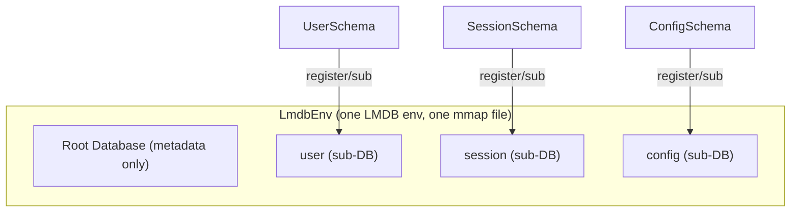

# @gramstax/lmdb

LMDB-backed key-value database with isolated sub-database namespaces per entity type. Multi-runtime (Bun, Node.js >=18).

## Why @gramstax/lmdb?

This package is a thin opinionated layer over lmdb-js — the Node/Bun binding for the LMDB embedded database. It does not abstract away LMDB's semantics; it codifies them into a consistent typed pattern. The value is in what you stop needing to do on every project:

**No sub-DB bookkeeping.** Raw lmdb-js requires you to call `root.openDB(name, opts)` for every sub-database, pass handles around manually, and remember to forward `encoding`, `compression`, and `cache` options every time. This package binds a schema class to a sub-DB at registration time — declare `static db`, and the wiring is automatic. Env-level options propagate to every sub-DB without repetition.

**No prefix-encoded keys.** Without sub-DBs, the established pattern is prefix-encoded keys (`"user:1"`, `"session:1"`) with manual inclusive-start / exclusive-end bounds for range queries. Each repository here owns a dedicated sub-DB — keys are intrinsically isolated, `count()` is O(1) per entity, and range scans never cross boundaries.

**Zero-overhead reads.** The underlying LMDB C calls for point lookups, existence checks, and cardinality are synchronous. Wrapping them in Promises would add a microtask with no benefit. `get()`, `has()`, and `count()` return values directly. Writes remain asynchronous — lmdb-js queues them and flushes in a batch on the next microtask, providing natural batching for single-key writes without explicit transactions.

**Cross-entity atomicity without ceremony.** Raw lmdb-js transactions are callback-based with manual error plumbing. This package lets you group reads and writes across any repositories inside a single `env.transaction()` call — one native LMDB write transaction, atomic commit or full rollback, no two-phase commit overhead.

**Consistent snapshot reads.** `env.readTransaction()` pins a read transaction at open time, giving a frozen point-in-time view that concurrent writers cannot affect. Useful for batch reports, exports, or queries that need consistency without blocking writes.

**Per-instance env isolation.** Each `LmdbEnv` opens its own LMDB environment. Multiple envs in the same process — read-only replicas, shards, or test fixtures — never share sub-DB handle caches. A problem that surfaces when lmdb-js caches `openDB` results on a shared prototype across `openAsClass` instances.

**Constructor-ready lifecycle.** The LMDB environment opens synchronously during `new LmdbEnv(...)`. No `await env.open()`, no deferred initialization point. The first read or write is safe immediately after construction.

## Runtime Support

| Runtime | Status       | Notes               |
| ------- | ------------ | ------------------- |
| Bun     | ✅ Supported | `>= 1.0.0` — native |
| Node.js | ✅ Supported | `>= 18`             |

**Dependencies**: Two runtime deps — [`lmdb`](https://www.npmjs.com/package/lmdb) for the LMDB native binding via Node-API, and [`croner`](https://www.npmjs.com/package/croner) (MIT, zero deps) for the cron scheduler behind `LmdbBackup.start`.

## Install

```bash
bun add @gramstax/lmdb
# or
npm install @gramstax/lmdb
```

## Quick Start

Repositories are declared with `LmdbSchema` — extend it with `static db`, `static key` (a `t` builder), and `static value` (a map of `t` column builders), then pass the class to `register(SchemaClass)`. `register` returns a typed **`LmdbEnvSub`** handle — every sub method comes pre-bound to the schema, so callers never repeat it as argument 1. The handle is CACHED: `env.register(UserSchema) === env.sub(UserSchema)`. Sub operations exist ONLY on the handle — the former schema-class-first env methods (schema as first argument) and raw `dbName` overloads were removed in v1.x.

```typescript
import { LmdbEnv, LmdbEnvSub, LmdbSchema, t } from "@gramstax/lmdb";

// 1. Define a repository schema
class UserSchema extends LmdbSchema {
  static db = `user`;
  static key = t.number();
  static value = {
    id: t.number().unique(),   // SQL UNIQUE INDEX — duplicates throw LmdbError
    name: t.string(),
    age: t.number()
  };
}

// 2. Root class extends LmdbEnv — register schemas in the constructor
class Db extends LmdbEnv {
  users!: LmdbEnvSub<typeof UserSchema>; // typed handle, schema pre-bound

  constructor(storePath: string) {
    super({ path: storePath, maxDbs: 10, compression: true, encoding: `json` });
    this.users = this.register(UserSchema); // → LmdbEnvSub<typeof UserSchema>
  }
}

// 3. Use it — handle methods bind the schema; `get()` is synchronous
const db = new Db(`./data`);

await db.users.put(1, { id: 1, name: `Alice`, age: 30 });
const alice = db.users.get(1); // sync — no await!
//    ^? { id: number; name: string; age: number } | undefined

console.log(db.users.count()); // sync — 1

await db.close();
```

The handle is the only sub API — `register` returns it, `sub` fetches the cached one:

```typescript
db.users.put(1, user)                    // handle: schema pre-bound
db.sub(UserSchema).get(1)                // cached handle fetch + call
```

Beyond point reads: full-text search (`t.string().search()` + `sub.search()`), concatenated-key composite indexes (`.index([`a`, `b`])`), change-data-capture (`env.subscribe` / `tailCdc` / `ackCdc` / `pruneCdc`), managed migrations (`env.migrate` with transform backfills), differential sync (`sub.syncTo`), and sorted bulk import (`putMany(entries, chunkSize?, {sorted: true})`) — see [Embedded Indexes](#embedded-indexes), [LmdbSchema](#lmdbschema), and `example/search-cdc-demo.ts`.

## Lifecycle

The native LMDB environment opens during construction — the `open()` system call happens synchronously inside `new LmdbEnv(...)`. No explicit `await env.open()` is needed. Closing flushes pending writes and releases the memory-mapped region, and also purges this env's handles from lmdb-js's internal `allDbs` registry so repeated open/close cycles do not accumulate process-lifetime references.

```typescript
// 1. Construct — LMDB env opens synchronously
const db = new Db(`./data`);

// 2. Use — env is immediately operational
await db.users.put(1, { id: 1, name: `Alice`, age: 30 });
const user = db.users.get(1); // synchronous read

// 3. Close — flush + release mmap
await db.close();
```

After `close()` every data/transaction entry point throws `LmdbError` (sub reads/writes, env-level data ops, transactions) instead of surfacing raw lmdb native errors. Exceptions: `resetReadTxn()` is an intentional no-op after `close`, and `isRegistered()` never throws.

## Sub-Database Isolation

Each entity type maps to one LMDB sub-database (`mdb_dbi`). Sub-DBs share the same physical file and memory-mapped region but maintain independent B+ trees. This gives:

- **Cursor isolation** — a range query over the `"user"` sub-DB cannot see `"session"` keys. No prefix filtering needed.
- **O(1) cardinality** — `mdb_env_stat` reports exact entry count per sub-DB at zero marginal cost.
- **Zero key collisions** — keys are scoped to the sub-DB namespace. `"1"` in `"user"` and `"1"` in `"session"` are distinct entries.



## Transaction Model

### Write Transactions

Every LMDB write transaction has exclusive writer lock semantics — a single writer is active at any time. Multiple writes queued in the same event turn are batched into one native transaction by lmdb-js before the next microtask boundary.

`env.transaction()` wraps the native callback-based transaction. **Use a sync callback whenever possible.** Both sync and async callbacks are atomic — the native write transaction stays open until the callback settles — but a sync callback leaves no `await` inside the open transaction, which is what keeps `tx.abort()` and throw-rollback reliable, and it avoids promise overhead. Sub methods are non-async, making sync callbacks natural:

```typescript
// ✅ Recommended: sync callback — all writes batched atomically
const result = await env.transaction(() => {
  users.put(`u1`, user);
  sessions.put(`s1`, session);
  return { ok: true };
});

// ⚠️  Works atomically too, but slower: async callback
await env.transaction(async (tx) => {
  await users.put(`u1`, user);
  await sessions.put(`s1`, session);
  tx.abort(); // also rolls back correctly after an await
});
```

`tx.abort()` — and a callback that throws — roll the transaction back. That is what makes `transaction()` the right default for read-then-write logic.

**An `async` callback is allowed here — and discouraged, because of what it does to the transaction window.** The signature is `T | Promise<T>`, so `async` compiles and runs everywhere in this package. But an `await` inside the callback keeps the native write transaction open across a microtask, and LMDB permits exactly one writer at a time. Writes queued by unrelated code during that window are pulled into **this** transaction, so the commit contains work you did not write, and a long callback stalls every other writer in the process.

The practical consequence on this method is that `tx.abort()` rolls those foreign writes back too — your rollback discards somebody else's committed-intent work. Prefer a sync callback, and keep the transaction to the reads and writes it actually needs.

### `transactionFast`: commit off the main thread, no rollback

`env.transactionFast()` is the counterpart for when you do **not** need rollback. Same atomicity — one native write transaction, invisible to other processes until it commits — but the commit is handed to lmdb-js's writer thread instead of blocking the main thread, and it batches with other writes queued in the same event turn:

```typescript
await env.transactionFast(() => {
  users.putSync(`u1`, user);
  sessions.putSync(`s1`, session);
});
```

**The trade-off is rollback, and it is genuinely unavailable here.** lmdb-js's `db.transaction()` records a callback error and rethrows it, but never calls `mdb_txn_abort` — the native transaction commits either way. So:

| | `transaction()` | `transactionFast()` |
| --- | --- | --- |
| `tx.abort()` rolls back | ✅ | ❌ **throws `LmdbError`** |
| Callback throws | rolled back | **writes already made are committed** |
| Commit blocks main thread | yes | no |

Same rule on `async` callbacks: discouraged, for the same reason. An `await` keeps the write transaction open, and writes queued by other code during that window are pulled into it — on this method you cannot even roll them back. Handing the commit to the writer thread does not shorten the window, it only relocates it.

One note on the upstream docs, since it reads as if the two lmdb-js primitives differ here. `lmdb` warns against `async` callbacks under `db.transaction()` ("not recommended", foreign writes join the transaction, surprising ordering) and gives only the softer "minimize how long a transaction is open on the main thread" under `db.transactionSync()`. Measured against this package, the **leak is the same on both** — an `await` pulls in queued writes either way. What genuinely differs between `transaction()` and `transactionFast()` is rollback, not leakage.

The package uses it for bulk work where partial application is harmless — `deleteByPrefix`, `putMany`, CDC pruning. It deliberately does **not** use it for the paths that need rollback: unique-index conflict handling (a committed row without its index entry would corrupt the index), `migrate` (`up()` runs inside the transaction), or `purgeExpired` (it counts `removeSync` return values, which the queued path does not reflect the same way).

Reach for `transaction()` whenever the outcome depends on the callback failing partway.

### Read Transactions

`env.readTransaction()` acquires an LMDB read transaction that pins a consistent snapshot. The raw read transaction is released when the callback completes. Inside the callback, sub reads receive the pinned snapshot by passing the transaction through — every read method (`get`/`has`/`count`/`keys`/`values`/`entries`/`iterate`/`like`/`findByPrefix`/`first`/`last`) accepts an optional trailing `tx` argument, so a frozen view is guaranteed regardless of concurrent writes:

### Atomicity Rules

| Pattern                                                | Safe? | Reason                                                |
| ------------------------------------------------------ | ----- | ----------------------------------------------------- |
| Single `put` or `delete`                               | ✅    | lmdb async writes are atomic per-key                  |
| `get` then `put` (no tx)                               | ❌    | Interleaving writer can modify between read and write |
| `get` then `put` (inside `env.transaction`)            | ✅    | Exclusive write lock covers both operations           |
| Multiple `put` across repos (inside `env.transaction`) | ✅    | Single native LMDB write transaction                  |
| Multiple `get` (inside `env.readTransaction`)          | ✅    | Snapshot isolation from pinned read transaction       |
| Read-then-write needing rollback on failure           | ✅    | Use `env.transaction()` — `transactionFast` cannot roll back |

## API

### `LmdbEnv` Constructor Options

Every option maps directly to lmdb-js `open()` parameters:

| Option              | Type             | Default          | Description                                             |
| ------------------- | ---------------- | ---------------- | ------------------------------------------------------- |
| `path`              | string           | **required**     | Filesystem path for data files                          |
| `maxDbs`            | number           | `128`            | Max sub-databases                                       |
| `encoding`          | string           | `msgpack`        | `msgpack`, `json`, `cbor`, `binary`, `string`, `ordered-binary` |
| `compression`       | boolean / object | `false`          | LZ4 compression (off-thread)                            |
| `readOnly`          | boolean          | `false`          | Open in read-only mode                                  |
| `mapSize`           | number           | `4 GB`           | Virtual memory mapping in bytes                         |
| `cache`             | boolean / object | `false`          | In-memory read cache                                    |
| `useVersions`       | boolean          | `false`          | Optimistic locking via version numbers                  |
| `keyEncoding`       | string           | `ordered-binary` | `uint32`, `binary`, `ordered-binary`                    |
| `dupSort`           | boolean          | `false`          | Allow duplicate entries per key                         |
| `noSync`            | boolean          | `false`          | Skip fsync (faster, crash-unsafe)                       |
| `encryptionKey`     | string / Buffer  | —                | ChaCha8 encryption (32 bytes)                           |
| `maxReaders`        | number           | `126`            | Max concurrent readers                                  |
| `pageSize`          | number           | OS default       | DB page size (4096/8192/16384)                          |
| `commitDelay`       | number (ms)      | `0`              | Batch writes before committing                          |
| `eventTurnBatching` | boolean          | `true`           | Batch writes in same event turn                         |
| `onWarn`            | `(message: string) => void` | — (silent) | Diagnostics sink — see [Diagnostics](#diagnostics) |

Sub-DB options (`compression`, `cache`, `encoding`, `useVersions`, `keyEncoding`, `dupSort`, `strictAsyncOrder`) are automatically forwarded from the env constructor to every sub-database — no need to repeat them per repository.

### Repository Registration

Repositories are declared as schema classes and registered against the env:

```
class UserSchema extends LmdbSchema { static db; static key; static value }  // declaration
env.register(UserSchema)                    // → typed handle — validates + attaches derived indexes
env.sub(UserSchema)                         // → the same cached instance (throws LmdbError if absent)
env.isRegistered(UserSchema)                // → boolean — registered or not
```

- `register(SchemaClass)` is strict: re-registering the same class throws `LmdbError`; a second schema with the same `static db` throws `LmdbError`.
- `env.sub(SchemaClass)` fetches the cached handle by its schema class; `env.isRegistered(SchemaClass)` checks whether it was registered — useful inside transactions and migrations, where the handle is not in scope.
- TTL: a schema with `static ttl` (ms) materializes a TTL repository (see the TTL note in [LmdbSchema](#lmdbschema)).

### Repository Handle Dispatch Model

Sub methods dispatch to one of two LMDB code paths depending on whether the underlying C function is synchronous or returns a Future:

**Synchronous** (calls lmdb `Database.get` / `doesExist` / `getCount` directly — returns value in the same call frame):

```
sub.get(key, tx?)       → T | undefined       // mdb_get, sync
sub.getStrict(key, tx?) → T                    // like get, throws LmdbError
sub.has(key, tx?)       → boolean              // mdb_get existence probe, sync
sub.count(tx?)          → number               // mdb_env_stat entry count, sync
sub.getKeys(options?)   → Iterable<K>          // sync cursor walk, never guarded
sub.getEntry(key)       → {version, value} | undefined  // sync, with version
```

**Asynchronous** (returns a Promise — write operations queue through lmdb-js async batching, range materialization drains a lazy `RangeIterable`):

```
await sub.put(key, value, ttlOrTx?) → void      // queued put
await sub.putIfNotExists(key, value) → boolean // queued conditional put
await sub.delete(key, tx?)          → boolean   // queued remove
await sub.clear(tx?)                → void      // queued clearAsync
await sub.drop()                    → void      // queued sub-DB drop
await sub.prefetch(keys)            → void      // async page-fault
sub.putSync(key, value)             → void      // sync write, for transaction callbacks
sub.removeSync(key)                 → boolean   // sync remove, for transaction callbacks

await sub.putMany(entries, chunk?, {sorted?, onProgress?}) → void  // chunked batch; {sorted} uses MDB_APPEND
await sub.importJSONL(jsonl, {sorted?, onProgress?}) → number       // per committed chunk
await sub.keys(options, tx?)        → K[]       // RangeIterable.asArray
await sub.values(options, tx?)      → T[]       // RangeIterable.asArray
await sub.entries(options, tx?)     → [K, T][]  // RangeIterable.asArray
await sub.first(tx?)                → [K, T] | undefined
await sub.last(tx?)                 → [K, T] | undefined
await sub.getMany(keys)             → (T | undefined)[]

await sub.like(pattern, options?, tx?)         → [K, T][]  // past 10 wildcards rejects
await sub.findByPrefix(prefix, options?, tx?)  → [K, T][]
await sub.countByPrefix(prefix) → Promise<number>
await sub.deleteByPrefix(prefix) → Promise<number>  // rejects LmdbError on empty prefix
await sub.findByIndex(query, tx?, {limit}?) → T[] | T | undefined  // unique-only → T | undefined
await sub.search(query, {limit}?) → K[]        // ranked full-text PKs
await sub.reindex(name?) → {built, skipped}    // rebuilds; unique collisions land in skipped
await sub.syncTo(dest, {name?, checkpoint?, limit?, verify?}) → {copied, checkpoint, verified}
await sub.increment(key, delta?) → number     // bare-number subs; forbidden on indexed/search subs
await sub.decrement(key, amount?) → number     // same guard as increment
await sub.addValue(key, value) → boolean       // dupSort-only; false when key absent
await sub.getValues(key) → T[]                 // dupSort-only
sub.getValuesCount(key) → number               // dupSort-only, sync
await sub.removeValue(key, value) → boolean    // dupSort-only
await sub.putBinary(key, buf) → boolean       // forbidden on indexed/search subs
await sub.getBinary(key) → Buffer | undefined
await sub.getBinaryFast(key) → Buffer | undefined
await sub.exportJSONL() → string
await sub.purgeExpired() → number              // 0 on non-TTL subs

for await (const [k, v] of sub.iterate(options?, tx?))  // lazy async generator, never guarded
```

The `owner` property is public, giving access to transaction boundaries:

```
this.owner.transaction(fn)
this.owner.sub(OtherSchema).get(key)
this.owner.readOnly
```

### `LmdbTransaction` Lifecycle

```
tx.lifecycle      → 'active' | 'committed' | 'aborted' | 'released'
tx.done           → boolean (true when lifecycle !== 'active')
tx.isCommitted    → boolean
tx.isAborted      → boolean  // read txns that finished normally report false
tx.raw            → underlying LMDB Transaction (read-tx only)
tx.commit()       → marks wrapper committed (auto-commits on callback return)
tx.abort()        → rolls back the native transaction
```

### Env-Level Operations

```typescript
// Transactions
await env.transaction((tx) => { ... })       // → T; sync callback, rolls back on abort/throw
await env.transactionFast((tx) => { ... })   // → T; commits off-thread, NO rollback (abort throws)
await env.readTransaction(async (tx) => { ... }) // → T; reads take tx for the snapshot
env.rootTransactionSync(() => { ... })       // → T; sync, joins the write txn

// Change-data-capture
env.subscribe(filter, cb)                    // → unsubscribe; filter is `db` or {db, op?}
await env.tailCdc({consumer?, from?, limit?}) // → ICdcRecord[] ({seq, db, type, key, value})
await env.ackCdc(consumer, seq)              // → void; unknown consumer throws LmdbError
await env.pruneCdc(keep?)                    // → number pruned; default keep 10000

// Migrations
await env.migrate(steps)                     // → {applied, currentVersion}
env.getMigrationVersion()                    // → number, sync

// Commit hooks + utilities
env.on(`aftercommit`, cb) / env.off(`aftercommit`, cb)
env.getMapSizeUsed()                         // → {total, used, free, ratio}, sync

// Diagnostics — this package never writes to `console`
env.onWarn((message) => logger.warn(message))
env.offWarn(listener)
```

Helper classes (all exported from the package root): `LmdbSearch` (`tokenize`/`fingerprintPk` statics), `RecordCodec` (positional row storage), `LmdbSyncStream` (`hashRowValue` static; `syncTo` runs one per call), `Cdc`/`CdcHub`/`CdcStore` (per-env CDC state; prefer `env.subscribe`/`tailCdc`), `LmdbBackup` (`backup`/`list`/`prune`/`restore`/`snapshot`/`start` + S3 companions), `LmdbJobRun` + `JobRunSchema` (`start`/`missed`/`lastRun`/`recordRun`/`clear`/`sub` — cron scheduling that survives restarts), `LmdbReader.open(path, {maxDbs?, pollMs?})` (read-only replica env).

## Encoding Architecture

LMDB natively serializes values using one of six encoders set per sub-DB at `openDB()` time. The encoding is NOT inherited from the root env — the wrapper explicitly forwards it to every sub-DB.

| Encoder             | Serializer                 | Use case                                        |
| ------------------- | -------------------------- | ----------------------------------------------- |
| `msgpack` (default) | msgpackr (binary)          | Default — fastest, supports Date/Map/Set/BigInt |
| `json`              | `JSON.stringify` / `parse` | Human-readable, V8-optimized for small objects  |
| `cbor`              | cbor-x (custom encoder path) | Compact binary alternative to msgpack          |
| `binary`            | Raw `Buffer`               | Already-encoded binary payloads                 |
| `string`            | UTF-8 string               | String-only values                              |
| `ordered-binary`    | Same encoding as keys      | `dupSort` index values                          |

Schema-level `hookBeforeWrite`/`hookBeforeRead` transforms can be stacked on top of LMDB encoding for custom formats (`Date → number`, encryption, compression) that run before the native serializer — see [Custom transforms](#custom-transforms-writeread-hooks).

## Custom transforms (write/read hooks)

The removed `LmdbCodec` class is replaced by optional `static hookBeforeWrite` / `static hookBeforeRead` functions on a schema. They transform rows at the repository boundary — `hookBeforeWrite` runs before LMDB serializes the value, `hookBeforeRead` after it deserializes it. Use them for types LMDB cannot represent natively, or for a compact stored form. They must be declared **together** or registration throws `LmdbError`:

```typescript
import { LmdbEnv, LmdbSchema, t } from "@gramstax/lmdb";

// Date → ms number at the boundary; the stored value is a plain object.
class DateSchema extends LmdbSchema {
  static db = `dates`;
  static key = t.string();
  static value = { at: t.date() };
  static hookBeforeWrite = (row: unknown): unknown => ({ at: (row as { at: Date }).at.getTime() });
  static hookBeforeRead = (raw: unknown): unknown => ({ at: new Date((raw as { at: number }).at) });
}
```

The schema's `static value` still drives the row type (`ValueOf`), so reads and writes stay typed while the on-disk representation is whatever `hookBeforeWrite`/`hookBeforeRead` produce.

## Embedded Indexes

Secondary indexes are declared as schema value columns. There is no manual index sub-DB wiring and no separate index helper class — the legacy `NonUniqueIndex`/`SecondaryIndex` helpers were removed. Each declared index gets an auto-created sub-DB (`{db}:idx:{name}`) and is maintained in the same writer transaction as the primary write.

```typescript
import { LmdbEnv, LmdbSchema, t } from "@gramstax/lmdb";

class UserSchema extends LmdbSchema {
  static db = `users`;
  static key = t.number();

  // id: SQL CREATE UNIQUE INDEX — duplicates throw LmdbError
  // email: SQL CREATE INDEX — duplicates allowed (many users, one address)
  // lowerEmail: `.index(name)` overrides the derived index name (auto-resolves value.lowerEmail)
  static value = {
    id: t.number().unique(),
    username: t.string().unique(),
    email: t.string().index(),
    lowerEmail: t.string().index(`lowerEmail`)
  };
}

class Db extends LmdbEnv {
  constructor(path: string) {
    super({ path, maxDbs: 10 });
    this.register(UserSchema); // attaches the index sub-DBs
  }
}

const db = new Db(`./data`);
const users = db.sub(UserSchema); // cached handle — schema pre-bound

await users.put(1, { id: 1, username: `damar`, email: `Damar@Example.com`, lowerEmail: `damar@example.com` });

await users.findByIndex({ email: `Damar@Example.com` });     // non-unique → UserRow[]
await users.findByIndex({ username: `damar` });               // unique → UserRow | undefined
await users.findByIndex({ lowerEmail: `damar@example.com` }); // explicit name lookup
```

Semantics:

- **Object-query reads.** `findByIndex(query, tx?, { limit }?)` is the single read API — no more `findByIndex`/`findOneByIndex` split (the old `findOneByIndex` was never released). The query maps declared index names to values; every key is ANDed, and unique and non-unique indexes are queried alike. The optional `tx` argument keeps every point read of the query (index lookups + primary fetches) on the same snapshot, so `findByIndex(query, tx)` inside `readTransaction`/`transaction` sees a consistent view. The optional `{ limit }` caps the final matched rows with flat memory (the driver index is paged in chunks until the limit is satisfied) — always pass it for fan-out reads like `findByIndex({ subscribed: true }, undefined, { limit: 1000 })`, since an unbounded non-unique query materializes every match. Return shape is driven by the *uniqueness of the queried keys*:
  - all queried keys are unique (`{ username: ... }`, `{ username, email }` on two unique indexes) → `T | undefined`
  - any queried key is non-unique (`{ email: ... }`, `{ username, email }` where email is non-unique) → `T[]`
  - multi-key queries AND the keys — the driver key (unique indexes tried first, then non-unique) seeds the candidates and the remaining keys filter them; contradictory keys yield no match (`undefined`/`[]`), never an error.
  - `{}` (no keys), a `null`/`undefined` value, or an undeclared index name each throw `LmdbError`. Unknown query keys are also compile errors: the schema's index map (`SchemaIndexesOf`) types `findByIndex` per schema.
- **Auto-resolved paths.** Without an `extractor`, the index name is treated as a field path on the value. Dotted paths work: `"profile.email": t.string().index()` indexes `value.profile.email`. A field resolving to `undefined` or `null` skips the entry, so that record is findable only by primary key. (Class-style custom `extractor`s are gone — schema indexes auto-resolve field paths only.)
- **Unique conflicts throw.** A write whose unique index value is already owned by a different primary key rejects with `LmdbError` and rolls back. Re-putting the same key with the same value (self-update) is allowed.
- **Atomic writes.** Primary value and index rows land in one writer transaction, so concurrent writers can never leave them inconsistent.
- **Updates free the old value.** Changing an indexed field removes the old index row and inserts the new one in the same transaction.
- **`reindex()` rebuilds.** `await sub.reindex()` clears and rebuilds every index from primary data, resolving `{built, skipped}` (`skipped` lists unique-conflict records); `reindex(name)` rebuilds one index (an embedded index, a searched column, or both). Records whose value collides on a unique index are reported in `skipped` instead of failing the rebuild.
- **Bulk deletes clean indexes.** `deleteByPrefix()` and `clear()` remove the index rows of every deleted record; `putMany` and `putIfNotExists` maintain indexes per entry.
- **TTL repos supported.** Extractors run on the unwrapped value (before the expiry envelope), and `purgeExpired` removes index rows with the record.
- **`increment`/`decrement`/`putBinary` forbidden.** All three reject with `LmdbError` on indexed/search subs, since they would leave the index stale. Keep counters in a separate non-indexed sub.
- **Unknown index names throw.** An undeclared query key throws `LmdbError` listing the declared indexes.
- **`useVersions` note.** All embedded-index sub-DBs (unique and non-unique alike) are created with `useVersions: false`, because LMDB rejects `dupSort` combined with versions.

### Composite Indexes

`.index([`a`, `b`])` on the first column by convention declares one concatenated-key sub-DB (`{db}:idx:{a+b}`, ordered-binary keys) keyed by the ordered tuple. Query with full tuples (point), short tuples (prefix seek), or `{start, end}` bounds (range) — at most one composite key per query:

```typescript
static value = {
  tenant: t.string().index([`tenant`, `status`]),
  status: t.string()
};

await orders.findByIndex({ [`tenant+status`]: [`t1`, `active`] }); // point
await orders.findByIndex({ [`tenant+status`]: [`t1`] }); // prefix seek
await orders.findByIndex({ [`tenant+status`]: { start: [`t1`], end: [`t2`] } }); // range
```

Maintenance (put/delete/clear/reindex) mirrors single-column behavior.

### Full-Text Search

`t.string().search()` marks a searchable column (storage-only — the row type is unchanged) backed by a `{db}:search:{column}` term→PK posting table maintained in the write transaction. `sub.search(query, {limit?})` ANDs tokenized terms (lowercase + non-alphanumeric split, no stemming) across all searched columns, ranked by per-column hits:

```typescript
static value = { title: t.string().search(), body: t.string().search() };

await docs.search(`hello world`); // ranked PKs across title + body
await docs.search(`hello`, { limit: 10 });
```

## LmdbSchema

`LmdbSchema` is the single sub declaration path — a Drizzle-inspired declarative layer over the sub-DB engine. Describe a sub as a schema class with `static db`, `static key`, and `static value` (a map of `t` column builders), then pass the class to `register(SchemaClass)`. All operations run on the returned `LmdbEnvSub` handle — schema pre-bound, no repeated class argument. Row type, key type, and per-query `findByIndex` narrowing all flow from the column definitions via `ValueOf`, `KeyOf`, and `SchemaIndexesOf`. (The former class-style `LmdbRepository` subclass with `static dbName` / `static indexes` / `static codec` is removed — see [Migrating from class-style](#migrating-from-class-style).)

```typescript
import { LmdbEnv, LmdbSchema, t } from "@gramstax/lmdb";
class UserSchema extends LmdbSchema {
  static db = `users`

  static key = t.number()              // primary key — required, never unique/indexed
  static value = {
    id: t.number().unique(),      // SQL CREATE UNIQUE INDEX — duplicates throw LmdbError
    username: t.string().index(), // SQL CREATE INDEX — duplicates allowed
    email: t.string(),
    tags: t.array().optional(),   // omit-able — absent or undefined values are stored as absent
    createdAt: t.date()
  } // no `as const` needed — builder generics carry the literal index markers
}

type UserRow = ValueOf<typeof UserSchema>

class Db extends LmdbEnv {
  constructor(path: string) {
    super({ path, maxDbs: 10 })
    this.register(UserSchema) // schema class → typed sub
  }
}

const db = new Db(`./data`)
const users = db.sub(UserSchema) // cached handle — schema pre-bound

await users.put(1, { id: 1, username: `damar`, email: `damar@example.com`, tags: [`admin`], createdAt: new Date() })

await users.findByIndex({ id: 1 })             // unique key → user | undefined
await users.findByIndex({ username: `damar` }) // non-unique key → user[]
```

**Column builders** — every kind maps to a TypeScript type; `.optional()` on any builder makes the field omit-able (`field?: T | undefined`):

| Builder       | Value type                | Notes          |
| ------------- | ------------------------- | -------------- |
| `t.string()`  | `string`                  |                |
| `t.number()`  | `number`                  |                |
| `t.bigint()`  | `bigint`                  | msgpack-native |
| `t.boolean()` | `boolean`                 |                |
| `t.object()`  | `Record<string, unknown>` | Generic `t.object<T>()` narrows to `T` |
| `t.array()`   | `unknown[]`               | Generic `t.array<T>()` narrows to `T[]` |
| `t.date()`    | `Date`                    | msgpack-native |
| `t.buffer()`  | `Uint8Array`              |                |
| `t.enum(...vals)` | `string \| number \| bigint` union | homogen only; empty/mixed throws `LmdbError`; runtime-validated |
| `t.any()`     | `unknown`                 | passthrough    |
| `t.map<K,V>(shape?)` | `Map<K, V>`          | generic or shape-inferred |
| `t.set<T>(shape?)` | `Set<T>`              | generic or shape-inferred |

**Index declaration.** `.unique()` marks the column as a unique index (implies indexed); `.index(name?)` marks it as a non-unique index under an explicit name (defaults to the column name). The `static key` is the primary key and must not be indexed. Derived indexes ride the same embedded-index machinery as the removed `static indexes` block, so every semantics carries over: atomic maintenance with primary writes, `LmdbError` on unique conflict, `reindex()` rebuilds, `delete` cleans index rows.

**Composite and search markers.** `.index([`a`, `b`])` declares a concatenated-key composite named `a+b` (queried with tuples, prefixes, or `{start, end}` — see [Composite Indexes](#composite-indexes)); `t.string().search()` marks a full-text column (see [Full-Text Search](#full-text-search)). Both are storage-only and preserve the row type.

**Record codec.** Row schemas without custom hooks store positionally (arrays in column order, no field names) — ~1.5x faster decode, ~20% smaller, zero type change. Custom-hook, TTL, and scalar schemas bypass it.

**Shape versions.** Optional `static version` (integer) declares the row-shape version; migration transforms name the version they produce and the runner refuses skewed steps with `LmdbError`.

**Type inference.** `ValueOf<typeof UserSchema>` is the row value type; `KeyOf` and `SchemaIndexesOf` supply the key type and index map — `env.sub(UserSchema).put(...)` / `env.sub(UserSchema).findByIndex(...)` are fully typed from the schema class. No `as const` is needed on `static value` — the builder generics carry the literal index markers, so `unique: true`-style narrowing keeps working. All of these are type-level only — nothing exists at runtime to dereference.

**Custom transforms.** Optional `static hookBeforeWrite` / `static hookBeforeRead` functions transform rows at the repository boundary — `hookBeforeWrite` runs before LMDB serializes the value, `hookBeforeRead` after it deserializes it (e.g. storing a `Date` field as a ms `number`). They must be declared **together** or registration throws `LmdbError` — see [Custom transforms](#custom-transforms-writeread-hooks).

**TTL.** Optional `static ttl` (ms) materializes a TTL sub: every `put` stores an expiry envelope and reads (`get`/`has`) treat expired entries as missing. Priority: per-put `{ttlMs}` override → `static ttl` → never expires. Declaring `static ttl = 0` still materializes a TTL sub (so per-call `{ttlMs}` and `purgeExpired` are available) but adds no default expiry. The TTL-specific members (`put(..., {ttlMs})`, `purgeExpired()`) live directly on the `LmdbEnvSub` handle — no cast needed:

```typescript
class SessionSchema extends LmdbSchema {
  static db = `sessions`
  static key = t.string()
  static value = { userId: t.string(), token: t.string() }
  static ttl = 0 // TTL repository, no default expiry
}

const sessions = env.register(SessionSchema)
await sessions.put(`s1`, { userId: `u1`, token: `tok` }, { ttlMs: 80 })
const purged = await sessions.purgeExpired() // → number (0 on non-TTL subs)
```

**Key types.** lmdb-js keys are `Key[] | string | symbol | number | boolean | Uint8Array`, and `register(SchemaClass)` intersects the inferred key with that union. `t.string()`, `t.number()`, `t.boolean()`, `t.array()` (composite keys like `["tenant-a", "u1"]`), and `t.buffer()` keys are valid; a `t.bigint()` key column degrades to `never` at the type level through the `KeyOf` intersection (runtime unchanged) — prefer number/string keys.

**Scalar values and dupSort.** Schemas can model non-row shapes with a scalar `static value` — a single `t` builder instead of a column map: bare-number subs (counters with `increment`/`decrement`, which require the stored value itself to be a number), string/blob values, and `dupSort` sub-DBs (one key → many ordered values, e.g. `tag → postId` tables, via `static dupSort = true`). `ValueOf<S>` resolves to the scalar type, so all sub methods stay typed. The former `_createRepo` escape hatch is gone — `register` is the only registration path.

```typescript
class CounterSchema extends LmdbSchema {
  static db = `counter`
  static key = t.string()
  static value = t.number()
}
const counters = env.register(CounterSchema)
await counters.increment(`order-seq`) // 1

class TagIndexSchema extends LmdbSchema {
  static db = `tag-index`
  static key = t.string()
  static value = t.string()
  static dupSort = true
}
const tags = env.register(TagIndexSchema)
await tags.addValue(`post:1`, `tag:js`)
await tags.getValues(`post:1`) // [`tag:js`]
```

## Migrating from class-style

Version 1.x declared repositories as `LmdbRepository` subclasses with `static dbName` (plus `static indexes` for embedded indexes, `static codec`/`serialize`/`deserialize` for transforms, and `static ttlMs` for TTL). Those paths are removed — `register()` accepts schema classes only, `LmdbCodec` is deleted, and the class-style declaration is a compile error.

The migration is mechanical:

| Class-style                                          | Schema-style                                           |
| ---------------------------------------------------- | ------------------------------------------------------ |
| `class X extends LmdbRepository<T, K>` + `static dbName` | `class X extends LmdbSchema` + `static db` + `static key` + `static value` |
| `static indexes = { email: { unique: true } }`       | `email: t.string().unique()` in `static value`         |
| `static indexes = { email: {} }`                     | `email: t.string().index()` in `static value`          |
| `static codec` / `static serialize` / `static deserialize` | `static hookBeforeWrite` / `static hookBeforeRead` on the schema |
| `static ttlMs = 80`                                  | `static ttl = 80`                                      |
| `register(RepoClass)` / `get(RepoClass)` on the env (class-style, removed) | `env.register(XSchema)` / `env.sub(XSchema)`           |
| custom `extractor`s and `{dbName}` overrides         | not expressible in schemas — move the logic to a service layer (schema + service class holding the sub handle) |

Custom domain methods move to a service layer: keep the schema class for storage (db/key/value) and put business logic in a service class that receives the `Db` (env subclass) and calls `env.sub(Schema).put(...)` directly.

## Range Query Model

Range queries use LMDB cursors exposed through lmdb-js's lazy `RangeIterable`. The iterator is created synchronously (no data read yet), and materialization via `.asArray` drains it asynchronously in a microtask. This means `keys()`/`values()`/`entries()`/`first()`/`last()`/`like()`/`findByPrefix()` all return Promises even though cursor creation is synchronous.

Prefix patterns (`"admin:*"`) are optimized into bounded range scans `[prefix, prefixEnd)` — the `start` and `end` bounds are computed from the literal prefix portion of the glob. Non-prefix patterns fall back to full scans with JavaScript regex filtering on the key.

```typescript
// Bounded range cursor → [start, end) exclusive
await sub.entries({ start: `user:`, end: `user:\uffff`, limit: 50 });

// Prefix scan — same cursor bounds, no regex
await sub.findByPrefix(`admin:`);

// Glob patterns — prefix shape optimized, otherwise full scan
await sub.like(`admin:*`); // range scan
await sub.like(`*partial*`); // full scan + regex filter
```

The `\uffff` sentinel produces the first key that sorts after any prefix — it is the exclusive upper bound for a prefix range scan.

### Pagination: prefer keyset over offset

`{offset}` skips by stepping the cursor over N rows (O(offset) wasted work per page — page 100 pays for 1000 discarded rows). Keyset pagination seeks straight to the last seen key (O(log n)):

```typescript
// ❌ Offset: every page re-walks all previous rows
await sub.entries({ limit: 10, offset: 1000 });

// ✅ Keyset: cursor seeks directly to the resume point
await sub.entries({ start: lastKeyFromPreviousPage, limit: 10 });
```

Measured in `bench/range.bench.ts` (`Range / pagination` group) — the gap grows linearly with page depth. Rule of thumb: `offset` is fine below ~100; beyond that, carry the last key forward.

### Materialization Guardrail

`keys()`/`values()`/`entries()`/`like()`/`findByPrefix()`/`deleteByPrefix()` materialize the entire result set into memory, so `MAX_MATERIALIZE` caps them at `100_000` entries. Any call that would return more entries than the cap — or that passes a `{limit}` above it — rejects with `LmdbError`.

**For result sets larger than 100k entries, use `iterate()`** — it streams entries lazily and is never guarded:

```typescript
for await (const [k, v] of sub.iterate()) {
  // one entry at a time — no array materialization
}

// ❌ LmdbError: would materialize more than 100_000 entries
// await sub.values();
```

## Queues

`LmdbQueue` is a FIFO queue over a dedicated sub-DB per queue name. The queue is declared as a schema class — its `static db` is the queue name and its value shape is the payload row. Enqueue bumps a monotonic sequence counter (kept in a shared `__queue_meta` sub-DB under key `__queue_seq_<db>`) and writes the payload in **one synchronous transaction** (`env.rootTransactionSync`) — the generated zero-padded id (`String(n).padStart(12, `0`)`) and the payload commit atomically, so FIFO order is preserved even across processes. Dequeue reads the head through a synchronous cursor and removes it in one synchronous transaction (at-least-once semantics).

```typescript
import { LmdbEnv, LmdbQueue, LmdbSchema, t } from "@gramstax/lmdb";

class JobSchema extends LmdbSchema {
  static db = `jobs`
  static key = t.string()
  static value = {
    type: t.string(),
    data: t.object<{ to: string }>()
  }
}

const env = new LmdbEnv({ path: `./data` });
const queue = new LmdbQueue(env, JobSchema);

// Single-transaction enqueue — counter bump + payload write commit together
const id = await queue.enqueue({ type: `email`, data: { to: `a@b.c` } }); // → zero-padded id

const head = queue.peek();    // sync [id, job] | undefined — head without removing
const job = await queue.dequeue();  // async [id, job] | undefined — atomic read + delete (single txn)
const size = queue.size();    // sync number of queued jobs
await queue.clear();          // async drain
```

Constructing a second `LmdbQueue` with the same schema is idempotent — it reuses the already-registered sub instead of throwing `LmdbError`.

## Diagnostics

**This package never writes to `console`.** Not once, not anywhere in `src/`. A library that logs behind your back fights your logger, pollutes your test output, and makes it impossible to route diagnostics somewhere sensible.

Every internal warning and every recoverable failure goes to one place, `env.emitWarn(message)`. With no listener attached, it reports nothing. You decide what happens to it:

```typescript
// At construction
const db = new Db(`./data`, { onWarn: (message) => logger.warn(message) });

// Or attach later, and detach when you no longer want it
const listener = (message) => metrics.increment(`lmdb.warning`, { message });
db.onWarn(listener);
db.offWarn(listener);
```

Three things reach the sink:

| Source | When |
| --- | --- |
| `maxDbs` headroom | once, when fewer than 32 sub-DB slots remain (production-scale configs only) |
| A throwing CDC subscriber | per occurrence — reported, then delivery continues |
| A failed scheduled tick | only when the job did not pass its own `onError` |

Two guarantees worth relying on:

- **A broken sink cannot break your data path.** If your listener throws, that is caught per-occurrence: the remaining listeners still run and the error never escapes into the writer transaction or the cron tick that triggered it. A logging call will never roll back a commit.
- **`close()` clears the sink**, so your callbacks are released and nothing reports after shutdown.

```typescript
db.onWarn((message) => {
  throw new Error(`my logger is broken`);   // contained — commits keep working
});
await db.transaction(() => users.put(`u1`, user));  // still commits
```

If you want the `maxDbs` warning, attach a sink. Everything else is exceptional and reported only for completeness.

## Backup and restore

`LmdbBackup` covers the lifecycle around the LMDB native copy: take a snapshot, keep a bounded number of them, optionally upload, and bring one back. Writers are never blocked — `mdb_env_copy2` reads a consistent view while writes continue.

```typescript
import { LmdbBackup } from '@gramstax/lmdb';

// Raw LMDB directory copy + prune to the newest 3.
const dir = await LmdbBackup.backup(env, `./backups`, 3);

// Single-file archive instead, no `tar` binary required (streams in-process).
const { path, uploaded } = await LmdbBackup.snapshot(env, {
  dir: `./backups`,
  keep: 3,
  format: 'tar.gz',
  s3: { bucket: 'my-backups', prefix: 'daily/', region: 'auto', accessKeyId, secretAccessKey }
});
```

### The pieces

| Call | Purpose |
| --- | --- |
| `backup(env, dir, keep?, compact?)` | `backup-<stamp>/` directory copy, then prune |
| `snapshot(env, {dir, keep?, format?, s3?})` | Full cycle → `{path, uploaded?}` |
| `list(dir)` / `listArchives(dir)` | Entries oldest-first, `mtimeMs` ordered |
| `prune(dir, keep)` / `pruneArchives(dir, keep)` | Retention, standalone |
| `pruneS3Archives(s3, keep)` | Remote retention (paginated listing, batched deletes) |
| `restore(src, dest, {overwrite?})` | Directory backup → live env; validates `data.mdb` |
| `restoreArchive(archivePath, destParent, destName)` | `.tar.gz` → live env |
| `uploadToS3(archivePath, s3, keep?)` | PUT + verify + remote prune |
| `downloadFromS3(s3, key, destDir, fileName)` | Fetch one object into `destDir` as `fileName`; returns the joined path |
| `clearStaleStaging(dir)` | Delete crash leftovers with no matching archive |

### `format`: `dir` or `tar.gz`

| | `dir` (default) | `tar.gz` |
| --- | --- | --- |
| Output | one `backup-<stamp>/` directory | one `backup-<stamp>.tar.gz` file |
| Needs | nothing | the `tar` peer dependency |
| Uploadable | no — a directory cannot be PUT as one object | yes |
| Use when | fast local snapshots, same-machine restore | off-host copies, S3 |

The `tar` peer is optional: `tar.gz` streams through the `tar` package in-process, so no `tar` binary and no temp archive on disk. A failed archive cleans up its staging directory and `.part` file, and `clearStaleStaging` removes whatever a hard kill left behind.

### S3-compatible destinations

The same options work for AWS S3, Cloudflare R2 and MinIO.

```typescript
const s3 = {
  bucket: 'my-backups',              // required
  prefix: 'daily/',                  // default ""
  endpoint: 'https://<account>.r2.cloudflarestorage.com', // absent = AWS
  region: 'auto',                    // "auto" works for R2
  accessKeyId, secretAccessKey,      // required unless `client` is given
  forcePathStyle: true,              // MinIO-style path URLs
  client                            // a preconfigured S3Client wins over the fields above
};
```

Every upload is **PUT-verified** (`200`) before the local file is considered done. A failed upload keeps the local archive and logs an error — it is never deleted. The token needs `Put`, `List` and `Delete` on the prefix.

### `compact`: dense copies, your call

LMDB's native copy takes a compaction flag, and this package surfaces it rather than hardcoding a value. `false` (the default) is a plain copy — faster, and it keeps the free-page layout the env had at snapshot time. `true` rewrites the copy densely — slower, but the result is smaller on disk and cheaper to restore from later.

```typescript
// local snapshot you will replace soon — no compaction
const {path} = await LmdbBackup.snapshot(env, {dir: `./backups`, keep: 3});

// long-lived archive you will ship off-host — worth compacting
const {path, uploaded} = await LmdbBackup.snapshot(env, {
  dir: `./backups`,
  format: `tar.gz`,
  compact: true,
  s3: {bucket: `my-backups`, region: `auto`, accessKeyId, secretAccessKey}
});

// scheduled backups can set it once for every tick
LmdbBackup.start(env, {dir: `./backups`, pattern: `0 3 * * *`, compact: true});
```

It reaches the copy on all four paths: `env.backup(dest, compact)`, `LmdbBackup.backup(env, dir, keep, compact)`, both `snapshot` branches, and the scheduled `start()` tick. One note on the low-level entry point: `env.backup()` requires the destination directory to **already exist** — `mdb_env_copy2` does not create it and fails with `ENOENT` otherwise. `LmdbBackup.backup` handles that for you.

### Gotchas

- **Keep `dir` dedicated.** `keep` prunes *everything* inside it, and `list()` only skips non-`backup-*` entries when counting — a stray file you put there can still be removed. Point it at a directory that belongs to backups alone.
- **One writer per data directory.** Two processes writing the same `path` will fight over the LMDB writer lock. Readers are fine — see [Read-only replicas](#read-only-replicas).
- **A failed `dir` snapshot no longer leaves debris.** The destination is created before the copy runs, so a throw mid-copy used to leave an empty `backup-<stamp>/` that `list()` reported and that consumed a `keep` slot. `backup()` now removes it, matching what the `tar.gz` path already did.
- **`keep` defaults to 3** and a non-positive value falls back to 3 rather than pruning everything.

See `example/backup-s3-tar.ts` for a runnable end-to-end snapshot → upload → restore cycle.

## Restart-safe scheduling

A plain timer forgets everything when the process exits. Restart a bot every six hours with a "daily" backup and you either get a snapshot on every boot, or — if the timer restarts from scratch — no coverage at all for the hours the process was down.

Two pieces with a clean split of responsibility:

| | Answers |
| --- | --- |
| [`croner`](https://www.npmjs.com/package/croner) | *when* to fire — a wall-clock cron pattern |
| `LmdbJobRun` | *did we miss one* — one persisted `{at}` per job name |

`LmdbJobRun` owns both halves, the way `LmdbQueue` owns a queue's metadata and lifecycle together. `LmdbBackup.start()` is a thin wrapper over it — so **any** job can opt into the same restart safety without going through the backup helper:

```typescript
import { LmdbJobRun } from '@gramstax/lmdb';

const jobs = new LmdbJobRun(env);
const handle = jobs.start(`weekly-report`, {
  pattern: `0 4 * * 1`,            // 04:00 Mondays
  timezone: `Asia/Jakarta`,
  task: async () => { await buildReport(); }
});

await handle.runNow();
handle.stop();
```

For backups specifically:

```typescript
import { LmdbBackup } from '@gramstax/lmdb';

// 03:00 every day, local time.
const handle = LmdbBackup.start(db, { dir: `./backups`, pattern: `0 3 * * *`, keep: 7 });

// On a restart the label already reports the previous process's stamp,
// before any run has happened this boot.
console.log(handle.label()); // '0 3 * * *, last run 2026-10-03T03:00:00.000Z'

await handle.runNow(); // manual "back up now" — resolves when it has completed
handle.stop();
```

### `pattern` is wall-clock, not a duration

This is the one thing to internalise: `pattern` replaces the old `intervalMs`, and a cron expression is **not** "every N milliseconds".

| You want | `intervalMs` (old) | `pattern` (new) |
| --- | --- | --- |
| every day at 03:00 | `86_400_000` — 24 h after the *last run* | `` `0 3 * * *` `` — 03:00 sharp, whatever the last run was |
| every six hours | `21_600_000` | `` `0 */6 * * *` `` |
| weekdays at 09:00 | not expressible | `` `0 9 * * 1-5` `` |

Because runs land on a fixed boundary rather than drifting by their own duration, a slow snapshot no longer pushes the next run late. Patterns are read in the **local** timezone unless you set `timezone`:

```typescript
LmdbBackup.start(db, { dir: `./backups`, pattern: `0 3 * * *`, timezone: `Asia/Jakarta` });
```

### Catching up after downtime

On boot, `start()` asks croner for the most recent scheduled time (`previousRuns(1)`) and compares it with the persisted stamp. If the boundary is newer than the last success, the job came due while the process was down — so it runs **once**, immediately:

- three days down against a daily pattern means three missed 03:00s, and you get **one** snapshot, not three near-identical archives burning through `keep`.
- a fresh env has no stamp at all, so it also snapshots once at boot rather than waiting out the first boundary.
- `runOnStart: true` forces an extra run on top, when the job is *not* due.

Set `persist: false` to turn catch-up off and write nothing at all.

### Reading and writing stamps directly

The primitive is public, so any scheduled job can use it. `lastRun` is synchronous, matching `sub.get()`; `recordRun` is async. It is a plain schema, so you can read the rows yourself:

```typescript
import { JobRunSchema, LmdbJobRun } from '@gramstax/lmdb';

const jobs = new LmdbJobRun(db); // registers JobRunSchema on first use

await jobs.recordRun(`weekly-report`); // only AFTER the work succeeded
const last = jobs.lastRun(`weekly-report`); // → epoch ms | undefined, no await
jobs.sub.get(`weekly-report`); // → { at: number } | undefined
```

A full runnable walkthrough — including the missed-boundary check written by hand — is in [`example/job-run.ts`](./example/job-run.ts).

Give each schedule sharing one env its own `persistKey` so they do not overwrite each other's stamp:

```typescript
LmdbBackup.start(db, { dir: `./nightly`, pattern: `0 3 * * *`, persistKey: `nightly` });
LmdbBackup.start(db, { dir: `./hourly`, pattern: `0 * * * *`, persistKey: `hourly` });
```

Three properties worth knowing:

- **A backup contains the stamp from the *previous* run** (the stamp lands after the copy resolves). Restoring one rolls the schedule back, so the app snapshots once soon after a restore — the correct response to a rollback.
- **`__job_run` is engine bookkeeping, so CDC ignores it.** The `__` prefix is the same one that keeps `__sync_state` and `__queue_meta` out of the outbox — a scheduler's timestamps are not your data, and a backup run should not appear in a consumer's change stream. It is still a real schema, so `env.sub(JobRunSchema)` and `jobs.sub` read it with full typing. Unlike CDC and sync, its `maxDbs` slot is taken **eagerly** when you construct `LmdbJobRun`, so only construct one if you actually schedule something.
- **`stop()` is permanent** — croner cannot resume a stopped job. `runNow()` still works afterwards, since stopping only ends the schedule.

## Change data capture

CDC turns every write into a durable outbox record you can tail, so a second process can follow a stream of changes instead of polling.

```typescript
// Live, in-process subscription — from now, no history.
const unsubscribe = env.subscribe('content', (event) => console.log(event.type, event.key));

// Durable consumer: resume across restarts by name.
const records = await env.tailCdc({ consumer: 'search-index', limit: 1000 });
if (records.length > 0) await env.ackCdc('search-index', records.at(-1)!.seq);

await env.pruneCdc(10_000); // drop entries at/below min(minAck, newest - keep)
```

| Call | Purpose |
| --- | --- |
| `subscribe(filter, cb)` | `db` or `{db, op?}`; returns an idempotent unsubscribe |
| `tailCdc({consumer?, from?, limit?})` | Records above a floor, oldest first |
| `ackCdc(consumer, seq)` | Persist a consumer's position; unknown consumer throws |
| `pruneCdc(keep?)` | Retention, default 10000 |

Three behaviours worth knowing before you rely on it:

- **Capture arms lazily and stays armed.** The first `subscribe` / `tailCdc` / `ackCdc` / `pruneCdc` call turns recording on, and writes made *before* that are invisible. Touch a CDC API at boot if you care about changes from startup onward.
- **Aborts publish nothing.** A record is appended inside the writer transaction, so a rolled-back write leaves no event.
- **`__`-prefixed internal subs are excluded** — `__queue_meta`, `__sync_state`, `__cdc_log` and `__job_run` never appear in the outbox. That is deliberate: engine bookkeeping is not your change stream.

`__cdc_log` and `__cdc_meta` open 2 `maxDbs` slots, lazily. See `example/search-cdc-demo.ts`.

## Differential sync

Copy rows into another env or sub through a persisted cursor, so a killed run resumes instead of starting over.

```typescript
const result = await source.syncTo(dest, { name: 'nightly', limit: 10_000 });
// → { copied, checkpoint, verified }
```

Rows past the stored checkpoint are copied through a keyset cursor in 500-row chunks, and each committed chunk advances the cursor in `__sync_state` — so a kill mid-stream resumes after the last committed chunk. Destination writes ride `{sorted: true}` appends.

- **Upsert only.** Destination-only rows are never deleted; clear the dest and re-baseline if you need an exact mirror.
- **Verify is on by default** and throws `LmdbError` on divergence (counts plus up to 8 evenly-strided row hashes). It races concurrent writers, so quiesce writes on both sides first.
- `checkpoint` runs one-shot past an explicit key without touching stored state; `limit` caps the run and reports `verified: false` because exhaustion never happens.
- One `__sync_state` slot, opened lazily. Helpers: `LmdbSyncStream.hashRowValue`.

## Migrations

Versioned, managed schema changes with resumable row rewrites.

```typescript
const { applied, currentVersion } = await env.migrate([
  { version: 1, name: 'add-email', up: async (env) => { /* raw writes */ } },
  {
    version: 2,
    name: 'split-name',
    transform: {
      schema: UserSchema,
      map: (row: UserRow) => ({ ...row, first: row.name.split(' ')[0], last: row.name.split(' ').slice(1).join(' ') }),
      onProgress: (done, total) => console.log(`${done}/${total}`)
    }
  }
]);

env.getMigrationVersion(); // sync
```

A step is `{version, name, up?, transform?}` and needs at least one of `up` / `transform`. Versions must be unique and monotonic.

**`map` must be idempotent.** A crashed step reruns from scratch, so rows may be rewritten twice — write for the possibility that it runs again. Rows are rewritten in 500-row `putMany` batches, and a `transform:<version>` marker commits alongside the version bump.

If you declare `static version` on a schema, `transform.schemaVersion` must equal it or the run throws — that skew check is what stops a transform from silently producing the wrong shape.

## TTL repositories

Declare a default expiry on the schema, override per write, and reap lazily.

```typescript
class SessionSchema extends LmdbSchema {
  static db = 'sessions';
  static key = t.string();
  static value = { userId: t.string(), token: t.string() };
  static ttl = 3_600_000; // default 1 h
}

const sessions = env.register(SessionSchema);
await sessions.put('s1', { userId: 'u1', token: 'tok' });          // default
await sessions.put('s2', { userId: 'u1', token: 'tok' }, { ttlMs: 60 }); // override

await sessions.purgeExpired(); // → number removed
```

Priority is per-put `{ttlMs}` → `static ttl` → never expires. `static ttl = 0` still materialises a TTL sub (so `purgeExpired` and per-call overrides exist) with no default expiry. Reads treat an expired entry as missing, and `has` agrees.

## Binary values

For blobs you would rather not push through a codec:

```typescript
await sub.putBinary('avatar', buffer);   // Buffer / Uint8Array
sub.getBinary('avatar');                 // Buffer | undefined
sub.getBinaryFast('avatar');             // skips the copy where possible
```

Like `increment` / `decrement`, these are **forbidden on indexed or search-enabled subs** — the value is stored outside the row shape, so an extractor would never see it and the index would go stale.

## Read-only replicas

One writer, many readers, no lock contention:

```typescript
import { LmdbReader } from '@gramstax/lmdb';

const replica = await LmdbReader.open('/var/db', { maxDbs: 64, pollMs: 1000 });
// a full LmdbEnv — same schemas, same queries, read-only
```

Useful for read-heavy fan-out (search indexes, API reads, analytics) that should never block the writer. Keep in mind the environment is a *different* process's data: LMDB gives you a consistent snapshot per read transaction, not cross-process replication.

## Bulk import

```typescript
// Ascending keys skip the B-tree search per put (MDB_APPEND, ~7x at 100k rows).
await sub.putMany(entries, 5_000, { sorted: true, onProgress: (done) => report(done) });

// One JSON object per line → returns rows written.
const n = await sub.importJSONL(jsonl, { sorted: true });
```

With `{sorted: true}` the first inversion throws `LmdbError` *before anything is written*, so a bad file cannot leave a half-imported sub behind.

## Conditional writes and counters

```typescript
await users.putIfNotExists('u1', user); // → true when it won the race
```

`putIfNotExists` maps to native `MDB_NOOVERWRITE`, so the check and the write are one atomic storage operation.

**Optimistic locking** needs an env opened with `useVersions: true`, and goes through the root API rather than a sub:

```typescript
const versioned = new LmdbEnv({ path, maxDbs: 8, useVersions: true });

// Stamp version 2 only if the stored version is 1.
await versioned.rootPut('u1', user, 2, 1); // → true when it applied, false when skipped

// Or branch on the current value inside one transaction.
await versioned.transaction(() => {
  const entry = versioned.rootGetEntry('u1');
  if (entry?.version !== 1) return false;
  return versioned.rootPut('u1', { ...user, name: 'New' }, 2);
});
```

`rootPut(id, value, version, ifVersion?)` applies and stamps `version` when the stored version equals `ifVersion` (or the key holds no version yet), and skips the write otherwise. Without `useVersions` the version overload throws. `rootGetEntry` returns `{value, version?}` — that is where you read the current version.

Note there is no `compareAndSet` method on the sub handle; optimistic locking is the root `rootPut` overload plus `rootGetEntry`. Embedded indexes are maintained on the versioned write, so a skipped CAS leaves the index untouched too.

Bare-number subs are counters:

```typescript
class CounterSchema extends LmdbSchema {
  static db = 'counter';
  static key = t.string();
  static value = t.number();
}
const counters = env.register(CounterSchema);
await counters.increment('order-seq'); // → 1
```

`increment` / `decrement` require a scalar numeric sub and are rejected on indexed or search-enabled subs — same reason as the binary helpers.

## Examples

Every file under `example/` is runnable on its own. They are the executable version of the sections above, and each header comment explains *when* you would reach for that feature rather than just how it is spelled.

| File | Shows |
| --- | --- |
| `basic.ts` | Smallest useful env: register, put, get, transaction |
| `schema.ts` | `LmdbSchema` declaration and the `RepoOf<typeof S>` handle type |
| `hybrid.ts` | Two schemas coexisting in one env |
| `transaction.ts` | Cross-repository atomicity and rollback |
| `transaction-fast.ts` | Off-thread commit without rollback, and when not to reach for it |
| `atomic-counter.ts` | `increment` / `decrement` without read-then-write races |
| `conditional-writes.ts` | `putIfNotExists`, plus versioned `rootPut` optimistic locking |
| `embedded-indexes.ts` | `.index()` and `.unique()` declared on value columns |
| `composite-keys.ts` | Tuple keys for tenant isolation, no string concatenation |
| `range-query.ts` | Prefix and range scans, keyset pagination |
| `dupsort.ts` | One key → many sorted values (tags, index tables) |
| `bulk-operations.ts` | `putMany`, `exportJSONL`, `importJSONL` |
| `binary-helpers.ts` | `putBinary` / `getBinary` / `getBinaryFast` for raw blobs |
| `custom-codec.ts` | Schema `write` / `read` hooks for `Date`, `Buffer`, `BigInt` |
| `cbor-encoding.ts` | Optional `cbor-x` peer encoding |
| `ttl-repository.ts` | `static ttl`, per-put override, lazy expiry |
| `migrations.ts` | Versioned `up` steps and resumable row rewrites |
| `queue.ts` | `LmdbQueue` FIFO shared across processes |
| `job-run.ts` | Restart-safe cron scheduling with `LmdbJobRun` |
| `backup-s3-tar.ts` | `snapshot` → `tar.gz` → S3 upload → `restoreArchive` |
| `reader-backup.ts` | `LmdbReader` 1-writer N-reader, backup retention |
| `search-cdc-demo.ts` | Full-text search + CDC + composite index in one schema |
| `all-features.ts` | Multi-tenant SaaS scenario using many features together |

## License

Proprietary — Copyright (c) 2026 Gramstax. See [LICENSE](./LICENSE).
