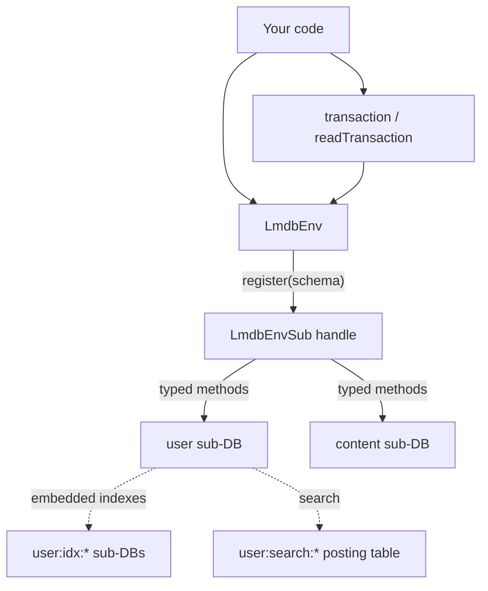

<div align="center">
  <h1>@gramstax/lmdb</h1>

  <p>A typed LMDB layer for Bun and Node.js — declare a schema, register it once, and get a sub-database handle with indexes, transactions, queues, backups, and change capture already wired in.</p>
  <p>
    
    
    
    
    
  </p>
</div>

## ✨ Features

### Storage that declares itself

- 🗃️ **One class per sub-database** — extend `LmdbSchema` with `static db`, `static key`, and `static value`; `register()` returns a handle where every method is already bound to that schema
- 🔗 **Embedded indexes** — `.unique()` and `.index()` on value columns, maintained in the same write transaction as the row, so they cannot drift
- 🎯 **Keyset pagination** — range cursors with `start`/`end` bounds beat `offset`, because seeking is O(log n) instead of re-walking skipped rows
- 🔎 **Full-text search** — `t.string().search()` provisions a posting table and returns ranked primary keys
- ⏳ **TTL repositories** — a repository-wide default or a per-write override, reaped lazily
- 📦 **Positional record codec** — hook-free schemas store rows as arrays in column order: ~1.5× faster decode, ~20% smaller, same type surface

### Transactions

- 🔐 **Atomic multi-table writes** — `env.transaction()` groups reads and writes across sub-databases in one native transaction, with real rollback
- ⚡ **A no-rollback variant** — `transactionFast()` commits off the main thread for bulk work where partial application is harmless, and says so loudly if you try to abort
- 📖 **Snapshot reads** — `readTransaction()` pins a consistent view that concurrent writers cannot disturb

### Building blocks

- 📮 **Queues** — `LmdbQueue` commits the id and the payload together in one `rootTransactionSync` per enqueue and dequeue, so FIFO survives across processes
- 💾 **Backups** — timestamped snapshots, `tar.gz` streaming, S3-compatible upload, pruning, and a restart-safe scheduler that catches up after downtime
- 🔄 **Change data capture** — every write lands in a durable outbox in the same transaction, so an aborted write publishes nothing
- 🧬 **Differential sync** — a persisted cursor moves rows between environments in resumable batches, verification on by default
- 🧵 **Read-only replicas** — `LmdbReader` attaches many readers to one writer without lock contention
- 🛠️ **Migrations** — versioned steps with resumable row rewrites

### Operational honesty

- 🚨 **One error class** — every failure is an `LmdbError` with a message you can act on
- 🔕 **Never logs behind your back** — diagnostics go to `env.emitWarn()`; with no listener attached, the library is silent
- 📏 **Materialization guardrail** — bulk reads that would materialize more than 100_000 rows throw `LmdbError` instead of exhausting memory

## 🚀 Quick Start

### 1. Prerequisites

- [Bun](https://bun.sh) v1.0+ or Node.js v18+
- An LMDB data directory (created on first open)

### 2. Install

```bash
bun add @gramstax/lmdb
```

### 3. Declare a schema

```ts
import {LmdbSchema, t} from "@gramstax/lmdb"

export class UserSchema extends LmdbSchema {
  static db = `user`
  static key = t.number()
  static value = {
    id: t.number().unique(),
    username: t.string(),
    age: t.number()
  }
}
```

`.unique()` becomes a uniqueness constraint, `.index()` a secondary index. Both are maintained automatically.

### 4. Extend the env and register

```ts
import {LmdbEnv, type LmdbEnvSub} from "@gramstax/lmdb"

export class Db extends LmdbEnv {
  users!: LmdbEnvSub<typeof UserSchema>

  constructor(path: string) {
    super({path, maxDbs: 10, compression: true})
    this.users = this.register(UserSchema)
  }
}
```

The env opens during construction — there is no `await open()`.

### 5. Use it

```ts
const db = new Db(`./data`)

await db.users.put(1, {id: 1, username: `Alice`, age: 30})
const alice = db.users.get(1) // sync — no await
db.users.count() // sync — O(1)
```

## 📖 Usage

### Reads and writes

Point reads are synchronous because the native LMDB calls are:

```ts
db.users.get(1) // UserRow | undefined
db.users.getStrict(1) // UserRow, throws when absent
db.users.has(1) // boolean
db.users.count() // number
await db.users.put(1, row)
await db.users.delete(1)
```

### Index reads

`findByIndex` is the single index API. The return shape follows the keys you query: all-unique gives one row, anything non-unique gives many.

```ts
db.users.findByIndex({username: `alice`}) // UserRow | undefined (unique)
db.users.findByIndex({age: 30}) // UserRow[] (non-unique)
db.users.findByIndex({[`tenant+status`]: [`t1`, `active`]}) // composite tuple key
```

Always pass `{limit}` for fan-out — an unbounded non-unique query materializes every match.

### Transactions

```ts
// Sync callback: all writes batch into one native transaction
await db.transaction(() => {
  users.put(`u1`, alice)
  sessions.put(`s1`, session)
})
```

A throw or `tx.abort()` rolls back. Keep the callback synchronous where you can: an `await` inside holds the single writer lock open and pulls unrelated queued writes into your transaction.

### Queues

```ts
import {LmdbQueue} from "@gramstax/lmdb"

const queue = new LmdbQueue(db, JobSchema)
const id = await queue.enqueue({type: `email`, to: `a@b.c`})
const job = await queue.dequeue() // atomic read + delete
```

### Backup and restore

```ts
import {LmdbBackup} from "@gramstax/lmdb"

const handle = LmdbBackup.start(db, {
  dir: `./backups`,
  pattern: `0 3 * * *`,
  keep: 3,
  s3Keep: 30,
  format: `tar.gz`,
  s3: {bucket: `my-backups`, region: `auto`, accessKeyId, secretAccessKey}
})
```

`pattern` is a wall-clock cron expression, not a duration — `0 3 * * *` means 03:00 sharp whatever the last run did. A boundary missed while the process was down triggers exactly one catch-up run at boot rather than a burst of identical archives.

`keep` prunes local archives; `s3Keep` prunes the remote ones. They default to the same number, which is usually wrong — you trim local copies aggressively to save disk and keep the copy you can restore from anywhere.

### Change capture

```ts
const unsubscribe = db.subscribe(`content`, (e) => console.log(e.type, e.key))
const records = await db.tailCdc({consumer: `search-index`, limit: 1000})
if (records.length > 0) await db.ackCdc(`search-index`, records.at(-1)!.seq)
```

## 🔍 How it works



One `LmdbEnv` owns one memory-mapped file. Each registered schema opens its own sub-database inside it, so ranges never cross boundaries and keys never collide across entities — no prefix encoding, no manual `openDB` bookkeeping, and options like `encoding` and `compression` propagate to every sub-database on their own.

An embedded index is just another sub-database written inside the same transaction as the row. That is why a unique conflict can roll back both together.

## 📜 Scripts

```bash
bun run build       # bundle with tsup
bun run bench:quick # fast subset — a few seconds
bun run bench:all   # full suite, including slow decode cases
bun run bench:crud  # one group: crud | queue | range | queries | transaction
                    # | decode | concurrent | codec | index | batch | ttl
```

## 🗂️ Project Structure

```text
packages/lmdb/
├── src/
│   ├── env.ts          # LmdbEnv — lifecycle, register/sub, transactions, CDC, migrations
│   ├── schema.ts       # LmdbSchema + the `t` column builders
│   ├── sub.ts          # LmdbEnvSub — the typed handle every method hangs off
│   ├── sub-manager.ts  # sub-DB registry (internal)
│   ├── transaction.ts  # LmdbTransaction lifecycle
│   ├── queue.ts        # LmdbQueue — FIFO in one transaction
│   ├── search.ts       # LmdbSearch — tokenizer and fingerprinting
│   ├── codec.ts        # RecordCodec — positional row storage
│   ├── sync.ts         # LmdbSyncStream — resumable differential sync
│   ├── cdc/            # change data capture: store, hub, facade
│   ├── backup.ts       # LmdbBackup — snapshot, prune, restore, schedule
│   ├── job-run.ts      # LmdbJobRun — cron scheduling with persisted stamps
│   ├── reader.ts       # LmdbReader — read-only replica
│   ├── errors.ts       # LmdbError — the single error class
│   └── types/          # internal I* types, one file per module
├── example/            # runnable feature demos
└── bench/              # mitata benchmarks
```

## 🔧 Configuration

Everything is a constructor option on `LmdbEnv`, forwarded to every sub-database:

| Option           | Default    | Purpose                                          |
| :--------------- | :--------- | :----------------------------------------------- |
| `path`           | required   | Data directory                                   |
| `maxDbs`         | `128`      | Sub-database slots — every schema and index costs one |
| `encoding`       | `msgpack`  | `msgpack` · `json` · `cbor` · `binary` · `string` |
| `compression`    | `false`    | LZ4, off-thread                                  |
| `mapSize`        | 4 GB       | Virtual mapping, not RAM                         |
| `cache`          | `false`    | In-memory read cache                             |
| `readOnly`       | `false`    | Open read-only                                   |
| `useVersions`    | `false`    | Enables optimistic locking via `rootPut`         |
| `encryptionKey`  | —          | ChaCha8, 32 bytes                                |
| `onWarn`         | silent     | Diagnostics sink                                 |

Diagnostics are opt-in on purpose — a library that logs behind your back fights your logger:

```ts
const db = new Db(`./data`, {onWarn: (message) => logger.warn(message)})
```

If your sink throws, the failure is contained and writes still commit.

## 🏗️ Architecture

- **`LmdbSchema` is the only declaration path.** Extend it, register it, use the returned handle. The class-style repository base classes are gone.
- **Domain logic is a service layer.** Schemas store; a service class that receives the env holds the behaviour. Never put methods on a schema.
- **CDC arms lazily and stays armed.** Writes made before the first `subscribe` are invisible, so touch a CDC API at boot if that matters.
- **`transactionFast` cannot roll back.** `tx.abort()` throws on it, and a throwing callback commits anyway. Use `transaction()` whenever the outcome depends on failing partway.

### Guardrails worth knowing

| Rule                          | Why                                                            |
| :---------------------------- | :------------------------------------------------------------- |
| `maxDbs` counts everything    | Each schema, unique index, composite, and search table takes a slot |
| Keyset over `offset`          | `offset` re-walks skipped rows on every page                    |
| `{limit}` on fan-out reads    | An unbounded non-unique index query materializes every match    |
| `iterate()` above 100_000 rows | Bulk reads are guarded; the lazy iterator is not               |
| `putMany(..., {sorted:true})` | The first inversion throws before anything is written           |

## ✅ Testing

```bash
cd packages/lmdb && bun test test/
```

Each feature has a runnable example under `example/` — from `basic.ts` through `queue.ts`, `job-run.ts`, `backup-s3-tar.ts`, and `search-cdc-demo.ts`:

```bash
bun packages/lmdb/example/basic.ts
```

Benchmarks are `@internal` and excluded from `bun test` and CI.

## 🚢 Deployment

- **`mapSize` is virtual, not RAM.** Size it 10–50× your expected data; breaching it throws.
- **One writer per data directory.** Two processes writing the same path fight over the LMDB writer lock; readers are fine.
- **Keep the backup dir dedicated.** Pruning counts everything inside it, and a stray file can be removed.
- **A backup contains the previous run's stamp** — the stamp lands after the copy resolves. Restoring one rolls the schedule back, so the app snapshots once soon after, which is the right response to a rollback.
- **`__`-prefixed sub-DBs are engine bookkeeping** — `__job_run`, `__cdc_log`, and `__sync_state` stay out of your change stream on purpose.

## 🩺 Troubleshooting

| Symptom                    | Likely cause                                | Fix                                                             |
| :------------------------- | :------------------------------------------ | :-------------------------------------------------------------- |
| `MDB_MAP_FULL`             | `mapSize` too small for the dataset         | Raise it; it is virtual, not reserved memory                     |
| Lock errors on start       | A stale reader, or a second writer          | One writer per directory; close readers cleanly                  |
| `register` throws          | Duplicate class, or two schemas sharing `db` | One schema per sub-database name                                |
| Index read returns nothing | A `null`/`undefined` indexed field          | Those rows skip the index — query them by primary key            |
| Bulk read throws           | Over `MAX_MATERIALIZE`                      | Add `{limit}` below the cap, or stream with `iterate()`          |
| `transactionFast` aborts   | It has no rollback path                     | Use `transaction()` when the outcome depends on a mid-way throw |
| Backup dir pruned oddly    | Something else lives there                  | Point it at a directory that belongs to backups alone            |

## 🧰 Tech Stack

- [lmdb](https://www.npmjs.com/package/lmdb) — the LMDB native binding
- [croner](https://www.npmjs.com/package/croner) — cron scheduling for `LmdbBackup.start` and `LmdbJobRun`
- Optional peers: [tar](https://www.npmjs.com/package/tar) for `tar.gz`, [@aws-sdk/client-s3](https://www.npmjs.com/package/@aws-sdk/client-s3) for uploads, [cbor-x](https://www.npmjs.com/package/cbor-x) for CBOR encoding
- [mitata](https://github.com/benoitgrelard/mitata) — benchmarks
- [tsup](https://tsup.egoist.dev) — bundler
- TypeScript in strict mode (`noUncheckedIndexedAccess`)

## 📚 Learn More

- [LMDB best practices](./AGENTS.md) — package conventions and anti-patterns
- [`example/all-features.ts`](./example/all-features.ts) — many features in one scenario
- [`example/job-run.ts`](./example/job-run.ts) — restart-safe scheduling
- [LMDB](https://www.npmjs.com/package/lmdb)

## 📄 License

Proprietary — Copyright (c) 2026 Gramstax. See [LICENSE](./LICENSE).
