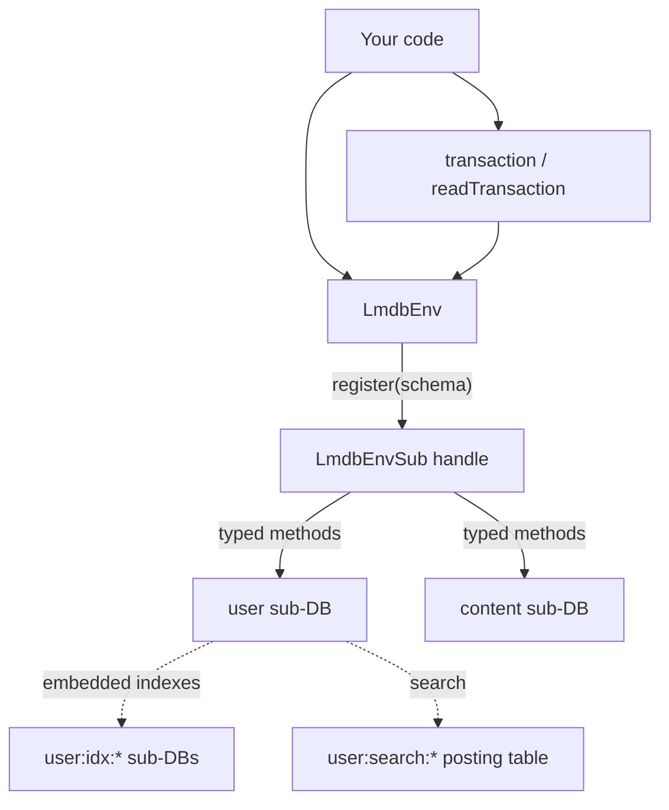

<div align="center">
  <h1>@gramstax/lmdb</h1>

  <p>A typed LMDB layer for Bun and Node.js: declare a schema, register it once, and get a sub-database handle with indexes, transactions, queues, backups, and change capture already wired in.</p>
  <p>
    
    
    
    
    
  </p>
</div>

## 💡 Why this package

`@gramstax/lmdb` is a thin opinionated layer over [lmdb-js](https://www.npmjs.com/package/lmdb). It does not hide LMDB's semantics; it codifies them into one typed pattern. The value is in what you stop doing on every project:

**No sub-database bookkeeping.** Raw lmdb-js means calling `root.openDB(name, opts)` for every entity, passing handles around by hand, and remembering to forward `encoding`, `compression`, and `cache` every time. Here a schema class is bound to its sub-database at registration: env-level options reach every sub-database on their own.

**No prefix-encoded keys.** The common workaround is keys like `"user:1"` with hand-computed inclusive/exclusive bounds for range scans. Each entity here owns a dedicated sub-database, so keys are intrinsically isolated, `count()` is O(1), and a range over `user` can never see `session` rows.

**No wrapper layer between you and LMDB.** Point reads are synchronous because the native calls are. Wrapping `mdb_get` in a promise would add a microtask and buy nothing.

**No implicit rounding.** Nothing is converted or clamped behind your back. If a value is out of range, you get an `LmdbError` naming it.

## ✨ Features

### Storage that declares itself

- 🗃️ **One class per sub-database**: extend `LmdbSchema` with `static db`, `static key`, and `static value`; `register()` returns a handle where every method is already bound to that schema
- 🔗 **Embedded indexes**: `.unique()` and `.index()` on value columns, maintained in the same write transaction as the row, so they cannot drift
- 🎯 **Keyset pagination**: range cursors with `start`/`end` bounds beat `offset`, because seeking is O(log n) instead of re-walking skipped rows
- 🔎 **Full-text search**: `t.string().search()` provisions a posting table and returns ranked primary keys
- ⏳ **TTL repositories**: a repository-wide default or a per-write override, reaped lazily
- 📦 **Positional record codec**: hook-free schemas store rows as arrays in column order: ~1.5× faster decode, ~20% smaller, same type surface

### Transactions

- 🔐 **Atomic multi-table writes**: `env.transaction()` groups reads and writes across sub-databases in one native transaction, with real rollback
- ⚡ **A no-rollback variant**: `transactionFast()` commits off the main thread for bulk work where partial application is harmless, and says so loudly if you try to abort
- 📖 **Snapshot reads**: `readTransaction()` pins a consistent view that concurrent writers cannot disturb

### Building blocks

- 📮 **Queues**: `LmdbQueue` commits the id and the payload together in one `rootTransactionSync` per enqueue and dequeue, so FIFO survives across processes
- 💾 **Backups**: timestamped snapshots, `tar.gz` streaming, S3-compatible upload, pruning, and a restart-safe scheduler that catches up after downtime
- 🔄 **Change data capture**: every write lands in a durable outbox in the same transaction, so an aborted write publishes nothing
- 🧬 **Differential sync**: a persisted cursor moves rows between environments in resumable batches, verification on by default
- 🧵 **Read-only replicas**: `LmdbReader` attaches many readers to one writer without lock contention
- 🛠️ **Migrations**: versioned steps with resumable row rewrites

### Operational honesty

- 🚨 **One error class**: every failure is an `LmdbError` with a message you can act on
- 🔕 **Never logs behind your back**: diagnostics go to `env.emitWarn()`; with no listener attached, the library is silent
- 📏 **Materialization guardrail**: bulk reads that would materialize more than 100_000 rows throw `LmdbError` instead of exhausting memory

## 🚀 Quick Start

### 1. Prerequisites

- [Bun](https://bun.sh) v1.0+ or Node.js v18+
- An LMDB data directory (created on first open)

### 2. Install

```bash
bun add @gramstax/lmdb
```

### 3. Declare a schema

```ts
import {LmdbSchema, t} from "@gramstax/lmdb"

export class UserSchema extends LmdbSchema {
  static db = `user`
  static key = t.number()
  static value = {
    id: t.number().unique(),
    username: t.string(),
    age: t.number()
  }
}
```

`.unique()` becomes a uniqueness constraint, `.index()` a secondary index. Both are maintained automatically.

### 4. Extend the env and register

```ts
import {LmdbEnv, type LmdbEnvSub} from "@gramstax/lmdb"

export class Db extends LmdbEnv {
  users!: LmdbEnvSub<typeof UserSchema>

  constructor(path: string) {
    super({path, maxDbs: 10, compression: true})
    this.users = this.register(UserSchema)
  }
}
```

The env opens during construction: there is no `await open()`.

### 5. Use it

```ts
const db = new Db(`./data`)

await db.users.put(1, {id: 1, username: `Alice`, age: 30})
const alice = db.users.get(1) // sync: no await
db.users.count() // sync: O(1)
```

## 📖 Usage

### Declaring data

Column builders come from `t`. Every one supports the same chain methods.

| Builder                | Value type                    | Notes                                                                  |
| :--------------------- | :---------------------------- | :--------------------------------------------------------------------- |
| `t.string()`           | `string`                      | The only kind that can be `.search()`-ed                             |
| `t.number()`           | `number`                      |                                                                        |
| `t.bigint()`           | `bigint`                      | msgpack-native; not usable as a primary key                           |
| `t.boolean()`          | `boolean`                     |                                                                        |
| `t.date()`             | `Date`                        | msgpack-native                                                         |
| `t.buffer()`           | `Uint8Array`                  |                                                                        |
| `t.object<T>()`        | `Record<string, unknown>`     | `T` narrows the row type                                              |
| `t.array<T>()`         | `unknown[]`                   | Also accepts a shape: `t.array(t.string())` → `string[]`              |
| `t.map<K, V>()`        | `Map<K, V>`                   | Or a `{key, value}` shape                                             |
| `t.set<T>()`           | `Set<unknown>`                | Or a shape: `t.set(t.string())` → `Set<string>`                       |
| `t.any()`              | `unknown`                     | Passthrough                                                            |
| `t.enum(...)`          | `string \| number \| bigint`  | Runtime-validated; must be homogeneous or `register` throws           |
| `t.string(...)`        | `string`                      | Literal-typed, same validation as `t.enum`                            |

| Chain method   | Effect                                                                          |
| :------------- | :------------------------------------------------------------------------------ |
| `.optional()`  | The field becomes omit-able; absent or `undefined` reads back as absent         |
| `.unique()`    | A uniqueness constraint, maintained in the row's write transaction              |
| `.index(name?)`| A secondary index; `name` overrides the derived one                            |
| `.index([a,b])`| A concatenated-key composite, matched by tuple key                             |
| `.search()`    | Provisions a posting table so the column is full-text searchable                |
| `.default(v)`  | Fills the field at write time when it is `undefined`                           |
| `.$defaultFn(f)` | Same, computed per write                                                     |

Nested `unique`, `index`, and `search` markers inside an `object`/`array` shape throw: they would be silently ignored. Declare them as top-level dotted columns instead, e.g. `bio.email: t.string().unique()`.

### Encoding

`encoding` is a per-env default and can be overridden per sub-database or per schema. It is **not** inherited from the root env by LMDB itself: this package forwards it to every `openDB` call for you.

| Encoder          | Serializer        | Use when                                          |
| :--------------- | :---------------- | :------------------------------------------------ |
| `msgpack`        | msgpackr (binary) | Default: fastest, handles `Date`/`Map`/`Set`/`BigInt` |
| `json`           | `JSON.stringify`  | Human-readable, V8-optimized for small objects    |
| `cbor`           | cbor-x            | Compact binary, good for typed structures          |
| `binary`         | raw `Buffer`      | Already-encoded payloads                          |
| `string`         | UTF-8             | String-only values                                |
| `ordered-binary` | same as keys      | dupSort index values                              |

### Naming the row type: `IK*` and `IV*`

A schema class is the single source of truth for its row shape. Export a name for it so services can say `IVUser` instead of repeating `ValueOf<typeof UserSchema>` at every signature:

```ts
import {KeyOf, LmdbSchema, t, ValueOf} from "@gramstax/lmdb"

export class UserSchema extends LmdbSchema {
  static db = `user`
  static key = t.number()
  static value = {
    userId: t.number(),
    firstName: t.string(),
    lastName: t.string().optional(),
    username: t.string().optional().unique(),
    lastActiveAt: t.number(),
    viewHistory: t.array(t.string())
  }
}

export type IKUser = KeyOf<typeof UserSchema>
export type IVUser = ValueOf<typeof UserSchema>
```

`IKUser` is the key type after `KeyOf` has intersected it with what lmdb accepts: for a `t.number()` key that is `number`, so an impossible key is a compile error. `IVUser` is the row shape, with `.optional()` and `.default()` columns reflected in whether the field is required.

**These names belong in a service layer's signatures, not on every read.** The handle already returns `ValueOf<S> | undefined`, so annotating a read does not restate the type: it fights it:

```ts
// TS2322: `get()` returns IVUser | undefined, and the annotation
// silently drops the half of the type that says "there may be no row"
const alice: IVUser = db.users.get(1)

// Correct: the handle is already typed, miss included
const alice = db.users.get(1) // IVUser | undefined
```

Where they earn their keep is a repository, where business methods compose several reads and writes and the row shape has to be named:

```ts
import type {LmdbEnvSub, LmdbTransaction} from "@gramstax/lmdb"
import type {IKUser, IVUser, UserSchema} from "../schema/user"

type ICreateUser = Pick<IVUser, `userId` | `firstName`> & Partial<Pick<IVUser, `lastName` | `username`>>
type ITrackView = Pick<IVUser, `userId`> & {viewed: string}


export class UserRepository {
  constructor(public readonly users: LmdbEnvSub<typeof UserSchema>) {}

  getUser(userId: IVUser[`userId`], tx?: LmdbTransaction): IVUser | undefined {
    return this.users.get(userId, tx)
  }

  findOrCreate(params: ICreateUser): IVUser | undefined {
    const existing = this.users.get(params.userId)
    if (existing) return existing
    const row: IVUser = {
      userId: params.userId,
      firstName: params.firstName,
      lastName: params.lastName,
      username: params.username,
      lastActiveAt: Date.now(),
      viewHistory: []
    }
    this.users.putSync(params.userId, row)
    return row
  }

  async trackView(params: ITrackView): Promise<void> {
    await this.users.owner.transaction(() => {
      const row = this.users.get(params.userId)
      if (!row) return
      this.users.putSync(params.userId, {
        ...row,
        lastActiveAt: Date.now(),
        viewHistory: [...row.viewHistory, params.viewed].slice(-20)
      })
    })
  }

  countAll(): number {
    return this.users.count()
  }

  async deleteUser(userId: IKUser): Promise<boolean> {
    return await this.users.delete(userId)
  }
}
}
```

What that buys you:

- **`Pick` / `Omit` / `Partial<Pick<…>>`** derive parameter types from the row, so adding a column to the schema updates every call site that constructs it instead of letting them drift apart.
- **`IVUser['userId']`** types a single argument without restating its type.
- **`IVUser | undefined`** is the honest return of a read, and making a service declare it forces a decision about a miss.
- **`IKUser`** for keys crossing a boundary, so a bad key cannot be smuggled in.
- **Constructor injection of the handle** keeps the repository off `env.sub()` entirely, so the schema class is only ever a type and the import stays `import type`.
- **`sub.owner.transaction()`** opens the write transaction; the sync callback with `putSync` keeps it reliable.

The row is annotated once: where it is **constructed** for a write. Reads stay unannotated because the handle already did that work.

### Reads and writes

Point reads are synchronous because the native LMDB calls are:

```ts
db.users.get(1) // UserRow | undefined
db.users.getStrict(1) // UserRow, throws when absent
db.users.has(1) // boolean
db.users.count() // number
await db.users.put(1, row)
await db.users.delete(1)
```

### Index reads

`findByIndex` is the single index API. The return shape follows the keys you query: all-unique gives one row, anything non-unique gives many.

```ts
db.users.findByIndex({username: `alice`}) // UserRow | undefined (unique)
db.users.findByIndex({age: 30}) // UserRow[] (non-unique)
db.users.findByIndex({[`tenant+status`]: [`t1`, `active`]}) // composite tuple key
```

Always pass `{limit}` for fan-out: an unbounded non-unique query materializes every match.

### Transactions

```ts
// Sync callback: all writes batch into one native transaction
await db.transaction(() => {
  users.put(`u1`, alice)
  sessions.put(`s1`, session)
})
```

A throw or `tx.abort()` rolls back. Keep the callback synchronous where you can: an `await` inside holds the single writer lock open and pulls unrelated queued writes into your transaction.

### Queues

```ts
import {LmdbQueue} from "@gramstax/lmdb"

const queue = new LmdbQueue(db, JobSchema)
const id = await queue.enqueue({type: `email`, to: `a@b.c`})
const job = await queue.dequeue() // atomic read + delete
```

### Backup and restore

```ts
import {LmdbBackup} from "@gramstax/lmdb"

const handle = LmdbBackup.start(db, {
  dir: `./backups`,
  pattern: `0 3 * * *`,
  keep: 3,
  s3Keep: 30,
  format: `tar.gz`,
  s3: {bucket: `my-backups`, region: `auto`, accessKeyId, secretAccessKey}
})
```

`pattern` is a wall-clock cron expression, not a duration: `0 3 * * *` means 03:00 sharp whatever the last run did. A boundary missed while the process was down triggers exactly one catch-up run at boot rather than a burst of identical archives.

`keep` prunes local archives; `s3Keep` prunes the remote ones. They default to the same number, which is usually wrong: you trim local copies aggressively to save disk and keep the copy you can restore from anywhere.

### Change capture

```ts
const unsubscribe = db.subscribe(`content`, (e) => console.log(e.type, e.key))
const records = await db.tailCdc({consumer: `search-index`, limit: 1000})
if (records.length > 0) await db.ackCdc(`search-index`, records.at(-1)!.seq)
```

## 🔍 How it works



One `LmdbEnv` owns one memory-mapped file. Each registered schema opens its own sub-database inside it, so ranges never cross boundaries and keys never collide across entities: no prefix encoding, no manual `openDB` bookkeeping, and options like `encoding` and `compression` propagate to every sub-database on their own.

An embedded index is just another sub-database written inside the same transaction as the row. That is why a unique conflict can roll back both together.

## 📜 Scripts

```bash
bun run build       # bundle with tsup
bun run bench:quick # fast subset: a few seconds
bun run bench:all   # full suite, including slow decode cases
bun run bench:crud  # one group: crud | queue | range | queries | transaction
                    # | decode | concurrent | codec | index | batch | ttl
```

## 🗂️ Project Structure

```text
packages/lmdb/
├── src/
│   ├── env.ts          # LmdbEnv: lifecycle, register/sub, transactions, CDC, migrations
│   ├── schema.ts       # LmdbSchema + the `t` column builders
│   ├── sub.ts          # LmdbEnvSub: the typed handle every method hangs off
│   ├── sub-manager.ts  # sub-DB registry (internal)
│   ├── transaction.ts  # LmdbTransaction lifecycle
│   ├── queue.ts        # LmdbQueue: FIFO in one transaction
│   ├── search.ts       # LmdbSearch: tokenizer and fingerprinting
│   ├── codec.ts        # RecordCodec: positional row storage
│   ├── sync.ts         # LmdbSyncStream: resumable differential sync
│   ├── cdc/            # change data capture: store, hub, facade
│   ├── backup.ts       # LmdbBackup: snapshot, prune, restore, schedule
│   ├── job-run.ts      # LmdbJobRun: cron scheduling with persisted stamps
│   ├── reader.ts       # LmdbReader: read-only replica
│   ├── errors.ts       # LmdbError: the single error class
│   └── types/          # internal I* types, one file per module
├── example/            # runnable feature demos
└── bench/              # mitata benchmarks
```

## 🔧 Configuration

### `LmdbEnv` constructor

Every option is optional except `path`, and everything but `path` is forwarded to the underlying LMDB `open()` call and inherited by every sub-database.

Only two defaults belong to this package: the constructor reads `mapSize` as `4 * 1024 * 1024 * 1024` and `maxDbs` as `128`, then passes both explicitly. Every other option is spread straight through to [lmdb-js](https://www.npmjs.com/package/lmdb) untouched, so its default is lmdb-js's and is marked as such below: you will not find those numbers in this package's source. A value of _none_ means no default is applied at all.

| Option              | Type                            | Default                | Purpose                                                          |
| :------------------ | :------------------------------ | :--------------------- | :--------------------------------------------------------------- |
| `path`              | `string`                        | **required**           | Data directory (or filename when `noSubdir` applies)            |
| `maxDbs`            | `number`                        | `128`                  | Sub-database slots: each schema and each index takes one        |
| `encoding`          | `ILmdbEncoding`                 | `msgpack`              | `msgpack` · `json` · `cbor` · `binary` · `string` · `ordered-binary` |
| `compression`       | `boolean \| ICompressionOptions` | `false`               | LZ4, off-thread; smaller on disk for a small CPU cost            |
| `readOnly`          | `boolean`                       | `false`                | Read-only env rejects every write                                |
| `maxReaders`        | `number`                        | lmdb-js              | Concurrent readers; each read transaction occupies one           |
| `mapSize`           | `number`                        | `4294967296` (4 GB)    | Virtual mapping: not RAM. Cannot change after open              |
| `cache`             | `boolean \| Record<string, unknown>` | `false`          | In-memory read cache; `true` for defaults or an object to tune    |
| `useVersions`       | `boolean`                       | `false`                | Record versioning, required for optimistic locking via `rootPut`  |
| `keyEncoding`       | `` `uint32` \| `binary` \| `ordered-binary` `` | `ordered-binary` | Key encoding; `ordered-binary` accepts any JS primitive as a key |
| `dupSort`           | `boolean`                       | `false`                | Duplicate entries per key: one key to many ordered values       |
| `strictAsyncOrder`  | `boolean`                       | _none_                 | Order async transactions against async single ops, at a switch cost |
| `commitDelay`       | `number`                        | `0`                    | Milliseconds to batch writes before committing                   |
| `pageSize`          | `number`                        | OS page size (lmdb-js) | Use `8192` for a database larger than RAM                        |
| `overlappingSync`   | `boolean`                       | on                     | Flush off the write lock so writes can overlap                   |
| `separateFlushed`   | `boolean`                       | _none_                 | Split `committed` (visible) from `flushed` (durable)             |
| `remapChunks`       | `boolean`                       | on                     | Dynamic mapping; slightly slower reads, kinder to other apps     |
| `noMemInit`         | `boolean`                       | _none_                 | Skip zeroing malloc'd data: leaves app data in unused pages      |
| `useWritemap`       | `boolean`                       | _none_                 | Writemap writes; faster, but a stray pointer can corrupt data    |
| `noSubdir`          | `boolean`                       | when `path` has an extension | Treat `path` as a filename instead of a directory          |
| `noSync`            | `boolean`                       | _none_                 | Skip flush-to-disk on commit: fast, but a crash can lose data   |
| `noMetaSync`        | `boolean`                       | _none_                 | Skip metadata flush: less risky than `noSync`, less benefit     |
| `encryptionKey`     | `string \| Buffer`              | _none_                 | At-rest encryption (ChaCha8); exactly 32 bytes or characters     |
| `eventTurnBatching` | `boolean`                       | `true`                 | Async writes in one event turn share a single commit             |
| `encoder`           | `unknown`                       | _none_                 | Custom value encoder; overrides `encoding`                       |
| `keyEncoder`        | `unknown`                       | _none_                 | Custom key encoder; overrides `keyEncoding`                      |
| `onWarn`            | `(message: string) => void`     | silent                 | Diagnostics sink                                                 |

Diagnostics are opt-in on purpose: a library that logs behind your back fights your logger:

```ts
const db = new Db(`./data`, {onWarn: (message) => logger.warn(message)})
```

If your sink throws, the failure is contained and writes still commit. `close()` clears the listener set, so host callbacks are released and nothing reports after shutdown.

### Schema statics

A schema class carries its shape as statics. `db`, `key`, and `value` are required; the rest are opt-in.

| Static                | Purpose                                                                        |
| :-------------------- | :----------------------------------------------------------------------------- |
| `db`                  | Sub-database name: one per entity type, unique across the env                 |
| `key`                  | Primary key: exactly one `t` builder, never `unique()` or `index()`            |
| `value`                | A map of `t` column builders, or a single builder for a scalar sub              |
| `ttl`                  | Repository-wide default expiry in ms; `0` materializes the TTL sub without one  |
| `version`              | Integer row-shape version, so a migration transform can check for skew          |
| `dupSort`              | Opt this sub into one-key-to-many-ordered-values                                |
| `useVersions`          | Per-schema record versioning, overriding the env setting                        |
| `encoding`             | Per-sub-database value encoding, overriding the env setting                     |
| `hookBeforeWrite`      | Transform a row before LMDB serializes it: must be declared with the read hook |
| `hookBeforeRead`       | Transform a row after LMDB deserializes it: must be declared with the write hook |

Declaring either hook without the other throws at `register` time. Declaring hooks, `ttl`, or a scalar value opts the schema out of the positional record codec.

### `LmdbBackup.start`

```ts
LmdbBackup.start(env, {
  dir, pattern, keep, s3Keep, timezone, runOnStart, format, compact, s3, onError, persist, persistKey
})
```

| Option        | Default              | Purpose                                                              |
| :------------ | :------------------- | :------------------------------------------------------------------- |
| `dir`         | _none_               | **Required.** Directory holding timestamped backups                  |
| `pattern`     | _none_               | **Required.** Cron expression, read in the local timezone unless `timezone` is set |
| `keep`        | `3`                  | Local archives to retain; non-positive falls back to `3`            |
| `s3Keep`      | `keep`               | Remote archives to retain, independent of `keep`                     |
| `timezone`    | host local           | IANA zone for `pattern`                                              |
| `runOnStart`  | `false`              | Force one extra run at boot even when not due                        |
| `format`      | `dir`                | `dir` or `tar.gz`                                                    |
| `compact`     | `false`              | Rewrite the copy densely: slower, smaller, cheaper to restore       |
| `s3`          | _none_               | Upload per tick; `tar.gz` only                                       |
| `onError`     | `env.emitWarn`       | Tick failure handler                                                 |
| `persist`     | `true`               | Persist the last successful run so a restart resumes the schedule    |
| `persistKey`  | `backup`             | Stamp name, so schedules sharing one env do not overwrite each other |

`snapshot()` takes the same shape minus `pattern`, `timezone`, `runOnStart`, `persist`, and `persistKey`.

### `IBackupS3Options`

| Option           | Default        | Purpose                                        |
| :--------------- | :------------- | :--------------------------------------------- |
| `bucket`         | **required**   | Bucket name                                    |
| `accessKeyId`    | **required**   | Access key: or supply `client`                |
| `secretAccessKey`| **required**   | Secret key: or supply `client`                |
| `prefix`         | `""`           | Key prefix                                     |
| `endpoint`       | AWS default    | R2/MinIO URL                                   |
| `region`         | `auto`         | `auto` works for R2                            |
| `forcePathStyle` | `false`        | MinIO-style path URLs                          |
| `client`         | _none_         | A preconfigured `S3Client`, which wins over the fields above |

### `LmdbJobRun.start`

| Option       | Default        | Purpose                                                             |
| :----------- | :------------- | :------------------------------------------------------------------ |
| `pattern`    | _none_         | **Required.** Cron expression for the schedule                     |
| `task`       | _none_         | **Required.** The work; the stamp is written only after it resolves |
| `timezone`   | host local     | IANA zone for `pattern`                                             |
| `runOnStart` | `false`        | Run once even when not due                                          |
| `catchUp`    | `true`         | Run once at boot when a boundary was missed while the process was down |
| `onError`    | `env.emitWarn` | Tick failure handler                                                |
| `persist`    | `true`         | Write the stamp; `false` skips stamp reads and catch-up entirely    |

`LmdbBackup.start` is a thin wrapper over this, which is why it accepts `pattern` too.

### `LmdbJobRun.missed`

The missed-boundary check on its own, for when you want the decision without a schedule.

| Option     | Default      | Purpose                                                   |
| :--------- | :----------- | :-------------------------------------------------------- |
| `pattern`  | _none_       | **Required.** The cron expression to evaluate             |
| `timezone` | host local   | IANA zone for `pattern`                                   |
| `now`      | `Date.now()` | Evaluate the boundary as of this instant instead of now  |

```ts
new LmdbJobRun(db).missed(`weekly-report`, {pattern: `0 4 * * 1`}) // → boolean
```

### `LmdbReader.open`

```ts
const replica = await LmdbReader.open(`/var/db`, {maxDbs: 10, pollMs: 1000})
```

| Option    | Default | Purpose                                                    |
| :-------- | :------ | :--------------------------------------------------------- |
| `maxDbs`  | `10`    | Slot budget for the replica                                |
| `pollMs`  | _none_  | Periodically `resetReadTxn` so a long-lived reader sees new writes |

The reader is always opened `readOnly`, and it is a different process's data: LMDB gives a consistent snapshot per read transaction, not cross-process replication.

## 🏗️ Architecture

- **`LmdbSchema` is the only declaration path.** Extend it, register it, use the returned handle. The class-style repository base classes are gone.
- **Domain logic is a service layer.** Schemas store; a service class that receives the env holds the behaviour. Never put methods on a schema.
- **CDC arms lazily and stays armed.** Writes made before the first `subscribe` are invisible, so touch a CDC API at boot if that matters.
- **`transactionFast` cannot roll back.** `tx.abort()` throws on it, and a throwing callback commits anyway. Use `transaction()` whenever the outcome depends on failing partway.

### Guardrails worth knowing

| Rule                          | Why                                                            |
| :---------------------------- | :------------------------------------------------------------- |
| `maxDbs` counts everything    | Each schema, unique index, composite, and search table takes a slot |
| Keyset over `offset`          | `offset` re-walks skipped rows on every page                    |
| `{limit}` on fan-out reads    | An unbounded non-unique index query materializes every match    |
| `iterate()` above 100_000 rows | Bulk reads are guarded; the lazy iterator is not               |
| `putMany(..., {sorted:true})` | The first inversion throws before anything is written           |

## 📚 API Reference

### Env-level

| Method                              | Returns                | Sync/Async |
| :---------------------------------- | :--------------------- | :--------- |
| `register(SchemaClass)`            | `LmdbEnvSub<S>`        | sync       |
| `sub(SchemaClass)`                 | the cached handle      | sync       |
| `isRegistered(SchemaClass)`        | `boolean`              | sync       |
| `transaction(fn)`                  | `T`                    | async      |
| `transactionFast(fn)`              | `T`                    | async      |
| `readTransaction(fn)`              | `T`                    | async      |
| `rootTransactionSync(fn)`          | `T`                    | sync       |
| `subscribe(filter, cb)`            | `unsubscribe`          | sync       |
| `tailCdc({consumer?, from?, limit?})` | `ICdcRecord[]`      | async      |
| `ackCdc(consumer, seq)`            | `void`                 | async      |
| `pruneCdc(keep?)`                  | `number` pruned        | async      |
| `migrate(steps)`                   | `{applied, currentVersion}` | async |
| `getMigrationVersion()`            | `number`               | sync       |
| `getMapSizeUsed()`                 | `{total, used, free, ratio}` | sync |
| `on`/`off('beforecommit'\|'aftercommit')` | `void`      | sync       |
| `onWarn`/`offWarn(fn)`             | `void`                 | sync       |
| `emitWarn(message)`                | `void`                 | sync       |
| `backup(dest, compact?)`           | _void_                 | async      |
| `readerList()`                     | `string`               | sync       |
| `resetReadTxn()`                   | `void`                 | sync       |
| `getWriteTxnId()`                  | `number`               | sync       |
| `close()`                          | `void`                 | async      |

### Sub handle

Point reads and cardinality are synchronous because the native LMDB calls are. Writes are async: lmdb-js queues them and flushes on the next microtask, which batches same-turn writes for free.

| Sync                                                    | Async                                                                    |
| :------------------------------------------------------ | :----------------------------------------------------------------------- |
| `get(key, tx?)` → `T \| undefined`                    | `put(key, value, ttlOrTx?)`                                               |
| `getStrict(key, tx?)` → `T` (throws when absent)       | `putIfNotExists(key, value)` → `boolean`                                 |
| `has(key, tx?)` → `boolean`                            | `delete(key, tx?)` → `boolean`                                           |
| `count(tx?)` → `number`                                | `clear(tx?)`, `drop()`                                                    |
| `getKeys(options?, tx?)`                               | `keys/values/entries(options?, tx?)`: lazy cursor, drained to an array |
| `getEntry(key)` → `{version, value} \| undefined`     | `putMany(entries, chunk?, {sorted?, onProgress?})`                        |
| `getBinary` / `getBinaryFast(key)` → `Buffer`          | `importJSONL(jsonl, {sorted?})` → `number`                               |
| `getValues(key)` / `getValuesCount(key)` (dupSort)     | `findByIndex(query, tx?, {limit}?)`                                       |
| `first(tx?)` / `last(tx?)`                             | `like(pattern, options?, tx?)`, `findByPrefix(prefix, options?, tx?)`     |
|                                                      | `countByPrefix`, `deleteByPrefix(prefix, options?, tx?)`                  |
|                                                      | `search(query, {limit?})` → `K[]`                                        |
|                                                      | `reindex(name?)` → `{built, skipped}`                                    |
|                                                      | `syncTo(dest, {name?, checkpoint?, limit?, verify?})`                     |
|                                                      | `increment(key, delta?)` / `decrement(key, amount?)`: scalar-number subs |
|                                                      | `addValue` / `removeValue` / `getValues`: dupSort subs                   |
|                                                      | `putBinary(key, buf)` / `prefetch(keys)` / `getMany(keys)`               |
|                                                      | `putSync` / `removeSync`: for transaction callbacks                      |
|                                                      | `purgeExpired()` → `number`: TTL subs                                   |
|                                                      | `exportJSONL()` → `string`, `for await … of iterate(options?, tx?)`      |

`increment`/`decrement` and `putBinary` are **rejected on indexed or search-enabled subs**: the value would be stored outside the row shape, so an index would go stale. Keep counters on a separate non-indexed sub.

### Types

| Type                | What it is                                                                     |
| :------------------ | :------------------------------------------------------------------------------ |
| `LmdbEnvSub<S>`     | The handle `register()` returns, bound to schema `S`: every method is pre-bound |
| `ILmdbKey`          | Anything lmdb accepts as a key: `string` · `number` · `boolean` · array · `Uint8Array` |
| `IRangeOptions`     | `{start?, end?}`: inclusive lower and exclusive upper bound for a range scan   |
| `ICompositeRange`   | `{start?, end?}` of key tuples, for a composite index                          |
| `IndexQueryValue`   | What a query accepts for one index: a key, a tuple, or a composite range      |
| `IIndexQuery<T, I>` | The object query accepted by `findByIndex`, typed per declared index            |
| `IIndexResult<T, I, Q>` | The return type: one row when every queried index is unique, otherwise many |
| `IIndexDef`         | One resolved index: name, extractor, uniqueness                                |
| `IIndexDefs`        | The index map keyed by declared index name                                     |
| `IndexDescriptor`   | `{name, extractor, unique}`: an index as resolved at registration             |
| `IQueueSchema`      | A schema class with a string primary key, as `LmdbQueue` requires              |
| `ICodec`            | The positional row encoder contract                                            |
| `ISearchTable`      | A posting table backing a `.search()` column                                   |
| `IEnvForSub`        | The env surface a sub handle depends on                                        |
| `JobRunSchema`      | The schema behind `LmdbJobRun` stamps: `db: '__job_run'`, `key: string`, `value: {at: number}` |

`LmdbSubState` exists but is `@internal` and is not part of the surface.

### Other modules

| Module                  | Entry points                                                                 |
| :---------------------- | :--------------------------------------------------------------------------- |
| `LmdbQueue`             | `enqueue` · `dequeue` · `peek` · `size` · `clear`                            |
| `LmdbBackup`            | `backup` · `snapshot` · `start` · `list` · `listArchives` · `prune` · `pruneArchives` · `pruneS3Archives` · `restore` · `restoreArchive` · `uploadToS3` · `downloadFromS3` · `clearStaleStaging` |
| `LmdbJobRun`            | `start` · `missed` · `lastRun` · `recordRun` · `clear` · `sub`               |
| `LmdbReader`            | `open(path, {maxDbs?, pollMs?})`                                             |
| `LmdbSearch`            | `tokenize` · `fingerprintPk`                                                  |
| `RecordCodec`           | Positional row encoding                                                       |
| `LmdbSyncStream`        | `hashRowValue`                                                                |
| `Cdc` · `CdcHub` · `CdcStore` | Per-env change-capture state                                            |
| `LmdbTransaction`       | `abort` · `commit` · `raw` · `lifecycle` · `isCommitted` · `isAborted`         |

### Runnable examples

Every file under `example/` runs on its own with `bun packages/lmdb/example/<file>.ts`.

| File                    | Demonstrates                                                             |
| :---------------------- | :----------------------------------------------------------------------- |
| `basic.ts`              | Smallest useful env: register, put, get, transaction                    |
| `schema.ts`             | Schema declaration and the typed handle                                  |
| `hybrid.ts`             | Two schemas coexisting in one env                                        |
| `transaction.ts`        | Cross-repository atomicity and rollback                                  |
| `transaction-fast.ts`   | Off-thread commit without rollback, and when not to reach for it          |
| `atomic-counter.ts`     | `increment` / `decrement` without read-then-write races                   |
| `conditional-writes.ts` | `putIfNotExists` and versioned `rootPut` optimistic locking               |
| `embedded-indexes.ts`   | `.index()` and `.unique()` declared on value columns                      |
| `composite-keys.ts`     | Tuple keys for tenant isolation without string concatenation             |
| `range-query.ts`        | Prefix and range scans, keyset pagination                                 |
| `dupsort.ts`            | One key to many sorted values                                             |
| `bulk-operations.ts`    | `putMany`, `exportJSONL`, `importJSONL`                                   |
| `binary-helpers.ts`     | `putBinary` / `getBinary` for blobs outside the row shape                |
| `custom-codec.ts`       | Write/read hooks for types LMDB cannot represent natively                 |
| `cbor-encoding.ts`      | The optional CBOR peer encoder                                            |
| `ttl-repository.ts`     | `static ttl`, per-write overrides, lazy expiry                           |
| `migrations.ts`         | Versioned steps and resumable row rewrites                                |
| `queue.ts`              | `LmdbQueue` FIFO shared across processes                                  |
| `job-run.ts`            | Restart-safe scheduling with `LmdbJobRun`, including the missed check     |
| `backup-s3-tar.ts`      | snapshot → `tar.gz` → S3 upload → restore                                 |
| `reader-backup.ts`      | `LmdbReader` for 1-writer N-reader, plus backup retention                 |
| `search-cdc-demo.ts`    | Full-text search + CDC + composite index end to end                       |
| `all-features.ts`       | A multi-tenant scenario pulling many features together                     |

## 🧾 API Reference: every exported symbol, by module

Exhaustive list of what the barrel `src/index.ts` re-exports: 20 modules, 68 exported names. Everything imports from the package root (`@gramstax/lmdb`), never from `dist/src/...`. The tables above are the orientation; these are the surface.

### Modules at a glance

| Module              | What it gives you                                | Key exports                                                   |
| :------------------ | :----------------------------------------------- | :------------------------------------------------------------ |
| `./env`             | The root handle: lifecycle, registration, transactions, migrations, CDC entry points, raw root access | `LmdbEnv` · `IEnvForSub`                                      |
| `./schema`          | The declaration surface: `t` column builders, the schema base class, and the row/key type helpers | `t` · `LmdbSchema` · `ValueOf` · `KeyOf`                       |
| `./sub`             | The typed per-entity handle every operation hangs off, plus the materialization cap | `LmdbEnvSub` · `MAX_MATERIALIZE`                    |
| `./transaction`     | The lifecycle wrapper handed to every transaction callback | `LmdbTransaction` · `ITransactionLifecycle`                    |
| `./errors`          | The single error class the package throws        | `LmdbError`                                                   |
| `./queue`           | FIFO queue with single-transaction enqueue and dequeue | `LmdbQueue` · `IQueueSchema`                              |
| `./job-run`         | Restart-safe cron scheduling backed by persisted run stamps | `LmdbJobRun` · `JobRunSchema` · `LmdbJobRunHandle`  |
| `./backup`          | Timestamped backups, tar.gz, S3, pruning, restore, scheduling | `LmdbBackup` · seven `LmdbBackup*` types             |
| `./reader`          | Read-only replica attach for a 1-writer / N-reader setup | `LmdbReader`                                            |
| `./cdc`             | Change data capture: durable outbox, in-process hub, the per-env facade | `Cdc` · `CdcHub` · `CdcStore` · five `ICdc*` types |
| `./sync`            | Resumable differential sync between two subs    | `LmdbSyncStream` · `ISyncOptions` · `ISyncResult`              |
| `./search`          | Tokenizer and primary-key fingerprinting for full-text search | `LmdbSearch`                                           |
| `./codec`           | Positional row encoding for hook-free schemas   | `RecordCodec`                                                |
| `./types/env`       | Env options, encoding union, lifecycle state     | `ILmdbEnvOptions` · `ILmdbEncoding` · `ICompressionOptions` · `ILmdbEnvState` |
| `./types/indexes`   | Index definition, query, and result types        | `IIndexDef` · `IIndexQuery` · `IIndexResult` · `IndexDescriptor` and four more |
| `./types/key`       | What LMDB accepts as a key                      | `ILmdbKey`                                                   |
| `./types/range`     | Bounds for range scans and iteration            | `IRangeOptions`                                              |
| `./types/search`    | Runtime shape of one attached posting table     | `ISearchTable`                                               |
| `./types/codec`     | The write/read hook contract                    | `ICodec`                                                     |
| `./types/sub-state` | Per-sub-DB state the env keeps                  | `LmdbSubState`                                               |

### `./env`

| Export         | Kind             | What it is                                                                                                                             |
| :------------- | :--------------- | :-------------------------------------------------------------------------------------------------------------------------------------- |
| `LmdbEnv`      | `class`          | The root handle for one LMDB environment. You extend it, never wrap it: construction opens the env, there is no `open()`.                |
| `IEnvForSub`   | `type`           | The subset of `LmdbEnv` a sub handle depends on: an lmdb `Database` plus `transaction`, `readTransaction`, and `readOnly`, picked straight off `LmdbEnv` so the signatures cannot drift. |

`LmdbEnv` declares no public statics. Instance surface:

| Member                                             | Sync/Async | What it does                                                                                                        |
| :------------------------------------------------- | :--------- | :------------------------------------------------------------------------------------------------------------------- |
| `constructor(options)`                            | sync       | Opens the env immediately. Only `path` is required; `mapSize` defaults to 4 GB and `maxDbs` to 128, everything else is spread straight to lmdb-js.        |
| `path` · `maxDbs` · `readOnly` · `encoding` · `useVersions` | sync | Readonly echo of the resolved constructor options.                                                                 |
| `state`                                           | sync       | The lifecycle state: `closed` · `opening` · `open` · `closing`.                                                     |
| `register(SchemaClass)`                           | sync       | The only registration path. Validates the schema, opens the sub-DB and returns the cached `LmdbEnvSub<S>`. Duplicate class or duplicate `db` throws. |
| `sub(SchemaClass)`                                | sync       | Returns the handle `register` already made; throws when the class was never registered.                             |
| `isRegistered(SchemaClass)`                       | sync       | Whether the class is registered, without throwing.                                                                  |
| `transaction(fn)`                                 | async      | Runs `fn` in one native write transaction. Nested calls join; concurrent calls serialize. A throw rolls back.        |
| `transactionFast(fn)`                             | async      | Same shape, committed off the main thread. `tx.abort()` throws, and a throwing callback still commits: there is no rollback path. |
| `readTransaction(fn)`                             | async      | Pins a consistent snapshot for `fn` and releases the reader slot when it returns.                                     |
| `rootTransactionSync(fn, flags?)`                 | sync       | One synchronous write transaction around `fn`; the primitive the queue and internal bulk paths sit on.                |
| `subscribe(filter, cb)`                           | sync       | Delivers committed writes to `cb` post-commit, from now. Returns an idempotent unsubscribe.                          |
| `tailCdc({consumer?, from?, limit?})`             | async      | Reads the durable outbox above a floor; a named consumer resumes past its persisted ack.                             |
| `ackCdc(consumer, seq)`                           | async      | Persists a consumer's position so a later `tailCdc` resumes there, across restarts.                                  |
| `pruneCdc(keep?)`                                 | async      | Deletes outbox records at or below `min(minAck, newest - keep)`; returns how many went.                               |
| `migrate(migrations)`                             | async      | Runs each step's `transform` then `up` inside writer transactions, bumping the stored version only on success.        |
| `getMigrationVersion()`                           | sync       | The highest applied migration version, or `0`.                                                                       |
| `getMapSizeUsed()`                                | sync       | `{total, used, free, ratio}` measured with `statSync` on the data file.                                             |
| `backup(destPath, compact?)`                      | async      | Direct lmdb `mdb_env_copy2` to an **existing** directory. `LmdbBackup.backup` creates the directory for you.           |
| `getDb(name, overrides?)` · `openDB(name, opts?)` | sync       | Low-level raw sub-DB open. Reach for a typed `register` handle instead.                                              |
| `on` / `off('beforecommit' \| 'aftercommit', cb)`  | sync       | Attach and detach commit listeners. `close()` detaches them all.                                                     |
| `onWarn(fn)` · `offWarn(fn)` · `emitWarn(message)` | sync       | The diagnostics surface. The package never writes to `console`; with no listener attached it is silent.               |
| `rootGetEntry` · `rootPut` · `rootPutSync` · `rootGetRange` · `rootGetKeys` · `rootGetCount` · `rootDoesExist` | sync / async | The raw root-DB surface, forwarded from lmdb-js for untyped access. `rootPut(id, value, version, ifVersion)` is the optimistic-locking overload. |
| `readerList()`                                    | sync       | A debugging description of the current reader locks.                                                                |
| `getWriteTxnId()`                                 | sync       | The current write-transaction id, callable inside a transaction callback.                                            |
| `resetReadTxn()`                                  | sync       | Renews the shared read snapshot so a long-lived reader sees new writes.                                              |
| `close()`                                         | async      | Closes the root store, clears the sub cache and listeners, and purges this env's handles from lmdb-js's `allDbs`. Every op throws after. |

### `./schema`

| Export                 | Kind    | What it is                                                                                                             |
| :--------------------- | :------ | :---------------------------------------------------------------------------------------------------------------------- |
| `t`                    | `const` | The column builders. `string` · `number` · `bigint` · `boolean` · `date` · `buffer` · `any` are zero-arg; `enum` infers its kind from the first literal and rejects mixed kinds. `object` · `array` · `map` · `set` also accept a shape (`t.array(t.string())` narrows the row field to `string[]`). The first three also take literal params for runtime-validated enums. |
| `LmdbSchema`           | `class` | The abstract base every schema extends. Abstract in the type system, concrete at runtime.                               |
| `ValueOf<S>`           | `type`  | The row shape of schema class `S`, with `.optional()` and `.default()` columns reflected in requiredness.                |
| `KeyOf<S>`             | `type`  | The key type of `S`, intersected with what lmdb accepts, so an impossible key is a compile error.                       |
| `IColumnBuilder`       | `type`  | One column builder: `kind` · `isUnique` · `indexName` · `indexFlag` · `compositeColumns` · `isSearchable` · `isOptional` · `enumValues` · `defaultValue` · `hasDefault` · `defaultFn`, plus the chain methods `unique()` · `index(nameOrColumns)` · `search()` · `optional()` · `default(v)` · `$defaultFn(f)`. |
| `IColumnKind`          | `type`  | The literal union of column kinds: `string` · `number` · `bigint` · `boolean` · `object` · `array` · `date` · `buffer` · `any` · `map` · `set`. |
| `IColumnIndexFlag`     | `type`  | The literal union of index markers: `none` · `index` · `unique`. Carried as a generic so index names stay literal in `ISchemaIndexesOf`. |
| `IInferSchemaValue<D>` | `type`  | Walks a column map into the row object type.                                                                            |
| `IInferSchemaKey<C>`   | `type`  | Resolves one key builder into its lmdb key type (a `bigint` key degrades to `never`).                                  |
| `ISchemaIndexesOf<D>`  | `type`  | The index-name map for a schema, keyed by the declared `unique`/`index`/composite literals; what narrows `findByIndex`.   |
| `IAnyColumnBuilder`    | `type`  | The erased `IColumnBuilder`, so a generic column map can be stored and passed without losing assignability.              |
| `IAnyShapeParam`       | `type`  | The union a shape argument may take: one builder, an array of builders, or a `{key, value}` record.                    |
| `IShapeValueOf<S>`     | `type`  | The value type of an `t.object({...})` shape.                                                                         |
| `IShapeElementOf<S>`   | `type`  | The element type of a `t.array(...)` / `t.set(...)` shape, whether it came from a builder, an array, or a record.       |
| `IShapeMapOf<S>`       | `type`  | The `Map<K, V>` type of a `t.map({key, value})` shape.                                                                 |

`LmdbSchema` statics:

| Static                          | What it is                                                                                                   |
| :------------------------------ | :------------------------------------------------------------------------------------------------------------ |
| `db`                            | Sub-DB name. Required, non-empty, unique per env.                                                              |
| `key`                           | The primary key builder. Required, and it must not carry `unique()` or `.index()`.                              |
| `value`                         | A map of column builders (row shape) or a single builder (scalar sub). Required.                               |
| `dupSort?`                      | One key to many ordered values. Requires a scalar `value`.                                                    |
| `useVersions?`                  | Per-schema record versioning; defaults to the env setting. Enables `rootPut(id, value, version, ifVersion)`.   |
| `encoding?`                     | Per-sub-DB value encoding, overriding the env default.                                                        |
| `hookBeforeWrite?`              | Transforms a row before LMDB serializes it. Must be declared together with `hookBeforeRead`.                   |
| `hookBeforeRead?`               | Transforms a decoded value back into a row. Must be declared together with `hookBeforeWrite`.                   |
| `ttl?`                          | Repository-wide default expiry in ms. `0` materializes the TTL sub with no default.                            |
| `version?`                      | Integer row-shape version, checked against a migration transform's `schemaVersion`.                           |
| `_schemaBrand`                  | Runtime discriminator inherited by every subclass; what lets `register` recognize a schema class. Never read by your code. |
| `validate(schemaClass)`         | The registration-time rule check. Throws `LmdbError` for a missing `db`/`key`/`value`, a lone hook, an indexed `key`, a non-integer `version`, `dupSort` on a row shape, `.search()` on a non-string column, or duplicate index names. |
| `deriveIndexes(columns)`        | Turns the `unique()`/`.index(...)` columns of a `value` map into resolved index descriptors.                     |
| `deriveSearch(columns)`         | Returns the column names carrying `.search()`.                                                                  |
| `deriveRecordColumns(columns)`  | Returns the ordered column list used by the positional record codec.                                           |
| `compositeTuple(value, parts)`  | Builds the ordered key tuple for a composite index, or `null` when a component is absent.                       |
| `isColumnBuilder(value)`        | Type guard: is this `static value` a single builder (scalar sub) rather than a column map?                    |
| `makeBuilder(...)`              | The builder factory behind every `t.*` function and every chain method. Each call returns a fresh immutable builder. |

### `./sub`

| Export             | Kind             | What it is                                                                                                                       |
| :----------------- | :--------------- | :------------------------------------------------------------------------------------------------------------------------------ |
| `LmdbEnvSub<S>`    | `class`          | The typed handle `register()` returns, bound to one schema. Self-contained: it owns its sub-DB state, so `env.register(S) === env.sub(S)`. |
| `MAX_MATERIALIZE`  | `const`          | `100_000`. The hard cap on a materializing range read. `keys` · `values` · `entries` · `like` · `findByPrefix` · `deleteByPrefix` throw `LmdbError` past it; `iterate()` is lazy and never guarded. |

`LmdbEnvSub<S>` members. Point reads and cardinality are sync because the native calls are; writes are async because lmdb-js queues them.

| Group                | Members                                                                                                                                                    |
| :------------------- | :--------------------------------------------------------------------------------------------------------------------------------------------------------- |
| Identity             | `dbName` · `owner` (the owning `LmdbEnv`) · `schemaClass` · `keyType` · `valueType` (type-level only, never read at runtime)                                 |
| Point reads (sync)   | `get(key, tx?)` → `T \| undefined` · `getStrict(key, tx?)` → `T`, throws when absent · `has(key, tx?)` · `count(tx?)` (O(1) `mdb_stat`)                        |
| Writes (async)        | `put(key, value, ttlOrTx?)` · `putSync` · `removeSync` · `putIfNotExists(key, value)` → `boolean` · `delete(key, tx?)` → `boolean` · `clear(tx?)` · `drop()` |
| Range reads (async)   | `keys` · `values` · `entries` · `iterate` (lazy, returns an `AsyncIterableIterator`) · `first(tx?)` · `last(tx?)` · `getKeys(options?)` (sync `Iterable`)        |
| Prefix reads (async)  | `like(pattern, options?, tx?)` · `findByPrefix(prefix, options?, tx?)` · `countByPrefix(prefix)` · `deleteByPrefix(prefix)` (the last rejects an empty prefix) |
| Bulk (async)          | `putMany(entries, chunk?, {sorted?, onProgress?})` · `importJSONL(jsonl, {sorted?, onProgress?})` → `number` · `exportJSONL()` → `string`                  |
| Batch reads (async)   | `getMany(keys)` · `prefetch(keys)`                                                                                                                          |
| Binary (mixed)        | `putBinary(key, buf)` → `Promise<boolean>` · `getBinary(key)` · `getBinaryFast(key)` → `Buffer` \| `undefined` (both sync)                                    |
| Scalar counters       | `increment(key, delta?)` · `decrement(key, amount?)` → `Promise<number>`; rejected on an indexed or search-enabled sub                                                 |
| dupSort values        | `addValue` · `removeValue` → `Promise<boolean>` · `getValues(key)` → `Promise<T[]>` · `getValuesCount(key)` → `number`                                             |
| Index reads (async)   | `findByIndex(query, tx?, {limit?})`, typed so an all-unique query returns one row and any non-unique key returns many · `reindex(name?)` → `{built, skipped}`     |
| Search (async)        | `search(query, {limit?})` → `Promise<KeyOf<S>[]>`, terms ANDed across every searched column and ranked by hits |
| Versions              | `getEntry(key)` → `{version, value} \| undefined` for optimistic locking (needs `useVersions`)                                                               |
| TTL (async)           | `put(key, value, {ttlMs})` per-write override · `purgeExpired()` → `Promise<number>`                                                                          |
| Sync (async)          | `syncTo(dest, {name?, checkpoint?, limit?, verify?})` → `{copied, checkpoint, verified}`                                                                      |

### `./transaction`

| Export                   | Kind             | What it is                                                                                                                            |
| :----------------------- | :--------------- | :------------------------------------------------------------------------------------------------------------------------------------- |
| `LmdbTransaction`        | `class`          | The lifecycle wrapper handed to your `transaction` / `transactionFast` / `readTransaction` callback. You never construct it.             |
| `ITransactionLifecycle`  | `type`           | `active` · `committed` · `aborted` · `released`. A read transaction that finishes normally reports `released`, not `aborted`.           |
| `IRawReadTransaction`    | `type`           | The underlying lmdb read transaction, exposed as `LmdbTransaction.raw` for low-level escape hatches.                                   |

`LmdbTransaction` members: `lifecycle` · `done` · `isAborted` · `isCommitted` · `abortRejected` (getters) · `raw` (the wrapped read txn) · `commit()` · `abort()` · `release()`.

- `commit()` sets the flag so LMDB commits when the wrapper callback returns. No-op for read transactions, which release automatically.
- `abort()` rolls back a write transaction. Inside `transactionFast` it **throws** `LmdbError`, because that path commits through lmdb-js even when the callback throws: pretending to roll back would be worse than saying so.
- `release()` marks a read transaction finished without reporting an abort. `readTransaction` calls it for you.

### `./errors`

| Export      | Kind    | What it is                                                                                                          |
| :---------- | :------ | :------------------------------------------------------------------------------------------------------------------- |
| `LmdbError` | `class` | The only error class this package throws. `name` is fixed to `LmdbError`; `cause` is set when an original error is wrapped (a `transactionFast` callback that threw, for instance). Catch it to handle any failure from the package. |

### `./queue`

| Export         | Kind             | What it is                                                                                                                          |
| :------------- | :--------------- | :--------------------------------------------------------------------------------------------------------------------------------- |
| `LmdbQueue<S>` | `class`          | FIFO queue over one sub-DB. `new LmdbQueue(env, Schema)`. Enqueue bumps a monotonic counter and stores the payload in **one** synchronous transaction; dequeue reads the head and deletes it in one. At-least-once across processes. |
| `IQueueSchema` | `type`           | The schema constraint `LmdbQueue` requires: a schema class whose `key` is string-kind (`t.string()`, `t.string('a','b')`, or `t.enum('a','b')`). A structural check, not a base class to extend. |

`LmdbQueue<S>` members: `enqueue(job)` → the generated zero-padded id (async) · `dequeue()` → `[id, job] \| undefined` (async) · `peek()` → `[id, job] \| undefined` (sync) · `size()` → `number` (sync) · `clear()` (async).

### `./job-run`

| Export                      | Kind             | What it is                                                                                                                     |
| :-------------------------- | :--------------- | :------------------------------------------------------------------------------------------------------------------------------ |
| `LmdbJobRun`                | `class`          | Restart-safe cron scheduling. Owns both halves: croner decides *when* to fire, this class persists *that a run happened*, so the next boot can tell whether the job is due. |
| `JobRunSchema`              | `class`          | The schema behind the stamps: `db: '__job_run'`, `key: t.string()`, `value: {at: t.number()}`. Registered rather than reached through a raw handle, so rows are typed and readable via `env.sub(JobRunSchema)`. |
| `LmdbJobRunHandle`          | `type`           | What `LmdbJobRun.start` returns: `stop()` · `runNow()` · `lastRun()` · `nextRun()` · `label()`.                                      |
| `LmdbJobRunScheduleOptions` | `type`           | `{pattern, task, timezone?, runOnStart?, catchUp?, onError?, persist?}`. `pattern` and `task` are required.                        |
| `LmdbJobRunMissedOptions`   | `type`           | `{pattern, timezone?, now?}` for the standalone missed-boundary check.                                                          |

`LmdbJobRun` members: `sub` (the `__job_run` handle) · `lastRun(key)` → epoch ms or `undefined` (sync) · `recordRun(key, at?)` (async, call it only after the work succeeded) · `clear(key)` → `Promise<boolean>` · `missed(key, opts)` → `boolean` · `start(key, opts)` → `LmdbJobRunHandle`. The constructor registers `JobRunSchema` idempotently and costs one `maxDbs` slot eagerly, unlike CDC and sync which open theirs lazily.

### `./backup`

| Export                          | Kind    | What it is                                                                                                                            |
| :------------------------------ | :------ | :------------------------------------------------------------------------------------------------------------------------------------- |
| `LmdbBackup`                    | `class` | Timestamped backup lifecycle: directory backups, tar.gz archives, S3 upload, pruning, restore, and scheduling. Only `backup-*` entries are ever listed or pruned, so foreign files in the directory are left alone. |
| `LmdbBackupStartOptions`        | `type`  | `{dir, pattern, keep?, s3Keep?, timezone?, runOnStart?, format?, compact?, s3?, onError?, persist?, persistKey?}`. `dir` and `pattern` are required. |
| `LmdbBackupHandle`              | `type`  | What `start` returns: `stop()` · `runNow()` · `lastRun()` · `nextRun()` · `label()`.                                                      |
| `LmdbBackupSnapshotOptions`     | `type`  | The same shape minus `pattern`, `timezone`, `runOnStart`, `persist`, and `persistKey`.                                                    |
| `LmdbBackupSnapshotResult`      | `type`  | `{path, ...}` from `snapshot`: the archive path (or backup dir) plus the remote key when uploaded.                                        |
| `LmdbBackupEntry`               | `type`  | One directory backup from `list`: `name` (`backup-<stamp>`), absolute `path`, and `mtimeMs` (the directory mtime, the prune order key). |
| `LmdbBackupArchiveEntry`        | `type`  | One tar.gz archive from `listArchives`: `name` (`backup-<stamp>.tar.gz`), absolute `path`, `mtimeMs`, and `sizeBytes`.                  |
| `LmdbBackupS3Options`           | `type`  | `{bucket, accessKeyId?, secretAccessKey?, client?, prefix?, endpoint?, region?, forcePathStyle?}`. Supply `client` for a preconfigured `S3Client`; it wins over the fields. |

`LmdbBackup` statics:

| Static                                                             | Returns                                              | What it does                                                                                       |
| :----------------------------------------------------------------- | :--------------------------------------------------- | :-------------------------------------------------------------------------------------------------- |
| `backup(env, baseDir, keep?, compact?)`                            | the backup directory name                            | Copies the env into `backup-<stamp>` under `baseDir`, creating it first, then prunes.                |
| `list(baseDir)`                                                    | `LmdbBackupEntry[]`                                  | Directory backups, oldest first.                                                                     |
| `prune(baseDir, keep?)`                                            | `{kept, removed}`                                    | Drops the oldest directory backups beyond `keep`; non-positive `keep` falls back to `3`.            |
| `restore(backupPath, destPath, {overwrite?})`                     | the restored path                                    | Validates `data.mdb` in the source before copying out.                                               |
| `snapshot(env, opts)`                                              | `LmdbBackupSnapshotResult`                           | One-shot `dir` or `tar.gz` copy, optional S3 upload, local and remote pruning.                      |
| `listArchives(baseDir)`                                            | `LmdbBackupArchiveEntry[]`                           | `tar.gz` archives, oldest first.                                                                    |
| `pruneArchives(baseDir, keep?)`                                    | `{kept, removed}`                                    | Drops the oldest archives beyond `keep`.                                                            |
| `restoreArchive(archivePath, destParent, destName)`                | the restored path                                    | Extracts an archive into a named directory under `destParent`.                                     |
| `uploadToS3(archivePath, s3, keep?)`                               | the remote key                                       | PUTs the archive and verifies it landed before pruning the remote.                                  |
| `pruneS3Archives(s3, keep?)`                                       | `{removed}`                                          | Drops the oldest remote archives beyond `keep`.                                                    |
| `downloadFromS3(s3, key, destDir, fileName)`                       | the local path                                       | Downloads to a `Math.random()`-suffixed `.part` sibling, so parallel downloads cannot interleave.   |
| `clearStaleStaging(dir)`                                           | `void`                                               | Removes orphaned staging leftovers from a crashed run.                                              |
| `start(env, opts)`                                                 | `LmdbBackupHandle`                                   | A thin wrapper that supplies the snapshot task and delegates every scheduling decision to `LmdbJobRun.start`. |

The `tar.gz` and S3 paths load their peer dependencies lazily: an install without `tar` or `@aws-sdk/client-s3` pays nothing and only those two paths throw.

### `./reader`

| Export       | Kind    | What it is                                                                                                                                                          |
| :----------- | :------ | :------------------------------------------------------------------------------------------------------------------------------------------------------------------- |
| `LmdbReader` | `class` | Read-only replica helper. `LmdbReader.open(path, {maxDbs?, pollMs?})` returns a `readOnly` `LmdbEnv` you must `close()`. `maxDbs` defaults to `10`; `pollMs` periodically calls `resetReadTxn` so a long-lived reader sees new writes, and `close()` is patched to clear that timer. |

This is a same-machine, same-file attach, not replication: LMDB gives a consistent snapshot per read transaction, so the reader sees whatever the writer has flushed.

### `./cdc`

| Export          | Kind            | What it is                                                                                                                  |
| :-------------- | :-------------- | :--------------------------------------------------------------------------------------------------------------------------- |
| `Cdc`           | `class`         | Per-env CDC entry point, all statics and `@internal`. `Cdc.for(env)` returns the cached `{store, hub}` pair from a `WeakMap`, so a closed env drops its entry with no manual cleanup. Never construct it. |
| `CdcHub`        | `class`         | In-process subscriber hub, one per env, `@internal`. `active` · `activate()` · `subscribe(filter, cb)` → unsubscribe · `drain()` · `tail(options?)` · `ack(consumer, seq)`. The `aftercommit` hook attaches on the first `subscribe` and detaches when the last one leaves. |
| `CdcStore`      | `class`         | The durable outbox, `@internal`. `ensure()` · `append(db, event, mode)` · `maxSeq()` · `scan(floor, limit?)` · `getAck(consumer)` · `setAck(consumer, seq)` · `prune(keep?)`. Backed by `__cdc_log` and `__cdc_meta`. |
| `ICdcEvent`     | `type`          | `{type, key, value}`. `type` is `put` · `delete` · `clear`; a delete is key-only and a clear has neither key nor value.            |
| `ICdcRecord`    | `type`          | `ICdcEvent` plus the gapless per-env outbox `seq` and the source `db`, appended in the same writer transaction as the write.    |
| `ICdcFilter`    | `type`          | `string` (a sub-DB name) or `{db, op?}` to narrow to `put` · `delete` · `clear`.                                                  |
| `ICdcCallback`  | `type`          | `(event: ICdcEvent) => void`, invoked post-commit on the `aftercommit` tail.                                                     |
| `ICdcTailOptions` | `type`        | `{consumer?, from?, limit?}` for `tailCdc`. A named consumer auto-registers on first tail and resumes past its persisted ack.    |

You reach all of this through `LmdbEnv`: `subscribe`, `tailCdc`, `ackCdc`, `pruneCdc`. Capture arms on the first CDC touch, so writes made before that are invisible; `__`-prefixed internal subs are excluded.

### `./sync`

| Export             | Kind    | What it is                                                                                                                       |
| :----------------- | :------ | :-------------------------------------------------------------------------------------------------------------------------------- |
| `LmdbSyncStream<S>` | `class` | One differential-sync run, constructed with `(source, dest, options?)` and single-use. Copies rows past a checkpoint through a keyset cursor in 500-row chunks, persisting the cursor after each committed chunk so a kill resumes mid-stream. |
| `ISyncOptions<S>`  | `type`  | `{name?, checkpoint?, limit?, verify?}`. `name` defaults to the destination db; an explicit `checkpoint` runs one-shot without touching the stored cursor; `verify` defaults to `true`. |
| `ISyncResult<S>`   | `type`  | `{copied, checkpoint, verified}`. A truncated run reports `verified: false`.                                                       |

Members: `run()` → `Promise<ISyncResult<S>>` (throws on self-sync and on verify divergence) · `LmdbSyncStream.hashRowValue(value)` → an unsigned 32-bit hash over a canonicalized row, used for the verify spot-checks. Sync upserts and never deletes destination-only rows; quiesce writes on both subs before running it.

### `./search`

| Export       | Kind    | What it is                                                                                                                                                       |
| :----------- | :------ | :------------------------------------------------------------------------------------------------------------------------------------------------------------------- |
| `LmdbSearch` | `class` | Full-text search primitives, all statics. Tokenization is deliberately minimal: lowercase plus a split on `[^a-z0-9]+`, no stemming, so non-ASCII letters act as separators. |

- `LmdbSearch.tokenize(text)` → lowercase alphanumeric terms, `[]` for empty or punctuation-only input.
- `LmdbSearch.tokenizeField(value)` → the same for a field value; non-strings contribute no terms, mirroring how `null` extracts skip embedded indexes.
- `LmdbSearch.fingerprintPk(pk)` → a stable string encoding of a key's *value*, so array and buffer primary keys still map to the same score-map entry across reads (a `Map` key would compare by reference identity).

### `./codec`

| Export        | Kind    | What it is                                                                                                                                             |
| :------------ | :------ | :------------------------------------------------------------------------------------------------------------------------------------------------------- |
| `RecordCodec` | `class` | The positional row codec installed automatically on hook-free, non-TTL, row-shaped schemas. Rows encode as arrays in column declaration order (field names never reach disk) and decode back to row objects. Implements `ICodec<unknown>`. |

Members: `constructor(columns)` (the column order is the codec's configuration) · `columns` (readonly) · `hookBeforeWrite(value)` → the positional cell array · `hookBeforeRead(raw)` → the rebuilt row, with `undefined` cells left absent. Statics `RecordCodec.getPath(row, column)` and `RecordCodec.setPath(row, column, cell)` walk and rebuild dotted paths such as `"profile.email"`; `getPath` returns `undefined` for an absent path rather than throwing. Non-array stored values decode through untouched, so rows written before the codec (or raw bytes from `putBinary`) still read.

### `./types/env`

| Export                 | Kind    | What it is                                                                                                                    |
| :--------------------- | :------ | :------------------------------------------------------------------------------------------------------------------------------- |
| `ILmdbEnvOptions`      | `type`  | The constructor options object. `path` is required; every other lmdb `open()` parameter is available and forwarded.              |
| `ILmdbEncoding`        | `type`  | `msgpack` · `json` · `cbor` · `string` · `binary` · `ordered-binary`.                                                           |
| `ICompressionOptions`  | `type`  | `{threshold?, dictionary?}` for the LZ4 settings, as an alternative to the `compression` boolean.                              |
| `ILmdbEnvState`        | `type`  | `closed` · `opening` · `open` · `closing`, what `LmdbEnv.state` returns.                                                        |

The `IMigration` and `ITransformStep` shapes `migrate()` consumes live in `src/types/env.ts` but are not re-exported from the barrel; annotate migrations inline or import them from your own alias.

### `./types/indexes`

| Export              | Kind    | What it is                                                                                                                                    |
| :------------------ | :------ | :----------------------------------------------------------------------------------------------------------------------------------------------- |
| `IIndexDef<T, K>`   | `type`  | One declarative index: `extractor?` · `unique?` · `dbName?` · `composite?`. An extractor returning `undefined`/`null` skips the entry.        |
| `IIndexDefs<T>`     | `type`  | The index map, `Record<string, IIndexDef<T, ILmdbKey>>`, keyed by declared index name.                                                        |
| `IndexQueryValue<T, P, D>` | `type` | What a query accepts for one index: the indexed field's type when the name is a field path on `T`, else `ILmdbKey`, or `ILmdbKey \| ICompositeRange` for a composite. |
| `IIndexQuery<T, I>` | `type`  | The object query `findByIndex` accepts. Every supplied key is ANDed; the intersection term makes `{}` a compile error.                      |
| `IIndexResult<T, I, Q>` | `type` | The return type: `T \| undefined` when every queried index is unique, `T[]` when any is not. Without `as const` on the index map the check widens and every query degrades to `T[]`. |
| `ICompositeRange`   | `type`  | `{start?, end?}` of key tuples for a composite range seek; `start` inclusive, `end` exclusive, either may be open-ended.                     |
| `IndexDescriptor`   | `type`  | One index as resolved at registration: `name` · `extractor` · `unique` · `state` · `autoResolved` · `composite`.                              |

### `./types/key`

| Export      | Kind    | What it is                                                                                                                              |
| :---------- | :------ | :--------------------------------------------------------------------------------------------------------------------------------------- |
| `ILmdbKey`  | `type`  | Anything lmdb accepts as a key, re-exported from `lmdb` as `Key`: `string` · `number` · `boolean` · `symbol` · `Uint8Array` · arrays of primitives. The array form is what makes `["tenant-a", 42]` composite keys sort lexicographically. |

### `./types/range`

| Export          | Kind    | What it is                                                                                                                                                                |
| :-------------- | :------ | :------------------------------------------------------------------------------------------------------------------------------------------------------------------------- |
| `IRangeOptions` | `type`  | Bounds for a range read: `start?` (inclusive) · `end?` (exclusive) · `inclusiveEnd?` · `exclusiveStart?` · `limit?` · `offset?` · `reverse?`. Omitting both bounds walks the whole key space in lexicographic order. |

`IRangeOptions` also carries a `transaction?` field, but it is `@internal`: `LmdbEnv` fills it in when you pass a transaction to a sub read, and you never set it yourself.

### `./types/search`

| Export          | Kind    | What it is                                                                                                     |
| :-------------- | :------ | :--------------------------------------------------------------------------------------------------------------- |
| `ISearchTable`  | `type`  | One attached posting table: the searched `column` name plus the `{db}:search:{column}` dupSort `state` holding term to primary-key rows. |

### `./types/codec`

| Export    | Kind    | What it is                                                                                                                    |
| :-------- | :------ | :------------------------------------------------------------------------------------------------------------------------------- |
| `ICodec<T>` | `type` | The write/read hook pair: `hookBeforeWrite(value: T): unknown` and `hookBeforeRead(raw: unknown): T`. Both run at the repository boundary, before and after lmdb's native encoding. |

### `./types/sub-state`

| Export         | Kind    | What it is                                                                                                              |
| :------------- | :------ | :------------------------------------------------------------------------------------------------------------------------- |
| `LmdbSubState` | `type`  | Per-sub-DB state the env's sub manager keeps: `dbName` · `env` · `codec?` · `hookBeforeRead` · `indexes` · `indexByName` · `searchTables` · `keyType?` · `opts` · `isTtl` · `ttlMs?`. It is `@internal`: reachable from the barrel so `ISearchTable` and `IndexDescriptor` can reference it, not part of the surface you code against. |

## ✅ Testing

```bash
cd packages/lmdb && bun test test/
```

Each feature has a runnable example under `example/`: from `basic.ts` through `queue.ts`, `job-run.ts`, `backup-s3-tar.ts`, and `search-cdc-demo.ts`:

```bash
bun packages/lmdb/example/basic.ts
```

Benchmarks are `@internal` and excluded from `bun test` and CI.

## 🚢 Deployment

- **`mapSize` is virtual, not RAM.** Size it 10–50× your expected data; breaching it throws.
- **One writer per data directory.** Two processes writing the same path fight over the LMDB writer lock; readers are fine.
- **Keep the backup dir dedicated.** Pruning counts everything inside it, and a stray file can be removed.
- **A backup contains the previous run's stamp**: the stamp lands after the copy resolves. Restoring one rolls the schedule back, so the app snapshots once soon after, which is the right response to a rollback.
- **`__`-prefixed sub-DBs are engine bookkeeping**: `__job_run`, `__cdc_log`, and `__sync_state` stay out of your change stream on purpose.

## 🩺 Troubleshooting

| Symptom                    | Likely cause                                | Fix                                                             |
| :------------------------- | :------------------------------------------ | :-------------------------------------------------------------- |
| `MDB_MAP_FULL`             | `mapSize` too small for the dataset         | Raise it; it is virtual, not reserved memory                     |
| Lock errors on start       | A stale reader, or a second writer          | One writer per directory; close readers cleanly                  |
| `register` throws          | Duplicate class, or two schemas sharing `db` | One schema per sub-database name                                |
| Index read returns nothing | A `null`/`undefined` indexed field          | Those rows skip the index: query them by primary key            |
| Bulk read throws           | Over `MAX_MATERIALIZE`                      | Add `{limit}` below the cap, or stream with `iterate()`          |
| `transactionFast` aborts   | It has no rollback path                     | Use `transaction()` when the outcome depends on a mid-way throw |
| Backup dir pruned oddly    | Something else lives there                  | Point it at a directory that belongs to backups alone            |

## 🧰 Tech Stack

- [lmdb](https://www.npmjs.com/package/lmdb) : the LMDB native binding
- [croner](https://www.npmjs.com/package/croner) : cron scheduling for `LmdbBackup.start` and `LmdbJobRun`
- Optional peers: [tar](https://www.npmjs.com/package/tar) for `tar.gz`, [@aws-sdk/client-s3](https://www.npmjs.com/package/@aws-sdk/client-s3) for uploads, [cbor-x](https://www.npmjs.com/package/cbor-x) for CBOR encoding
- [mitata](https://github.com/benoitgrelard/mitata) : benchmarks
- [tsup](https://tsup.egoist.dev) : bundler
- TypeScript in strict mode (`noUncheckedIndexedAccess`)

## 📚 Learn More

- [LMDB best practices](./AGENTS.md) : package conventions and anti-patterns
- [`example/all-features.ts`](./example/all-features.ts) : many features in one scenario
- [`example/job-run.ts`](./example/job-run.ts) : restart-safe scheduling
- [LMDB](https://www.npmjs.com/package/lmdb)

## 📄 License

Apache-2.0: Copyright (c) 2026 Gramstax. See [LICENSE](./LICENSE).
