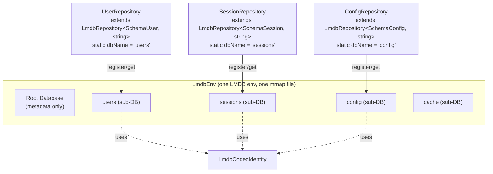
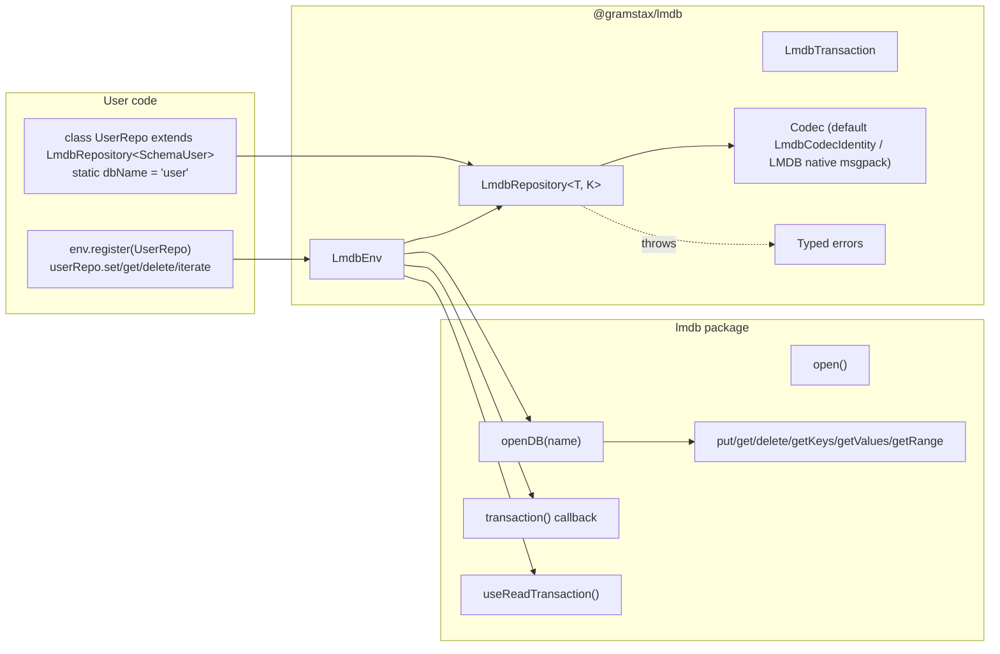
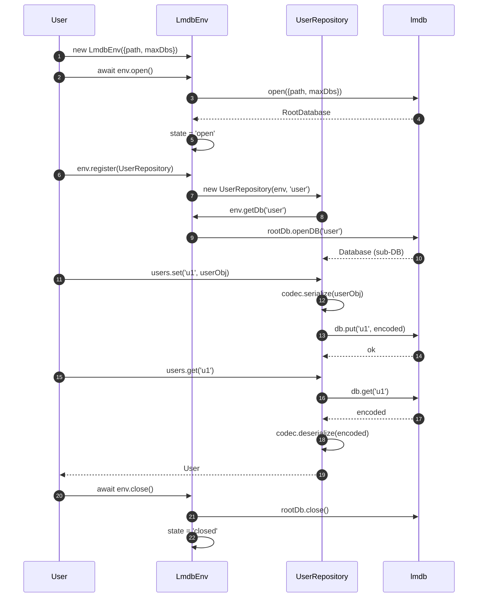
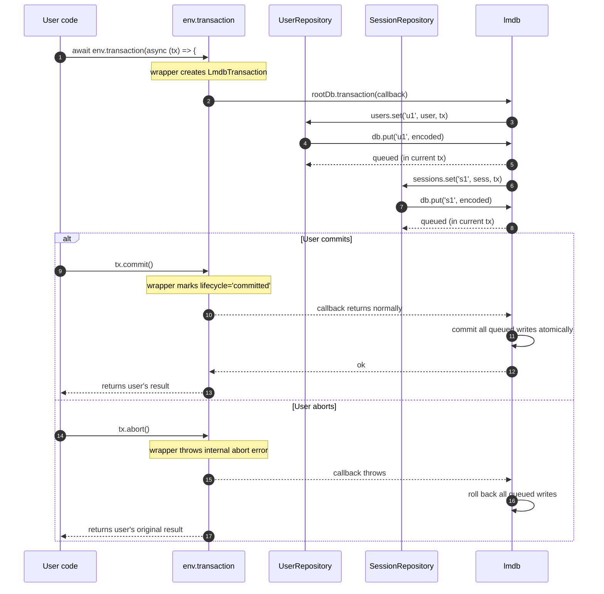

# @gramstax/lmdb

LMDB-backed key-value database with OOP Repository pattern per sub-database. Multi-runtime (Bun, Node.js >=18).

## Features

- **OOP Repository pattern** — each repository owns a sub-database (named `dbName`) and exposes typed CRUD over it
- **Cross-repository transactions** — atomic writes across multiple repositories via `env.transaction()`
- **Snapshot reads** — consistent point-in-time reads via `env.readTransaction()`
- **Typed codec system** — default `LmdbCodecIdentity` (LMDB native msgpack, fastest + 40% smaller), override with `new LmdbCodecJson()` for human-readable storage, `LmdbCodec.create()` for custom serializers
- **Range queries & streaming** — `keys`/`values`/`entries`/`iterate` with start/end/limit/offset/reverse options
- **Read-only mode** — open envs as read-only for safe sharing
- **Async (Promise-based)** API

## Runtime Support

| Runtime | Status       | Notes               |
| ------- | ------------ | ------------------- |
| Bun     | ✅ Supported | `>= 1.0.0` — native |
| Node.js | ✅ Supported | `>= 18`             |

**Dependencies**: One runtime dep — [`lmdb`](https://www.npmjs.com/package/lmdb) — for the LMDB native binding via Node-API.

## Install

```bash
bun add @gramstax/lmdb
# or
npm install @gramstax/lmdb
```

## Quick Start

```typescript
import { LmdbEnv, LmdbRepository } from "@gramstax/lmdb";

type SchemaUser = {
  id: string;
  name: string;
  age: number;
};

class UserRepository extends LmdbRepository<SchemaUser, string> {
  static dbName = `user`;
}

const env = new LmdbEnv({ path: `./data`, maxDbs: 10 });
await env.open();

const users = env.register(UserRepository);

await users.set(`u1`, { id: `u1`, name: `Alice`, age: 30 });
const u1 = await users.get(`u1`);
//    ^? { id: string; name: string; age: number } | undefined

console.log(await users.count()); // 1

await env.close();
```

## The Problem: SQL Tables Are Too Rigid For Key-Value

In SQL, tables have rigid schemas. Adding a new "table" means a migration. Changing one means a careful ALTER TABLE dance. Indexes are global, locks propagate across the whole DB, and the type system is the schema — not your application.

For a Telegram bot, you don't need this. You need:

```typescript
users.get(id); // typed, O(1)
sessions.set(id, s); // typed, fast
config.get(key); // typed, fast
cache.del(key); // typed, fast
```

No migrations. No schema. No global locks. Just typed CRUD over many small namespaces.

## The Solution: Repository-Per-Sub-DB With Typed Codecs

`@gramstax/lmdb` wraps the LMDB native binding with an OOP `Repository<T, K>` class. Each repository subclass declares a `static dbName` and gets one isolated sub-database inside a single LMDB env.



**Why sub-DBs, not one shared DB with prefix-encoded keys?**

| Approach                         | Pros                                                          | Cons                                                                           |
| -------------------------------- | ------------------------------------------------------------- | ------------------------------------------------------------------------------ |
| **One sub-DB per repo** (chosen) | Clean cursor isolation, simple `count()`, `clear()`, `drop()` | Limited to `maxDbs` (set high in `LmdbEnvOptions`)                             |
| One shared DB with prefixes      | Unlimited logical "tables"                                    | Range queries must encode prefix bounds manually; cursor leaks across prefixes |

For most bots, you'd never hit `maxDbs: 128` (LMDB's recommended upper bound). If you do, bump it.

## Architecture Overview



**Key components:**

| Component                | Lives in      | Role                                                                                               |
| ------------------------ | ------------- | -------------------------------------------------------------------------------------------------- |
| `LmdbEnv`                | top-level     | Opens one LMDB env, manages sub-DBs, transactions, lifecycle                                       |
| `LmdbRepository<T, K>`       | abstract base | Typed CRUD over one sub-DB; subclass with `static dbName`                                          |
| `LmdbTransaction`            | wrapper       | Lifecycle API (`commit`/`abort`/`lifecycle`/`raw`)                                                 |
| `ICodec<T>`              | codec.ts      | Default LmdbCodecIdentity (LMDB msgpack) + `LmdbCodecJson` + `LmdbCodec.create` factory for custom serializers |
| `LmdbError` + subclasses | errors.ts     | Typed errors: `instanceof`-discriminable                                                           |

## Lifecycle: Open → Register → Use → Close



## Cross-LmdbRepository Transactions

For atomic writes spanning multiple repositories, use `env.transaction(fn)`. The wrapper detects user-initiated aborts and re-throws user errors wrapped in `LmdbTransactionError`.



**Important caveat** — LMDB's async batching model auto-commits awaited puts in the next event turn. Awaiting `users.set(...)` inside the callback may put the write in a separate transaction context. For true rollback semantics across awaits, ensure the callback is short and sync where possible.

## API

### `LmdbEnv`

```typescript
new LmdbEnv({
  path: string,           // filesystem path for the data files
  maxDbs?: number,        // max named sub-databases (default 10)
  compression?: boolean,  // enable LMDB compression (default false)
  readOnly?: boolean,     // open in read-only mode (default false)
  maxReaders?: number,    // max concurrent readers (default 126)
  mapSize?: number,        // virtual memory mapping in bytes (default 256 MB)
})

await env.open()
env.register(RepoClass)        // returns typed Repo instance
env.get(RepoClass)             // get previously-registered instance
env.has(RepoClass)             // boolean check
await env.transaction(fn)      // cross-repo write transaction
await env.readTransaction(fn)  // snapshot read
await env.close()
```

### `LmdbRepository<T, K>`

```typescript
class UserRepository extends LmdbRepository<SchemaUser, string> {
  static dbName = `user`
  // Optional: static serialize / static deserialize / static codec
}

await users.set(key, value, tx?)    // write
const v = await users.get(key, tx?)  // read (T | undefined)
const exists = await users.has(key)   // boolean
const deleted = await users.delete(key) // boolean (true if existed)
await users.clear()                   // remove all
const n = await users.count()         // O(1)

// Iteration
const keys = await users.keys(options?)      // K[]
const values = await users.values(options?)    // T[]
const entries = await users.entries(options?)  // [K, T][]
for await (const [k, v] of users.iterate(options?)) { ... }
```

### `LmdbTransaction`

```typescript
await env.transaction(async (tx) => {
  await userRepo.set("u1", user, tx);
  await sessionRepo.set("s1", session, tx);
  tx.commit(); // explicit commit (otherwise callback return auto-commits)
});

tx.lifecycle; // 'active' | 'committed' | 'aborted'
tx.done; // true when lifecycle !== 'active'
tx.isCommitted; // true after tx.commit()
tx.isAborted; // true after tx.abort()
tx.raw; // underlying LMDB read transaction (read-tx only)
```

## Codec Choice

The default codec is `LmdbCodecIdentity` (LMDB native msgpack — fastest, 40% smaller on disk for large payloads). Override `static codec` to switch.

| Codec                                  | Storage                          | Performance             | Use when                                            |
| -------------------------------------- | -------------------------------- | ----------------------- | --------------------------------------------------- |
| `new LmdbCodecIdentity()` (default)        | Binary msgpack                   | Fastest reads, smallest | Default for performance                             |
| `new LmdbCodecJson()`                      | Human-readable JSON              | Slightly slower reads   | Need `cat`/`strings` inspection, cross-tool inspect |
| `LmdbCodec.create(serialize, deserialize)` | Custom (msgpack, protobuf, etc.) | Depends on format       | Date, custom types, domain-specific encoding        |
| Static `serialize` / `deserialize`     | Custom (typically JSON)          | Depends on format       | Legacy compat with old JSON layout                  |

**Benchmark snapshot** (2,000 ops per codec, fresh env per codec, `process.hrtime.bigint`):

```
                          SMALL (4 fields)  MEDIUM (12 fields)  LARGE (40 fields)  HUGE (22KB)
LmdbCodecIdentity   read p50:   57us              90us                163us              534us
LmdbCodecJson       read p50:   49us              77us                109us              605us
LmdbCodecIdentity   size/value: 397B              790B                4.6KB              13.3KB
LmdbCodecJson       size/value: 397B              922B                4.6KB              22.1KB
```

- **SMALL/MEDIUM**: LmdbCodecJson has slightly faster reads (V8 native JSON.parse); sizes similar.
- **LARGE**: LmdbCodecJson faster reads, same size.
- **HUGE**: LmdbCodecIdentity wins reads by **1.13x** and storage by **40%**.

## Custom Codecs

Override the default codec for non-standard types:

```typescript
class DateRepo extends LmdbRepository<Date, string> {
  static dbName = `cache-date`;
  static codec = LmdbCodec.create<Date, number>(
    (d) => d.getTime(),
    (n) => new Date(n),
  );
}
```

Or use static methods:

```typescript
class SessionRepo extends LmdbRepository<SchemaSession, string> {
  static dbName = `session`;
  static serialize(value: SchemaSession): string {
    return JSON.stringify({ ...value, ts: value.ts.getTime() });
  }
  static deserialize(raw: string): SchemaSession {
    const obj = JSON.parse(raw);
    return { ...obj, ts: new Date(obj.ts) };
  }
}
```

## Range Queries

```typescript
await users.keys({ start: `u1`, end: `u5`, limit: 10 });
await users.values({ start: `u1`, end: `u5` });
await users.entries({ start: `u1`, end: `u5`, reverse: true });

// LMDB reverse convention: start > end
await users.entries({ start: `u5`, end: `u1`, reverse: true });
```

## License

Proprietary — Copyright (c) 2026 Gramstax. See [LICENSE](./LICENSE).
