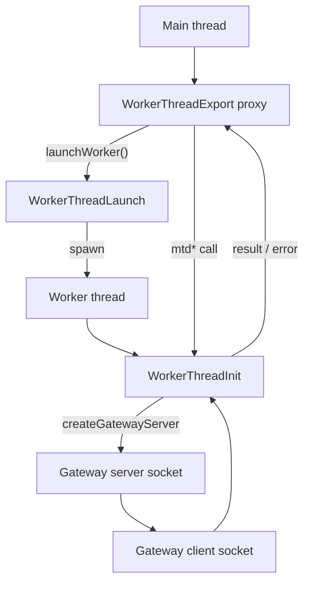

<div align="center">
  <h1>@gramstax/worker-thread</h1>

  <p>Multi-runtime worker threads for Bun and Node.js — spawn a worker, call its methods like local async functions, and let workers talk to each other directly over a socket.</p>
  <p>
    
    
    
    
  </p>
</div>

## ✨ Features

### Lifecycle

- 🧵 **Spawn and forget** — `launchWorker()` spawns the thread and resolves when it signals ready
- 📞 **Local-looking calls** — `await Job.mtdAdd(2, 3)` reads like an async function; the transport is someone else's problem
- 🧹 **Two kinds of stop** — `shutdown()` drains through `onBeforeExit()` before terminating; `kill()` is the immediate exit
- 📡 **Lifecycle events** — `ready`, `exit`, and `error` on the main-thread handle, so you react instead of polling

### Type safety

- 🧩 **The worker class is the contract** — `WorkerThreadExport.init()` derives the client from your real class, so a renamed method is a compile error rather than a runtime one
- 🚦 **`mtd` prefix** — only `mtd*` methods cross the boundary, keeping internals private and the exposed surface greppable

### Scale

- 🧺 **Pools** — round-robin dispatch across many workers, plus fan-out that reports per worker instead of failing as a batch
- 🌉 **Worker-to-worker gateway** — a socket channel so sibling workers talk directly, with the main thread off the hot path
- 🔌 **Cross-platform** — Unix sockets on POSIX, named pipes on Windows, path normalized for you

### Reliability & safety

- ⏱️ **Timeouts with an opt-out** — 30 s default per request; pass `0` for calls that legitimately run longer
- 💥 **Crash detection** — when a worker dies, its pending calls reject instead of hanging forever
- 🔒 **Gateway auth** — a shared token plus a per-method allow-list; exposing a worker without a list throws
- 🛡️ **Prototype-pollution guard** — `__proto__`, `constructor`, and `prototype` are refused as RPC methods
- 📏 **Message cap** — 10 MB by default, so one oversized frame cannot exhaust memory

## 🚀 Quick Start

### 1. Prerequisites

- [Bun](https://bun.sh) v1.0+ or Node.js v18+

### 2. Install

```bash
bun add @gramstax/worker-thread
```

### 3. Write the worker

Extend `WorkerThreadInit` and prefix the methods you want reachable with `mtd`.

```ts
import {WorkerThreadExport, WorkerThreadInit} from "@gramstax/worker-thread"

export class ProcessorWorker extends WorkerThreadInit {
  mtdAdd(a: number, b: number) {
    return a + b
  }
}

export const ProcessorJob = WorkerThreadExport.init({
  path: __filename,
  WTInit: ProcessorWorker
})
```

### 4. Launch and call

```ts
import {ProcessorJob} from "./processor"

const worker = await ProcessorJob.launchWorker()
console.log(await ProcessorJob.mtdAdd(2, 3))
await worker.shutdown()
```

### 5. Shut down cleanly

Override `onBeforeExit()` in the worker to flush state, then `shutdown()` from the main thread. It force-terminates after 5 s if the drain hangs.

## 📖 Usage

### Lifecycle

```text
main thread:  launch → ready → request… → shutdown
worker:       constructor → signals ready → handles RPC → onBeforeExit() → terminated
```

| Phase               | How                                                       | Notes                                                  |
| :------------------ | :-------------------------------------------------------- | :----------------------------------------------------- |
| Spawn               | `launchWorker(argv?)`                                    | Extra argv is readable in the worker                   |
| Ready               | resolves automatically                                   | Rejects if the worker dies before signalling ready      |
| RPC                 | `Job.mtdFoo(...)` or `worker.request(m, params, wait?, others?, timeoutMs?)` | Typed proxy preferred |
| Kill                | `worker.kill()`                                           | Immediate terminate, no cleanup                        |
| Graceful            | `worker.shutdown(timeoutMs?)`                            | Runs `onBeforeExit()`, force-terminates after the timeout |

A worker can call back into the main thread — as long as the main-thread class declares the method:

```ts
// main.ts — your launch class, so you own the method name
export class MainThread extends WorkerThreadLaunch {
  mtdGetConfig() {
    return {feature: true}
  }
}

// inside your worker
const answer = await this.request(`mtdGetConfig`, [])
```

### Worker pool

```ts
import {WorkerThreadPool} from "@gramstax/worker-thread"

// `mtdAdd` is the worker method declared in the quick start above.
const pool = new WorkerThreadPool(await Promise.all([1, 2, 3].map(() => ProcessorJob.launchWorker())))
const sums = await Promise.all([1, 2, 3, 4].map((n) => pool.execute(`mtdAdd`, [n, 10])))
```

`execute` spreads calls round-robin. `broadcastRequest` fans out to every worker and rejects if any fail; `broadcastSettled` returns one result per worker, which is usually what you want for best-effort fan-out. Workers that exit are dropped from the pool automatically, and `threadCount` reflects the live ones.

### Inter-worker gateway

`node:worker_threads` gives each worker exactly one channel — its `parentPort` back to the main thread. The gateway adds a second one, directly between workers.

```text
Worker A ──parentPort──▶ Main ◀──parentPort── Worker B
Worker A ─────── socket ─────── Worker B          (gateway, no relay)
```

Server side:

```ts
class ServerWorker extends WorkerThreadInit {
  async mtdStart() {
    return await this.createGatewayServer(`/tmp/server.sock`, this, {
      token: `shared-secret`,
      allowedMethods: [`mtdHello`]
    })
  }
}
```

Client side:

```ts
const result = await ServerJob.launchGatewayClient(`/tmp/server.sock`, {token: `shared-secret`})
console.log(await result.mtdHello(`ClientWorker`))
```

Clients reconnect automatically with exponential backoff (`reconnect: true` by default, `retries: 50`, `maxRetryTime: 500`).

## 🔍 How it works



Calls travel as JSON-RPC envelopes (`id`, `method`, `params`, `result`, `error`). The main thread sends, the worker dispatches to the matching `mtd*` method, and the reply carries a value or a structured error. `WorkerThreadRpc` does the framing, size check, timeout, and method filtering underneath — you normally never touch it.

The gateway is the same protocol over a socket instead of a thread port. That is the whole idea: one hop and one serialization, and the main thread only orchestrates lifecycle.

## 📜 Scripts

```bash
bun run build   # bundle with tsup
bun run bench   # RPC round-trip, gateway round-trip, pool benchmarks
```

## 🗂️ Project Structure

```text
packages/worker-thread/
├── src/
│   ├── init.ts             # WorkerThreadInit — worker side
│   ├── launch.ts           # WorkerThreadLaunch — main-thread handle
│   ├── export.ts           # WorkerThreadExport — typed proxy factory
│   ├── pool.ts             # WorkerThreadPool — round-robin + broadcast
│   ├── gateway-server.ts   # socket RPC server
│   ├── gateway-client.ts   # socket RPC client
│   ├── gateway-path.ts     # socket path normalization
│   ├── rpc.ts              # low-level JSON-RPC dispatcher
│   ├── error-handler.ts    # package-wide error routing
│   └── types/              # one types file per runtime module
├── example/                # runnable clusters
└── bench/                  # round-trip and pool benchmarks
```

## 🔧 Configuration

### `WorkerThreadExport.init`

The factory both instantiates the worker and returns the main-thread proxy, so one declaration serves both processes.

| Option     | Default                 | Purpose                                                                        |
| :--------- | :---------------------- | :----------------------------------------------------------------------------- |
| `path`     | **required**            | Path to the worker file — normally `__filename` for a self-referential worker  |
| `WTInit`   | **required**            | Worker class extending `WorkerThreadInit`                                     |
| `WTLaunch` | `WorkerThreadLaunch`    | Main-thread class, when you need your own `mtd*` methods on the launch side    |
| `wrap`     | —                       | Wrap the main-thread handle in a custom type                                  |

### Exported calls

```ts
await Job.launchWorker(argv?)      // spawn + wait until ready
await Job.launchGatewayClient(path, options)
await Job.shutdown(timeoutMs?)
```

`argv` items beyond the first two are readable inside the worker as `this.argv[3]...`.

### RPC per call

```ts
worker.request(method, params, wait?, others?, timeoutMs?)
```

| Argument     | Default             | Meaning                                                        |
| :----------- | :------------------ | :------------------------------------------------------------- |
| `method`     | —                   | Name of the `mtd*` method                                      |
| `params`     | `[]`                | Arguments passed positionally                                  |
| `wait`       | `true`              | Resolve when the worker answers; `false` for fire-and-forget   |
| `others`     | —                   | Broadcast to a pool instead of one worker                      |
| `timeoutMs`  | `30000`             | Reject after this many ms; **`0` disables the timeout**        |

To change the default for every call on one instance, set `rpc.defaultTimeoutMs`:

```ts
worker.rpc.defaultTimeoutMs = 60_000
```

A call that passes `0` keeps running in the worker after the caller gives up, so a naive retry double-executes it. Size the timeout to the work, not to hope.

### Gateway server

```ts
this.createGatewayServer(path, register?, {token, allowedMethods, maxConnections, maxMessageSize})
```

| Option           | Default                    | Purpose                                                       |
| :--------------- | :-------------------------- | :------------------------------------------------------------ |
| `token`          | —                          | Connections without a matching token are closed immediately   |
| `allowedMethods` | —                          | Remote call surface; **required** when `register` is the whole worker |
| `maxConnections` | `net-ipc` default          | Concurrent connection ceiling                                 |
| `maxMessageSize` | `DEFAULT_MAX_MESSAGE_SIZE` | Estimated cap in bytes for one incoming message               |

Passing `undefined` for `register` would expose the entire worker instance, so that combination throws unless a non-empty `allowedMethods` list is supplied. An empty list denies everything — it never opens anything.

### Gateway client

```ts
launchGatewayClient(path, {token, reconnect, retries, maxRetryTime, maxMessageSize, messagepack})
```

| Option           | Default                    | Purpose                                                       |
| :--------------- | :-------------------------- | :------------------------------------------------------------ |
| `token`          | —                          | Must match the server's                                       |
| `reconnect`      | `true`                     | Reconnect automatically when the connection drops              |
| `retries`        | `net-ipc` default          | Reconnect attempts before giving up                           |
| `maxRetryTime`   | `net-ipc` default          | Upper bound in ms for the exponential backoff                 |
| `maxMessageSize` | `DEFAULT_MAX_MESSAGE_SIZE` | Estimated cap in bytes for one incoming message                |
| `messagepack`    | `false`                    | Use msgpackr instead of JSON, preserving `Date`, `BigInt`, `undefined`, and typed arrays |

`retries` and `maxRetryTime` are only forwarded when you set them; otherwise `net-ipc`'s own defaults apply.

### Constants

| Constant                     | Default | Purpose                                    |
| :--------------------------- | :------ | :----------------------------------------- |
| `DEFAULT_REQUEST_TIMEOUT_MS` | `30000` | Per-request timeout in ms                  |
| `DEFAULT_MAX_MESSAGE_SIZE`   | 10 MB   | Largest payload accepted in one RPC message |
| `DENIED_RPC_METHODS`         | `__proto__`, `constructor`, `prototype`, … | Refused before dispatch      |

### Error handling

The library never writes to the console. Errors on a worker with no `error` listener go to the package-wide handler, which is silent by default:

```ts
import {WorkerThreadErrorHandler} from "@gramstax/worker-thread"

WorkerThreadErrorHandler.setDefault((err) => logger.error(err))
```

Attach it at boot, or a worker crash disappears silently.

## 🏗️ Architecture

- **The `mtd` prefix is the boundary.** Only those methods are reachable, so a refactor inside the worker cannot silently break the main thread.
- **Types flow one way.** The worker class is the single source of truth and the client is derived from it, so the two cannot drift apart.
- **Gateway is opt-in.** Single-worker apps never touch it; it exists for meshes, and it reuses the same protocol rather than inventing a second one.
- **Delivery is at-least-once.** The transport retries failed writes and replays in-flight requests across reconnects, so a handler can observe the same id twice. Request ids are monotonic per client and the server dedupes per connection — but keep handlers idempotent anyway, since responses over 64 KB are never cached.

## ✅ Testing

Workers are plain classes, so a handler can be tested without a thread:

```ts
const worker = new ProcessorWorker()
expect(worker.mtdAdd(2, 3)).toBe(5)
```

For the transport, `example/` holds runnable clusters covering lifecycle events, gateway auth, pools, timeouts, and shutdown:

```bash
bun packages/worker-thread/example/worker-main.ts
```

That starts an authenticated gateway server, three pooled client workers, round-robin compute tasks, an RPC timeout, and a graceful teardown.

## 🚢 Deployment

- **A pool is threads, not processes** — it scales CPU work inside one process. Use separate processes when you need memory isolation.
- **Drain before you close** — shut the worker down before closing whatever it writes to, or an in-flight call lands on a closed handle.
- **The gateway is single-host** — the socket lives on the machine, so it only reaches workers on the same host.
- **Errors are silent by default** — the library never logs to the console. Attach `WorkerThreadErrorHandler.setDefault()` or listen for `error` on the handle, or failures disappear.

## 🩺 Troubleshooting

| Symptom                       | Likely cause                                  | Fix                                                         |
| :---------------------------- | :-------------------------------------------- | :---------------------------------------------------------- |
| `request is not a function`   | Method lacks the `mtd` prefix                | Rename it — the prefix is the boundary                       |
| `ready()` rejected            | Worker crashed during boot                    | Read the error event; the worker never signalled ready       |
| Caller hangs forever          | A call exceeded the timeout                   | Pass an explicit `timeoutMs`, or `0` for long tasks         |
| `__proto__ is not a function` | A method name collided with a prototype key   | Expected — it is denied on purpose; rename the method        |
| Gateway rejects the client    | Token mismatch, or path differs between hosts | Both sides need the same secret and the same resolved path   |
| `allowedMethods` required     | Exposing the whole worker instance            | Pass an explicit non-empty list — an empty list denies all    |

## 🧰 Tech Stack

- [Bun](https://bun.sh) / Node.js `worker_threads`
- [net-ipc](https://www.npmjs.com/package/net-ipc) — gateway socket transport
- [mitata](https://github.com/benoitgrelard/mitata) — benchmarks
- [tsup](https://tsup.egoist.dev) — bundler
- TypeScript in strict mode (`noUncheckedIndexedAccess`)

## 📚 Learn More

- [Worker-thread best practices](./AGENTS.md) — conventions, topology, and anti-patterns
- [`example/worker-main.ts`](./example/worker-main.ts) — a full cluster in one file
- [Node worker_threads](https://nodejs.org/api/worker_threads.html)

## 📄 License

Proprietary — Copyright (c) 2026 Gramstax. See [LICENSE](./LICENSE).
