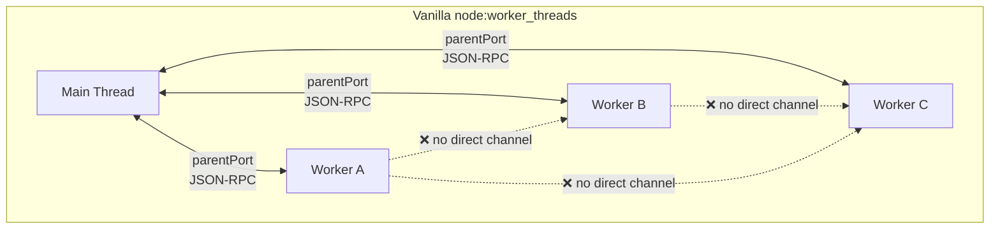
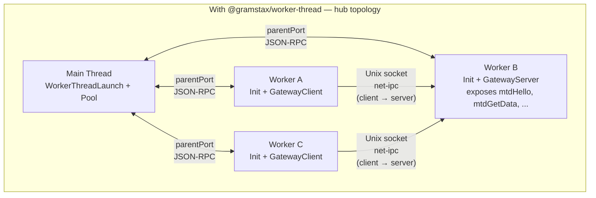
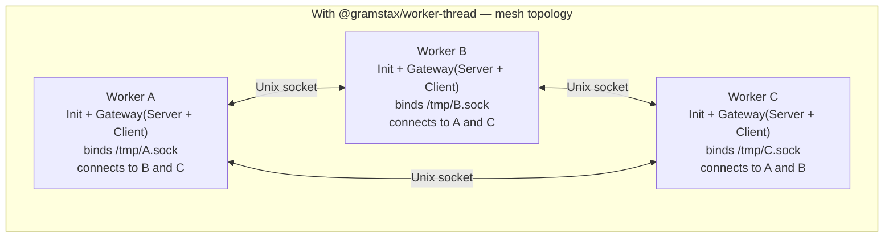
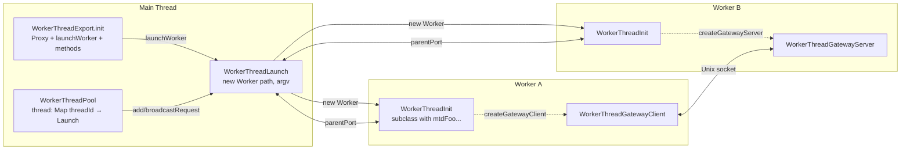
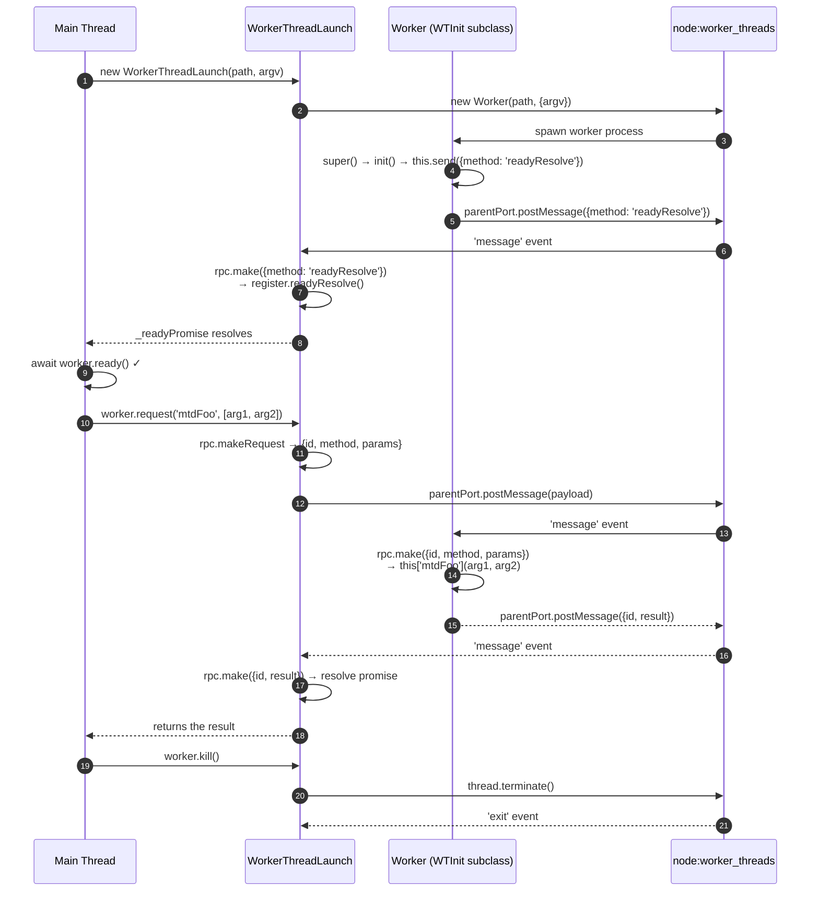
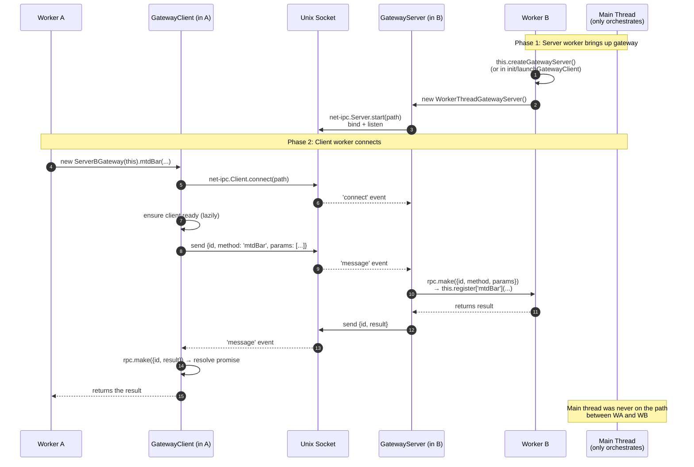
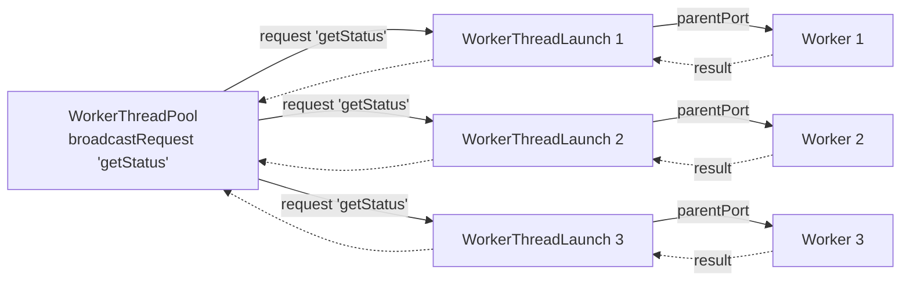

# @gramstax/worker-thread

Multi-runtime worker thread utilities with RPC and Unix socket gateway. Works in **Bun** and **Node.js** (>=18).

## Features

- Worker thread lifecycle management (`WorkerThreadInit`, `WorkerThreadLaunch`)
- Type-safe RPC via proxy (`WorkerThreadExport.init`)
- Inter-worker gateway over Unix domain sockets (`WorkerThreadGatewayServer/Client`)
- Worker pool with broadcast (`WorkerThreadPool`)
- JSON-RPC over `node:worker_threads` `parentPort`

## Runtime Support

| Runtime | Status       | Notes               |
| ------- | ------------ | ------------------- |
| Bun     | ✅ Supported | `>= 1.0.0` — native |
| Node.js | ✅ Supported | `>= 18` — native    |

**Transport**: In-worker IPC uses `node:worker_threads`. Inter-worker gateway uses Unix domain sockets via the `net-ipc` library, which works on both Bun and Node.js.

**Dependencies**: One runtime dep — [`net-ipc`](https://www.npmjs.com/package/net-ipc) — for the Unix-socket gateway transport.

## Install

```bash
bun add @gramstax/worker-thread
# or
npm install @gramstax/worker-thread
```

## The Problem: Default `node:worker_threads` Has No Direct Worker-to-Worker Channel

`node:worker_threads` workers are isolated. Each worker has exactly one channel — its `parentPort` back to the thread that spawned it. There is no built-in way for two sibling workers to talk to each other; every message has to be relayed through the main thread.



**Consequences:**

- Main thread becomes a **forced message broker** for all inter-worker traffic
- Every cross-worker call costs **two hops** (sender → main → receiver) and **two serializations**
- Main-thread event loop becomes a **bottleneck** — if it stalls, all worker-to-worker traffic stalls too
- Adds **latency** and **back-pressure** on the central thread

## The Solution: Unix-Socket Gateway Side-Channels

`@gramstax/worker-thread` adds a **peer-to-peer transport** on top of `node:worker_threads`. The transport is **client–server** under the hood (via `net-ipc`): one side calls `createGatewayServer()` to bind a socket, the other side calls `createGatewayClient(path)` to connect. The main thread is no longer required to relay messages between siblings.

**Hub topology (most common):** one worker runs the gateway server and exposes its methods; every other worker (and the main thread) connects to it as a client. No main-thread relay on the hot path.



**Mesh topology (advanced):** any worker can be **both** a server and a client at the same time — just call `createGatewayServer()` and `createGatewayClient(peerPath)` on the same instance. That gives you a full peer-to-peer mesh where every worker can expose methods to its peers and call into them.



**Important:** a `GatewayClient` cannot talk directly to another `GatewayClient` — there is no discovery, no peer-to-peer mode in the transport. The socket is a named pipe with exactly one bind side and one or more connect sides. The "peer-to-peer" property of the package is that **the main thread is not involved** — not that any two endpoints can speak without a server somewhere.

**Result:**

- Inter-worker calls are **one hop, one serialization** (no main-thread relay on the data path)
- Main-thread is **freed** from relaying — it only orchestrates lifecycle (`ready`, `kill`)
- Each worker can **discover and connect** to peers at runtime (via the peer's socket path)
- Back-pressure on one channel **does not** block unrelated worker-to-worker traffic

## Architecture Overview



**Key components:**

| Component                   | Lives in      | Role                                                                          |
| --------------------------- | ------------- | ----------------------------------------------------------------------------- |
| `WorkerThreadLaunch`        | main thread   | spawns a worker, holds `parentPort` link, exposes `request()`                 |
| `WorkerThreadInit`          | worker thread | base class for worker code; holds `parentPort` link, exposes `request()`      |
| `WorkerThreadRpc`           | both          | JSON-RPC dispatcher (request/result/error envelopes)                          |
| `WorkerThreadGatewayServer` | worker thread | binds a Unix socket, routes incoming RPC calls to registered methods          |
| `WorkerThreadGatewayClient` | worker thread | connects to a peer's gateway socket, sends RPC requests                       |
| `WorkerThreadPool`          | main thread   | manages many `WorkerThreadLaunch` instances, supports broadcast               |
| `WorkerThreadExport.init`   | both          | factory that returns a typed proxy whose methods auto-RPC across `parentPort` |

## Lifecycle: Spawn → Ready → RPC → Kill



## Inter-Worker Communication (Direct, Bypassing Main Thread)

This is the headline feature. Once a worker has `createGatewayServer()` running, any other worker (or even the main thread) can reach its methods directly over a Unix socket — no relay, no main-thread bottleneck.



**Key points:**

- The **main thread is completely off the inter-worker hot path** — it only spawns/kills workers
- The connection is **lazily created on first call** (`owner.createGatewayClient(path)` only runs if the gateway isn't already in `owner.gatewayClients`)
- The `register` object can be **`this`** (expose the worker itself) **or any plain object** with callable methods
- Multiple workers can **share one gateway** (server side fans out to all connected clients)
- A worker can run **both** a server and clients — it can serve peers **and** call out to others

## Pool Broadcast

`WorkerThreadPool.broadcastRequest` is the only "many-to-many" call that still uses the main-thread path — and that is by design: the main thread owns the worker registry, so fanning out from there is the natural place.



If you need **worker-to-worker broadcast** (e.g. all workers need to ask every other worker the same question), wire it through a gateway — that path bypasses the pool and main thread entirely.

## Quick Start

```typescript
import { WorkerThreadExport, WorkerThreadInit } from "@gramstax/worker-thread";

class CounterWorker extends WorkerThreadInit {
  count = 0;
  mtdAutoIncrement(ms: string) {
    setInterval(() => {
      this.count += 1;
    }, ms);
  }

  mtdGetNumber() {
    return this.count;
  }
}

export const CounterJob = WorkerThreadExport.init({
  path: __filename,
  WTInit: CounterWorker,
});

// main.ts
await CounterJob.launchWorker();
console.log(await CounterJob.mtdGetNumber()); // 0
await CounterJob.mtdAutoIncrement(`1000`); // 1 seconds
setTimeout(() => {
  console.log(await CounterJob.mtdIncrement()); // >1
}, 2000);
```

## Inter-worker gateway example

```typescript
// server-worker.ts
import { WorkerThreadExport, WorkerThreadInit } from "@gramstax/worker-thread";

class ServerWorker extends WorkerThreadInit {
  static gatewayServerPath = "/tmp/server.sock";
  mtdHello(from: string) {
    return `Hello ${from}!`;
  }

  async mtdStart() {
    return await this.createGatewayServer();
  }
}

export const Server = WorkerThreadExport.init({
  path: __filename,
  WTInit: ServerWorker,
});
export const ServerGateway = Server.launchGatewayClient();

// client-worker.ts
import { ServerGateway } from "./server-worker";
import { WorkerThreadExport, WorkerThreadInit } from "@gramstax/worker-thread";

class ClientWorker extends WorkerThreadInit {
  async mtdCallServer() {
    // pass `this` as first arg — the gateway client needs an owner with a gatewayClients map
    return await ServerGateway.mtdHello(this, "ClientWorker");
  }
}

export const Client = WorkerThreadExport.init({
  path: __filename,
  WTInit: ClientWorker,
});

// main.ts
await Server.launchWorker();
await Client.launchWorker();
await Server.mtdStart();
console.log(await Client.mtdCallServer()); // "Hello ClientWorker!"
```

## API

| Export                      | Description                                  |
| --------------------------- | -------------------------------------------- |
| `WorkerThreadInit`          | Base class for worker thread implementations |
| `WorkerThreadLaunch`        | Main-thread side to spawn workers            |
| `WorkerThreadExport`        | `init()` factory creating typed proxy        |
| `WorkerThreadPool`          | Manage multiple workers + broadcast          |
| `WorkerThreadRpc`           | JSON-RPC dispatcher                          |
| `WorkerThreadGatewayServer` | Unix-socket server for inter-worker comms    |
| `WorkerThreadGatewayClient` | Unix-socket client for inter-worker comms    |

See [JSDoc](./src/) in source for full API.

## License

Proprietary — Copyright (c) 2026 Gramstax. See [LICENSE](./LICENSE).
