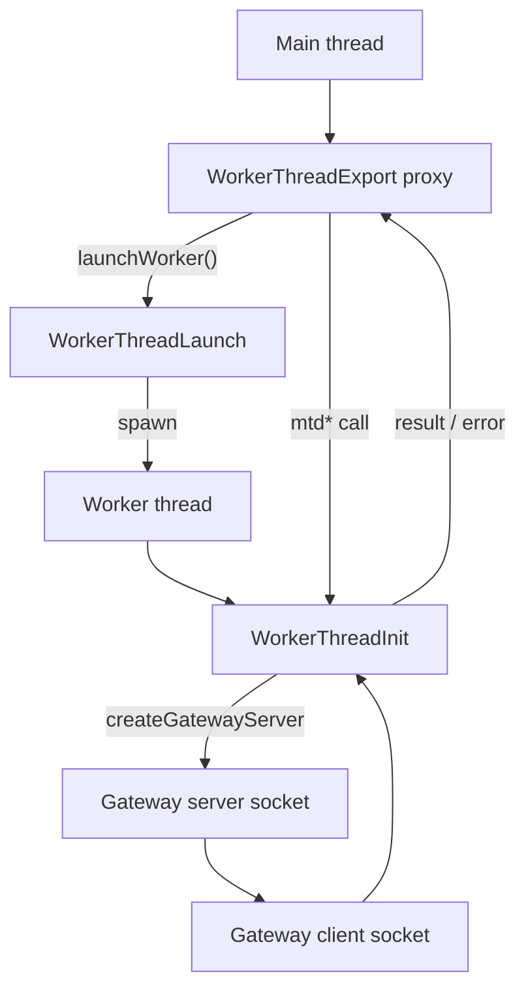

<div align="center">
  <h1>@gramstax/worker-thread</h1>

  <p>Multi-runtime worker threads for Bun and Node.js: spawn a worker, call its methods like local async functions, and let workers talk to each other directly over a socket.</p>
  <p>
    <a href="https://github.com/gramstax/gramstax/actions/workflows/release.yml"></a>
    
    
    
    
    <a href="https://gramstax.mintlify.site/"></a>
    
  </p>
</div>

`node:worker_threads` gives you a channel and leaves you the rest. Spawning a
worker means wiring a `parentPort`, inventing a request id scheme, deciding
what a reply looks like when it never comes, and, before any of that, working
out how one worker reaches another, since every worker has exactly one channel
and it points at the main thread.

This package owns those parts. You write a class, mark the methods that should
be reachable, and call them as if they were local:

```ts

const worker = await EchoWorker.launchWorker()
console.log(await EchoWorker.mtdAdd(2, 3)) // 5. result from worker thread
```

The transport, the id matching, the timeout, the error propagation, and the
worker-to-worker path are the package's problem, not yours.

## 💡 Why this package

Four decisions usually get remade in every project that uses raw worker
threads, and each of them has a failure mode that only shows up in production.

| Decision | What you write yourself | What this package does |
| :------- | :---------------------- | :---------------------- |
| The request protocol | Envelope shape, id scheme, reply matching, error encoding | JSON-RPC envelopes with monotonic ids, a pending map, and a structured error payload |
| The exposed surface | A convention you have to remember and a lint rule to enforce | The `mtd` prefix, so the reachable methods are greppable |
| The type of a call site | `any`, or a hand-maintained interface | The client is derived from your worker class, so a renamed method breaks compilation at every call site |
| Worker-to-worker calls | A relay through the main thread, or a second transport | A socket gateway with a shared token, a per-method allow-list, and the same protocol underneath |

The result is that a worker is a class you can read in one file, and the
plumbing around it is a dependency rather than a project convention.

### What the package does not do

- It does not schedule work across processes. A pool is threads inside one
  process; use separate processes when you need memory isolation.
- It does not make a handler durable. A worker that dies takes its in-flight
  calls with it, and the gateway delivers at-least-once, not exactly-once.
- It does not log. The library never writes to the console, so failures are
  yours to surface.

## ✨ Features

### Lifecycle

- 🧵 **Spawn and forget**: `launchWorker()` spawns the thread and resolves when
  the worker signals ready.
- 📞 **Local-looking calls**: `await Job.mtdAdd(2, 3)` reads like an async
  function, and the transport is somebody else's problem.
- 🧹 **Two kinds of stop**: `shutdown()` drains through `onBeforeExit()` before
  terminating; `kill()` is the immediate exit.
- 📡 **Lifecycle events**: `ready`, `exit`, and `error` on the main-thread
  handle, so you react instead of polling.

### Type safety

- 🧩 **The worker class is the contract**: `WorkerThreadExport.init()` derives
  the client from your real class, so a renamed method is a compile error
  rather than a runtime one.
- 🚦 **`mtd` prefix**: only `mtd*` methods cross the boundary, which keeps
  internals private and the exposed surface greppable.

### Scale

- 🧺 **Pools**: round-robin dispatch across many workers, plus fan-out that
  reports per worker instead of failing as a batch.
- 🌉 **Worker-to-worker gateway**: a socket channel so sibling workers talk
  directly, with the main thread off the hot path.
- 🔌 **Cross-platform**: Unix sockets on POSIX, named pipes on Windows, with the
  path normalized for you.

### Reliability and safety

- ⏱️ **Timeouts with an opt-out**: 30 s default per request; pass `0` for calls
  that legitimately run longer.
- 💥 **Crash detection**: when a worker dies, its pending calls reject instead
  of hanging forever.
- 🔒 **Gateway auth**: a shared token plus a per-method allow-list. Exposing a
  whole worker instance without a list throws.
- 🛡️ **Denied method names**: `__proto__`, `constructor`, `prototype`, `send`,
  `request`, `kill`, `init`, `handleOnMessage`, `createGatewayServer`, and
  `createGatewayClient` are refused before dispatch.
- 📏 **Message cap**: the gateway estimates the decoded size of an incoming
  message and rejects anything over 10 MB.

## 🚀 Quick Start

### 1. Prerequisites

- [Bun](https://bun.sh) v1.0+ or Node.js v18+
- `typescript ^6.0.3` (peer dependency)

### 2. Install

```bash
bun add @gramstax/worker-thread
```

### 3. Write the worker

One file holds both halves. The class is the worker's core, so it is named
`Worker`; `WorkerThreadExport.init()` hands back the main-thread proxy, named
for what the worker does. Methods reachable from the main thread carry the
`mtd` prefix.

```ts
// echo-worker.ts
import {WorkerThreadExport, WorkerThreadInit} from "@gramstax/worker-thread"

export class Worker extends WorkerThreadInit {
  mtdAdd(a: number, b: number) {
    return a + b
  }
}

export const EchoWorker = WorkerThreadExport.init({
  path: __filename,
  WTInit: Worker
})
```

### 4. Launch and call

`EchoWorker` is an ordinary import: `launchWorker` and every `mtd*` method are
on it.

```ts
// main.ts
import {EchoWorker} from "./echo-worker"

const worker = await EchoWorker.launchWorker()
console.log(await EchoWorker.mtdAdd(2, 3)) // 5: an RPC into the worker
await worker.shutdown()
```

### 5. Shut down cleanly

Override `onBeforeExit()` on the worker so it can drain, then `shutdown()` from
the main thread. It force-terminates after 5 s if the drain hangs.

```ts
// echo-worker.ts: inside `Worker`
async onBeforeExit() {
  await this.flushState()
}

// main.ts
await worker.shutdown()
```

> **Naming**: `class Worker extends WorkerThreadInit` is the file's core, and
> the value returned by `WorkerThreadExport.init()` is what the main thread
> imports. When one file holds a server and one holds a client, both classes
> are called `Worker` and each export takes the role: `ServerWorker`,
> `ClientWorker`. The package's own `example/worker-server.ts` and
> `example/worker-client.ts` follow exactly this shape.

## 📖 Usage

### Lifecycle

```text
main thread:  launch → ready → request… → shutdown
worker:       constructor → signals ready → handles RPC → onBeforeExit() → terminated
```

| Phase | How | Notes |
| :----- | :-- | :---- |
| Spawn | `launchWorker(argv?)` | Extra argv is readable in the worker at `this.argv[3]` and up |
| Ready | resolves automatically | Rejects if the worker dies before signalling ready |
| RPC | `EchoWorker.mtdAdd(…)`: any `mtd*` method on the exported proxy | The proxy is derived from the worker class, so it autocompletes and cannot drift |
| Kill | `worker.kill()` | Immediate terminate, no cleanup |
| Graceful | `worker.shutdown(timeoutMs?)` | Runs `onBeforeExit()`, force-terminates after the timeout |

Two details about the exported proxy are worth knowing before you build on it:

- `Job.mtd*` routes to the **most recent** launch. Calling `launchWorker()` a
  second time does not create a second pool of call targets, it replaces the
  one the proxy talks to.
- `Job.shutdown(timeoutMs?)` drains **every** live instance that the proxy
  launched, so an earlier worker cannot leak.
- Calling any `mtd*` method before the first `launchWorker()` throws
  `Thread at <path> not launched yet.`

### Calling back into the main thread

A worker can call back into the main thread. That needs a class on the **main**
side, passed as `WTLaunch`, declaring the methods the worker may reach:

```ts
// main-thread.ts
import {WorkerThreadLaunch} from "@gramstax/worker-thread"

export class MainThread extends WorkerThreadLaunch {
  // `WTLaunch` calls this with `argv` possibly absent, so the constructor has
  // to declare it optional: the base class takes a required one.
  constructor(path: string, argv?: unknown[]) {
    super(path, argv ?? [])
  }

  mtdGetConfig() {
    return {feature: true}
  }
}
```

```ts
// echo-worker.ts: hand it to init() so the launch side is MainThread
import {MainThread} from "./main-thread"

export const EchoWorker = WorkerThreadExport.init({
  path: __filename,
  WTInit: Worker,
  WTLaunch: MainThread
})
```

```ts
// echo-worker.ts: inside `Worker`
const config = await this.request(`mtdGetConfig`, [])
```

Without `WTLaunch` the main-thread side is the plain `WorkerThreadLaunch`,
which has no `mtd*` methods of your own and the call has nowhere to land.

### Worker pool

A pool fans one worker class out over many threads. The worker class is
inferred from the handles you hand it, so its `mtd*` methods become callable
on the pool itself: no type argument, no cast. The trailing options object
selects the mode.

```ts
// main.ts: `EchoWorker` is from the quick start above
import {WorkerThreadPool} from "@gramstax/worker-thread"
import {EchoWorker} from "./echo-worker"

const pool = new WorkerThreadPool(await Promise.all([1, 2, 3].map(() => EchoWorker.launchWorker())))

// No options: round-robin across the pool. Returns one value.
console.log(await pool.mtdAdd(2, 3)) // 5

// mode: "broadcast". Every worker, fail-fast. Returns an array.
console.log(await pool.mtdAdd(2, 3, {mode: "broadcast"})) // [5, 5, 5]

// mode: "settled". Every worker, settled per worker. Never rejects on a peer.
console.log(await pool.mtdAdd(2, 3, {mode: "settled"}))

// A timeout rides in the same object.
console.log(await pool.mtdAdd(2, 3, {mode: "broadcast", timeoutMs: 5000}))

// add() reports the key it registered each worker under.
const id = pool.add(await EchoWorker.launchWorker())
console.log(id)

// One specific worker keeps the string form.
console.log(await pool.request(id, "mtdAdd", [2, 3]))
```

| Call | Dispatches to | Returns | Fails when |
| :--- | :------------ | :------ | :--------- |
| `pool.mtdX(…)` | `execute`: round-robin, one worker | `Promise<R>` | the chosen worker throws |
| `pool.mtdX(…, {mode: "broadcast"})` | `broadcastRequest`: all, fail-fast | `Promise<R[]>` | any worker throws |
| `pool.mtdX(…, {mode: "settled"})` | `broadcastSettled`: all, settled | `Promise<Outcome<R>[]>` | never on a peer; throws on an empty pool |
| `pool.request(id, "mtdX", params)` | `request`: one specific worker | `Promise<R>` | `id` is not in the pool |

Workers that exit are dropped from the pool automatically, and `threadCount`
reflects the live ones.

> **The options object is always last.** A worker method that ends in its own
> optional parameter owns that position first, so you pass a placeholder:
>
> ```ts
> // mtdBroadcast(text: string, key?: string)
> await pool.mtdBroadcast(text, undefined, {mode: "broadcast"}) // works
> await pool.mtdBroadcast(text, {mode: "broadcast"})             // TS2345
> ```

> **Pass the mode as a literal.** Writing `const mode: IWorkerThreadPoolMode = "broadcast"`
> widens the result to a union of all three shapes. `{mode: "broadcast"}` inline
> keeps it exact.

### Gateway topology

**Hub** is the common shape: one worker binds a server and exposes methods,
every other worker connects as a client.

```text
Worker A ──parentPort──▶ Main ◀──parentPort── Worker B
Worker A ─────── socket ─────── Worker B          (gateway, no relay)
```

**Mesh** is the advanced shape: a worker can bind *and* connect at the same
time, so peers talk without a single hub. Either way the main thread stays off
the inter-worker hot path: it only orchestrates lifecycle.

### Inter-worker gateway

`node:worker_threads` gives each worker exactly one channel: its `parentPort`
back to the main thread. The gateway adds a second one, directly between
workers.

```text
Worker A ──parentPort──▶ Main ◀──parentPort── Worker B
Worker A ─────── socket ─────── Worker B          (gateway, no relay)
```

Two files, one worker each. The server binds a socket and exposes `mtdHello`;
the client connects to it. `register` is a map of plain functions: leaving it
`undefined` exposes the worker instance itself, which is allowed only because a
non-empty `allowedMethods` is supplied.

```ts
// worker-server.ts
import {WorkerThreadExport, WorkerThreadInit} from "@gramstax/worker-thread"

export class Worker extends WorkerThreadInit {
  mtdHello(from: string) {
    return `Hello ${from}!`
  }

  async mtdStart() {
    return await this.createGatewayServer(`/tmp/server.sock`, undefined, {
      token: `shared-secret`,
      allowedMethods: [`mtdHello`]
    })
  }
}

export const ServerWorker = WorkerThreadExport.init({path: __filename, WTInit: Worker})
```

Exposing one method and nothing else is the tighter form: pass the map instead
of `undefined`:

```ts
// inside `Worker`
await this.createGatewayServer(
  `/tmp/server.sock`,
  {mtdHello: (from: string): string => `Hello ${from}!`},
  {token: `shared-secret`, allowedMethods: [`mtdHello`]}
)
```

The gateway proxy **prepends the calling worker**, so `this` is always the
first argument:

```ts
// worker-client.ts
import {WorkerThreadExport, WorkerThreadInit} from "@gramstax/worker-thread"
import {ServerWorker} from "./worker-server"

export class Worker extends WorkerThreadInit {
  async mtdCallServer() {
    const gateway = await ServerWorker.launchGatewayClient(`/tmp/server.sock`, {token: `shared-secret`})
    return await gateway.mtdHello(this, `ClientWorker`)
  }
}

export const ClientWorker = WorkerThreadExport.init({path: __filename, WTInit: Worker})
```

Clients reconnect automatically when the connection drops (`reconnect` is
`true` by default). The attempt budget and the backoff ceiling are
[net-ipc's own defaults](#gateway-client) unless you override them.

### Testing a worker without a thread

Workers are plain classes, so a handler can be tested without spawning
anything:

```ts
const worker = new Worker() // echo-worker.ts: no thread needed
expect(worker.mtdAdd(2, 3)).toBe(5)
```

The package's `test/` directory holds 11 `bun:test` files covering the
transport, the gateway, the pool, and the error handler.

## 🔍 How it works



Calls travel as JSON-RPC envelopes (`id`, `method`, `params`, `result`,
`error`). The main thread sends, the worker dispatches to the matching `mtd*`
method, and the reply carries a value or a structured error. `WorkerThreadRpc`
does the framing, the size check, the timeout, and the method filtering
underneath: you normally never touch it.

The gateway is the same protocol over a socket instead of a thread port. That
is the whole idea: one hop and one serialization, and the main thread only
orchestrates lifecycle.

### The ready handshake

`WorkerThreadInit`'s constructor defers the ready signal by one microtask, so
subclass field initializers have run before the main thread can observe worker
state. `WorkerThreadExport.init()` detects which side it is running on by
comparing `process.argv[2]` with the routing token it passes to the worker,
so the same module can be both the worker and the client.

## 📜 Scripts

Inside `packages/worker-thread`:

```bash
bun run build   # tsup → dist/src
bun run bench   # 5 bench files: RPC round-trip, gateway round-trip, payload codec, pool scale, reconnect storm
```

From the repository root:

```bash
bun run test:packages       # bun test ./packages
bun run build:worker-thread # nx build worker-thread
bun run lint:packages       # biome lint ./packages
```

## 🗂️ Project Structure

```text
packages/worker-thread/
├── src/
│   ├── init.ts             # WorkerThreadInit: the worker side
│   ├── launch.ts           # WorkerThreadLaunch: the main-thread handle
│   ├── export.ts           # WorkerThreadExport: the typed proxy factory
│   ├── pool.ts             # WorkerThreadPool: round-robin and fan-out dispatch
│   ├── gateway-server.ts   # WorkerThreadGatewayServer: socket RPC server
│   ├── gateway-client.ts   # WorkerThreadGatewayClient: socket RPC client
│   ├── gateway-path.ts     # WorkerThreadGatewayPath: socket path normalization
│   ├── rpc.ts              # WorkerThreadRpc: the JSON-RPC dispatcher
│   ├── error-handler.ts    # WorkerThreadErrorHandler: package-wide error routing
│   ├── index.ts            # Public barrel: 9 runtime modules, then 5 type modules
│   └── types/              # 5 files: export, gateway-client, gateway-server, pool, rpc
├── test/                   # 11 bun:test files + a fixtures directory
├── example/                # 9 runnable clusters and integration fixtures
├── bench/                  # 5 bench files + shared setup and fixtures
├── AGENTS.md               # Package conventions and architecture facts
├── tsup.config.ts          # Bundler: cjs + esm, dts
└── package.json            # name: @gramstax/worker-thread · license: Apache-2.0
```

This package is one of four in the repository; `gramstax`, `create-gramstax`
and `@gramstax/lmdb` are siblings under
[`packages/`](https://github.com/gramstax/gramstax/tree/main/packages).

## 🔧 Configuration

### `WorkerThreadExport.init`

The factory both instantiates the worker and returns the main-thread proxy, so
one declaration serves both processes.

| Option | Default | Purpose |
| :----- | :------ | :------ |
| `path` | **required** | Path to the worker file: normally `__filename` for a self-referential worker |
| `WTInit` | **required** | Worker class extending `WorkerThreadInit` |
| `WTLaunch` | `WorkerThreadLaunch` | Main-thread class, when you need your own `mtd*` methods on the launch side |
| `wrap` | _none_ | Wrap the main-thread handle in a custom type |

### Exported calls

```ts
await Job.launchWorker(argv?)      // spawn + wait until ready
await Job.launchGatewayClient(path, options)
await Job.shutdown(timeoutMs?)
```

`argv` items beyond the first two are readable inside the worker as
`this.argv[3]...`.

### RPC per call

```ts
worker.request(method, params, wait?, others?, timeoutMs?)
```

| Argument | Default | Meaning |
| :------- | :------ | :------ |
| `method` | _none_ | Name of the `mtd*` method |
| `params` | `[]` | Arguments passed positionally |
| `wait` | `true` | Resolve when the worker answers; `false` for fire-and-forget |
| `others` | _none_ | Broadcast to a pool instead of one worker |
| `timeoutMs` | `30000` | Reject after this many ms; **`0` disables the timeout** |

To change the default for every call on one instance, set
`rpc.defaultTimeoutMs`:

```ts
worker.rpc.defaultTimeoutMs = 60_000
```

A call that passes `0` keeps running in the worker after the caller gives up,
so a naive retry double-executes it. Size the timeout to the work, not to hope.

### Gateway server

```ts
this.createGatewayServer(path, register?, {token, allowedMethods, maxConnections, maxMessageSize})
```

| Option | Default | Purpose |
| :----- | :------ | :------ |
| `token` | _none_ | Connections without a matching token are closed immediately |
| `allowedMethods` | _none_ | Remote call surface; **required** when `register` is the whole worker |
| `maxConnections` | `net-ipc` default | Concurrent connection ceiling |
| `maxMessageSize` | `DEFAULT_MAX_MESSAGE_SIZE` | Estimated cap in bytes for one incoming message |

Passing `undefined` for `register` would expose the entire worker instance, so
that combination throws unless a non-empty `allowedMethods` list is supplied.
An empty list denies everything: it never opens anything.

The server applies `token`, `allowedMethods`, and `maxMessageSize` only after
the socket binds, so a failed bind leaves no half-configured instance behind.

### Gateway client

```ts
launchGatewayClient(path, {token, reconnect, retries, maxRetryTime, maxMessageSize, messagepack})
```

| Option | Default | Purpose |
| :----- | :------ | :------ |
| `token` | _none_ | Must match the server's |
| `reconnect` | `true` | Reconnect automatically when the connection drops |
| `retries` | `net-ipc` default (3) | Reconnect attempts before giving up |
| `maxRetryTime` | `net-ipc` default (10000 ms) | Upper bound in ms for the exponential backoff |
| `maxMessageSize` | `DEFAULT_MAX_MESSAGE_SIZE` | Estimated cap in bytes for one incoming message |
| `messagepack` | `false` | Use msgpackr instead of JSON, preserving `Date`, `BigInt`, `undefined`, and typed arrays |

`retries` and `maxRetryTime` are only forwarded when you set them; otherwise
net-ipc's own defaults apply. The backoff step is a fixed 500 ms increment,
capped at `maxRetryTime`.

`messagepack: true` needs the `msgpackr` package installed. The client
refuses the connection rather than letting net-ipc silently downgrade to JSON.

### Constants

| Constant | Default | Purpose |
| :-------- | :------ | :------ |
| `DEFAULT_REQUEST_TIMEOUT_MS` | `30000` | Per-request timeout in ms |
| `DEFAULT_MAX_MESSAGE_SIZE` | 10 MB | Largest payload accepted in one RPC message |
| `DENIED_RPC_METHODS` | `__proto__`, `constructor`, `prototype`, `send`, `request`, `kill`, `init`, `handleOnMessage`, `createGatewayServer`, `createGatewayClient` | Refused before dispatch |

`DEFAULT_MAX_MESSAGE_SIZE` is enforced against the **estimated** in-memory
footprint of the decoded value, and only on the gateway. The `parentPort`
channel is trusted and ships with no cap. The estimate bounds what a handler
receives; it is not a wire-level defence against a flood, because the message
has already been received by then.

### Error handling

The library never writes to the console. Errors on a worker with no `error`
listener go to the package-wide handler, which is silent by default:

```ts
import {WorkerThreadErrorHandler} from "@gramstax/worker-thread"

WorkerThreadErrorHandler.setDefault((err) => logger.error(err))
```

Attach it at boot, or a worker crash disappears silently. `setDefault(undefined)`
restores the silent drop, `resetDefault()` does the same without an argument,
and a value that is neither a function nor `undefined` throws a `TypeError`.

## 🏗️ Architecture

- **The `mtd` prefix is the boundary.** Only those methods are reachable, so a
  refactor inside the worker cannot silently break the main thread.
- **Types flow one way.** The worker class is the single source of truth and
  the client is derived from it, so the two cannot drift apart.
- **Gateway is opt-in.** Single-worker apps never touch it; it exists for
  meshes, and it reuses the same protocol rather than inventing a second one.
- **Delivery is at-least-once.** The transport retries failed writes and
  replays in-flight requests across reconnects, so a handler can observe the
  same id twice. Request ids are monotonic per client and the server dedupes
  per connection, but keep handlers idempotent anyway, since responses over
  64 KB are never cached.

### Gotchas

- **Only `mtd*` methods cross the boundary.** A method without the prefix is
  invisible to the main thread and there is no warning.
- **The prefix is not a security boundary.** At runtime the dispatcher refuses
  the names in `DENIED_RPC_METHODS` and `Object.prototype` members, but any
  other worker method is reachable over the wire. The pool's `mtd` filter is a
  readability surface, not an access control.
- **The gateway proxy prepends the caller.** `gateway.mtdHello(from)` becomes
  `gateway.mtdHello(this, from)`: the calling worker is always the first
  argument.
- **A custom `WTLaunch` needs an explicit constructor.** `WorkerThreadLaunch`
  takes a required `argv`, while `init()` may call the constructor without one,
  so declare `argv?: unknown[]` and forward `argv ?? []`.
- **`register` is a function map, not a worker.** Passing `this` does not
  typecheck; pass `undefined` to expose the instance (which then requires a
  non-empty `allowedMethods`), or pass `{mtdHello: fn}` to expose only what you
  name.
- **Two clients cannot talk directly.** Every gateway call needs a server in
  between: a client is not a server.
- **Do not route main-thread work through the gateway.** It is for
  worker-to-worker calls; orchestration stays on `parentPort`.
- **Pool broadcast still goes through the main thread.** That is deliberate:
  the main thread owns lifecycle. Do not use it as a worker-to-worker path.
- **A call with `timeoutMs: 0` keeps running.** The caller stops waiting; the
  worker does not stop working. A naive retry double-executes it.
- **`shutdown()` and `kill()` are permanent.** Neither worker can be resumed:
  spawn a new one. `shutdown()` drains via `onBeforeExit()` then
  force-terminates after the timeout; `kill()` terminates immediately with no
  cleanup.

## 📚 API Reference

The package exports **27 names**: 12 runtime values and 15 type-only
definitions. `src/index.ts` re-exports the nine runtime modules with
`export *` and the five `types/` modules with explicit `export type` lists.

| Module | What it gives you | Key exports |
| :----- | :---------------- | :---------- |
| `./init` | Worker-side base class: RPC registration, gateway creation, drain hook | `WorkerThreadInit` |
| `./launch` | Main-thread handle: spawn, ready detection, request, kill, shutdown | `WorkerThreadLaunch` |
| `./export` | Typed proxy factory that turns a worker class into a main-thread client | `WorkerThreadExport` |
| `./pool` | Registry over many handles: round-robin, fail-fast fan-out, settled fan-out | `WorkerThreadPool` (a const value and a same-named type) |
| `./rpc` | JSON-RPC framing, pending map, per-request timeouts, middleware | `WorkerThreadRpc`, `DEFAULT_MAX_MESSAGE_SIZE`, `DEFAULT_REQUEST_TIMEOUT_MS`, `DENIED_RPC_METHODS` |
| `./gateway-server` | Socket RPC server: bind, token auth, method allow-list, duplicate suppression | `WorkerThreadGatewayServer` |
| `./gateway-client` | Socket RPC client: connect, reconnect with backoff, request | `WorkerThreadGatewayClient` |
| `./gateway-path` | Cross-platform socket path resolution, shared by server and client | `WorkerThreadGatewayPath` |
| `./error-handler` | Package-wide error routing, silent until you attach something | `WorkerThreadErrorHandler` |
| `./types/export` | Type-only: `init()` options, gateway proxy, and the value `init()` returns | `IWorkerThreadExportOpt`, `IWorkerThreadExportResult`, `IWorkerThreadAsyncMethods`, `IWorkerThreadGatewayProxy`, `IWorkerThreadGatewayClientFactory` |
| `./types/pool` | Type-only: pool modes, trailing options, per-worker outcomes, the `mtd*` surface | `IWorkerThreadPoolMode`, `IWorkerThreadPoolOptions`, `IWorkerThreadPoolOutcome`, `IWorkerThreadPoolMethods`, `IWorkerThreadWorkerClass` |
| `./types/gateway-client` | Type-only: gateway client connect options | `IGatewayClientOptions` |
| `./types/gateway-server` | Type-only: gateway server start options | `IGatewayServerOptions` |
| `./types/rpc` | Type-only: pending-request map, middleware context, middleware function | `IMapRpc`, `IRpcContext`, `IRpcMiddleware` |

### `WorkerThreadInit`: the worker side

| Member | Purpose |
| :----- | :------ |
| `mtd*` methods | Everything reachable from the main thread |
| `request(method, params, …)` | Call back into the main thread |
| `createGatewayServer(path, register?, options?)` | Bind a socket server |
| `createGatewayClient(path, options?)` | Connect to another worker's gateway |
| `onBeforeExit()` | Override: drain hook run by `shutdown()` |
| `onError(err)` | Override: in-worker error surface |
| `shutdown()` | Acknowledge a shutdown request |
| `init()`, `handleOnMessage()`, `send()` | Transport internals |
| `argv` | `process.argv`; the worker's own arguments are readable from index `3` upward |
| `id`, `pid` | The worker `threadId` and the shared `process.pid` |

`shutdown()` runs `onBeforeExit()` at most once, then closes gateway resources
in a `finally` block and clears `gatewayClients`, `gatewayServer`, and
`gatewayClientLatest`.

### `WorkerThreadLaunch`: the main-thread side

| Member | Purpose |
| :----- | :------ |
| `launchWorker(argv?)` | Spawn and resolve when the worker signals ready |
| `ready()` | Rejects if the worker died before signalling ready |
| `request(method, params, wait?, others?, timeoutMs?)` | Low-level call when you are not using the typed proxy |
| `kill()` | Immediate terminate, no cleanup |
| `shutdown(timeoutMs?)` | Graceful stop; force-terminates after `timeoutMs` (5000) |
| `threadId` | The worker's thread id |
| `events` | `ready` · `exit` · `error` |

`shutdown()` serializes concurrent callers onto one drain, and returns
immediately for a worker that already exited.

### `WorkerThreadPool`

| Member | Purpose |
| :----- | :------ |
| `new WorkerThreadPool(instances)` | Build from already-launched workers; the worker class is inferred from them |
| `pool.mtdFoo(…args, {mode?, timeoutMs?})` | Typed dispatch: no options means `execute` round-robin; `{mode: "broadcast"}` fans out fail-fast; `{mode: "settled"}` settles per worker. `timeoutMs` rides in the same object and the result shape follows the mode |
| `add(instance): number` / `addMany(instances): number[]` | Grow the pool and report each registered `threadId` (`addMany` returns one id per worker, in order) |
| `execute(method, params, timeoutMs?)` | Round-robin to the next worker |
| `request(threadId, method, params, …)` | Target one specific worker |
| `broadcastRequest(method, params, timeoutMs?)` | Fan out; rejects if any worker fails |
| `broadcastSettled(method, params, timeoutMs?)` | Fan out; one result per worker, never rejects on a peer failure but throws when the pool is empty |
| `getInstance(threadId)` | Look one up |
| `kill(threadId)` / `killAll()` | Remove one or every worker; `killAll()` throws `AggregateError` when any worker fails to terminate |
| `threadCount` | Live workers only: exits are dropped automatically |

Re-adding the same worker instance is a no-op, so the count does not drift. A
different instance carrying an already-registered `threadId` replaces the
entry, and the old `exit` listener is detached first.

`WorkerThreadPool` is a `const` value rather than a class because TypeScript
types `new C()` as `C` regardless of what the constructor returns. The
constructor returns a `Proxy` over the pool, so any `mtd`-prefixed property
resolves to a cached dispatch closure.

### `WorkerThreadRpc`

| Member | Purpose |
| :----- | :------ |
| `makeRequest(method, params, timeoutMs?)` | Send a request |
| `rejectAllPending()` | Fail every in-flight call: used when a worker dies |
| `use(middleware)` | Request middleware chain; short-circuit by setting `ctx.result` |
| `context` | Object merged into every outgoing request |
| `defaultTimeoutMs` | Per-instance timeout override, default `30000` |

Middleware can log, measure, or guard every call:

```ts
worker.rpc.use(async (ctx, next) => {
  metrics.count(`rpc.${ctx.method}`)
  await next()
})
worker.rpc.context = {traceId: `abc-123`}
```

Short-circuiting middleware (setting `ctx.result` without calling `next()`)
skips dispatch and, on a gateway, also skips the `allowedMethods` guard. That
escape hatch is only reachable by code that already holds the server instance.

### Full export index by module

Every symbol the package exports, grouped by its source module.

#### `./error-handler`

| Symbol | Kind | What it does |
| :----- | :--- | :----------- |
| `WorkerThreadErrorHandler` | class, statics only | Package-wide fallback for every error reported by `WorkerThreadLaunch`, `WorkerThreadInit`, `WorkerThreadPool`, and gateway peers. Never instantiated, and never writes to the console |
| `WorkerThreadErrorHandler.setDefault(handler)` | static | Installs the handler used when no per-instance `error` listener exists. `undefined` restores the silent drop; a non-function, non-`undefined` value throws `TypeError` |
| `WorkerThreadErrorHandler.resetDefault()` | static | Restores the silent drop without passing `undefined` |

`WorkerThreadErrorHandler.report(err)` is also on the class but is marked
`@internal`: it routes an error to the current default and swallows a throwing
user handler so a bad logger cannot kill the transport that reported.

#### `./export`

| Symbol | Kind | What it does |
| :----- | :--- | :----------- |
| `WorkerThreadExport` | class, statics only | Factory that pairs a worker class with its main-thread client. Never instantiated |
| `WorkerThreadExport.init(options)` | static | The factory itself. Detects its own context from `process.argv[2]`: in worker context it constructs `WTInit` and returns only `launchGatewayClient`; on the main thread it returns `launchWorker`, `launchGatewayClient`, `shutdown`, every `mtd*` method, and whatever `wrap` adds. Typed by `IWorkerThreadExportOpt` in, `IWorkerThreadExportResult` out |
| `WorkerThreadExport.launchGatewayClient(path, options?)` | static | Builds a typed gateway proxy for a peer worker, usable statically (calling worker passed as the first argument) or with `new` (owner bound to the instance). Throws when `path` is absent or empty |

The returned proxy refuses the props `then`, `toString`, `constructor`,
`__proto__`, `prototype`, and `inspect`, and its `has` trap reports only the
proxy's own members plus props that really exist on `WTInit.prototype`, so a
typo fails a feature-detection check instead of passing it and throwing at call
time.

#### `./gateway-client`

| Symbol | Kind | What it does |
| :----- | :--- | :----------- |
| `WorkerThreadGatewayClient` | class, extends `EventEmitter` | Socket RPC client for worker-to-worker calls. Built for you by `WorkerThreadInit.createGatewayClient`; the low-level way to construct one directly |
| `.client` | field | The underlying `net-ipc` `Client` |
| `.rpc` | field | The `WorkerThreadRpc` instance framing every call on this connection |
| `.connect(path, options?)` | method | Normalizes the path, applies `reconnect` (default `true`), `retries`, `maxRetryTime`, `messagepack`, and `maxMessageSize` (default `DEFAULT_MAX_MESSAGE_SIZE`), sends `token` as the handshake `auth` payload. Resolves to the client on `ready`, rejects on close or connect failure. Throws if already closed, if `path` is empty, or if `messagepack: true` without `msgpackr` installed |
| `.request(method, params, wait?, others?, timeoutMs?)` | method | One RPC call over the socket; the same argument shape as `WorkerThreadInit.request` |
| `.isClosed()` | method | Whether `close()` or `destroy()` has already run; a closed client cannot be reused |
| `.close()` | method | Permanent close: disables auto-reconnect, rejects every pending request, closes gracefully then force-destroys after 500 ms |
| `.destroy()` | method | Same cleanup without the graceful handshake |
| events | | `status` (numeric transport status), `close` (reason), and `error` (routed to `WorkerThreadErrorHandler` when unlistened, so an unhandled error is never fatal) |

#### `./gateway-path`

| Symbol | Kind | What it does |
| :----- | :--- | :----------- |
| `WorkerThreadGatewayPath` | class, statics only | Stateless path helper, never instantiated, shared by the gateway server and client so both resolve the same string |
| `WorkerThreadGatewayPath.normalize(path)` | static | On Windows turns POSIX-style paths and bare identifiers into named pipes (`gateway-main` becomes `\\.\pipe\gateway--main`; dashes are escaped before slashes are mapped, so `/tmp/a-b` and `/tmp/a/b` stay distinct) and passes existing `\\.\pipe\` paths through. On POSIX passes absolute paths through after a length check and resolves relative paths against `os.tmpdir()`. Throws when the resolved POSIX path exceeds 104 characters |

#### `./gateway-server`

| Symbol | Kind | What it does |
| :----- | :--- | :----------- |
| `WorkerThreadGatewayServer` | class, extends `EventEmitter` | Socket RPC server for worker-to-worker calls. Built for you by `WorkerThreadInit.createGatewayServer`; the low-level way to construct one directly |
| `.server` | field | The underlying `net-ipc` `Server` |
| `.rpc` | field | `Map` of connection id to that connection's `WorkerThreadRpc` |
| `.register` | field | The object exposed to clients. Never wrapped, so registered methods keep reading their own instance state through `this` |
| `.closePromise` | field | The in-flight `close()` promise, or `null` when nothing is closing |
| `.start(path, register?, options?)` | method | Normalizes the path, binds the socket, and only after a successful bind applies `token`, `allowedMethods`, and `maxMessageSize` (default `DEFAULT_MAX_MESSAGE_SIZE`), so a failed bind leaves no half-configured instance. Resolves to the server on `ready`. Throws on an empty path |
| `.close()` | method | Releases the socket so the path can be reused: graceful close, force-destroy after 500 ms, best-effort unlink of the socket file on POSIX, then clears the RPC, dedupe, and inflight maps. Concurrent calls share one teardown; a later call re-runs it, and every step tolerates an already-closed socket |
| events | | `connect` (connection), `disconnect` (connection, reason), `ready` (normalized path), and `error` (routed to `WorkerThreadErrorHandler` when unlistened) |

Token auth is checked per connection with `crypto.timingSafeEqual`; the token
is compared for presence, so an explicitly empty token still enforces auth
rather than disabling it. Redelivered request ids are suppressed per
connection: the first delivery executes, redeliveries replay the cached
response, responses over 64 KB are never cached, and the cache holds 1000
entries FIFO per connection.

#### `./init`

| Symbol | Kind | What it does |
| :----- | :--- | :----------- |
| `WorkerThreadInit` | class | Worker-side base class. Extend it, add `mtd*` methods, and the constructor wires the RPC handler and signals ready |
| `.isMainThread` | static | Re-exported `node:worker_threads` flag, for branching between main and worker logic |
| `new WorkerThreadInit()` | constructor | Runs `init()`, builds `rpc`, and defers the ready signal by one microtask so subclass field initializers are applied before the main thread can observe worker state |
| `.argv` | field | `process.argv`; the worker's own arguments are readable from index `3` upward |
| `.id` | field | The worker `threadId` |
| `.pid` | field | `process.pid`, shared by every worker in the process |
| `.rpc` | field | The worker's `WorkerThreadRpc` instance |
| `.parentPort` | field | The `node:worker_threads` parent port |
| `.gatewayServer` | field | The `WorkerThreadGatewayServer` created by `createGatewayServer`, if any |
| `.gatewayClients` | field | `Map` of socket path to the `WorkerThreadGatewayClient` created for it |
| `.gatewayClientLatest` | field | The most recently created gateway client |
| `.gatewayClient` | getter | Alias for `gatewayClientLatest` |
| `.request(method, params, wait?, others?, timeoutMs?)` | method | Call back into the main thread over `parentPort` |
| `.createGatewayServer(path, register?, options?)` | method | Closes any previous server, then binds a new one. Returns `true` when ready. Throws when `register` is omitted without a non-empty `allowedMethods`, because omitting it exposes the whole worker instance |
| `.createGatewayClient(serverPath, options?)` | method | Closes the previous client for that path, connects a new one, registers it, and returns it |
| `.onBeforeExit()` | hook | Override to drain before a graceful stop; awaited by `shutdown()` |
| `.onError(err)` | hook | Override to see in-worker RPC failures. The default forwards to `WorkerThreadErrorHandler.report`, so call `super.onError(err)` inside an override to keep package-wide observability |
| `.shutdown()` | method | Runs `onBeforeExit()` at most once, then closes gateway resources in a `finally` block and clears `gatewayClients`, `gatewayServer`, and `gatewayClientLatest`. Returns `true` |
| `.send(payload)` | method | Posts a raw payload to `parentPort`; returns `false` when there is no port |
| `.init()` | method | `[LOW-LEVEL]` attaches the `message` listener to `parentPort`; idempotent per port |
| `.handleOnMessage(data)` | method | `[LOW-LEVEL]` feeds an incoming envelope into `rpc.make()` and routes failures to `onError` |
| `._initDone`, `._initPort`, `._shutdownDone` | fields | Underscore-prefixed guards, so they are technically public: listener attachment and the once-only drain |

#### `./launch`

| Symbol | Kind | What it does |
| :----- | :--- | :----------- |
| `WorkerThreadLaunch` | class, extends `EventEmitter` | Main-thread handle for one worker: spawn, ready detection, request, and termination |
| `.isMainThread` | static | Re-exported `node:worker_threads` flag |
| `new WorkerThreadLaunch(path, argv, register?)` | constructor | Normalizes empty or `[undefined]` argv to `[]`, then spawns immediately. `register` defaults to the instance itself and is what a worker calling back can reach |
| `.path` | field | The worker file path passed to the constructor |
| `.argv` | field | The normalized argv passed to the worker |
| `.register` | field | The object exposed to the worker for inbound RPC |
| `.pid` | field | `process.pid` on the main thread |
| `.thread` | field | The underlying `node:worker_threads` `Worker` |
| `.threadId` | field | The worker thread id |
| `.rpc` | field | The handle's `WorkerThreadRpc` instance |
| `.ready()` | method | Resolves once the worker signals ready; rejects if the worker exited first, and rejects rather than resolving when called on a worker that already died |
| `.request(method, params, wait?, others?, timeoutMs?)` | method | Low-level RPC call. Throws once the worker has exited or started exiting |
| `.send(payload)` | method | Posts a raw payload to the worker. Throws once exited or exiting |
| `.kill()` | method | Immediate terminate with no cleanup; safe after exit, since terminating an exited thread hangs on some runtimes. Detaches the signal handlers |
| `.shutdown(timeoutMs = 5000)` | method | Graceful drain: sends the `shutdown` RPC so the worker runs `onBeforeExit()`, then kills it, force-terminating after `timeoutMs`. Concurrent callers share one drain; an already-exited worker returns immediately |
| `.readyResolve()` | method | `[LOW-LEVEL]` one-shot; resolves `ready()` and emits `ready` |
| `.init()` | method | `[LOW-LEVEL]` spawns the worker, wires `message`/`error`/`exit`, and registers `once` `SIGINT`/`SIGTERM` handlers that call `kill()`. On exit it rejects every pending RPC and rejects `ready()` if it never signalled |
| `.handleOnMessage(data)` | method | `[LOW-LEVEL]` feeds an incoming envelope into `rpc.make()` and routes failures to the `error` event or the package handler |
| events | | `ready`, `exit` (with the exit code), and `error` |

#### `./pool`

| Symbol | Kind | What it does |
| :----- | :--- | :----------- |
| `WorkerThreadPool` | const value | Construct-signature only. `new WorkerThreadPool(handles)` returns a `Proxy` over the pool, so any `mtd*` property resolves to a cached dispatch closure. It is a const rather than a class because TypeScript types `new C()` as `C` regardless of what the constructor returns, so the construct signature itself has to name the `mtd*` intersection |
| `WorkerThreadPool<TInit>` | type | The instance type: the registry plus the worker class's `mtd*` surface (`IWorkerThreadPoolMethods<TInit>`). Same name as the const, so it still works in a type annotation |
| `new WorkerThreadPool(instances)` | constructor | Takes already-launched handles and registers them with `addMany` |
| `.thread` | getter | `ReadonlyMap<number, WorkerThreadLaunch>` view of the registry, keyed by `threadId` |
| `.threadCount` | getter | Live worker count, derived from the registry so the two cannot disagree |
| `.add(instance)` | method | Registers one worker by `threadId` and returns that id. Re-adding the same instance is a no-op; a different instance with the same id replaces the entry and detaches the old `exit` listener first |
| `.addMany(instances)` | method | Registers many and returns their ids in the order supplied |
| `.getInstance(threadId)` | method | One worker by `threadId`, or `undefined` |
| `.kill(threadId)` | method | Kills and removes one worker; returns its `threadId`, or `undefined` when not in the pool |
| `.killAll()` | method | Kills every worker from a key snapshot, resets the round-robin cursor, and throws a single `AggregateError` after processing them all if any failed |
| `.execute(method, params, timeoutMs?)` | method | Round-robin to the next worker, cursor rebased modulo the live size after a shrink. Throws on an empty pool |
| `.request(threadId, method, params, wait?, others?, timeoutMs?)` | method | Targets one specific worker; throws on an unknown `threadId` rather than resolving `undefined` |
| `.broadcastRequest(method, params, timeoutMs?)` | method | Fail-fast fan-out built on `Promise.all`: the first rejection rejects the whole call and the other results are discarded. Throws on an empty pool |
| `.broadcastSettled(method, params, timeoutMs?)` | method | Fan-out that resolves one `{threadId, ok, result?, error?}` envelope per worker in insertion order and never rejects on a peer failure. Throws only on an empty pool |
| `.mtd*` | proxy members | Any `mtd`-prefixed name is dispatched according to the trailing `IWorkerThreadPoolOptions`: no options or `mode: "execute"` goes round-robin, `broadcast` fans out fail-fast, `settled` fans out per worker. An unrecognised `mode` throws instead of silently falling back |

Workers are removed automatically on their `exit` event, so `threadCount` only
ever counts live workers.

#### `./rpc`

| Symbol | Kind | What it does |
| :----- | :--- | :----------- |
| `WorkerThreadRpc` | class | JSON-RPC dispatcher: decodes an incoming envelope, runs the middleware chain, dispatches to the registered method, and sends back a result or a structured error |
| `new WorkerThreadRpc(send, register, options?)` | constructor | `send` posts an envelope, `register` is the callable method map, `options` accepts `maxMessageSize` and `defaultTimeoutMs` |
| `.map` | field | `IMapRpc` of in-flight requests keyed by id, each holding `resolve`, `reject`, and an optional timeout `timer` |
| `.context` | field | Object merged into every outgoing payload; per-call `others` take precedence. Reserved envelope fields (`id`, `method`, `params`) always win |
| `.maxMessageSize` | field | Cap on the estimated size of an incoming message; `undefined` disables it, which is the default for the trusted `parentPort` channel |
| `.defaultTimeoutMs` | field | Timeout for `makeRequest` calls that omit `timeoutMs`, initialised to `DEFAULT_REQUEST_TIMEOUT_MS`. `0` waits indefinitely |
| `.send` | field | The transport function, swappable at runtime (`shutdown()` swaps it temporarily) |
| `.register` | field | The method map dispatch resolves against |
| `WorkerThreadRpc.estimatePayloadSize(value)` | static | Approximates a decoded value's in-memory footprint without serializing it, so it tolerates `BigInt`. The gateway server uses it to decide whether a response is worth caching |
| `.use(...middlewares)` | method | Appends middleware to the inbound chain, run in registration order; returns `this` for chaining |
| `.make(data)` | method | Processes one envelope: request, result, or error. Enforces `maxMessageSize` before dispatch, and turns an `undefined` result into `null` so the caller resolves instead of hanging |
| `.makeId()` | method | Monotonic request id, unique within the instance |
| `.makeRequest(method, params, wait?, others?, timeoutMs?)` | method | Sends a request and, unless `wait` is `false`, returns a promise resolved by the matching reply. A send failure or timeout rejects and clears the pending entry |
| `.rejectAllPending(error)` | method | Rejects and clears every in-flight request; used when a worker dies so callers do not hang |

`WorkerThreadRpc.assertTimeout(value, name)` is also on the class but is marked
`@internal`. Dispatch is gated by `DENIED_RPC_METHODS`, by `Object.prototype`
ownership, and by the `mtd*` surface on the pool; the prefix itself is not
enforced at runtime.

#### Type-only exports

Not exported at runtime; import them with `import type` or under
`verbatimModuleSyntax`.

`./types/export`:

| Symbol | What it is |
| :----- | :---------- |
| `IWorkerThreadExportOpt<TWorker, TMain, TWrap>` | The options object accepted by `WorkerThreadExport.init`: required `path` and `WTInit`, optional `WTLaunch` and `wrap` |
| `IWorkerThreadExportResult<TWorker, TMain, TWrap>` | What `init()` returns: `TWrap` plus every `mtd*` method as async, plus `launchWorker`, `launchGatewayClient`, and `shutdown` |
| `IWorkerThreadAsyncMethods<T>` | A worker class's own methods, each returning `Promise<Awaited<R>>`; members inherited from `WorkerThreadInit` are filtered out |
| `IWorkerThreadGatewayProxy<T>` | The same methods with the calling worker prepended as the first argument, so the gateway proxy can hand it to the server |
| `IWorkerThreadGatewayClientFactory<TWorker>` | The signature of `launchGatewayClient`: a callable proxy or a `new`-able one bound to an owner |

`./types/pool`:

| Symbol | What it is |
| :----- | :---------- |
| `IWorkerThreadPoolMode` | `"execute" \| "broadcast" \| "settled"` |
| `IWorkerThreadPoolOptions<TMode>` | The trailing options object: `mode?` and `timeoutMs?`. The mode literal picks the result shape |
| `IWorkerThreadPoolOutcome<TResult>` | One worker's `{threadId, ok, result?, error?}` envelope from `broadcastSettled` |
| `IWorkerThreadPoolMethods<TInit>` | The pool's `mtd*` surface, filtered on the `mtd` prefix rather than on `WorkerThreadInit` membership |
| `IWorkerThreadWorkerClass<TInit>` | A purely phantom, never-assigned carrier so a `launchWorker()` result still knows its worker class after crossing into an array, which is what lets the pool constructor infer it |

`IWorkerThreadPoolResult<TResult, TMode>` also exists in `./types/pool` but is
marked `@internal` and is not re-exported from the barrel.

`./types/gateway-client`:

| Symbol | What it is |
| :----- | :---------- |
| `IGatewayClientOptions` | `token?`, `reconnect?`, `retries?`, `maxRetryTime?`, `maxMessageSize?`, `messagepack?` |

`./types/gateway-server`:

| Symbol | What it is |
| :----- | :---------- |
| `IGatewayServerOptions` | `token?`, `allowedMethods?`, `maxConnections?`, `maxMessageSize?` |

`./types/rpc`:

| Symbol | What it is |
| :----- | :---------- |
| `IMapRpc` | `Map<number, {resolve, reject, timer?}>` of in-flight requests |
| `IRpcContext` | The mutable context passed through the middleware chain: `method`, `params`, and `result?` |
| `IRpcMiddleware` | `(ctx, next) => Promise<void>`; set `ctx.result` without calling `next` to short-circuit, or throw to reject |

### Live documentation

**https://gramstax.mintlify.site/**

The [worker threads guide](https://github.com/gramstax/gramstax/blob/main/docs-site/guides/worker-threads.md)
is the narrative version of this page. It covers the same surface in prose
form, alongside the framework guides that use this package.

### Agent skills

The repository ships three rule-based skills consumed by coding agents, with
`references/` holding one file per rule:

- [`skills/worker-thread-best-practices/`](https://github.com/gramstax/gramstax/blob/main/skills/worker-thread-best-practices/SKILL.md):
  the API surface, `mtd*` dispatch, lifecycle, gateway security and
  at-least-once reliability, cross-platform socket paths, error visibility
  against the silent-drop default, pool dispatch, and bench conventions.
- [`skills/gramstax-best-practices/`](https://github.com/gramstax/gramstax/blob/main/skills/gramstax-best-practices/SKILL.md)
  and [`skills/lmdb-best-practices/`](https://github.com/gramstax/gramstax/blob/main/skills/lmdb-best-practices/SKILL.md)
  for the sibling packages.

### Examples

Nine runnable files under
[`packages/worker-thread/example/`](https://github.com/gramstax/gramstax/tree/main/packages/worker-thread/example):

| File | Demonstrates |
| :--- | :----------- |
| `worker-main.ts` | Full cluster: gateway server, three pooled clients, timeout, teardown |
| `worker-server.ts` | The gateway server half |
| `worker-client.ts` | The client half, paired with the above |
| `worker-main-debug.ts` | A debug-oriented variant of the main orchestration |
| `test-final-main.ts` | Integration fixture: main side |
| `test-final-server-main.ts` | Integration fixture: server side |
| `test-final-worker-a.ts` | Integration fixture: worker variant A |
| `test-final-worker-b.ts` | Integration fixture: worker variant B |
| `test-final-worker-c.ts` | Integration fixture: worker variant C |

```bash
bun packages/worker-thread/example/worker-main.ts
```

That starts an authenticated gateway server, three pooled client workers,
round-robin compute tasks, an RPC timeout, and a graceful teardown.

### Domain docs

[`CONTEXT-MAP.md`](https://github.com/gramstax/gramstax/blob/main/CONTEXT-MAP.md)
points at one `CONTEXT.md` per context. [`AGENTS.md`](https://github.com/gramstax/gramstax/blob/main/packages/worker-thread/AGENTS.md)
is the package's own conventions and architecture facts.

## 🚀 Deployment

- **A pool is threads, not processes**: it scales CPU work inside one process.
  Use separate processes when you need memory isolation.
- **Drain before you close**: shut the worker down before closing whatever it
  writes to, or an in-flight call lands on a closed handle.
- **The gateway is single-host**: the socket lives on the machine, so it only
  reaches workers on the same host.
- **Errors are silent by default**: the library never logs to the console.
  Attach `WorkerThreadErrorHandler.setDefault()` or listen for `error` on the
  handle, or failures disappear.

## 🩺 Troubleshooting

| Symptom | Likely cause | Fix |
| :------ | :----------- | :-- |
| `request is not a function` | Method lacks the `mtd` prefix | Rename it: the prefix is the boundary |
| `ready()` rejected | Worker crashed during boot | Read the error event; the worker never signalled ready |
| Caller hangs forever | A call exceeded the timeout | Pass an explicit `timeoutMs`, or `0` for long tasks |
| `__proto__ is not a function` | A method name collided with a prototype key | Expected: it is denied on purpose; rename the method |
| Gateway rejects the client | Token mismatch, or path differs between hosts | Both sides need the same secret and the same resolved path |
| `allowedMethods` required | Exposing the whole worker instance | Pass an explicit non-empty list: an empty list denies all |

## 🧰 Tech Stack

- [Bun](https://bun.sh) / Node.js `worker_threads`
- [net-ipc](https://www.npmjs.com/package/net-ipc) : the gateway socket transport
- [mitata](https://github.com/benoitgrelard/mitata) : benchmarks
- [tsup](https://tsup.egoist.dev) : bundler
- TypeScript in strict mode (`noUncheckedIndexedAccess`)
- [Node worker_threads](https://nodejs.org/api/worker_threads.html) : the platform API this package builds on

## ❤️ Donate

If this project saves you time, you can support its development:

**Donate:** [Sociabuzz](https://sociabuzz.com/damarts/donate) · [Damarts](https://damarts.vercel.app/donate)

## 📄 License

Apache-2.0: Copyright (c) 2026 Gramstax. See [LICENSE](./LICENSE).

The published history is part of the record and is not rewritten. Every version
from `0.9.0` through `5.0.0` (24 releases, June to October 2026) was published
under proprietary terms. Everything from `6.0.0` onward is Apache-2.0.
